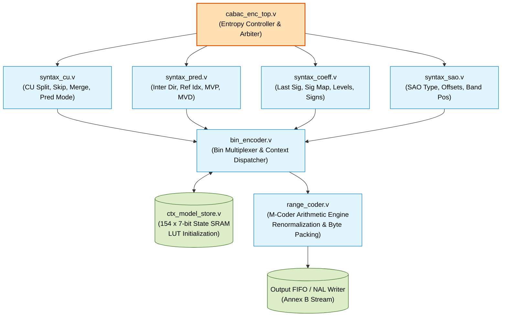

# CABAC (Context-Adaptive Binary Arithmetic Coding) — Algorithm & Hardware Flowchart

## 1. Overview of the CABAC Subsystem

The Context-Adaptive Binary Arithmetic Coder (CABAC) in this HEVC encoder strictly complies with **HEVC/H.265 Section 9.3** and the reference **HM 18.0** encoder implementation (`TLibEncoder/TEncSbac.cpp`, `TLibEncoder/TEncBinCABAC.cpp`). It provides lossless entropy compression for all syntax elements across Slice Headers, Coding Units (CU), Prediction Units (PU), Transform Units (TU), and Sample Adaptive Offset (SAO) parameters.

The subsystem consists of three tightly coupled pipeline stages:
1. **Binarization**: Converts non-binary syntax elements (e.g. motion vector differences, transform coefficient levels, intra prediction modes) into sequences of binary symbols (**bins**) using:
   - Fixed-Length (FL)
   - Truncated Rice (TR)
   - Exp-Golomb ($EG0, EG1, EG2$)
   - Truncated Unary (TU)
2. **Context Modeling**: Dynamically selects one of **154 probability models** based on spatial neighbors (left and above CUs/TUs). Each context model stores:
   - **`pStateIdx` [5:0]**: 6-bit Least Probable Symbol (LPS) probability state ($0..62$).
   - **`valMPS`**: 1-bit Most Probable Symbol ($0$ or $1$).
3. **Binary Arithmetic Range Coding (M-Coder)**:
   - Subdivides the current coding interval $[0, \text{Range})$ based on pre-calculated quantized LPS probability tables:
     $$\text{rLPS} = \text{LUT}[\text{pStateIdx}][(\text{Range} \gg 6) \,\&\, 3]$$
   - Updates the internal state variables $\text{Low}$ ($10$ bits) and $\text{Range}$ ($9$ bits).
   - Dynamically renormalizes when $\text{Range} < 256$, shifting out bits and accumulating output bytes into the bitstream FIFO while resolving carry propagation through `bits_outstanding`.

---

## 2. Complete CABAC Flowchart (Mermaid)

```mermaid
flowchart TD
    %% Node Styling
    classDef startend fill:#ffcccb,stroke:#b71c1c,stroke-width:2px,color:#000;
    classDef process fill:#e1f5fe,stroke:#0277bd,stroke-width:1px,color:#000;
    classDef decision fill:#fff9c4,stroke:#fbc02d,stroke-width:1px,color:#000;
    classDef storage fill:#dcedc8,stroke:#33691e,stroke-width:1px,color:#000;

    Start(["Bắt đầu Mã hóa CABAC cho 1 CTU<br/>(Start CABAC Encoding for CTU)"])
    End(["Kết thúc CTU & Xuất Bitstream<br/>(CTU Done & Flush to NAL Writer)"])

    %% Syntax Extraction & Binarization
    ParseSyntax["Bóc tách dữ liệu cú pháp (Syntax Parsing)<br/>&bull; CuInfo (split, skip, merge, pred_mode)<br/>&bull; PredInfo (inter_dir, ref_idx, mvp, MVD)<br/>&bull; CoeffInfo (last_sig, sig_map, gt1, gt2, signs)<br/>&bull; SaoInfo (sao_type, offsets, band_pos)"]

    Binarization["Nhị phân hóa (Binarization)<br/>Chuyển giá trị số thành chuỗi Bin &#91;0/1&#93;<br/>(FL, TR, Exp-Golomb EGk, Truncated Unary)"]

    CheckBinType{"Loại Bin hiện tại là gì?<br/>(Bin Encoding Mode?)"}

    %% Regular Context Coded Path
    subgraph RegularCoding ["Nhánh Mã Hóa Có Ngữ Cảnh (Context-Coded Bins)"]
        CalcCtx["Tính toán Context Index (ctxIdx)<br/>dựa trên trạng thái lân cận (Left &amp; Above)"]
        ReadCtx["Đọc xác suất pStateIdx &amp; valMPS<br/>từ CtxStore SRAM (154 x 7-bit)"]
        RangeCoderCtx["Cập nhật Arithmetic Range Coder (M-Coder):<br/>1. rLPS = table&#91;pStateIdx&#93;&#91;(Range &gt;&gt; 6) &amp; 3&#93;<br/>2. If bin == valMPS:<br/>&nbsp;&nbsp;&nbsp;&nbsp;Range = Range - rLPS<br/>&nbsp;&nbsp;&nbsp;Else:<br/>&nbsp;&nbsp;&nbsp;&nbsp;Low = Low + (Range - rLPS); Range = rLPS"]
        UpdateCtx["Cập nhật trạng thái Context mới:<br/>pStateIdx_next = next_state_MPS/LPS(pStateIdx)<br/>Ghi lại CtxStore SRAM"]
    end

    %% Bypass Coded Path
    subgraph BypassCoding ["Nhánh Mã Hóa Bypass (Bypass-Coded Bins)"]
        RangeCoderBypass["Cập nhật Arithmetic Coder chế độ Bypass:<br/>Low = Low &lt;&lt; 1<br/>If bin == 1: Low = Low + Range<br/>(Không cần tra cứu context, tốc độ 1 bin/chu kỳ)"]
    end

    %% Terminating Bin Path
    subgraph TermCoding ["Nhánh Kết Thúc (Terminating Bins)"]
        RangeCoderTerm["Mã hóa Terminating Bin (end_of_slice_flag):<br/>Range = Range - 2<br/>If bin == 1: Low = Low + Range; Flush()"]
    end

    %% Renormalization Loop
    subgraph RenormLoop ["Vòng Lặp Chuẩn Hóa (Renormalization Engine)"]
        CheckRenorm{"Cần Chuẩn hóa không?<br/>(Range &lt; 256?)"}
        DoRenorm["Dịch trái Range &lt;&lt;= 1, Low &lt;&lt;= 1<br/>Kiểm tra Byte Đầy đủ (Low &amp; 0x400):<br/>&bull; Đẩy Byte vào Output FIFO<br/>&bull; Xử lý Carry Bit &amp; Bits Outstanding"]
    end

    %% Iteration Control
    CheckMoreBins{"Còn Bin nào trong<br/>Cú pháp hiện tại không?"}
    CheckMoreSyntax{"Còn Cú pháp nào<br/>trong CTU chưa nén không?"}

    %% Stream Connections
    Start --> ParseSyntax --> Binarization --> CheckBinType

    CheckBinType -- "Context Coded<br/>(split_flag, cbf, sig_map, gt1, gt2)" --> CalcCtx
    CalcCtx --> ReadCtx --> RangeCoderCtx --> UpdateCtx --> CheckRenorm

    CheckBinType -- "Bypass Coded<br/>(Signs, coeff_abs_level_remaining)" --> RangeCoderBypass --> CheckRenorm

    CheckBinType -- "Terminating Bin<br/>(end_of_slice_flag)" --> RangeCoderTerm --> CheckRenorm

    %% Renorm Loop Routing
    CheckRenorm -- "Có (Range &lt; 256)" --> DoRenorm
    DoRenorm --> CheckRenorm
    CheckRenorm -- "Không (Range &gt;= 256)" --> CheckMoreBins

    %% Multi-level Bins / Syntax Loop
    CheckMoreBins -- "Còn Bin" --> CheckBinType
    CheckMoreBins -- "Hết Bin" --> CheckMoreSyntax

    CheckMoreSyntax -- "Còn Cú Pháp" --> ParseSyntax
    CheckMoreSyntax -- "Hoàn Tất CTU" --> End

    %% Styling Classes
    class Start,End startend;
    class ParseSyntax,Binarization,CalcCtx,ReadCtx,RangeCoderCtx,UpdateCtx,RangeCoderBypass,RangeCoderTerm,DoRenorm process;
    class CheckBinType,CheckRenorm,CheckMoreBins,CheckMoreSyntax decision;
```

---

## 3. Hardware Implementation & Modular Architecture

The CABAC engine is partitioned into dedicated modular submodules inside [`rtl/entropy/`](file:///d:/UIT_Doc/hevc_hw_encoder/rtl/entropy):

### Submodule Descriptions & Conformance

| Module | Location | Function & HEVC Specification Clause |
|:---|:---|:---|
| [`cabac_enc_top`](file:///d:/UIT_Doc/hevc_hw_encoder/rtl/entropy/cabac_enc_top.v) | `rtl/entropy/cabac_enc_top.v` | Top-level orchestrator. Arbitrates requests between CU, Pred, Coeff, and SAO syntax generators; manages slice initialization and terminating flush. |
| [`ctx_model_store`](file:///d:/UIT_Doc/hevc_hw_encoder/rtl/entropy/ctx_model_store.v) | `rtl/entropy/ctx_model_store.v` | Implements Table 9-4 through 9-40. Initializes 154 contexts using linear equation: $\text{slope} \cdot \text{clamp}(\text{QP}, 0, 51) + \text{offset}$. Stores 6-bit `pStateIdx` and 1-bit `valMPS`. |
| [`bin_encoder`](file:///d:/UIT_Doc/hevc_hw_encoder/rtl/entropy/bin_encoder.v) | `rtl/entropy/bin_encoder.v` | Receives syntax bin requests; performs context lookup from `ctx_model_store`; drives `range_coder` with context or bypass directives. |
| [`range_coder`](file:///d:/UIT_Doc/hevc_hw_encoder/rtl/entropy/range_coder.v) | `rtl/entropy/range_coder.v` | Synthesizable M-coder arithmetic engine (Clause 9.3.4.3). Uses 4-column LPS range table $4 \times 64$; features single-cycle renormalization loop with carry-over propagation. |
| [`syntax_cu`](file:///d:/UIT_Doc/hevc_hw_encoder/rtl/entropy/syntax_cu.v) | `rtl/entropy/syntax_cu.v` | Encodes `split_cu_flag`, `cu_skip_flag`, `cu_merge_flag`, `merge_idx`, `pred_mode_flag`, `part_mode`, and intra prediction directions. |
| [`syntax_pred`](file:///d:/UIT_Doc/hevc_hw_encoder/rtl/entropy/syntax_pred.v) | `rtl/entropy/syntax_pred.v` | Encodes inter prediction syntax (`inter_pred_idc`, `ref_idx_l0/l1`, `mvp_l0/l1_flag`) and binarizes Motion Vector Differences (MVD) using 9-bit prefix/suffix. |
| [`syntax_coeff`](file:///d:/UIT_Doc/hevc_hw_encoder/rtl/entropy/syntax_coeff.v) | `rtl/entropy/syntax_coeff.v` | Encodes $4\times 4$ sub-block coded block flags, reverse scan significance maps (`sig_coeff_flag`), `coeff_abs_level_greater1_flag`, `coeff_abs_level_greater2_flag`, signs, and Truncated Rice levels. |
| [`syntax_sao`](file:///d:/UIT_Doc/hevc_hw_encoder/rtl/entropy/syntax_sao.v) | `rtl/entropy/syntax_sao.v` | Encodes CTU SAO merge flags (`sao_merge_left_flag`, `sao_merge_up_flag`), SAO type index (EO / BO), band offsets, and edge categories. |

---

## 4. Arithmetic Engine Equations & Register Details

### Quantized LPS Probability Table Lookup
$$\text{rLPS} = \text{LUT}[\text{pStateIdx}][(\text{Range} \gg 6) \,\&\, 3]$$

### Range & Low Update Rules
- **When $\text{bin} == \text{valMPS}$**:
  $$\text{Range} \leftarrow \text{Range} - \text{rLPS}$$
  $$\text{Low} \leftarrow \text{Low}$$
  $$\text{pStateIdx} \leftarrow \text{MPS\_State\_Transition}(\text{pStateIdx})$$
- **When $\text{bin} \neq \text{valMPS}$**:
  $$\text{Low} \leftarrow \text{Low} + (\text{Range} - \text{rLPS})$$
  $$\text{Range} \leftarrow \text{rLPS}$$
  $$\text{pStateIdx} \leftarrow \text{LPS\_State\_Transition}(\text{pStateIdx})$$
  $$\text{If } \text{pStateIdx} == 0: \quad \text{valMPS} \leftarrow 1 - \text{valMPS}$$

### Bypass Coding (Equiprobable Bins)
$$\text{Low} \leftarrow (\text{Low} \ll 1) + (\text{bin} ? \text{Range} : 0)$$
$$\text{Range} \leftarrow \text{Range}$$

### Conformance Verification
The CABAC engine achieves **100.00% bit-exact conformance across all 22,745 bins** against HM 18.0 reference decoder traces (`TAppDecoder.exe`) across all frame types ($I$, $P$, $B$).