# TU Quadtree, 2D Transform (DCT-II / DST-VII) & Quantization — Algorithm & Hardware Flowchart

## 1. Overview & Algorithmic Principles

In HEVC/H.265, prediction residuals are encoded using a recursive **Transform Tree (TU Quadtree)**. Residual blocks are transformed from the spatial domain into the frequency domain, followed by scalar quantization.

This hardware implementation supports:
1. **Transform Block Sizes**: $4\times 4, 8\times 8, 16\times 16,$ and $32\times 32$.
2. **Transform Kernels**:
   - **4x4 DST-VII (Type-7 Discrete Sine Transform)**: Strictly mandated by **HEVC Clause 8.6.3 (Table 8-15)** for $4\times 4$ Intra Luma prediction residuals.
   - **DCT-II (Type-2 Discrete Cosine Transform)**: Utilized for all other transform sizes ($4\times 4$ chroma/inter, $8\times 8, 16\times 16, 32\times 32$) using integer approximation matrix kernels scaled by 64.
   - **Transform Skip**: Allows bypassing the transform stage for high-frequency or screen content (applicable to $4\times 4$ blocks).
3. **Quantization & Dequantization**:
   - Scalar uniform deadzone quantization indexed by $\text{QP} \in [0..51]$.
   - Coded Block Flag (CBF) generation: indicates whether any non-zero coefficient remains in the transform unit.
4. **Row-Serial 2D Architecture**:
   - Implements a 2-pass 1D transform engine with an on-chip $32\times 32$ dual-port Transpose RAM (`transpose_ram_32x32.v`).
   - Achieves a **98.3% multiplier reduction** (~949 multipliers vs ~57,411 in a fully unrolled 2D implementation) while meeting real-time throughput budgets ($4\times 4$ in 12 cycles, $8\times 8$ in 20 cycles, $16\times 16$ in 36 cycles, $32\times 32$ in 68 cycles).

---

## 2. Complete Flowchart (Mermaid)

```mermaid
flowchart TD
    %% Node Styling
    classDef startend fill:#ffcccb,stroke:#b71c1c,stroke-width:2px,color:#000;
    classDef process fill:#e1f5fe,stroke:#0277bd,stroke-width:1px,color:#000;
    classDef decision fill:#fff9c4,stroke:#fbc02d,stroke-width:1px,color:#000;
    classDef storage fill:#dcedc8,stroke:#33691e,stroke-width:1px,color:#000;

    Start(["Bắt đầu xử lý TU kích thước 2Nx2N<br/>(Start TU 2Nx2N Processing)"])
    End(["Kết thúc: Xuất Cấu trúc TU, CBF & Hệ số<br/>(Emit TU Structure, CBF & Coeffs)"])

    %% --- TU Transformation Branch ---
    CheckTSkip{"Kiểm tra Transform Skip<br/>(TU == 4x4 & TS_Flag == 1?)"}
    BypassT["Bỏ qua Biến đổi (Bypass Transform)<br/>Lấy trực tiếp Residual scaled"]

    CheckDST{"Khối là Luma 4x4 Intra?<br/>(HEVC Clause 8.6.3)"}
    DoDST["Thực hiện Biến đổi DST-VII<br/>(Kernel 4x4: &#91;29, 55, 74, 84&#93;)"]
    DoDCT["Thực hiện Biến đổi DCT-II<br/>(Hỗ trợ 4x4, 8x8, 16x16, 32x32)"]

    %% --- Forward Quantization ---
    DoQ["Lượng tử hóa Forward Quantization<br/>Scalar Deadzone: Level = (Coeff * QScale + Offset) &gt;&gt; (QBits + 10)<br/>(QP: 0..51, RDOQ = 0)"]

    %% --- CBF Decision ---
    CheckCBF{"Mọi hệ số đều bằng 0?<br/>(Check All Coeffs == 0?)"}
    SetCBF0["Set CBF = 0<br/>(Không phát sinh bit hệ số)"]
    SetCBF1["Set CBF = 1<br/>(Lưu mảng hệ số lượng tử vào CoeffBuffer)"]

    %% --- Rate-Distortion Cost Calculation ---
    CalcCurrentCost["Tính RD Cost cho TU 2Nx2N hiện tại:<br/>Cost_2N = Distortion(D_2N) + &lambda; &times; Bits(R_2N)"]

    %% --- Recursive Quadtree Splitting Decision ---
    CheckTUDepth{"Đạt Max TU Depth<br/>hoặc kích thước 4x4?"}

    Split4["Chia thành 4 Sub-TU kích thước NxN<br/>(Split into 4 NxN Sub-TUs)"]
    Recurse["Đệ quy xử lý cho 4 Sub-TU<br/>(Transform &amp; Quantize 4 Sub-TUs)"]
    CalcSubCost["Tính Tổng RD Cost của 4 Sub-TU:<br/>Cost_split = &sum; Cost_sub_i + Cost_split_flag"]

    CompareTUCost{"So sánh RD Cost:<br/>Cost_2N &le; Cost_split?"}

    KeepTU["Giữ nguyên TU 2Nx2N hiện tại<br/>(split_transform_flag = 0)"]
    KeepSubTU["Chấp nhận chia thành 4 Sub-TU<br/>(split_transform_flag = 1)"]

    %% --- Local Inverse Loop (for Chosen Representation) ---
    IQIT["Thực hiện Giải Lượng tử &amp; Giải Biến đổi (IQ / IT):<br/>1. Inv-Quant: Coeff' = (Level * InvQScale) &lt;&lt; Shift<br/>2. Inv-Transform: IDST-VII hoặc IDCT-II<br/>&rArr; Khôi phục phần dư cục bộ cho Reconstruction"]

    %% --- Flow Routing ---
    Start --> CheckTSkip

    CheckTSkip -- "Có (Transform Skip)" --> BypassT --> DoQ
    CheckTSkip -- "Không" --> CheckDST

    CheckDST -- "Đúng (Luma 4x4 Intra)" --> DoDST --> DoQ
    CheckDST -- "Sai (DCT-II)" --> DoDCT --> DoQ

    DoQ --> CheckCBF
    CheckCBF -- "Đúng (Tất cả = 0)" --> SetCBF0 --> CalcCurrentCost
    CheckCBF -- "Sai (Có hệ số &ne; 0)" --> SetCBF1 --> CalcCurrentCost

    CalcCurrentCost --> CheckTUDepth

    CheckTUDepth -- "Có (Không chia tiếp)" --> KeepTU
    CheckTUDepth -- "Không (Được phép chia)" --> Split4

    Split4 --> Recurse --> CalcSubCost --> CompareTUCost

    CompareTUCost -- "Đúng (Giữ 2Nx2N)" --> KeepTU
    CompareTUCost -- "Sai (Chia nhỏ tốt hơn)" --> KeepSubTU

    KeepTU --> IQIT
    KeepSubTU --> IQIT
    IQIT --> End

    %% Class Assignments
    class Start,End startend;
    class BypassT,DoDST,DoDCT,DoQ,SetCBF0,SetCBF1,CalcCurrentCost,Split4,Recurse,CalcSubCost,KeepTU,KeepSubTU,IQIT process;
    class CheckTSkip,CheckDST,CheckCBF,CheckTUDepth,CompareTUCost decision;
```



---

## 3. Mathematical Foundations & Spec Conformance

### 1. DST-VII Kernel Matrix ($4\times 4$)
Per **HEVC Section 8.6.3**, the integer matrix $T_{\text{DST4}}$ is:
$$T_{\text{DST4}} = \begin{bmatrix}
29 & 55 & 74 & 84 \\
74 & 74 & 0 & -74 \\
84 & -29 & -74 & 55 \\
55 & -84 & 74 & -29
\end{bmatrix}$$

### 2. Forward & Inverse Transform Scaling
- **Pass 1 (Horizontal / Rows)**:
  $$E_1 = T_N \cdot X^T, \quad Y_1 = (E_1 + (1 \ll (\text{shift}_1 - 1))) \gg \text{shift}_1$$
  $$\text{shift}_1 = \log_2(N) + \text{BitDepth} - 9 = \log_2(N) + 1$$
- **Pass 2 (Vertical / Columns)**:
  $$E_2 = T_N \cdot Y_1^T, \quad Y_2 = (E_2 + (1 \ll (\text{shift}_2 - 1))) \gg \text{shift}_2$$
  $$\text{shift}_2 = \log_2(N) + 6$$

### 3. Forward Quantization Formulation
For coefficient $C$ with quantization step factor $Q_{\text{scale}}(\text{QP} \bmod 6)$:
$$\text{Level} = \text{sign}(C) \cdot \Big( (|C| \cdot Q_{\text{scale}}(\text{QP} \bmod 6) + f) \gg (14 + \lfloor\text{QP}/6\rfloor) \Big)$$
where $f = (1 \ll (14 + \lfloor\text{QP}/6\rfloor)) / 3$ (deadzone round offset).

---

## 4. Hardware Microarchitecture: `dct_top.v` & `transform_1d_core.v`

```mermaid
graph LR
    classDef core fill:#e1f5fe,stroke:#0277bd,stroke-width:1px,color:#000;
    classDef ram fill:#dcedc8,stroke:#33691e,stroke-width:1px,color:#000;
    classDef fsm fill:#fff9c4,stroke:#fbc02d,stroke-width:1px,color:#000;

    InResidual["Residual Input<br/>(32x32 x 16-bit Array)"]:::core
    FSM["Transform FSM Controller<br/>(Pass 1 vs Pass 2 Sequencer)"]:::fsm
    Core1D["transform_1d_core.v<br/>&bull; DST-VII 4-pt<br/>&bull; DCT-II 4/8/16/32-pt<br/>&bull; Forward & Inverse Mode"]:::core
    TransRAM[("transpose_ram_32x32.v<br/>Dual-Port Transpose SRAM<br/>(Row Write / Col Read)")]:::ram
    OutReg["Output Array<br/>(32x32 x 16-bit)"]:::core

    InResidual -->|Row Vectors| Core1D
    FSM -.->|Control & Shifts| Core1D
    Core1D -->|Pass 1 Result| TransRAM
    TransRAM -->|Col Vectors (Pass 2)| Core1D
    Core1D -->|Pass 2 Result| OutReg
```

### Synthesis Verification & Resource Metrics
- **Multipliers**: 949 DSP units total (98.3% reduction over 57,411).
- **Tested Block Types**: $4\times 4$ DST-VII, $4\times 4$ DCT-II, $8\times 8$ DCT-II, $16\times 16$ DCT-II, $32\times 32$ DCT-II.
- **Verification**: Verified bit-exact against HM 18.0 `TComTrQuant::xTrMxN()` and `TComTrQuant::xITrMxN()`.