# HEVC Main10 Hardware Video Encoder — Algorithm Flowchart

## 1. Overview & System Execution Flow

The hardware encoder implements the **HEVC/H.265 Main10 Profile** targeting synthesizable FPGA/ASIC integration. The algorithm is organized into a hierarchical pipelined structure:

1. **GOP & Slice Control**: Generates Picture Order Count (POC), determines slice coding types ($I$, $P$, $B$), manages reference picture lists ($L0$, $L1$), and enforces hierarchical temporal layers ($TId$).
2. **WPP & CTU Dispatch**: Traverses the frame in $64\times 64$ Coding Tree Units (CTUs) using raster scan order with Wavefront Parallel Processing (WPP) dependency tracking.
3. **Recursive CU Partitioning & Mode Decision (FEN)**: Evaluates $64\times 64$ down to $8\times 8$ Coding Units (CUs). Employs Fast Encoder Decision (FEN) early termination based on Lagrangian Rate-Distortion ($RD$) cost:
   $$J = D + \lambda \cdot R$$
4. **Motion Estimation & Motion Compensation (Inter)**:
   - **AMVP**: Derives spatial and temporal motion vector predictors.
   - **TZ Search**: Fast integer-pel Test Zone search with diamond/raster patterns.
   - **FME**: Quarter-pel Fractional Motion Estimation.
   - **MC Unit**: 8-tap luma and 4-tap chroma sub-pel interpolation for unidirectional ($L0$, $L1$) and bidirectional ($BI$) prediction.
5. **Intra Prediction**:
   - **RMD**: Rough Mode Decision screens all 35 intra modes using $4\times 4$ Hadamard SATD.
   - **Reference Filter**: 3-tap smoothing filter $[1, 2, 1]/4$ applied to boundary samples.
   - **Predictors**: Planar (Mode 0), DC (Mode 1), and Angular (Modes 2–34).
6. **Transform & Quantization (TU Quadtree)**:
   - Supports $4\times 4$ DST-VII (Intra luma) and $4\times 4, 8\times 8, 16\times 16, 32\times 32$ DCT-II.
   - Row-serial 2D transform engine with dual-port transpose RAM.
   - Scalar uniform quantization with QP-adaptive scaling.
7. **Reconstruction Loop**:
   - Inverse Quantization ($IQ$) and Inverse Transform ($IT$).
   - Local reconstructed sample feedback for intra-frame spatial prediction.
8. **In-Loop Filters**:
   - **Deblocking Filter**: Boundary Strength ($bS = 0, 1, 2$) evaluation followed by strong/weak luma filtering and chroma filtering across horizontal and vertical edges.
   - **SAO (Sample Adaptive Offset)**: Edge Offset (EO) across 4 directional classes and Band Offset (BO) across 32 sample bands.
9. **Entropy Coding (CABAC)**:
   - M-coder binary arithmetic coder with 154 context models.
   - Dedicated syntax serialization for slice headers, CU syntax, prediction info, SAO, and residual transform coefficients.
   - Emits an Annex B compliant byte stream.

---

## 2. Complete Algorithm Flowchart (Mermaid)

```mermaid
flowchart TD
    %% Node Styling
    classDef startend fill:#ffcccb,stroke:#b71c1c,stroke-width:2px,color:#000;
    classDef process fill:#e1f5fe,stroke:#0277bd,stroke-width:1px,color:#000;
    classDef decision fill:#fff9c4,stroke:#fbc02d,stroke-width:1px,color:#000;
    classDef storage fill:#dcedc8,stroke:#33691e,stroke-width:1px,color:#000;

    Start(["BẮT ĐẦU MÃ HÓA (Start Encoding)"])
    End(["KẾT THÚC MÃ HÓA & LƯU BITSTREAM (End & Flush str.bin)"])

    %% GOP & Frame Initialization
    InitGOP["Khởi tạo GOP & Frame<br/>(GOP Controller: POC, Slice Type I/P/B, Base QP)"]
    WPP["Wavefront / Raster CTU Scheduler<br/>(Phân phối tọa độ CTU 64x64 theo Raster Scan)"]

    Start --> InitGOP --> WPP --> ReadCTU

    %% CTU Processing Subgraph
    subgraph RowProcess ["VÒNG LẶP XỬ LÝ CTU 64x64 (CTU Processing Pipeline)"]
        ReadCTU["Đọc CTU gốc 64x64<br/>(Raw YUV 4:2:0 Pixels)"]
        SplitCU{"Đệ quy chia CU Quadtree<br/>(64x64 &rarr; 32x32 &rarr; 16x16 &rarr; 8x8)"}
        SliceCheck{"Kiểm tra loại Slice<br/>(Slice Type?)"}

        %% Intra Branch
        Intra["Intra Prediction Evaluation<br/>1. RMD SATD Pre-screen (35 modes)<br/>2. 3-Tap Ref Sample Filtering<br/>3. Planar, DC, Angular 2..34"]

        %% Inter Branch
        FDM["FDM / Early Merge & Skip Check<br/>(Đánh giá 5 ứng viên Merge từ MVP)"]
        TZ["TZ Search (Integer Motion Estimation)<br/>(Tìm kiếm chuyển động nhanh Diamond/Raster)"]
        Hadamard["Hadamard SATD Matching<br/>(Tính chi phí SAD/SATD cho Inter)"]
        FME["FME (Fractional Motion Estimation)<br/>(Tinh chỉnh 1/2-pel & 1/4-pel)"]

        %% Mode Decision
        FEN{"Thuật toán FEN<br/>RD Cost &lt; Threshold?<br/>(Dừng đệ quy sớm?)"}
        ChooseMode["So sánh RD Cost (J = D + &lambda; &times; R)<br/>CU hiện tại vs 4 Sub-CUs<br/>&rArr; CHỌN MODE TỐT NHẤT"]

        CheckMode{"Mode tốt nhất<br/>là Inter hay Intra?"}
        MC["Motion Compensation (MC Unit)<br/>Nội suy 8-tap Luma / 4-tap Chroma từ DPB<br/>(Đơn hướng L0/L1 hoặc Song hướng BI)"]

        CalcRes["TÍNH PHẦN DƯ (Residual Subtraction)<br/>Residual = Original - Predicted"]

        %% TU & Transform/Quant
        TULoop["Vòng lặp cây TU (TU Quadtree)<br/>1. Transform Skip (4x4)<br/>2. DST-VII (Intra Luma 4x4) / DCT-II (4..32)<br/>3. Lượng tử hóa Forward Quant (QP)"]

        %% Split Pipeline: Critical Path (Recon) vs Bitstream (CABAC)
        IQIT["Giải lượng tử & Giải biến đổi (IQ / IT)<br/>Khôi phục phần dư cục bộ"]
        Recon["TÁI TẠO PIXEL (Reconstruction)<br/>Reconstructed = Clip(Predicted + Decoded_Residual)"]

        FIFO[("Bộ đệm Hệ số<br/>(Coeff Buffer SRAM)")]
        Entropy["Mã hóa Entropy CABAC<br/>(Binarization &rarr; Context &rarr; Range Coder)"]

        NextCU{"Còn Sub-CU nào<br/>trong CTU không?"}
        NextCTU{"Còn CTU nào<br/>trong Frame không?"}

        %% Connections inside CTU
        ReadCTU --> SplitCU
        SplitCU --> SliceCheck

        SliceCheck -- "I-Slice" --> Intra
        SliceCheck -- "P / B-Slice" --> FDM
        FDM --> TZ --> Hadamard --> FME

        Intra --> FEN
        FME --> FEN

        FEN -- "Có (Dừng sớm)" --> ChooseMode
        FEN -- "Không (Chia tiếp)" --> SplitCU

        ChooseMode --> CheckMode
        CheckMode -- "Inter Mode" --> MC --> CalcRes
        CheckMode -- "Intra Mode" --> CalcRes

        CalcRes --> TULoop

        %% Decoupled Pipeline
        TULoop -->|"Nhánh Tái Tạo (Recon Path)"| IQIT --> Recon --> NextCU
        TULoop -->|"Nhánh Bitstream"| FIFO --> Entropy

        NextCU -- "Có" --> SplitCU
        NextCU -- "Không" --> NextCTU
        NextCTU -- "Có" --> ReadCTU
    end

    %% Post-Reconstruction & In-Loop
    Sync["Đồng bộ Pipeline CTU / Hàng<br/>(Line Buffers & Cross-CTU Synchronization)"]
    Filter["LỌC NỘI VÒNG (In-Loop Filtering)<br/>1. Deblocking Filter (bS=0,1,2 & strong/weak)<br/>2. SAO (Edge Offset / Band Offset)"]
    DPB[("Bộ đệm Decoded Picture Buffer (DPB)<br/>Lưu trữ khung hình tham chiếu vào AXI DRAM")]
    NextFrame{"Còn Frame nào<br/>cần mã hóa không?"}

    NextCTU -- "Không" --> Sync
    Sync --> Filter --> DPB --> NextFrame

    NextFrame -- "Có" --> InitGOP
    NextFrame -- "Không" --> End

    %% Class Assignments
    class Start,End startend;
    class InitGOP,WPP,ReadCTU,Intra,FDM,TZ,Hadamard,FME,ChooseMode,MC,CalcRes,TULoop,Entropy,IQIT,Recon,Sync,Filter process;
    class SplitCU,SliceCheck,FEN,CheckMode,NextCU,NextCTU,NextFrame decision;
    class DPB,FIFO storage;
```

---

## 3. Hardware Architecture & RTL Mapping Table

The algorithm flowchart directly maps to dedicated synthesizable RTL hardware modules:

| Flowchart Stage | RTL Module | File Path | Key Algorithmic Role |
|:---|:---|:---|:---|
| **Init GOP & Frame** | [`gop_controller`](file:///d:/UIT_Doc/hevc_hw_encoder/rtl/top/gop_controller.v) | `rtl/top/gop_controller.v` | Enforces GOP 16 / IPBB / Hierarchical B, POC allocation, reference buffer slot management. |
| **Slice Control** | [`slice_controller`](file:///d:/UIT_Doc/hevc_hw_encoder/rtl/top/slice_controller.v) | `rtl/top/slice_controller.v` | Slice header generation, CTU coordinate sequencing, CABAC context reload strobe. |
| **CTU Scheduler** | [`ctu_raster_scan`](file:///d:/UIT_Doc/hevc_hw_encoder/rtl/partition/ctu_raster_scan.v) | `rtl/partition/ctu_raster_scan.v` | Raster order CTU $(x, y)$ coordinate generation, frame boundary clipping. |
| **CU Quadtree Split** | [`ctu_partitioner`](file:///d:/UIT_Doc/hevc_hw_encoder/rtl/partition/ctu_partitioner.v) [`pu_cu_splitter`](file:///d:/UIT_Doc/hevc_hw_encoder/rtl/partition/pu_cu_splitter.v) | `rtl/partition/ctu_partitioner.v` `rtl/partition/pu_cu_splitter.v` | Recursive top-down quadtree splitting ($64\to 8$), PU partition dispatching ($2N\times 2N$). |
| **Intra Evaluation** | [`intra_rmd`](file:///d:/UIT_Doc/hevc_hw_encoder/rtl/intra/intra_rmd.v) [`intra_pred_top`](file:///d:/UIT_Doc/hevc_hw_encoder/rtl/intra/intra_pred_top.v) | `rtl/intra/intra_rmd.v` `rtl/intra/intra_pred_top.v` | 35-mode RMD screening, boundary reference filtering, Planar, DC, and 33-direction Angular prediction. |
| **Inter Evaluation** | [`tz_search`](file:///d:/UIT_Doc/hevc_hw_encoder/rtl/inter/tz_search.v) [`fme_search`](file:///d:/UIT_Doc/hevc_hw_encoder/rtl/inter/fme_search.v) [`mvp_predictor`](file:///d:/UIT_Doc/hevc_hw_encoder/rtl/inter/mvp_predictor.v) | `rtl/inter/tz_search.v` `rtl/inter/fme_search.v` `rtl/inter/mvp_predictor.v` | Test Zone Search integer ME, AMVP candidate list derivation, quarter-pel sub-pixel refinement. |
| **Motion Comp (MC)** | [`mc_unit`](file:///d:/UIT_Doc/hevc_hw_encoder/rtl/inter/mc_unit.v) [`subpel_interpolation_core`](file:///d:/UIT_Doc/hevc_hw_encoder/rtl/inter/subpel_interpolation_core.v) | `rtl/inter/mc_unit.v` `rtl/inter/subpel_interpolation_core.v` | Bi-prediction motion compensation, 8-tap luma and 4-tap chroma filtering. |
| **Mode Decision** | [`mode_decision`](file:///d:/UIT_Doc/hevc_hw_encoder/rtl/partition/mode_decision.v) | `rtl/partition/mode_decision.v` | Lagrangian RD-cost comparison ($J = D + \lambda R$), FEN early termination split flag generation. |
| **Residual Calculation** | [`residual_sub`](file:///d:/UIT_Doc/hevc_hw_encoder/rtl/recon/residual_sub.v) | `rtl/recon/residual_sub.v` | Exact pixel difference computation $\text{Res} = \text{Orig} - \text{Pred}$. |
| **Transform Engine** | [`dct_top`](file:///d:/UIT_Doc/hevc_hw_encoder/rtl/transform/dct_top.v) [`transform_1d_core`](file:///d:/UIT_Doc/hevc_hw_encoder/rtl/transform/transform_1d_core.v) | `rtl/transform/dct_top.v` `rtl/transform/transform_1d_core.v` | 2D row-serial DCT-II ($4\times 4..32\times 32$) and DST-VII ($4\times 4$ Intra Luma) with transpose SRAM. |
| **Quantization** | [`fwd_quant`](file:///d:/UIT_Doc/hevc_hw_encoder/rtl/quant/fwd_quant.v) [`inv_quant`](file:///d:/UIT_Doc/hevc_hw_encoder/rtl/quant/inv_quant.v) | `rtl/quant/fwd_quant.v` `rtl/quant/inv_quant.v` | Forward deadzone scalar quantization and inverse scaling dequantization. |
| **Reconstruction** | [`recon_unit`](file:///d:/UIT_Doc/hevc_hw_encoder/rtl/recon/recon_unit.v) [`frame_store`](file:///d:/UIT_Doc/hevc_hw_encoder/rtl/recon/frame_store.v) | `rtl/recon/recon_unit.v` `rtl/recon/frame_store.v` | Reconstructs $\text{Rec} = \text{Clip}(\text{Pred} + \text{InvRes})$, manages on-chip line buffers and DRAM writes. |
| **Deblocking Filter** | [`deblock_top`](file:///d:/UIT_Doc/hevc_hw_encoder/rtl/inloop_filters/deblock_top.v) | `rtl/inloop_filters/deblock_top.v` | Boundary strength calculation, vertical and horizontal edge filtering across CTU boundaries. |
| **SAO Filter** | [`sao_top`](file:///d:/UIT_Doc/hevc_hw_encoder/rtl/inloop_filters/sao_top.v) | `rtl/inloop_filters/sao_top.v` | Sample Adaptive Offset Edge Offset and Band Offset filtering and statistics accumulation. |
| **Entropy Coding** | [`cabac_enc_top`](file:///d:/UIT_Doc/hevc_hw_encoder/rtl/entropy/cabac_enc_top.v) | `rtl/entropy/cabac_enc_top.v` | Context model management, syntax element binarization, M-coder arithmetic engine, byte packing. |
| **Rate Control** | [`rate_controller`](file:///d:/UIT_Doc/hevc_hw_encoder/rtl/rate_control/rate_controller.v) | `rtl/rate_control/rate_controller.v` | VBV virtual buffer fullness estimation, frame-level QP adaptation, $\lambda$ cost scaling. |