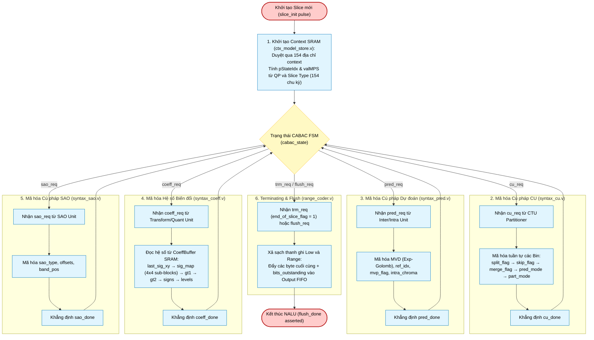

# CABAC Encoder Top-Level (`cabac_enc_top`) — Module Architecture & Flowchart

## 1. Architectural Scope & Module Hierarchy

[`cabac_enc_top.v`](file:///d:/UIT_Doc/hevc_hw_encoder/rtl/entropy/cabac_enc_top.v) coordinates the entropy compression pipeline for the HEVC encoder. It arbitrates syntax serialization across five dedicated syntax submodules, routes bin streams into the context dispatcher, drives the arithmetic range coder, and emits raw byte stream packets (RBSP) to the NAL writer.

```
cabac_enc_top
 ├── ctx_model_store    (154 × 7-bit dual-port SRAM, slice init, context read/write)
 ├── bin_encoder        (Context address lookup, MPS/LPS dispatch, bypass multiplexer)
 ├── range_coder        (M-coder arithmetic engine, renormalization, byte accumulation)
 ├── syntax_cu          (split_flag, skip_flag, merge_flag, pred_mode, part_mode)
 ├── syntax_pred        (inter_dir, ref_idx, mvp_flag, MVD binarization)
 ├── syntax_coeff       (last_sig_pos, sig_coeff_map, gt1, gt2, signs, levels)
 └── syntax_sao         (sao_merge, sao_type, band_pos, bo_offsets, eo_classes)
```

---

## 2. Top-Level State Machine & Arbitration Flowchart (Mermaid)



---

## 3. Bin-by-Bin Serialization Protocol

Arbitration across the syntax modules guarantees **zero bus conflict**:
1. Only one `syntax_*` engine asserts `bin_valid` at any given cycle.
2. `bin_rdy` from `range_coder` is broadcast back to all syntax units; when deasserted (e.g. during multi-cycle renormalization), the active syntax module stalls its internal bit pointer.
3. Quantized coefficient reading from `coeff_buffer.v` uses an asynchronous prefetch address `coeff_rd_addr[11:0]` with single-cycle read latency.

---

## 4. Hardware Port Map (`cabac_enc_top.v`)

| Port Group | Port Name | Dir | Width | Description |
|:---|:---|:---:|:---:|:---|
| **Global** | `clk`, `rst_n` | In | 1 | Clock and active-low reset. |
| **Slice Init** | `slice_init` | In | 1 | Pulse to trigger 154-cycle context initialization. |
| | `slice_type` | In | 2 | 0: I, 1: P, 2: B. |
| | `qp_in` | In | 7 | Quantization parameter for context initialization. |
| **CU Interface**| `cu_req`, `cu_done`| In/Out | 1 | Handshake for CU syntax generation. |
| | `cu_depth`, `cu_is_split` | In | 2, 1 | CU depth and split status. |
| | `cu_skip`, `cu_merge` | In | 1, 1 | Skip and Merge flags. |
| | `cu_merge_idx` | In | 3 | Merge candidate index ($0..4$). |
| | `cu_pred_intra`, `cu_intra_mode` | In | 1, 6 | Intra mode flag and 6-bit direction. |
| **Pred Interface**| `pred_req`, `pred_done`| In/Out | 1 | Handshake for motion vector syntax. |
| | `mvd_l0/l1_x/y` | In | 12 | Motion vector differences (quarter-pel). |
| | `mvp_flag_l0/l1`| In | 1 | AMVP candidate index chosen ($0$ or $1$). |
| **Coeff Interface**| `coeff_req`, `coeff_done`| In/Out | 1 | Handshake for transform coefficient syntax. |
| | `coeff_tu_size_log2` | In | 3 | TU size ($2=4\times 4..5=32\times 32$). |
| | `coeff_tu_cbf` | In | 1 | Coded Block Flag. |
| | `coeff_last_sig_pos` | In | 10 | Raster position of last non-zero coefficient. |
| | `coeff_rd_addr`, `coeff_rd_data` | Out/In | 12, 16 | SRAM interface to on-chip `coeff_buffer.v`. |
| **SAO Interface** | `sao_req`, `sao_done` | In/Out | 1 | Handshake for SAO parameters. |
| **Term/Flush** | `trm_req`, `flush_req` | In | 1 | Terminating bin request and end-of-slice flush. |
| | `flush_done` | Out | 1 | Strobe asserted when range coder completes final byte flush. |
| **Byte Output** | `byte_valid`, `byte_out` | Out | 1, 8 | Encoded byte stream to `nal_writer.v`. |
