# Deblocking Filter Subsystem (`deblock_top`) — Algorithm & Hardware Flowchart

## 1. Subsystem Architecture & Responsibilities

The **Deblocking Filter Subsystem** ([`rtl/inloop_filters/deblock_top.v`](file:///d:/UIT_Doc/hevc_hw_encoder/rtl/inloop_filters/deblock_top.v)) attenuates blocking artifacts at block boundaries introduced by block-based transform and motion-compensated prediction per **HEVC Section 8.7.2**.

Key architectural features:
1. **Processing Sequence**: Filters **Vertical Edges** across the CTU first (Luma then Chroma), followed by **Horizontal Edges** (Luma then Chroma).
2. **8x8 Grid Filtering**: Evaluates edges on an $8\times 8$ sample grid to prevent overlapping filter dependencies and allow efficient line-buffered pipelining.
3. **Dedicated Submodules**:
   - **[`boundary_strength`](file:///d:/UIT_Doc/hevc_hw_encoder/rtl/inloop_filters/boundary_strength.v)**: Calculates Boundary Strength ($bS \in \{0, 1, 2\}$) from CU prediction modes, transform coefficients (CBF), and motion vector distances.
   - **[`db_filter_luma`](file:///d:/UIT_Doc/hevc_hw_encoder/rtl/inloop_filters/db_filter_luma.v)**: Evaluates filter threshold criteria ($d < \beta$), executes Strong or Weak 3-tap filtering, and computes clipping values based on $t_C$.
   - **[`db_filter_chroma`](file:///d:/UIT_Doc/hevc_hw_encoder/rtl/inloop_filters/db_filter_chroma.v)**: Filters chroma boundaries when $bS = 2$.
   - **Cross-CTU Boundary SRAMs**: Manages left column and above row shadow maps and pixel line buffers.

---

## 2. Algorithm Flowchart (Mermaid)

```mermaid
flowchart TD
    %% Node Styling
    classDef startend fill:#ffcccb,stroke:#b71c1c,stroke-width:2px,color:#000;
    classDef process fill:#e1f5fe,stroke:#0277bd,stroke-width:1px,color:#000;
    classDef decision fill:#fff9c4,stroke:#fbc02d,stroke-width:1px,color:#000;
    classDef storage fill:#dcedc8,stroke:#33691e,stroke-width:1px,color:#000;

    Start(["Bắt đầu Lọc Deblocking cho 1 CTU<br/>(ctu_valid)"])
    End(["Hoàn tất Deblocking CTU<br/>(ctu_ready & chuyển sang SAO)"])

    %% Pass 1: Vertical Edges
    subgraph Pass1 ["GIAI ĐOẠN 1: LỌC BIÊN DỌC (Vertical Edges)"]
        IterVer["Duyệt qua các biên 8x8 dọc trong CTU 64x64<br/>(Bao gồm biên trái nối với CTU lân cận)"]
        CalcBsVer["Tính Boundary Strength (bS) cho từng cạnh 4x4:<br/>&bull; bS = 2: Nếu khối P hoặc Q là Intra<br/>&bull; bS = 1: Nếu có hệ số non-zero (CBF) hoặc &#124;&Delta;MV&#124; &ge; 1 pixel<br/>&bull; bS = 0: Các trường hợp còn lại"]

        CheckBsVer{"Giá trị bS &gt; 0?"}

        LumaFilterVer["Lọc Biên Dọc Luma:<br/>1. Tra cứu bảng &beta; và t_C từ QP trung bình<br/>2. Kiểm tra điều kiện: d = d0 + d3 &lt; &beta;<br/>3. Quyết định Strong Filter vs Weak Filter<br/>4. Ghi lại mẫu đã lọc vào bộ đệm CTU"]

        CheckChromaVer{"Cạnh Chroma &amp; bS == 2?"}
        ChromaFilterVer["Lọc Biên Dọc Chroma (Cb &amp; Cr):<br/>Áp dụng lọc 1-mẫu có kẹp t_C"]
        BypassVer["Bỏ qua lọc (Bypass Filter)"]
    end

    %% Pass 2: Horizontal Edges
    subgraph Pass2 ["GIAI ĐOẠN 2: LỌC BIÊN NGANG (Horizontal Edges)"]
        IterHor["Duyệt qua các biên 8x8 ngang trong CTU 64x64<br/>(Bao gồm biên trên nối với CTU hàng trên)"]
        CalcBsHor["Tính Boundary Strength (bS) cho từng cạnh ngang"]

        CheckBsHor{"Giá trị bS &gt; 0?"}

        LumaFilterHor["Lọc Biên Ngang Luma:<br/>Áp dụng Strong/Weak filter trên các mẫu đã qua lọc dọc"]

        CheckChromaHor{"Cạnh Chroma &amp; bS == 2?"}
        ChromaFilterHor["Lọc Biên Ngang Chroma (Cb &amp; Cr)"]
        BypassHor["Bỏ qua lọc (Bypass Filter)"]
    end

    %% Flow Routing
    Start --> IterVer --> CalcBsVer --> CheckBsVer
    CheckBsVer -- "bS &gt; 0" --> LumaFilterVer --> CheckChromaVer
    CheckBsVer -- "bS == 0" --> BypassVer --> CheckChromaVer

    CheckChromaVer -- "Có" --> ChromaFilterVer --> IterHor
    CheckChromaVer -- "Không" --> IterHor

    IterHor --> CalcBsHor --> CheckBsHor
    CheckBsHor -- "bS &gt; 0" --> LumaFilterHor --> CheckChromaHor
    CheckBsHor -- "bS == 0" --> BypassHor --> CheckChromaHor

    CheckChromaHor -- "Có" --> ChromaFilterHor --> End
    CheckChromaHor -- "Không" --> End

    %% Styling
    class Start,End startend;
    class IterVer,CalcBsVer,LumaFilterVer,ChromaFilterVer,BypassVer,IterHor,CalcBsHor,LumaFilterHor,ChromaFilterHor,BypassHor process;
    class CheckBsVer,CheckChromaVer,CheckBsHor,CheckChromaHor decision;
```

---

## 3. Boundary Strength & Strong/Weak Filter Equations

### Boundary Strength ($bS$) Derivation (Clause 8.7.2.4)
$$bS = \begin{cases}
2, & \text{if } P \text{ is Intra or } Q \text{ is Intra} \\
1, & \text{else if } \text{CBF}_P = 1 \text{ or } \text{CBF}_Q = 1 \\
1, & \text{else if } \text{RefPic}(P) \neq \text{RefPic}(Q) \text{ or } \text{Count}(MVs) \text{ differs} \\
1, & \text{else if } |MV_x(P) - MV_x(Q)| \ge 4 \text{ or } |MV_y(P) - MV_y(Q)| \ge 4 \text{ (quarter-pel units)} \\
0, & \text{otherwise}
\end{cases}$$

### Filter Activation Condition
$$d = |p_{2,0} - 2p_{1,0} + p_{0,0}| + |q_{2,0} - 2q_{1,0} + q_{0,0}| + |p_{2,3} - 2p_{1,3} + p_{0,3}| + |q_{2,3} - 2q_{1,3} + q_{0,3}| < \beta$$

### Strong Filter Selection Criteria
The strong filter is selected if:
1. $2d < (\beta \gg 2)$
2. $|p_{3,0} - p_{0,0}| + |q_{0,0} - q_{3,0}| + |p_{3,3} - p_{0,3}| + |q_{0,3} - q_{3,3}| < (\beta \gg 3)$
3. $|p_{0,0} - q_{0,0}| + |p_{0,3} - q_{0,3}| < ((5t_C + 1) \gg 1)$

- **Strong Filter Output**:
  $$p_0' = (p_2 + 2p_1 + 2p_0 + 2q_0 + q_1 + 4) \gg 3$$
  $$p_1' = (p_2 + p_1 + p_0 + q_0 + 2) \gg 2$$
  $$p_2' = (2p_3 + 3p_2 + p_1 + p_0 + q_0 + 4) \gg 3$$
  (and symmetrically for $q_0', q_1', q_2'$).

- **Weak Filter Output**:
  $$\Delta = \text{clip3}(-t_C, t_C, ((9(q_0 - p_0) - 3(q_1 - p_1) + 8) \gg 4))$$
  $$p_0' = \text{clip}_{10}(p_0 + \Delta), \quad q_0' = \text{clip}_{10}(q_0 - \Delta)$$
