# Inter Prediction Subsystem (`inter_pred_top`) — Algorithm & Hardware Flowchart

## 1. Subsystem Architecture & Responsibilities

The **Inter Prediction Subsystem** ([`rtl/inter/inter_pred_top.v`](file:///d:/UIT_Doc/hevc_hw_encoder/rtl/inter/inter_pred_top.v)) computes temporal motion-compensated prediction blocks for $P$ and $B$ slices per **HEVC Section 8.5**.

At the system level, inter prediction operates across five closely-coupled hardware modules:
1. **[`mvp_predictor`](file:///d:/UIT_Doc/hevc_hw_encoder/rtl/inter/mvp_predictor.v)** (Top-Level Engine): Evaluates spatial ($A_0, A_1, B_0, B_1, B_2$) and temporal collocated candidates to produce Advanced Motion Vector Prediction (AMVP) candidates (`mvp_x`, `mvp_y`) driving `inter_pred_top` and `mode_decision`.
2. **[`ref_frame_buffer`](file:///d:/UIT_Doc/hevc_hw_encoder/rtl/inter/ref_frame_buffer.v)** (Inside `inter_pred_top`): Dual-port on-chip search window buffer fed via AXI4 DRAM burst reads.
3. **[`tz_search`](file:///d:/UIT_Doc/hevc_hw_encoder/rtl/inter/tz_search.v)** (Inside `inter_pred_top`): Integer Test Zone Search motion estimation engine.
4. **[`fme_search`](file:///d:/UIT_Doc/hevc_hw_encoder/rtl/inter/fme_search.v)** (Inside `inter_pred_top`): Fractional Motion Estimation engine (half-pel and quarter-pel refinement).
5. **[`mc_unit`](file:///d:/UIT_Doc/hevc_hw_encoder/rtl/inter/mc_unit.v)** (Inside `inter_pred_top`): Motion Compensation unit supporting Unidirectional ($L0, L1$) and Bidirectional ($BI$) prediction with 8-tap luma and 4-tap chroma sub-pel FIR filters.

---

## 2. Algorithm Flowchart (Mermaid)

```mermaid
flowchart TD
    %% Node Styling
    classDef startend fill:#ffcccb,stroke:#b71c1c,stroke-width:2px,color:#000;
    classDef process fill:#e1f5fe,stroke:#0277bd,stroke-width:1px,color:#000;
    classDef decision fill:#fff9c4,stroke:#fbc02d,stroke-width:1px,color:#000;
    classDef storage fill:#dcedc8,stroke:#33691e,stroke-width:1px,color:#000;

    Start(["Bắt đầu Dự đoán Inter cho CU (Search Start)"])
    End(["Hoàn tất: Xuất MVs, SAD &amp; Predicted Pixels (Search/MC Done)"])

    %% Step 1: AMVP Candidate Derivation
    subgraph AMVP_Stage ["1. Khởi tạo Ứng viên AMVP (mvp_predictor.v)"]
        SpatialA["Kiểm tra ứng viên Trái: A0 (bottom-left), A1 (left)"]
        SpatialB["Kiểm tra ứng viên Trên: B0 (top-right), B1 (above), B2 (top-left)"]
        TemporalCol["Kiểm tra ứng viên Collocated Thời gian (Col H / Center)"]
        PruneAMVP["Loại bỏ ứng viên trùng lặp (Pruning) &rarr; Xuất mvp_x, mvp_y"]
    end

    %% Step 2: Integer ME (TZ Search)
    subgraph TZ_Stage ["2. Integer Motion Estimation (tz_search.v)"]
        StartCenter["Đặt tâm tìm kiếm tại MVP: (mvp_x, mvp_y)"]
        GridSearch["Diamond Search / Raster Search theo bán kính tăng dần (1, 2, 4, 8, 16, 32, 64)"]
        FetchRefTZ["Yêu cầu vùng mẫu tham chiếu 4x4 từ ref_frame_buffer.v"]
        SAD_Calc["Tính chi phí biến dạng SAD (Sum of Absolute Differences)"]
        CheckBestTZ{"Tìm thấy điểm có SAD cực tiểu mới?"}
        UpdateTZ["Cập nhật tz_best_mv &amp; tz_best_sad"]
        RefineDiamond["Thu hẹp Diamond Search (bán kính 1-pel) xung quanh điểm tốt nhất"]
    end

    %% Step 3: Fractional ME (FME)
    subgraph FME_Stage ["3. Fractional Motion Estimation (fme_search.v)"]
        HalfPel["Đánh giá 8 vị trí Nửa điểm ảnh (Half-Pel: 1/2) xung quanh Integer MV"]
        PickHalf["Chọn điểm Half-Pel có SAD thấp nhất"]
        QuartPel["Đánh giá 8 vị trí Phần tư điểm ảnh (Quarter-Pel: 1/4)"]
        FinalFME["Xuất Best MV độ chính xác 1/4-pel: (best_mv_x, best_mv_y)"]
    end

    %% Step 4: Motion Compensation
    subgraph MC_Stage ["4. Bù chuyển động Motion Compensation (mc_unit.v)"]
        CheckBiPred{"Loại dự đoán Inter?<br/>(inter_pred_idc)"}
        FetchL0["Đọc cửa sổ mẫu tham chiếu L0 từ DPB"]
        InterpL0["Lọc nội suy 8-tap Luma &amp; 4-tap Chroma cho L0"]
        FetchL1["Đọc cửa sổ mẫu tham chiếu L1 từ DPB"]
        InterpL1["Lọc nội suy 8-tap Luma &amp; 4-tap Chroma cho L1"]
        BlendBi["Trộn mẫu song hướng (Bi-Prediction Blending):<br/>Pred_BI = (Pred_L0 + Pred_L1 + 1) &gt;&gt; 1"]
    end

    %% Inter-stage Routing
    Start --> SpatialA --> SpatialB --> TemporalCol --> PruneAMVP --> StartCenter
    StartCenter --> GridSearch --> FetchRefTZ --> SAD_Calc --> CheckBestTZ
    CheckBestTZ -- "Có" --> UpdateTZ --> RefineDiamond
    CheckBestTZ -- "Không" --> RefineDiamond
    RefineDiamond --> HalfPel --> PickHalf --> QuartPel --> FinalFME

    FinalFME --> CheckBiPred
    CheckBiPred -- "Pred_L0 (0)" --> FetchL0 --> InterpL0 --> End
    CheckBiPred -- "Pred_L1 (1)" --> FetchL1 --> InterpL1 --> End
    CheckBiPred -- "Pred_BI (2)" --> FetchL0 & FetchL1
    InterpL0 & InterpL1 --> BlendBi --> End

    %% Styling
    class Start,End startend;
    class SpatialA,SpatialB,TemporalCol,PruneAMVP,StartCenter,GridSearch,FetchRefTZ,SAD_Calc,UpdateTZ,RefineDiamond,HalfPel,PickHalf,QuartPel,FinalFME,FetchL0,InterpL0,FetchL1,InterpL1,BlendBi process;
    class CheckBestTZ,CheckBiPred decision;
```

---

## 3. Sub-Pel FIR Interpolation Filter Specifications

Per **HEVC Section 8.5.3.2.2**:

### Luma 8-Tap Fractional Interpolation Filters
| Fractional Phase | Filter Coefficients ($f_0$ to $f_7$) |
|:---:|:---|
| **$1/4$** | $[-1, \quad 4, \quad -10, \quad 58, \quad 17, \quad -5, \quad 1, \quad 0]$ |
| **$2/4$ ($1/2$)** | $[-1, \quad 4, \quad -11, \quad 40, \quad 40, \quad -11, \quad 4, \quad -1]$ |
| **$3/4$** | $[0, \quad 1, \quad -5, \quad 17, \quad 58, \quad -10, \quad 4, \quad -1]$ |

### Chroma 4-Tap Fractional Interpolation Filters (1/8-pel resolution)
| Fractional Phase | Filter Coefficients ($c_0$ to $c_3$) |
|:---:|:---|
| **$1/8$** | $[-2, \quad 58, \quad 10, \quad -2]$ |
| **$2/8$** | $[-4, \quad 54, \quad 16, \quad -2]$ |
| **$3/8$** | $[-6, \quad 46, \quad 28, \quad -4]$ |
| **$4/8$** | $[-4, \quad 36, \quad 36, \quad -4]$ |
| **$5/8$** | $[-4, \quad 28, \quad 46, \quad -6]$ |
| **$6/8$** | $[-2, \quad 16, \quad 54, \quad -4]$ |
| **$7/8$** | $[-2, \quad 10, \quad 58, \quad -2]$ |

---

## 4. Hardware Port Map (`inter_pred_top.v`)

| Port Name | Dir | Width | Description |
|:---|:---:|:---:|:---|
| `clk`, `rst_n` | In | 1 | Clock and active-low asynchronous reset. |
| `ref_slot_in` | In | 3 | L0 reference picture DPB slot ($0..5$). |
| `ref_slot_l1` | In | 3 | L1 reference picture DPB slot for B slices. |
| `inter_pred_idc` | In | 2 | 0: Pred_L0, 1: Pred_L1, 2: Pred_BI. |
| `search_start` | In | 1 | Strobe to initiate ME search. |
| `search_ready` | Out | 1 | Ready to accept new search command. |
| `cu_orig_flat` | In | 160 | Flattened $4\times 4$ original pixels ($16 \times 10\text{-bit}$). |
| `cu_x`, `cu_y` | In | 12 | Current CU coordinates in frame. |
| `mvp_x`, `mvp_y`| In | 10 | AMVP predictor from `mvp_predictor.v`. |
| `search_done` | Out | 1 | High strobe when ME completes. |
| `best_mv_x/y` | Out | 12 | Final $1/4\text{-pel}$ motion vector. |
| `best_sad` | Out | 12 | Final minimum SAD cost. |
| `mc_start` | In | 1 | Strobe to execute sub-pel motion compensation. |
| `mc_ready` | Out | 1 | MC unit idle and ready. |
| `mc_done` | Out | 1 | Strobe asserted when MC output pixels are valid. |
| `mc_pred_y_flat` | Out | 160 | 16 interpolated luma pixels ($16 \times 10\text{-bit}$). |
| `mc_pred_cb/cr_flat`| Out | 40 | 4 interpolated chroma pixels ($4 \times 10\text{-bit}$). |
| `axi_ar*`, `axi_r*`| Both | — | AXI4 read master for fetching reference DRAM frames. |
