# Intra Prediction Subsystem (`intra_pred_top`) — Algorithm & Hardware Flowchart

## 1. Subsystem Architecture & Responsibilities

The **Intra Prediction Subsystem** ([`rtl/intra/intra_pred_top.v`](file:///d:/UIT_Doc/hevc_hw_encoder/rtl/intra/intra_pred_top.v)) computes spatial intra prediction blocks for $I$, $P$, and $B$ slices per **HEVC Section 8.4**.

At the system level, intra processing is split between two specialized engines:
1. **[`intra_rmd`](file:///d:/UIT_Doc/hevc_hw_encoder/rtl/intra/intra_rmd.v)** (Top-Level Pre-Screening): Evaluates all 35 HEVC intra modes using $4\times 4$ Hadamard SATD to pre-screen the top rate-distortion candidates for the top-level mode decision engine (`mode_decision.v`).
2. **[`intra_pred_top`](file:///d:/UIT_Doc/hevc_hw_encoder/rtl/intra/intra_pred_top.v)** (Reconstruction Predictor): Generates the full spatial prediction pixel matrix ($4\times 4$ to $32\times 32$) using filtered reference samples:
   - **[`ref_sample_filter`](file:///d:/UIT_Doc/hevc_hw_encoder/rtl/intra/ref_sample_filter.v)**: Retrieves reference samples from neighbor boundary line buffers, checks availability, applies edge substitution, and executes 3-tap $[1, 2, 1]/4$ smoothing filters.
   - **[`intra_planar`](file:///d:/UIT_Doc/hevc_hw_encoder/rtl/intra/intra_planar.v)** (Mode 0): 2D bilinear surface interpolation.
   - **[`intra_dc`](file:///d:/UIT_Doc/hevc_hw_encoder/rtl/intra/intra_dc.v)** (Mode 1): Average DC calculation with edge smoothing for luma $4\times 4, 8\times 8, 16\times 16$.
   - **[`intra_angular`](file:///d:/UIT_Doc/hevc_hw_encoder/rtl/intra/intra_angular.v)** (Modes 2..34): Directional angular projection using 1/32 fractional sample interpolation.

---

## 2. Algorithm Flowchart (Mermaid)

```mermaid
flowchart TD
    %% Node Styling
    classDef startend fill:#ffcccb,stroke:#b71c1c,stroke-width:2px,color:#000;
    classDef process fill:#e1f5fe,stroke:#0277bd,stroke-width:1px,color:#000;
    classDef decision fill:#fff9c4,stroke:#fbc02d,stroke-width:1px,color:#000;
    classDef storage fill:#dcedc8,stroke:#33691e,stroke-width:1px,color:#000;

    Start(["Bắt đầu Dự đoán Intra cho PU<br/>(pu_valid)"])
    End(["Hoàn tất: Xuất Mẫu Pixel Dự Đoán<br/>(out_valid &amp; out_pixel)"])

    %% Stage 1: RMD Pre-screening
    subgraph RMD_Stage ["1. Sàng lọc nhanh RMD (intra_rmd.v)"]
        LoadRMD["Tải 35 Chế độ Intra (0..34)"]
        Hadamard4x4["Tính chi phí SATD bằng Hadamard 4x4 cho từng hướng"]
        SortCand["Sắp xếp và chọn Top 3 ứng viên có SATD nhỏ nhất"]
    end

    %% Stage 2: Reference Sample Filtering
    subgraph RefFilter_Stage ["2. Lọc mẫu tham chiếu biên (ref_sample_filter.v)"]
        FetchNbr["Đọc 4N + 1 mẫu lân cận (Top, Left, Top-Left Corner)"]
        CheckAvail{"Các khối lân cận<br/>có khả dụng (Available)?"}
        FillMissing["Thay thế mẫu không khả dụng bằng mẫu hợp lệ gần nhất (Edge Substitution)"]
        CheckSmoothing{"Kích thước PU &amp; Mode<br/>có yêu cầu làm mịn?"}
        ApplyFilter["Áp dụng bộ lọc làm mịn 3-tap: &#91;1, 2, 1&#93; / 4<br/>p'_i = (p_{i-1} + 2*p_i + p_{i+1} + 2) &gt;&gt; 2"]
        PassUnfiltered["Giữ nguyên mẫu không lọc (Bypass Filter)"]
    end

    %% Stage 3: Mode Execution Dispatch
    subgraph Predictor_Stage ["3. Thực thi Bộ sinh mẫu dự đoán (Predictor Dispatch)"]
        CheckMode{"Chế độ Intra là gì?<br/>(intra_mode: 0..34)"}

        PlanarCore["intra_planar.v (Chế độ 0)<br/>Nội suy mặt phẳng song tuyến tính (Bilinear):<br/>Pred(x,y) = ((N-1-x)*pLeft&#91;y&#93; + (x+1)*pTopRight + (N-1-y)*pTop&#91;x&#93; + (y+1)*pBottomLeft + N) &gt;&gt; (log2(N)+1)"]

        DCCore["intra_dc.v (Chế độ 1)<br/>1. Tính trung bình DC = (&sum; pTop + &sum; pLeft + N) &gt;&gt; (log2(N)+1)<br/>2. Lọc làm mịn biên cho Luma 4x4, 8x8, 16x16"]

        AngularCore["intra_angular.v (Chế độ 2..34)<br/>1. Chiếu góc theo bảng intraPredAngle (-32..+32)<br/>2. Nội suy phân số 1/32: Pred(x,y) = ((32-fact)*ref&#91;i&#93; + fact*ref&#91;i+1&#93; + 16) &gt;&gt; 5"]
    end

    %% Stage 4: Output Muxing
    MuxOutput["Bộ ghép kênh đầu ra (Output Mux)<br/>Chọn kết quả từ Predictor đang hoạt động"]

    %% Flow Routing
    Start --> LoadRMD --> Hadamard4x4 --> SortCand --> FetchNbr
    FetchNbr --> CheckAvail
    CheckAvail -- "Không đủ" --> FillMissing --> CheckSmoothing
    CheckAvail -- "Đủ" --> CheckSmoothing

    CheckSmoothing -- "Có" --> ApplyFilter --> CheckMode
    CheckSmoothing -- "Không" --> PassUnfiltered --> CheckMode

    CheckMode -- "Mode 0: Planar" --> PlanarCore --> MuxOutput
    CheckMode -- "Mode 1: DC" --> DCCore --> MuxOutput
    CheckMode -- "Mode 2..34: Angular" --> AngularCore --> MuxOutput

    MuxOutput --> End

    %% Styling
    class Start,End startend;
    class LoadRMD,Hadamard4x4,SortCand,FetchNbr,FillMissing,ApplyFilter,PassUnfiltered,PlanarCore,DCCore,AngularCore,MuxOutput process;
    class CheckAvail,CheckSmoothing,CheckMode decision;
```

---

## 3. Directional Angular Modes & Angles (HEVC Table 8-7)

| Intra Mode Index | Projection Offset (`intraPredAngle`) | Primary Direction Description |
|:---:|:---:|:---|
| **0** | — | **Planar**: Smooth surfaces |
| **1** | — | **DC**: Flat uniform regions |
| **2** | $+32$ | Bottom-Left diagonal |
| **10** | $0$ | Pure Horizontal direction |
| **18** | $+32$ | Top-Left diagonal |
| **26** | $0$ | Pure Vertical direction |
| **34** | $+32$ | Top-Right diagonal |

---

## 4. Hardware Port Map (`intra_pred_top.v`)

| Port Name | Dir | Width | Description |
|:---|:---:|:---:|:---|
| `clk`, `rst_n` | In | 1 | Clock and active-low reset. |
| `pu_size_log2` | In | 3 | $2=4\times 4, 3=8\times 8, 4=16\times 16, 5=32\times 32$. |
| `intra_mode` | In | 6 | Intra mode index ($0..34$). |
| `is_luma` | In | 1 | 1: Luma component, 0: Chroma component. |
| `ref_valid` | In | 1 | Handshake valid for incoming reference samples. |
| `ref_ready` | Out | 1 | Ready to accept reference samples from line buffer. |
| `ref_sample` | In | 10 | 10-bit raw boundary pixel value. |
| `ref_idx` | In | 8 | Sample position along the boundary ($0..4N$). |
| `ref_last` | In | 1 | End of boundary sample stream indicator. |
| `out_valid` | Out | 1 | Predicted pixel output valid strobe. |
| `out_ready` | In | 1 | Downstream stage ready handshake. |
| `out_pixel` | Out | 10 | 10-bit predicted pixel sample. |
| `out_x`, `out_y` | Out | 6 | Spatial coordinate within the PU. |
| `out_last` | Out | 1 | Last pixel in PU pulse. |
