# Mode Decision Subsystem (`mode_decision`) — Algorithm & Hardware Flowchart

## 1. Subsystem Architecture & Responsibilities

The **Mode Decision Subsystem** ([`rtl/partition/mode_decision.v`](file:///d:/UIT_Doc/hevc_hw_encoder/rtl/partition/mode_decision.v)) selects the optimal coding mode for each Coding Unit (CU) across the recursive quadtree hierarchy ($64\times 64 \to 32\times 32 \to 16\times 16 \to 8\times 8$).

It implements:
1. **Lagrangian Rate-Distortion Optimization (RDO)**:
   $$J = \text{Distortion} + \lambda(\text{QP}) \cdot \text{Rate}$$
   where $\text{Distortion}$ is computed via SATD / SAD and $\text{Rate}$ is estimated via `rate_estimator.v`.
2. **Fast Encoder Decision (FEN = 1)**: Early termination logic comparing current CU RD cost against depth-dependent split thresholds to bypass redundant deeper quadtree levels.
3. **Multi-Mode Candidate Evaluation**:
   - **Intra Modes**: Pre-screened candidates from `intra_rmd.v`.
   - **Inter AMVP Modes**: Quarter-pel refined vectors from `fme_search.v`.
   - **Merge & Skip Modes**: 5 spatial and temporal candidates from `mvp_predictor.v`.

---

## 2. Algorithm Flowchart (Mermaid)

```mermaid
flowchart TD
    %% Node Styling
    classDef startend fill:#ffcccb,stroke:#b71c1c,stroke-width:2px,color:#000;
    classDef process fill:#e1f5fe,stroke:#0277bd,stroke-width:1px,color:#000;
    classDef decision fill:#fff9c4,stroke:#fbc02d,stroke-width:1px,color:#000;
    classDef storage fill:#dcedc8,stroke:#33691e,stroke-width:1px,color:#000;

    Start(["Bắt đầu Đánh giá Mode cho CU<br/>(pu_valid & pu_size)"])
    End(["Hoàn tất: Xuất Mode Tốt Nhất & Split Flag<br/>(mode_valid & split_flag)"])

    %% State Machine
    subgraph FSM_Eval ["Giai đoạn Kích hoạt & Thu nhận Chi phí"]
        TriggerEngines["Kích hoạt đồng thời các khối dự đoán:<br/>&bull; eval_intra_start &rarr; intra_rmd.v<br/>&bull; eval_inter_start &rarr; tz_search.v / fme_search.v (nếu P/B slice)"]

        WaitCosts["Chờ cờ hoàn tất chi phí:<br/>Chờ intra_cost_valid &amp; inter_cost_valid"]

        EvalIntra["Thu nhận Chi phí Intra:<br/>J_intra = intra_rd_cost (SATD + &lambda; &times; Bits)"]
        EvalInter["Thu nhận Chi phí Inter AMVP:<br/>J_inter = inter_rd_cost (SAD_fme + &lambda; &times; (Bits_mv + Bits_mvd))"]
    end

    %% Merge & Skip Evaluation
    subgraph Merge_Eval ["Giai đoạn Đánh giá Merge & Skip (5 Ứng viên)"]
        LoopMerge["Duyệt qua 5 ứng viên Merge (merge_cand_valid&#91;4:0&#93;):<br/>cand0 (A1), cand1 (B1), cand2 (B0), cand3 (A0), cand4 (B2/Col)"]
        CalcMergeCost["Tính chi phí Merge:<br/>J_merge_i = Distortion + &lambda; &times; Bits(merge_idx)"]
        PickBestMerge["Tìm ứng viên Merge có J_merge nhỏ nhất"]

        CheckSkip{"J_merge_min &lt; Ngưỡng Skip Thresh(QP)?<br/>(Kiểm tra điều kiện Skip sớm)"}
        SetSkip["Đánh dấu Chế độ SKIP:<br/>best_skip_flag = 1, best_merge_flag = 1<br/>Không truyền phần dư (CBF=0)"]
    end

    %% Final Comparison & Decision
    subgraph Mode_Selection ["So sánh Chi phí Tuyệt đối (Minimization)"]
        CompareModes{"So sánh các chi phí:<br/>min(J_intra, J_inter, J_merge)"}
        SelectIntra["Chọn INTRA:<br/>best_is_intra = 1<br/>best_intra_mode = intra_best_mode"]
        SelectInter["Chọn INTER AMVP:<br/>best_is_intra = 0, best_merge_flag = 0<br/>best_inter_mv = inter_best_mv"]
        SelectMerge["Chọn MERGE:<br/>best_is_intra = 0, best_merge_flag = 1<br/>best_merge_idx = best_cand_idx"]
    end

    %% FEN Early Termination (Split Decision)
    subgraph FEN_Stage ["Thuật toán Quyết định Phân mảnh Sớm FEN"]
        CheckDepth{"Kích thước CU hiện tại &gt; 8x8<br/>và chưa đạt Max Depth?"}
        CheckFEN_Thresh{"Best RD Cost &lt; Ngưỡng FEN_Threshold(Depth, QP)?<br/>(Chi phí đã đủ tối ưu?)"}
        StopSplit["Dừng chia đệ quy sớm (Early Termination):<br/>split_flag = 0"]
        DoSplit["Tiếp tục chia thành 4 Sub-CU:<br/>split_flag = 1"]
    end

    %% Stream Connections
    Start --> TriggerEngines --> WaitCosts --> EvalIntra & EvalInter
    EvalIntra & EvalInter --> LoopMerge --> CalcMergeCost --> PickBestMerge --> CheckSkip

    CheckSkip -- "Đúng (Thỏa mãn Skip)" --> SetSkip --> CheckDepth
    CheckSkip -- "Sai (Không Skip)" --> CompareModes

    CompareModes -- "J_intra nhỏ nhất" --> SelectIntra --> CheckDepth
    CompareModes -- "J_inter nhỏ nhất" --> SelectInter --> CheckDepth
    CompareModes -- "J_merge nhỏ nhất" --> SelectMerge --> CheckDepth

    CheckDepth -- "Không (CU = 8x8)" --> StopSplit --> End
    CheckDepth -- "Có (Cho phép chia)" --> CheckFEN_Thresh

    CheckFEN_Thresh -- "Đúng (Dừng sớm)" --> StopSplit --> End
    CheckFEN_Thresh -- "Sai (Cần chia tiếp)" --> DoSplit --> End

    %% Styling
    class Start,End startend;
    class TriggerEngines,WaitCosts,EvalIntra,EvalInter,LoopMerge,CalcMergeCost,PickBestMerge,SetSkip,SelectIntra,SelectInter,SelectMerge,StopSplit,DoSplit process;
    class CheckSkip,CompareModes,CheckDepth,CheckFEN_Thresh decision;
```

---

## 3. Lagrangian Cost Formulation & $\lambda$ Calculation

$$J = D + \lambda \cdot R$$
- **Distortion ($D$)**:
  - For Intra: Hadamard SATD $4\times 4$ accumulation.
  - For Inter AMVP: Sub-pel SAD from `fme_search`.
  - For Merge / Skip: Motion-compensated difference against current block.
- **Lagrangian Multiplier ($\lambda$)**:
  Derived dynamically in [`lambda_calc.v`](file:///d:/UIT_Doc/hevc_hw_encoder/rtl/rate_control/lambda_calc.v) from QP:
  $$\lambda = 0.57 \cdot 2^{(\text{QP} - 12) / 3}$$
  In hardware, this is computed using an on-chip LUT or shift-multiplier tree with fixed-point $Q8.8$ scaling.

---

## 4. Hardware Port Map (`mode_decision.v`)

| Port Name | Dir | Width | Description |
|:---|:---:|:---:|:---|
| `clk`, `rst_n` | In | 1 | Clock and active-low reset. |
| `split_valid` | Out | 1 | Strobe validating `split_flag` to `ctu_partitioner.v`. |
| `split_flag` | Out | 1 | 1: Split into 4 sub-CUs, 0: Terminate quadtree and code current CU. |
| `split_ready` | In | 1 | Partitioner ready handshake. |
| `pu_valid` | In | 1 | Input strobe indicating new CU ready for evaluation. |
| `pu_size` | In | 7 | CU size ($8, 16, 32, 64$). |
| `pu_depth` | In | 2 | Quadtree depth ($0=64\times 64, 1=32\times 32, 2=16\times 16, 3=8\times 8$). |
| `slice_type` | In | 2 | 0: B, 1: P, 2: I. |
| `qp` | In | 6 | Quantization parameter ($0..51$). |
| `intra_rd_cost`| In | 32 | SATD cost from `intra_rmd.v`. |
| `inter_rd_cost`| In | 32 | SAD cost from `fme_search.v`. |
| `merge_cand_*` | In | — | 5 candidate motion vectors from `mvp_predictor.v`. |
| `mode_valid` | Out | 1 | High strobe when mode decision is finalized. |
| `best_rd_cost` | Out | 32 | Minimum RD cost selected. |
| `best_is_intra`| Out | 1 | 1: Intra mode chosen, 0: Inter/Merge/Skip mode chosen. |
| `best_intra_mode`| Out| 6 | Chosen intra mode index ($0..34$). |
| `best_inter_mv_x/y`| Out| 12 | Chosen quarter-pel motion vector. |
| `best_merge_flag`| Out | 1 | 1 if Merge mode was selected. |
| `best_merge_idx` | Out | 3 | Index of winning Merge candidate ($0..4$). |
| `best_skip_flag` | Out | 1 | 1 if Skip mode was selected (no residual). |
