# Rate Control Subsystem (`rate_controller`) — Algorithm & Hardware Flowchart

## 1. Subsystem Architecture & Responsibilities

The **Rate Control Subsystem** ([`rtl/rate_control/rate_controller.v`](file:///d:/UIT_Doc/hevc_hw_encoder/rtl/rate_control/rate_controller.v) and [`rtl/rate_control/lambda_calc.v`](file:///d:/UIT_Doc/hevc_hw_encoder/rtl/rate_control/lambda_calc.v)) regulates output bit generation to match a user-specified target bitrate (Constant Bitrate / Variable Bitrate) while preventing buffer overflow and underflow in a standard Virtual Buffer Verifier (VBV).

Key mechanisms implemented:
1. **Target Bit Budget Allocation**:
   - Computes dynamic bit budgets per frame based on Slice Type ($I, P, B$), frame rate ($\text{FPS}$), and target bitrate:
     $$\text{Target}_P = \frac{\text{Bitrate}_{\text{kbps}} \cdot 1000}{\text{FPS} \cdot (1 + (w_I - 1)/\text{GOP\_SIZE})}, \quad \text{Target}_I = w_I \cdot \text{Target}_P$$
2. **VBV Buffer Accumulator**:
   - Tracks buffer fill deviation across frames:
     $$\text{Buffer\_Fill} \leftarrow \text{Buffer\_Fill} + \text{Actual\_Bits}_{\text{prev}} - \text{Target\_Bits}$$
3. **Proportional Buffer Feedback $\Delta\text{QP}$**:
   - Dampens bit fluctuations by adjusting QP within $[-3, +3]$ per frame:
     $$\Delta\text{QP} = \text{clamp}\left(\frac{\text{Buffer\_Fill} - \text{Buffer\_Target}}{K_{\text{buf}}}, -3, +3\right)$$
     $$\text{Frame\_QP} = \text{clamp}(\text{Base\_QP} + \Delta\text{QP}, 10, 51)$$
4. **Dividerless Synthesizable Fullness Estimator**:
   - Evaluates virtual buffer fullness ($0..100\%$) via a binary shift-threshold comparator tree without hardware dividers.
5. **Lagrangian Multiplier Derivation**:
   - Derives $\lambda$ from `frame_qp` for RDO cost evaluation in `mode_decision.v`.

---

## 2. Algorithm Flowchart (Mermaid)

```mermaid
flowchart TD
    %% Node Styling
    classDef startend fill:#ffcccb,stroke:#b71c1c,stroke-width:2px,color:#000;
    classDef process fill:#e1f5fe,stroke:#0277bd,stroke-width:1px,color:#000;
    classDef decision fill:#fff9c4,stroke:#fbc02d,stroke-width:1px,color:#000;
    classDef storage fill:#dcedc8,stroke:#33691e,stroke-width:1px,color:#000;

    Start(["Khởi động Khung hình Mới (frame_start)"])
    End(["Cập nhật QP & VBV Fullness (Ready for Encoding)"])

    %% Check Enable
    CheckRC{"Chế độ Rate Control<br/>có được kích hoạt?<br/>(rc_enable == 1?)"}
    UseBaseQP["Chế độ Fixed QP:<br/>frame_qp = base_qp<br/>slice_qp_delta = base_qp - 26"]

    %% Frame Budget Calculation
    subgraph Budget_Stage ["1. Tính Ngân sách Bit Mục tiêu (Target Bit Budget)"]
        CheckSliceType{"Loại Slice của Frame hiện tại?<br/>(slice_type: I, P, B)"}
        CalcBudgetI["Gán ngân sách khung I:<br/>Target_Bits = w_I &times; Target_P<br/>(Ưu tiên chất lượng cho khung tham chiếu gốc)"]
        CalcBudgetP["Gán ngân sách khung P:<br/>Target_Bits = Target_P"]
        CalcBudgetB["Gán ngân sách khung B:<br/>Target_Bits = w_B &times; Target_P"]
    end

    %% VBV Feedback
    subgraph VBV_Stage ["2. Cập nhật Bộ đệm Ảo VBV & Phản hồi Delta QP"]
        UpdateVBV["Tích lũy sai lệch VBV Buffer Fill:<br/>vbv_buffer_bits = vbv_buffer_bits + actual_frame_bits - Target_Bits"]

        CalcDeltaQP["Tính toán độ lệch QP phản hồi:<br/>Delta_QP = (vbv_buffer_bits - Target_Fullness) / K_buf<br/>Kẹp trong giới hạn: clamp(Delta_QP, -3, +3)"]

        UpdateFrameQP["Tính Frame QP mới:<br/>frame_qp = clamp(base_qp + Delta_QP, 10, 51)<br/>slice_qp_delta = frame_qp - 26"]
    end

    %% Shift Tree Fullness
    subgraph Shift_Tree ["3. Ước lượng Tỷ lệ Đầy Bộ đệm (Dividerless Fullness Tree)"]
        TreeComp["Cây so sánh dịch bit (Binary Shift Comparison Tree):<br/>So sánh |vbv_buffer_bits| với (vbv_max &gt;&gt; 1), (&gt;&gt; 2), (&gt;&gt; 3), (&gt;&gt; 4)<br/>Tích lũy các mức phần trăm (+25%, +12%, +6%, +3%)<br/>&rArr; Xuất status_vbv_fullness_pct &#91;0..100%&#93;"]
    end

    %% Lambda Derivation
    subgraph Lambda_Stage ["4. Tính Toán Hệ số Lambda RDO (lambda_calc.v)"]
        CalcLambda["Tính hệ số Lagrangian Multiplier:<br/>&lambda; = 0.57 &times; 2^((frame_qp - 12) / 3)<br/>Truyền &lambda; sang mode_decision.v để tối ưu hóa RD Cost"]
    end

    %% Stream Connections
    Start --> CheckRC
    CheckRC -- "Không (rc_enable = 0)" --> UseBaseQP --> CalcLambda --> End
    CheckRC -- "Có (rc_enable = 1)" --> CheckSliceType

    CheckSliceType -- "I-Slice (2)" --> CalcBudgetI --> UpdateVBV
    CheckSliceType -- "P-Slice (1)" --> CalcBudgetP --> UpdateVBV
    CheckSliceType -- "B-Slice (0)" --> CalcBudgetB --> UpdateVBV

    UpdateVBV --> CalcDeltaQP --> UpdateFrameQP --> TreeComp --> CalcLambda --> End

    %% Styling
    class Start,End startend;
    class UseBaseQP,CalcBudgetI,CalcBudgetP,CalcBudgetB,UpdateVBV,CalcDeltaQP,UpdateFrameQP,TreeComp,CalcLambda process;
    class CheckRC,CheckSliceType decision;
```



---

## 3. Mathematical Equations & Buffer Constants

### VBV Buffer Capacities
- **Buffer Size**: 1.0 second worth of bits:
  $$\text{VBV\_Max} = \text{Target\_Bitrate}_{\text{kbps}} \cdot 1000$$
- **Target Buffer Occupancy**: 50% ($0.5 \cdot \text{VBV\_Max}$)
- **Weightings**: $w_I = 3.0$ (I-frame bit allocation weight), $w_B = 0.8$ (B-frame weight).

### Dividerless Hardware Fullness Estimator Algorithm
```verilog
if (vbv_buffer_bits >= vbv_max)
    calc_fullness_pct = 16'd100;
else if (vbv_buffer_bits <= -vbv_max)
    calc_fullness_pct = 16'd0;
else begin
    // Shift-threshold comparison tree
    if (rem >= (b_max >> 1)) begin d_pct += 25; rem -= (b_max >> 1); end
    if (rem >= (b_max >> 2)) begin d_pct += 12; rem -= (b_max >> 2); end
    if (rem >= (b_max >> 3)) begin d_pct += 6;  rem -= (b_max >> 3); end
    if (rem >= (b_max >> 4)) begin d_pct += 3;  rem -= (b_max >> 4); end
    ...
end
```

---

## 4. Hardware Port Map (`rate_controller.v`)

| Port Name | Dir | Width | Description |
|:---|:---:|:---:|:---|
| `clk`, `rst_n` | In | 1 | Clock and active-low reset. |
| `rc_enable` | In | 1 | 1: Enable CBR/VBR rate control, 0: Fixed base QP. |
| `frame_start` | In | 1 | Strobe pulse asserted at the beginning of each frame. |
| `frame_done` | In | 1 | Strobe pulse asserted when frame encoding finishes. |
| `slice_type` | In | 2 | 0: B, 1: P, 2: I. |
| `actual_frame_bits` | In | 32 | Total bits accumulated by CABAC for the previous frame. |
| `target_bitrate_kbps`| In | 16 | User target bitrate setting (kbps). |
| `fps` | In | 8 | Target frame rate (e.g. 30 fps). |
| `base_qp` | In | 6 | Default baseline QP ($0..51$). |
| `frame_qp` | Out | 6 | Dynamically adjusted frame QP for encoding the current frame. |
| `slice_qp_delta` | Out | 7 | Signed delta QP (`frame_qp - 26`) written to slice header. |
| `vbv_fullness_pct` | Out | 16 | Estimated buffer fullness percentage ($0..100\%$). |
