# Transform & Quantization Subsystem (`dct_top` / `transform_1d_core`) — Flowchart

## 1. Subsystem Architecture & Responsibilities

The **Transform & Quantization Subsystem** ([`rtl/transform/dct_top.v`](file:///d:/UIT_Doc/hevc_hw_encoder/rtl/transform/dct_top.v), [`rtl/transform/transform_1d_core.v`](file:///d:/UIT_Doc/hevc_hw_encoder/rtl/transform/transform_1d_core.v), [`rtl/quant/fwd_quant.v`](file:///d:/UIT_Doc/hevc_hw_encoder/rtl/quant/fwd_quant.v), [`rtl/quant/inv_quant.v`](file:///d:/UIT_Doc/hevc_hw_encoder/rtl/quant/inv_quant.v)) implements spatial-frequency energy compaction and scalar quantization for HEVC **Sections 8.6.2 and 8.6.3**.

Key architectural features:
1. **Row-Serial 2D Transform Architecture**:
   - Replaces the naive fully unrolled 2D matrix multiplication (~57,411 multipliers) with a pipelined 2-pass 1D core (348 shared symmetric multipliers) and an on-chip dual-port Transpose RAM (`transpose_ram_32x32.v`).
   - Achieves a **99.4% silicon area reduction**.
2. **HEVC Compliant Kernels**:
   - **$4\times 4$ DST-VII**: Clause 8.6.3 integer sine transform for $4\times 4$ Intra Luma blocks.
   - **$4\times 4, 8\times 8, 16\times 16, 32\times 32$ DCT-II**: Even-symmetric cosine transforms.
   - Dual-mode operation: Forward transform (encoding) and Inverse transform (local reconstruction).
3. **Deadzone Quantization**:
   - Dynamic scalar quantization scaled by 6-phase QP lookups.
   - Zero-coefficient detection generating the Coded Block Flag (`cbf`).

---

## 2. 2-Pass Transform & Quantization Flowchart (Mermaid)

```mermaid
flowchart TD
    %% Node Styling
    classDef startend fill:#ffcccb,stroke:#b71c1c,stroke-width:2px,color:#000;
    classDef process fill:#e1f5fe,stroke:#0277bd,stroke-width:1px,color:#000;
    classDef decision fill:#fff9c4,stroke:#fbc02d,stroke-width:1px,color:#000;
    classDef storage fill:#dcedc8,stroke:#33691e,stroke-width:1px,color:#000;

    Start(["Bắt đầu Biến đổi Khối TU (in_valid)"])
    End(["Hoàn tất: Xuất Mức Lượng Tử & CBF (out_valid)"])

    %% Pass 1: Row Transform
    subgraph Pass1_FSM ["Giai đoạn 1: Biến đổi Hàng (Row Transform - Pass 1)"]
        FeedRows["FSM: S_ROW_FEED<br/>Đẩy từng hàng của khối (N hàng) vào transform_1d_core.v"]
        Exec1D_Row["transform_1d_core.v:<br/>1. Lựa chọn Kernel: DST-VII (4x4 Intra Luma) hoặc DCT-II (4..32)<br/>2. Nhân ma trận 1D: E1 = T_N &times; Row^T<br/>3. Dịch bit làm tròn: Y1 = (E1 + offset) &gt;&gt; shift1"]
        WriteTranspose["Ghi kết quả biến đổi hàng vào Transpose RAM 32x32<br/>(Địa chỉ ghi: Theo Hàng)"]
        WaitRow["FSM: S_ROW_WAIT &rarr; Chờ hàng cuối cùng ghi xong"]
    end

    %% Pass 2: Column Transform
    subgraph Pass2_FSM ["Giai đoạn 2: Biến đổi Cột (Column Transform - Pass 2)"]
        PrepCol["FSM: S_ROW_DONE / S_COL_PREP<br/>Yêu cầu đọc Cột 0 & Cột 1 từ Transpose RAM (Đọc chéo cột)"]
        FeedCols["FSM: S_COL_FEED<br/>Đẩy từng cột vào transform_1d_core.v"]
        Exec1D_Col["transform_1d_core.v:<br/>1. Nhân ma trận 1D: E2 = T_N &times; Col^T<br/>2. Dịch bit chuẩn hóa cuối cùng: Y2 = (E2 + offset) &gt;&gt; shift2"]
        WaitCol["FSM: S_COL_WAIT &rarr; Chờ cột cuối cùng xử lý xong"]
        LatchOut["FSM: S_DONE<br/>Chốt ma trận hệ số 2D vào out_data_reg &#91;32&#93;&#91;32&#93;"]
    end

    %% Quantization Path
    subgraph Quant_Stage ["Giai đoạn 3: Lượng tử hóa Forward Quant (fwd_quant.v)"]
        ReadFreqCoeff["Đọc hệ số tần số theo thứ tự quét nghịch đảo (Reverse Scan)"]
        ApplyQuant["Áp dụng công thức Lượng tử hóa Vô hướng:<br/>Level = sign(C) &times; ((&#124;C&#124; &times; QScale + Offset) &gt;&gt; (14 + QP/6))"]
        CheckZero{"Tất cả hệ số trong TU<br/>đều bằng 0?"}
        SetCBF0["Gán CBF = 0 (Không cần truyền hệ số)"]
        SetCBF1["Gán CBF = 1 (Lưu hệ số vào CoeffBuffer)"]
    end

    %% Stream Connections
    Start --> FeedRows --> Exec1D_Row --> WriteTranspose --> WaitRow
    WaitRow --> PrepCol --> FeedCols --> Exec1D_Col --> WaitCol --> LatchOut
    LatchOut --> ReadFreqCoeff --> ApplyQuant --> CheckZero

    CheckZero -- "Đúng (= 0)" --> SetCBF0 --> End
    CheckZero -- "Sai (&ne; 0)" --> SetCBF1 --> End

    %% Styling
    class Start,End startend;
    class FeedRows,Exec1D_Row,WriteTranspose,WaitRow,PrepCol,FeedCols,Exec1D_Col,WaitCol,LatchOut,ReadFreqCoeff,ApplyQuant,SetCBF0,SetCBF1 process;
    class CheckZero decision;
```

---

## 3. Shift and Scaling Bit-Budgets

| Stage | Operation | Shift Amount ($\text{shift}$) | Intermediate Precision |
|:---|:---|:---:|:---:|
| **Pass 1 (Forward)** | Horizontal 1D Matrix Mult | $\log_2(N) + \text{BitDepth} - 9 = \log_2(N) + 1$ | 16-bit signed |
| **Pass 2 (Forward)** | Vertical 1D Matrix Mult | $\log_2(N) + 6$ | 16-bit signed |
| **Pass 1 (Inverse)** | Horizontal 1D Matrix Mult | $7$ | 16-bit signed |
| **Pass 2 (Inverse)** | Vertical 1D Matrix Mult | $20 - \text{BitDepth} = 10$ | 16-bit signed |
| **Quantization** | Forward Scalar Quant | $14 + \lfloor\text{QP}/6\rfloor$ | 16-bit signed level |
| **Dequantization** | Inverse Scalar Quant | $\lfloor\text{QP}/6\rfloor$ | 16-bit frequency coeff |

---

## 4. Hardware Port Map (`dct_top.v`)

| Port Name | Dir | Width | Description |
|:---|:---:|:---:|:---|
| `clk`, `rst_n` | In | 1 | Clock and active-low reset. |
| `fwd_inv_n` | In | 1 | 1: Forward transform, 0: Inverse transform. |
| `tu_size_log2`| In | 3 | $2=4\times 4, 3=8\times 8, 4=16\times 16, 5=32\times 32$. |
| `is_dst7` | In | 1 | 1: Execute DST-VII ($4\times 4$), 0: Execute DCT-II. |
| `in_valid` | In | 1 | Input 2D residual array valid. |
| `in_ready` | Out | 1 | Core idle and ready to accept block. |
| `in_data` | In | 16384 | Flattened $32\times 32 \times 16\text{-bit}$ input signed matrix. |
| `out_valid` | Out | 1 | Transformed matrix valid strobe. |
| `out_ready` | In | 1 | Downstream stage ready handshake. |
| `out_data` | Out | 16384 | Flattened $32\times 32 \times 16\text{-bit}$ output coefficient matrix. |
| `out_tu_size_log2`| Out| 3 | Passthrough TU size for downstream quantization unit. |
| `out_fwd_inv_n`| Out | 1 | Passthrough mode flag. |
