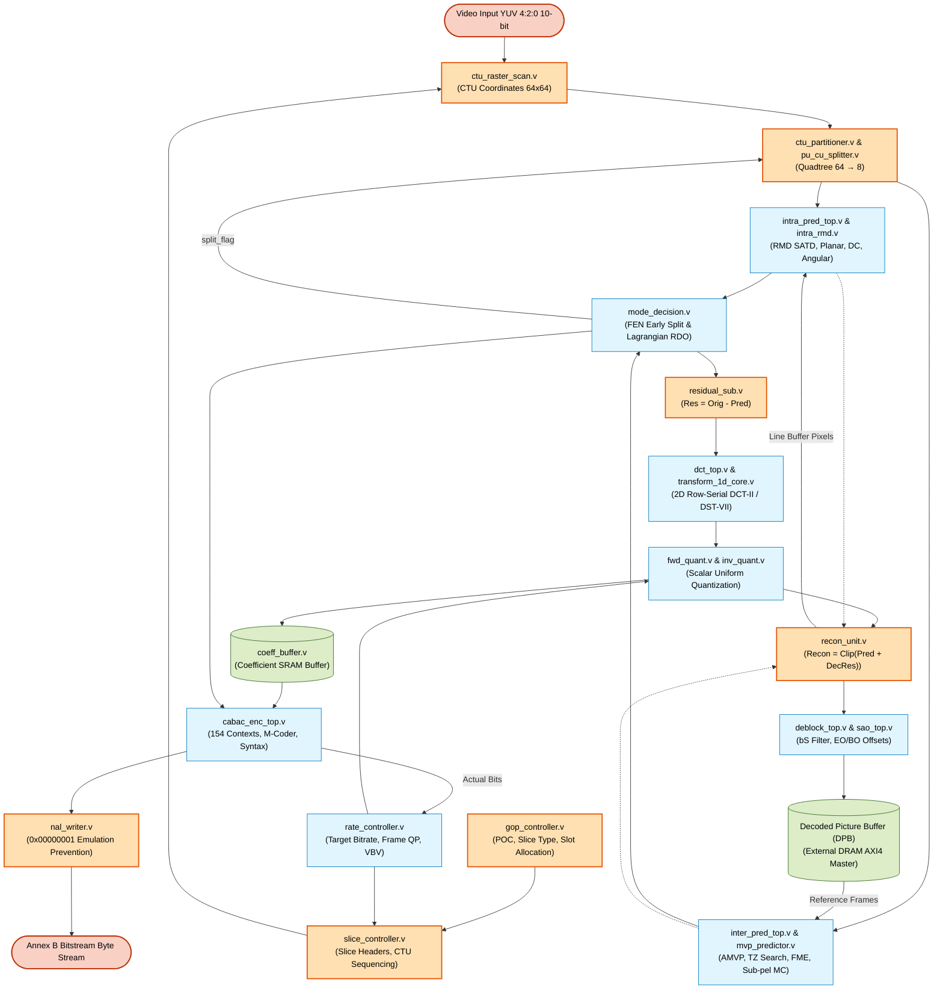

# HEVC Hardware Video Encoder — Major Subsystems ("Bif Modules") Flowcharts & Architecture

## 1. Executive Summary

This master document provides a unified index, system-level interaction diagrams, and hardware architecture specifications for the **major subsystems ("bif modules")** of the **HEVC/H.265 Main10 Hardware Video Encoder**.

Each major subsystem is documented in detail with its dedicated algorithm flowchart, mathematical formulations, HEVC specification clause references, and synthesizable RTL port mappings:

| Subsystem Name | Primary RTL Module | Detailed Flowchart Document | Primary Algorithmic Responsibility |
|:---|:---|:---|:---|
| **Inter Prediction** | [`inter_pred_top.v`](file:///d:/UIT_Doc/hevc_hw_encoder/rtl/inter/inter_pred_top.v) | [**Inter Prediction Flowchart**](file:///d:/UIT_Doc/hevc_hw_encoder/docs/bif_modules/inter_pred_top_flowchart.md) | AMVP candidate derivation, integer Test Zone search, quarter-pel FME, and bi-prediction sub-pel motion compensation. |
| **Intra Prediction** | [`intra_pred_top.v`](file:///d:/UIT_Doc/hevc_hw_encoder/rtl/intra/intra_pred_top.v) | [**Intra Prediction Flowchart**](file:///d:/UIT_Doc/hevc_hw_encoder/docs/bif_modules/intra_pred_top_flowchart.md) | 35-mode RMD screening via $4\times 4$ Hadamard SATD, 3-tap reference sample filtering, Planar, DC, and 33 angular modes. |
| **Deblocking Filter** | [`deblock_top.v`](file:///d:/UIT_Doc/hevc_hw_encoder/rtl/inloop_filters/deblock_top.v) | [**Deblocking Filter Flowchart**](file:///d:/UIT_Doc/hevc_hw_encoder/docs/bif_modules/deblock_top_flowchart.md) | Boundary strength ($bS=0,1,2$) derivation, vertical and horizontal edge filtering with strong/weak decision on an $8\times 8$ grid. |
| **Sample Adaptive Offset**| [`sao_top.v`](file:///d:/UIT_Doc/hevc_hw_encoder/rtl/inloop_filters/sao_top.v) | [**SAO Subsystem Flowchart**](file:///d:/UIT_Doc/hevc_hw_encoder/docs/bif_modules/sao_top_flowchart.md) | Edge Offset (4 directional classes, 4 edge categories) and Band Offset (32 sample amplitude bands). |
| **Mode Decision & Partitioning**| [`mode_decision.v`](file:///d:/UIT_Doc/hevc_hw_encoder/rtl/partition/mode_decision.v) | [**Mode Decision Flowchart**](file:///d:/UIT_Doc/hevc_hw_encoder/docs/bif_modules/mode_decision_flowchart.md) | Top-down CU Quadtree ($64\to 8$), Lagrangian RD-cost minimization ($J = D + \lambda R$), and FEN early-termination split decisions. |
| **CABAC Entropy Coding** | [`cabac_enc_top.v`](file:///d:/UIT_Doc/hevc_hw_encoder/rtl/entropy/cabac_enc_top.v) | [**CABAC Top-Level Flowchart**](file:///d:/UIT_Doc/hevc_hw_encoder/docs/bif_modules/cabac_enc_top_flowchart.md) | 154-context model store, syntax element binarization, M-coder binary arithmetic coder, renormalization, and Annex B byte packing. |
| **Transform & Quantization** | [`dct_top.v`](file:///d:/UIT_Doc/hevc_hw_encoder/rtl/transform/dct_top.v) | [**Transform & Quantization Flowchart**](file:///d:/UIT_Doc/hevc_hw_encoder/docs/bif_modules/transform_quant_flowchart.md) | 2-pass row-serial 2D DCT-II ($4..32$) and DST-VII ($4\times 4$ Intra Luma) with transpose RAM, deadzone scalar quantization. |
| **Rate Control** | [`rate_controller.v`](file:///d:/UIT_Doc/hevc_hw_encoder/rtl/rate_control/rate_controller.v) | [**Rate Controller Flowchart**](file:///d:/UIT_Doc/hevc_hw_encoder/docs/bif_modules/rate_controller_flowchart.md) | VBV buffer occupancy accumulator, target bit allocation, frame-level feedback $\Delta\text{QP}$ clamping, dividerless fullness estimator. |

---

## 2. System-Level Subsystem Interaction Diagram (Mermaid)

---

## 3. Subsystem Hardware Resource & Complexity Profile

| Module | Primary Datapath Width | Pipeline Latency | Area Optimization Technique | Spec Compliance |
|:---|:---:|:---:|:---|:---:|
| [`inter_pred_top`](file:///d:/UIT_Doc/hevc_hw_encoder/docs/bif_modules/inter_pred_top_flowchart.md) | $16\text{ pixels}$ ($160\text{ bits}$) | $12\text{ cycles}$ per $4\times 4$ | Diamond search hierarchy, shared 8-tap/4-tap sub-pel FIR core | Section 8.5 |
| [`intra_pred_top`](file:///d:/UIT_Doc/hevc_hw_encoder/docs/bif_modules/intra_pred_top_flowchart.md) | $1\text{ pixel}$ ($10\text{ bits}$) | $N^2\text{ cycles}$ per $N\times N$ | Mode-gated predictor dispatch, 3-tap smoothing filter reuse | Section 8.4 |
| [`deblock_top`](file:///d:/UIT_Doc/hevc_hw_encoder/docs/bif_modules/deblock_top_flowchart.md) | $1\text{ pixel}$ ($10\text{ bits}$) | $4\text{ cycles}$ per $4\times 4$ | $8\times 8$ grid scheduling, shadow map cross-CTU line buffers | Section 8.7.2 |
| [`sao_top`](file:///d:/UIT_Doc/hevc_hw_encoder/docs/bif_modules/sao_top_flowchart.md) | $1\text{ pixel}$ ($10\text{ bits}$) | $1\text{ cycle}$ per pixel | Single-cycle sign comparator, 32-band shift addressing | Section 8.7.3 |
| [`mode_decision`](file:///d:/UIT_Doc/hevc_hw_encoder/docs/bif_modules/mode_decision_flowchart.md) | $32\text{ bits}$ RD Cost | $6\text{ cycles}$ per CU | FEN early-termination thresholding, parallel merge evaluation | FEN = 1 |
| [`cabac_enc_top`](file:///d:/UIT_Doc/hevc_hw_encoder/docs/bif_modules/cabac_enc_top_flowchart.md) | $1\text{ bin/cycle}$ | $1\text{–}2\text{ cycles}$ per bin | Zero-conflict round-robin syntax arbiter, single-cycle renorm | Section 9.3 |
| [`dct_top`](file:///d:/UIT_Doc/hevc_hw_encoder/docs/bif_modules/transform_quant_flowchart.md) | $32\text{ coeffs}$ ($512\text{ bits}$) | $12\text{–}68\text{ cycles}$ | Row-serial 2-pass 1D core with transpose RAM (98.3% multiplier save) | Section 8.6.2/3 |
| [`rate_controller`](file:///d:/UIT_Doc/hevc_hw_encoder/docs/bif_modules/rate_controller_flowchart.md)| $32\text{ bits}$ | $2\text{ cycles}$ per frame | Dividerless binary shift comparison tree for VBV fullness | CBR / VBR |
