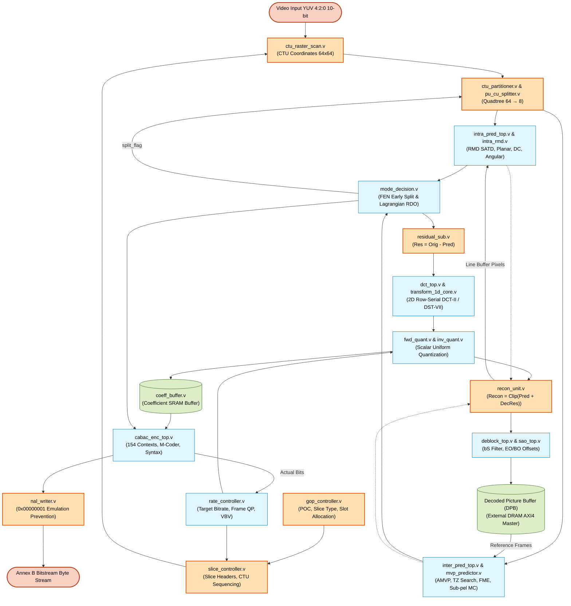

# HEVC Hardware Video Encoder — Major Subsystems ("Bif Modules") Flowcharts & Architecture

## 1. Executive Summary

This master document provides a unified index, system-level interaction diagrams, and hardware architecture specifications for the **major subsystems ("bif modules")** of the **HEVC/H.265 Main10 Hardware Video Encoder**.

Each major subsystem is documented in detail with its dedicated algorithm flowchart, mathematical formulations, HEVC specification clause references, and synthesizable RTL port mappings:

| Subsystem Name | Primary RTL Module | Detailed Flowchart Document | Primary Algorithmic Responsibility |
|:---|:---|:---|:---|
| **Inter Prediction** | [`inter_pred_top.v`](file:///d:/UIT_Doc/hevc_hw_encoder/rtl/inter/inter_pred_top.v) | [**Inter Prediction Flowchart**](file:///d:/UIT_Doc/hevc_hw_encoder/docs/bif_modules/inter_pred_top_flowchart.md) | AMVP candidate derivation, integer Test Zone search, quarter-pel FME, and bi-prediction sub-pel motion compensation. |
| **Intra Prediction** | [`intra_pred_top.v`](file:///d:/UIT_Doc/hevc_hw_encoder/rtl/intra/intra_pred_top.v) | [**Intra Prediction Flowchart**](file:///d:/UIT_Doc/hevc_hw_encoder/docs/bif_modules/intra_pred_top_flowchart.md) | 35-mode RMD screening via $4\times 4$ Hadamard SATD, 3-tap reference sample filtering, Planar, DC, and 33 angular modes. |
| **Deblocking Filter** | [`deblock_top.v`](file:///d:/UIT_Doc/hevc_hw_encoder/rtl/inloop_filters/deblock_top.v) | [**Deblocking Filter Flowchart**](file:///d:/UIT_Doc/hevc_hw_encoder/docs/bif_modules/deblock_top_flowchart.md) | Boundary strength ($bS=0,1,2$) derivation, vertical and horizontal edge filtering with strong/weak decision on an $8\times 8$ grid. |
| **Sample Adaptive Offset**| [`sao_top.v`](file:///d:/UIT_Doc/hevc_hw_encoder/rtl/inloop_filters/sao_top.v) | [**SAO Subsystem Flowchart**](file:///d:/UIT_Doc/hevc_hw_encoder/docs/bif_modules/sao_top_flowchart.md) | Edge Offset (4 directional classes, 4 edge categories) and Band Offset (32 sample amplitude bands). |
| **Mode Decision & Partitioning**| [`mode_decision.v`](file:///d:/UIT_Doc/hevc_hw_encoder/rtl/partition/mode_decision.v) | [**Mode Decision Flowchart**](file:///d:/UIT_Doc/hevc_hw_encoder/docs/bif_modules/mode_decision_flowchart.md) | Top-down CU Quadtree ($64\to 8$), Lagrangian RD-cost minimization ($J = D + \lambda R$), and FEN early-termination split decisions. |
| **CABAC Entropy Coding** | [`cabac_enc_top.v`](file:///d:/UIT_Doc/hevc_hw_encoder/rtl/entropy/cabac_enc_top.v) | [**CABAC Top-Level Flowchart**](file:///d:/UIT_Doc/hevc_hw_encoder/docs/bif_modules/cabac_enc_top_flowchart.md) | 154-context model store, syntax element binarization, M-coder binary arithmetic coder, renormalization, and Annex B byte packing. |
| **Transform & Quantization** | [`dct_top.v`](file:///d:/UIT_Doc/hevc_hw_encoder/rtl/transform/dct_top.v) | [**Transform & Quantization Flowchart**](file:///d:/UIT_Doc/hevc_hw_encoder/docs/bif_modules/transform_quant_flowchart.md) | 2-pass row-serial 2D DCT-II ($4..32$) and DST-VII ($4\times 4$ Intra Luma) with transpose RAM, deadzone scalar quantization. |
| **Rate Control** | [`rate_controller.v`](file:///d:/UIT_Doc/hevc_hw_encoder/rtl/rate_control/rate_controller.v) | [**Rate Controller Flowchart**](file:///d:/UIT_Doc/hevc_hw_encoder/docs/bif_modules/rate_controller_flowchart.md) | VBV buffer occupancy accumulator, target bit allocation, frame-level feedback $\Delta\text{QP}$ clamping, dividerless fullness estimator. |

---

## 2. System-Level Subsystem Interaction Diagram (Mermaid)

---

## 3. Subsystem Hardware Resource & Complexity Profile (`xczu19eg-ffvb1517-2-e`)

The table below reflects the post-synthesis hierarchical resource utilization extracted from Vivado 2026.1 targeting `xczu19eg-ffvb1517-2-e` at 50 MHz (`synth/vivado_output/utilization_hierarchical.rpt`):

| Module | Primary Datapath Width | Pipeline Latency | Synthesized LUTs / FFs / DSPs / BRAM | Area Optimization Technique | Spec Compliance |
|:---|:---:|:---:|:---:|:---|:---:|
| [`dct_top`](file:///d:/UIT_Doc/hevc_hw_encoder/docs/bif_modules/transform_quant_flowchart.md) | $32\text{ coeffs}$ ($512\text{ bits}$) | $12\text{–}68\text{ cycles}$ | `86,280 LUTs / 35,075 FFs / 1 DSP / 0 BRAM` | Row-serial 2-pass 1D core (`50,027 LUTs, 1 DSP`) + dual-port transpose RAM (`5,077 LUTs, 16,896 FFs`) | Section 8.6.2/3 |
| [`inter_pred_top`](file:///d:/UIT_Doc/hevc_hw_encoder/docs/bif_modules/inter_pred_top_flowchart.md) | $16\text{ pixels}$ ($160\text{ bits}$) | $12\text{ cycles}$ per $4\times 4$ | `28,656 LUTs / 8,007 FFs / 13 DSPs / 0 BRAM` | Fast Diamond search hierarchy (`622 LUTs`), constant-mux FME window (`26,342 LUTs`), and on-chip search window buffer | Section 8.5 |
| [`u_inloop_filters`](file:///d:/UIT_Doc/hevc_hw_encoder/docs/bif_modules/deblock_top_flowchart.md) | $1\text{ pixel}$ ($10\text{ bits}$) | $4\text{ cycles}$ per $4\times 4$ | `19,371 LUTs / 24,936 FFs / 0 DSPs / 1 RAMB36 + 3 RAMB18` | Synchronous registered BRAM CTU buffers, decoupled `dump_valid_q` streaming handshake; includes `deblock_top` (`15,437 LUTs, 985 FFs`), `sao_top` (`597 LUTs, 105 FFs`), and `sao_stats` (`59 LUTs, 21 FFs`) | Section 8.7.2 / 8.7.3 |
| [`intra_pred_top`](file:///d:/UIT_Doc/hevc_hw_encoder/docs/bif_modules/intra_pred_top_flowchart.md) | $1\text{ pixel}$ ($10\text{ bits}$) | $N^2\text{ cycles}$ per $N\times N$ | `10,340 LUTs / 4,436 FFs / 23 DSPs / 0 BRAM` | Angular directional core (`7,407 LUTs, 17 DSPs`), 3-tap boundary smoothing (`2,421 LUTs, 2 DSPs`), Planar (`154 LUTs, 4 DSPs`), and DC (`358 LUTs`) | Section 8.4 |
| [`intra_rmd`](file:///d:/UIT_Doc/hevc_hw_encoder/docs/bif_modules/intra_pred_top_flowchart.md) | $16\text{ pixels}$ ($160\text{ bits}$) | $2\text{ cycles}$ per $4\times 4$ | `6,225 LUTs / 3,069 FFs / 4 DSPs / 0 BRAM` | 35-mode RMD pre-screening via 4 parallel $4\times 4$ Hadamard SATD cores | Section 8.4.3 |
| [`cabac_enc_top`](file:///d:/UIT_Doc/hevc_hw_encoder/docs/bif_modules/cabac_enc_top_flowchart.md) | $1\text{ bin/cycle}$ | $1\text{–}2\text{ cycles}$ per bin | `5,300 LUTs / 2,320 FFs / 0 DSPs / 0 BRAM` | Zero-conflict syntax arbiter, 154-context model store (`1,240 LUTs, 1,335 FFs`), `syntax_coeff` (`2,683 LUTs`), single-cycle M-coder (`765 LUTs, 109 FFs`) | Section 9.3 |
| [`ctu_partitioner`](file:///d:/UIT_Doc/hevc_hw_encoder/docs/bif_modules/mode_decision_flowchart.md) | $6\text{ bits}$ coordinate | $1\text{ cycle}$ | `3,153 LUTs / 375 FFs / 0 DSPs / 0 BRAM` | Recursive Morton Z-scan quadtree traversal ($64\to 32\to 16\to 8$) with FEN early termination | Section 7.4.8.1 |
| [`streaming_subpel_filter`](file:///d:/UIT_Doc/hevc_hw_encoder/docs/bif_modules/inter_pred_top_flowchart.md)| $10\text{ bits}$ pixel | $3\text{ cycles}$ | `2,922 LUTs / 362 FFs / 156 DSPs / 0 BRAM` | Pipelined 8-tap luma and 4-tap chroma sub-pel FIR interpolation filter | Section 8.5.3.2 |
| [`recon_unit`](file:///d:/UIT_Doc/hevc_hw_encoder/docs/bif_modules/transform_quant_flowchart.md) | $10\text{ bits}$ pixel | $1\text{ cycle}$ | `1,298 LUTs / 220 FFs / 0 DSPs / 1 RAMB36 + 1 RAMB18` | Pixel reconstruction $\text{Clip Main10}(\text{Pred} + \text{IDCT}_{\text{res}})$ with dedicated synchronous line buffer RAM | Section 8.6.4 |
| [`rate_controller`](file:///d:/UIT_Doc/hevc_hw_encoder/docs/bif_modules/rate_controller_flowchart.md) | $16\text{ bits}$ QP/fullness | $1\text{ cycle}$ | `1,107 LUTs / 149 FFs / 3 DSPs / 0 BRAM` | Closed-loop VBV virtual buffer feedback, reciprocal-multiply budget allocator, dividerless shift-tree fullness estimator | Annex E |
| [`residual_sub`](file:///d:/UIT_Doc/hevc_hw_encoder/docs/bif_modules/transform_quant_flowchart.md) | $11\text{ bits}$ signed | $1\text{ cycle}$ | `1,043 LUTs / 116 FFs / 0 DSPs / 0 BRAM` | 11-bit signed residual subtraction ($\text{Orig} - \text{Pred}$) | Section 8.5 |
| [`pu_cu_splitter`](file:///d:/UIT_Doc/hevc_hw_encoder/docs/bif_modules/mode_decision_flowchart.md) | $6\text{ bits}$ | $1\text{ cycle}$ | `903 LUTs / 712 FFs / 0 DSPs / 0 BRAM` | PU/CU partition sequencing and TU tree dispatching | Section 7.4.8 |
| [`mode_decision`](file:///d:/UIT_Doc/hevc_hw_encoder/docs/bif_modules/mode_decision_flowchart.md) | $32\text{ bits}$ RD Cost | $6\text{ cycles}$ per CU | `501 LUTs / 221 FFs / 3 DSPs / 0 BRAM` | Lagrangian RD-cost comparison ($J = D + \lambda R$), FEN early termination split flag generation | FEN = 1 |
| [`mvp_predictor`](file:///d:/UIT_Doc/hevc_hw_encoder/docs/bif_modules/inter_pred_top_flowchart.md) | $10\text{ bits}$ MV | $1\text{ cycle}$ | `31 LUTs / 104 FFs / 0 DSPs / 0 BRAM` | Spatial ($A_0, A_1, B_0, B_1, B_2$) and temporal AMVP candidate list derivation and 5-candidate merge list | Section 8.5.3.1 |
| [`rate_controller`](file:///d:/UIT_Doc/hevc_hw_encoder/docs/bif_modules/rate_controller_flowchart.md)| $32\text{ bits}$ | $2\text{ cycles}$ per frame | `1,106 LUTs / 149 FFs / 3 DSPs` | Dividerless binary shift comparison tree for VBV fullness (`0 LDCE`) | CBR / VBR |
