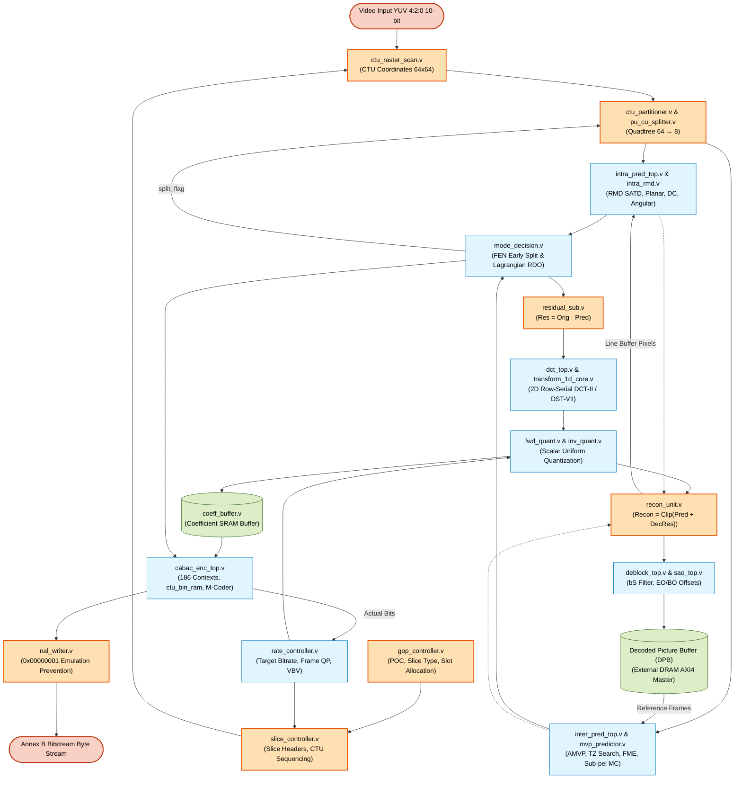

# HEVC Hardware Video Encoder — Major Subsystems ("Bif Modules") Flowcharts & Architecture

## 1. Executive Summary

This master document provides a unified index, system-level interaction diagrams, and hardware architecture specifications for the **major subsystems ("bif modules")** of the **HEVC/H.265 Main10 Hardware Video Encoder**.

Each major subsystem is documented in detail with its dedicated algorithm flowchart, mathematical formulations, HEVC specification clause references, and synthesizable RTL port mappings:

| Subsystem Name | Primary RTL Module | Detailed Flowchart Document | Primary Algorithmic Responsibility |
|:---|:---|:---|:---|
| **Inter Prediction** | [`inter_pred_top.v`](file:///d:/UIT_Doc/hevc_hw_encoder/rtl/inter/inter_pred_top.v) | [**Inter Prediction Flowchart**](file:///d:/UIT_Doc/hevc_hw_encoder/docs/bif_modules/inter_pred_top_flowchart.md) | AMVP candidate derivation, `128x128` Luma [`ref_search_cache.v`](file:///d:/UIT_Doc/hevc_hw_encoder/rtl/inter/ref_search_cache.v), integer TZ search, quarter-pel FME, and TDP sub-pel motion compensation. |
| **Intra Prediction** | [`intra_pred_top.v`](file:///d:/UIT_Doc/hevc_hw_encoder/rtl/intra/intra_pred_top.v) | [**Intra Prediction Flowchart**](file:///d:/UIT_Doc/hevc_hw_encoder/docs/bif_modules/intra_pred_top_flowchart.md) | Pipelined `150 MHz` 4-mode Luma RMD (`Planar=0, DC=1, Hor=10, Ver=26`) via `4x4`-tiled Hadamard SATD + 5-cand Chroma RDO (`intra_rmd.v`); 3-tap reference filtering and full Planar, DC, and 33 angular mode reconstruction (`intra_pred_top.v`, modes 0..34). |
| **Deblocking Filter** | [`deblock_top.v`](file:///d:/UIT_Doc/hevc_hw_encoder/rtl/inloop_filters/deblock_top.v) | [**Deblocking Filter Flowchart**](file:///d:/UIT_Doc/hevc_hw_encoder/docs/bif_modules/deblock_top_flowchart.md) | Boundary strength ($bS=0,1,2$) derivation, vertical and horizontal edge filtering with 2-stage pipelined `db_filter_luma.v` and 2-bank CTU Ping-Pong in `decoder_inloop_filters.v`. |
| **Sample Adaptive Offset**| [`sao_top.v`](file:///d:/UIT_Doc/hevc_hw_encoder/rtl/inloop_filters/sao_top.v) | [**SAO Subsystem Flowchart**](file:///d:/UIT_Doc/hevc_hw_encoder/docs/bif_modules/sao_top_flowchart.md) | Edge Offset (4 directional classes, 4 edge categories) and Band Offset (32 sample amplitude bands). |
| **Mode Decision & Partitioning**| [`mode_decision.v`](file:///d:/UIT_Doc/hevc_hw_encoder/rtl/partition/mode_decision.v) | [**Mode Decision Flowchart**](file:///d:/UIT_Doc/hevc_hw_encoder/docs/bif_modules/mode_decision_flowchart.md) | Top-down CU Quadtree ($64\to 8$), Lagrangian RD-cost minimization ($J = D + \lambda R$), and FEN early-termination split decisions. |
| **CABAC Entropy Coding** | [`cabac_enc_top.v`](file:///d:/UIT_Doc/hevc_hw_encoder/rtl/entropy/cabac_enc_top.v) | [**CABAC Top-Level Flowchart**](file:///d:/UIT_Doc/hevc_hw_encoder/docs/bif_modules/cabac_enc_top_flowchart.md) | 186-context model store (`ctx 0..185`, 186-cycle init), dual-bank `ctu_bin_ram_0/1` CTU-delayed serialization (`drain_prefetched_valid`), pipelined `S_LOAD_CG` `syntax_coeff`, M-coder, and Annex B packing. |
| **Transform & Quantization** | [`dct_top.v`](file:///d:/UIT_Doc/hevc_hw_encoder/rtl/transform/dct_top.v) | [**Transform & Quantization Flowchart**](file:///d:/UIT_Doc/hevc_hw_encoder/docs/bif_modules/transform_quant_flowchart.md) | 2-pass row-serial 2D DCT-II ($4..32$) and DST-VII ($4\times 4$ Intra Luma) with transpose RAM, deadzone scalar quantization. |
| **Rate Control** | [`rate_controller.v`](file:///d:/UIT_Doc/hevc_hw_encoder/rtl/rate_control/rate_controller.v) | [**Rate Controller Flowchart**](file:///d:/UIT_Doc/hevc_hw_encoder/docs/bif_modules/rate_controller_flowchart.md) | VBV buffer occupancy accumulator, target bit allocation, frame-level feedback $\Delta\text{QP}$ clamping, dividerless fullness estimator. |

> [!TIP]
> **RTL Finite State Machine (FSM) Reference Suite:** For cycle-accurate state encodings, `localparam` tables, transition guards, and reset/backpressure semantics across every RTL block, see the [**Master FSM Reference Index**](file:///d:/UIT_Doc/hevc_hw_encoder/docs/fsm_reference.md) and its 7 subsystem specs: [Top & Control](file:///d:/UIT_Doc/hevc_hw_encoder/docs/fsm/top_and_control_fsms.md) · [Partition & Mode Decision](file:///d:/UIT_Doc/hevc_hw_encoder/docs/fsm/partition_and_mode_decision_fsms.md) · [Intra Prediction](file:///d:/UIT_Doc/hevc_hw_encoder/docs/fsm/intra_prediction_fsms.md) · [Inter Prediction](file:///d:/UIT_Doc/hevc_hw_encoder/docs/fsm/inter_prediction_fsms.md) · [Transform, Quant, Recon, DPB & RC](file:///d:/UIT_Doc/hevc_hw_encoder/docs/fsm/transform_quant_recon_fsms.md) · [In-Loop Filters](file:///d:/UIT_Doc/hevc_hw_encoder/docs/fsm/inloop_filters_fsms.md) · [Entropy & NAL](file:///d:/UIT_Doc/hevc_hw_encoder/docs/fsm/entropy_and_nal_fsms.md).

---

## 2. System-Level Subsystem Interaction Diagram (Mermaid)

---

## 3. Subsystem Hardware Resource & Complexity Profile (`xczu19eg-ffvb1517-2-e`, `150 MHz` Timing Met)

The table below reflects the post-synthesis hierarchical resource utilization extracted from Vivado 2026.1 targeting `xczu19eg-ffvb1517-2-e` at **`150 MHz` (`6.667 ns`, `WNS = +0.318 ns`, `Fmax = 157.51 MHz`, `237,476 LUTs`, `163,801 FFs`, `60 BRAM Tiles`, `63 DSPs`)** (`synth/vivado_output/utilization_hierarchical.rpt`):

| Module | Primary Datapath Width | Pipeline Latency | Synthesized LUTs / FFs / DSPs / BRAM | Area / Throughput Technique | Spec Compliance |
|:---|:---:|:---:|:---:|:---|:---:|
| [`dct_top`](file:///d:/UIT_Doc/hevc_hw_encoder/docs/bif_modules/transform_quant_flowchart.md) | $32\text{ coeffs}$ ($512\text{ bits}$) | $12\text{–}68\text{ cycles}$ | `84,904 LUTs / 37,172 FFs / 1 DSP / 0 BRAM` | Row-serial 2-pass 1D core (`48,541 LUTs, 2,619 FFs, 1 DSP`) + dual-port transpose RAM (`5,048 LUTs, 16,896 FFs`) + top mux | Section 8.6.2/3 |
| [`inter_pred_top`](file:///d:/UIT_Doc/hevc_hw_encoder/docs/bif_modules/inter_pred_top_flowchart.md) | $16\text{ pixels}$ ($160\text{ bits}$) | $12\text{ cycles}$ per $4\times 4$ | `31,739 LUTs (30 SRLs) / 9,803 FFs / 13 DSPs / 4 RAMB36 + 1 RAMB18` | TZ search (`636 LUTs`), FME (`26,801 LUTs, 27 SRLs`), `mc_unit` (`110 LUTs`), `ref_frame_buffer` (`1,585 LUTs, 13 DSPs`), **`ref_search_cache`** (`2,606 LUTs, 1,692 FFs, 4 RAMB36 + 1 RAMB18`) | Section 8.5 |
| [`u_inloop_filters`](file:///d:/UIT_Doc/hevc_hw_encoder/docs/bif_modules/deblock_top_flowchart.md) | $1\text{ pixel}$ ($10\text{ bits}$) | $4\text{ cycles}$ per $4\times 4$ | `47,570 LUTs / 55,699 FFs / 2 DSPs / 4 RAMB36 + 12 RAMB18` | 2-bank CTU Ping-Pong + skid buffer + 2-stage pipelined `deblock_top` (`19,483 LUTs, 1,192 FFs`) + `sao_top` (`13,704 LUTs, 1,008 FFs`) + `sao_stats` (`7,072 LUTs, 6,376 FFs, 2 DSPs`) | Section 8.7.2 / 8.7.3 |
| [`intra_pred_top`](file:///d:/UIT_Doc/hevc_hw_encoder/docs/bif_modules/intra_pred_top_flowchart.md) | $1\text{ pixel}$ ($10\text{ bits}$) | $N^2\text{ cycles}$ per $N\times N$ | `10,399 LUTs (48 LUTRAMs) / 4,482 FFs / 23 DSPs / 0 BRAM` | Full 35-mode reconstruction: Angular (`7,392 LUTs, 17 DSPs`), 3-tap ref filter (`2,497 LUTs, 2 DSPs`), DC (`357 LUTs, 721 FFs`), and Planar (`153 LUTs [48 LUTRAMs], 4 DSPs`) | Section 8.4 |
| [`intra_rmd`](file:///d:/UIT_Doc/hevc_hw_encoder/docs/bif_modules/intra_pred_top_flowchart.md) | $16\text{ pixels}$ ($160\text{ bits}$) | $4\times 4\text{ tiled}$ | `8,916 LUTs / 5,625 FFs / 12 DSPs / 0 BRAM` | `150 MHz`-pipelined 4-mode Luma (`0,1,10,26`) `4x4`-tiled Hadamard SATD across `4x4..32x32` (4x `hadamard_satd_4x4`) + 5-cand Chroma RDO | Section 8.4.3 |
| [`cabac_enc_top`](file:///d:/UIT_Doc/hevc_hw_encoder/docs/bif_modules/cabac_enc_top_flowchart.md) | $1\text{ bin/cycle}$ | $1\text{–}2\text{ cycles}$ per bin | `5,532 LUTs / 2,423 FFs / 0 DSPs / 4 RAMB36 + 2 RAMB18` | 186-context store (`1,200 LUTs, 1,335 FFs`), pipelined `syntax_coeff` (`2,623 LUTs, 758 FFs` w/ CG skip), `range_coder` (`837 LUTs`), `syntax_pred` (`407 LUTs`), `bin_encoder` (`236 LUTs`), `syntax_sao` (`180 LUTs`), dual-bank `ctu_bin_ram_0/1` | Section 9.3 |
| [`ctu_partitioner`](file:///d:/UIT_Doc/hevc_hw_encoder/docs/bif_modules/mode_decision_flowchart.md) | $6\text{ bits}$ coordinate | $1\text{ cycle}$ | `2,961 LUTs / 376 FFs / 0 DSPs / 0 BRAM` | Recursive Morton Z-scan quadtree traversal ($64\to 32\to 16\to 8$) with FEN early termination | Section 7.4.8.1 |
| [`mc_window_fetch`](file:///d:/UIT_Doc/hevc_hw_encoder/rtl/inter/mc_window_fetch.v)| $10\text{ bits}$ pixel | $0\text{D/1D fast + TDP}$ | `13,823 LUTs / 3,891 FFs / 0 DSPs / 0 BRAM` | TDP 2-sample/cyc sliding-column DPB fetcher (`rd_hold` Port-A collision stall, 0D/1D fast fetch, row-start reuse) feeding `u_subpel_core_l0` (`1,168 LUTs`) and `u_subpel_core_l1` (`324 LUTs`) | Section 8.5.3.2 |
| [`recon_unit`](file:///d:/UIT_Doc/hevc_hw_encoder/docs/bif_modules/transform_quant_flowchart.md) | $10\text{ bits}$ pixel | $1\text{ cycle}$ | `1,869 LUTs / 362 FFs / 0 DSPs / 1 RAMB36 + 1 RAMB18` | Pixel reconstruction $\text{Clip Main10}(\text{Pred} + \text{IDCT}_{\text{res}})$ with dedicated synchronous line buffer RAM | Section 8.6.4 |
| [`rate_controller`](file:///d:/UIT_Doc/hevc_hw_encoder/docs/bif_modules/rate_controller_flowchart.md) | $16\text{ bits}$ QP/fullness | $1\text{–}2\text{ cycles}$ | `1,175 LUTs / 216 FFs / 3 DSPs / 0 BRAM` | Closed-loop VBV virtual buffer feedback, reciprocal-multiply budget allocator, dividerless shift-tree fullness estimator (`0 LDCE`) | Annex E / CBR-VBR |
| [`residual_sub`](file:///d:/UIT_Doc/hevc_hw_encoder/docs/bif_modules/transform_quant_flowchart.md) | $11\text{ bits}$ signed | $1\text{ cycle}$ | `1,002 LUTs / 116 FFs / 0 DSPs / 0 BRAM` | 11-bit signed residual subtraction ($\text{Orig} - \text{Pred}$) | Section 8.5 |
| [`pu_cu_splitter`](file:///d:/UIT_Doc/hevc_hw_encoder/docs/bif_modules/mode_decision_flowchart.md) | $6\text{ bits}$ | $1\text{ cycle}$ | `958 LUTs / 709 FFs / 0 DSPs / 0 BRAM` | PU/CU partition sequencing and TU tree dispatching | Section 7.4.8 |
| [`mode_decision`](file:///d:/UIT_Doc/hevc_hw_encoder/docs/bif_modules/mode_decision_flowchart.md) | $32\text{ bits}$ RD Cost | $6\text{ cycles}$ per CU | `634 LUTs / 221 FFs / 3 DSPs / 0 BRAM` | Lagrangian RD-cost comparison ($J = D + \lambda R$), depth-0 64×64 bypass & parameterized `FAST_EARLY_CU_SPLIT` (`0` default) | FEN = 1 |
| [`mvp_predictor`](file:///d:/UIT_Doc/hevc_hw_encoder/docs/bif_modules/inter_pred_top_flowchart.md) | $10\text{ bits}$ MV | $1\text{ cycle}$ | `34 LUTs / 104 FFs / 0 DSPs / 0 BRAM` | Spatial ($A_0, A_1, B_0, B_1, B_2$) and temporal AMVP candidate list derivation and 5-candidate merge list | Section 8.5.3.1 |
