# HEVC Main10 Hardware Encoder — Datapath Architecture & Pipeline Flow

## 1. Executive Summary & Datapath Organization

The hardware datapath of the **HEVC Main10 Hardware Video Encoder** processes high-definition video frames with 10-bit color depth (YUV 4:2:0 format) through a synthesizable, decoupled pipeline. The architecture is engineered around the standard HEVC hybrid video coding model: **Inter/Intra Prediction $\to$ Residual Subtraction $\to$ 2D Transform (DCT/DST) $\to$ Scalar Quantization $\to$ CABAC Entropy Coding $\to$ Inverse Quantization / Inverse Transform $\to$ Local Reconstruction $\to$ In-Loop Filtering (Deblock + SAO) $\to$ External Decoded Picture Buffer (DPB)**.

Key pipeline design principles implemented:
1. **Critical Path Decoupling**: The **Reconstruction Loop** (which generates reference samples for spatial intra prediction) is isolated from the slower **CABAC Bitstream Serialization Path** using an intermediate dual-port SRAM coefficient buffer (`coeff_buffer.v`).
2. **Spatial vs Temporal Feedback Loops**:
   - **Intra Spatial Feedback**: Unfiltered reconstructed samples from `recon_unit` are immediately registered into CTU line buffers to serve as boundary references for neighboring CUs.
   - **Inter Temporal Feedback**: Fully filtered frames (post-Deblock and post-SAO) are committed to external DRAM via an AXI4 memory controller, forming the multi-frame Decoded Picture Buffer (DPB) for subsequent $P$ and $B$ frames.
3. **Multi-Rate Processing**:
   - Pixel domains operate on $16\text{-pixel}$ parallel buses ($16 \times 10\text{-bit} = 160\text{ bits}$).
   - Transform cores operate in row-serial mode ($32 \times 16\text{-bit} = 512\text{ bits/cycle}$) with transpose RAM.
   - CABAC serializes symbols at 1 bin/cycle for bypass and 1 bin per 1–2 cycles for regular context bins.

---

## 2. Complete Datapath Flowchart (Mermaid)

```mermaid
flowchart TD
    %% Node Styles
    classDef io fill:#f9d0c4,stroke:#bf360c,stroke-width:2px,color:#000;
    classDef process fill:#e1f5fe,stroke:#0277bd,stroke-width:1px,color:#000;
    classDef decision fill:#fff9c4,stroke:#fbc02d,stroke-width:1px,color:#000;
    classDef storage fill:#dcedc8,stroke:#33691e,stroke-width:1px,color:#000;
    classDef math fill:#ede7f6,stroke:#512da8,stroke-width:1px,color:#000;

    %% Primary Inputs and Outputs
    Input(["Raw Video Input<br/>(YUV 4:2:0, 10-bit Samples)"]):::io
    Output(["HEVC Annex B Bitstream Output<br/>(Byte Stream to Host/Storage)"]):::io

    %% Top Control & Partitioning
    WPP["Wavefront / Raster CTU Controller<br/>(ctu_raster_scan.v / slice_controller.v)"]:::process
    CTU["CTU Partitioning Unit<br/>(ctu_partitioner.v & pu_cu_splitter.v)<br/>MaxCU: 64x64, MaxDepth: 4 (64&rarr;32&rarr;16&rarr;8)"]:::process

    %% Prediction Engines
    Intra["Intra Prediction Subsystem<br/>&bull; intra_rmd.v (35-mode SATD)<br/>&bull; ref_sample_filter.v (3-tap filter)<br/>&bull; intra_pred_top.v (Planar, DC, Angular)"]:::process

    Inter["Inter Prediction Subsystem<br/>&bull; mvp_predictor.v (AMVP L0/L1)<br/>&bull; tz_search.v (Diamond/Raster Integer ME)<br/>&bull; fme_search.v (Quarter-pel Fractional ME)<br/>&bull; mc_unit.v (8-tap/4-tap Sub-pel Filter)"]:::process

    ModeSwitch{"Mode Decision Engine<br/>(mode_decision.v)<br/>Minimizes J = D + &lambda; &times; R"}:::decision

    %% Residual Path
    ResSub["Residual Subtraction Unit<br/>(residual_sub.v)<br/>Residual = Original - Predicted"]:::process

    Trans["TU Quadtree & 2D Transform<br/>(dct_top.v & transform_1d_core.v)<br/>&bull; DST-VII (4x4 Intra Luma)<br/>&bull; DCT-II (4x4, 8x8, 16x16, 32x32)<br/>&bull; Transform Skip Support"]:::process

    Quant["Forward Quantization<br/>(fwd_quant.v)<br/>Scalar Uniform Quantization (QP: 0..51)"]:::process

    %% Decoupled Entropy Branch
    CoeffBuf[("Coefficient SRAM Buffer<br/>(coeff_buffer.v)<br/>Decouples Recon from CABAC")]:::storage
    Entropy["CABAC Entropy Coding Engine<br/>(cabac_enc_top.v & nal_writer.v)<br/>154 Contexts, M-Coder, Byte Packing"]:::process

    %% Reconstruction Branch (Critical Path)
    IQ["Inverse Quantization<br/>(inv_quant.v)"]:::process
    IT["Inverse Transform (IDCT/IDST)<br/>(dct_top.v)"]:::process
    ReconAdd(("Tái tạo (+)<br/>recon_unit.v")):::math

    %% In-Loop Filters & External Memory
    Filter["In-Loop Filtering Subsystem<br/>(decoder_inloop_filters.v)<br/>1. Deblocking Filter (deblock_top.v)<br/>2. Sample Adaptive Offset (sao_top.v)"]:::process

    DPB[("Decoded Picture Buffer (DPB)<br/>(External DRAM via AXI4 Master)<br/>Stores Reference Frames for Inter ME")]:::storage

    %% --- Signal Routing Connections ---
    Input --> WPP --> CTU

    CTU -->|"Original CU Pixels"| Intra
    CTU -->|"Original CU Pixels"| Inter

    Intra -->|"Intra Candidates & Costs"| ModeSwitch
    Inter -->|"Inter Vectors & Costs"| ModeSwitch

    ModeSwitch -->|"Best Prediction Pixels"| ResSub
    CTU -->|"Original Pixels"| ResSub

    ResSub -->|"Residual Coefficients"| Trans -->|"Transform Blocks"| Quant

    %% Bitstream Branch
    Quant -->|"Quantized Levels & CBF"| CoeffBuf -->|"Buffered Coeffs"| Entropy
    ModeSwitch -->|"Mode Info, MVs, Headers"| Entropy
    Entropy --> Output

    %% Local Reconstruction Loop
    Quant -->|"Quantized Levels"| IQ -->|"Dequantized Coeffs"| IT
    IT -->|"Decoded Residual"| ReconAdd
    ModeSwitch -.->|"Best Prediction Pixels"| ReconAdd

    %% Intra Spatial Feedback Loop (Unfiltered Reconstructed Pixels)
    ReconAdd -->|"Unfiltered Boundary Pixels<br/>(CTU Neighbor Line Buffers)"| Intra

    %% Frame Store & In-Loop Filtering
    ReconAdd -->|"Reconstructed Frame Samples"| Filter
    Filter -->|"Deblocked & SAO Filtered Picture"| DPB

    %% Inter Temporal Feedback Loop
    DPB -->|"Reference Frame Caches<br/>(ref_frame_buffer.v via AXI4)"| Inter
```



---

## 3. Detailed Subsystem Interconnect & Data Width Specifications

| Subsystem Stage | Source Module | Destination Module | Key Data Buses | Signal Width & Format |
|:---|:---|:---|:---|:---|
| **Video Input** | External Stream / DMA | `hevc_encoder_top` | `in_pixel_y`, `in_pixel_u`, `in_pixel_v` | $3 \times 10\text{-bit}$ (Main10 profile) |
| **CTU Dispatch** | `ctu_raster_scan` | `ctu_partitioner` | `ctu_x`, `ctu_y`, `ctu_addr` | $[9:0]$ coordinates, $[15:0]$ raster address |
| **CU Partitioning** | `ctu_partitioner` | `pu_cu_splitter`, `mode_decision` | `cu_x`, `cu_y`, `cu_size`, `cu_depth` | $[5:0]$ coordinates, $[6:0]$ size ($8..64$), $[1:0]$ depth |
| **AMVP Prediction** | `mvp_predictor` | `tz_search`, `mode_decision` | `amvp_mv_x_flat`, `amvp_mv_y_flat` | $2 \times 10\text{-bit}$ signed predictors ($1/4\text{-pel}$) |
| **Motion Estimation** | `tz_search` / `fme_search` | `mode_decision`, `mc_unit` | `best_mv_x`, `best_mv_y`, `best_sad` | $12\text{-bit}$ signed ($1/4\text{-pel}$), $12\text{-bit}$ SAD |
| **Motion Comp** | `mc_unit` | `mode_decision`, `residual_sub` | `mc_pred_y_flat`, `mc_pred_cb/cr_flat` | $16 \times 10\text{-bit} = 160\text{ bits}$ luma, $40\text{ bits}$ chroma |
| **Intra Prediction** | `intra_pred_top` | `mode_decision`, `residual_sub` | `intra_pred_pixel`, `intra_out_x/y` | $10\text{-bit}$ pixel, $6\text{-bit}$ coordinates |
| **Residual Generation** | `residual_sub` | `dct_top` | `res_sub_pixel_data` | $32 \times 32 \times 16\text{-bit}$ signed residual |
| **2D Transform** | `dct_top` | `fwd_quant` | `dct_out_data`, `dct_out_tu_size_log2` | $32 \times 32 \times 16\text{-bit}$ frequency coefficients |
| **Forward Quant** | `fwd_quant` | `coeff_buffer`, `inv_quant` | `quant_out_level`, `quant_out_scan_idx`, `cbf` | $16\text{-bit}$ level, $10\text{-bit}$ scan index, $1\text{-bit}$ CBF |
| **Inverse Transform** | `inv_quant` $\to$ `dct_top` | `recon_unit` | `idct_out_data` | $16\text{-bit}$ decoded residual samples |
| **Reconstruction** | `recon_unit` | `frame_store`, `intra_pred_top` | `recon_pixel_data`, `recon_sample_out` | $10\text{-bit}$ clipped pixel $[0..1023]$ |
| **Deblocking Filter** | `frame_store` | `deblock_top` | `pix_rd_data`, `pix_wr_data` | $10\text{-bit}$ sample read/write |
| **SAO Filter** | `deblock_top` | `sao_top` | `pix_rd_data`, `pix_wr_data` | $10\text{-bit}$ sample with edge/band offset applied |
| **External Memory** | `address_generator` | External AXI4 DRAM | `axi_aw*`, `axi_w*`, `axi_ar*`, `axi_r*` | $33\text{-bit}$ address, $256\text{-bit}$ data channel |
| **Bitstream Output** | `cabac_enc_top` | `nal_writer` $\to$ Output Pin | `rbsp_byte`, `out_byte` | $8\text{-bit}$ byte-stream Annex B format |

---

## 4. Pipeline Balancing & Timing Coordination

```
Cycle Timeline (per CTU):
Stage 1: [ CTU Raster Fetch & MVP Derivation ]
Stage 2:      [ TZ Integer ME & Intra RMD SATD ]
Stage 3:           [ FME 1/4-pel & Mode Decision (FEN) ]
Stage 4:                [ Motion Compensation / Intra Prediction ]
Stage 5:                     [ Residual Subtraction & 2D DCT/DST ]
Stage 6:                          [ Forward Quantization & Coeff Buffer Store ]
Stage 7:                               [ IQ / IDCT & Local Reconstruction Loop ] -> (Intra Line Buffer Feedback)
Stage 8 (Parallel Async):              [ CABAC Entropy Serialization & NAL Packing ]
Stage 9 (CTU Row Boundary):                 [ Deblocking Filter (Ver & Hor Edges) ]
Stage 10 (Post-Deblock):                         [ SAO Offset Filtering & DPB Commit ]
```