# HEVC Entropy Coding & NAL Byte-Packing FSM Reference

This document specifies every finite state machine (FSM), context/bin pipeline stage, and byte-packing controller in the HEVC hardware encoder entropy and output subsystems under [`rtl/entropy/`](file:///d:/UIT_Doc/hevc_hw_encoder/rtl/entropy/cabac_enc_top.v) and [`rtl/input_output/`](file:///d:/UIT_Doc/hevc_hw_encoder/rtl/input_output/nal_writer.v).

Unless explicitly noted as legacy (`NO_REMEDIATION`), all behavior reflects the active production configuration (`REMEDIATION` defined by default in [`rtl/common/parameter_pkg.vh`](file:///d:/UIT_Doc/hevc_hw_encoder/rtl/common/parameter_pkg.vh#L26-L30)).

**Covered Modules:**
1. [CABAC Top-Level & CTU-Delayed Bin Queue (`cabac_enc_top.v`)](file:///d:/UIT_Doc/hevc_hw_encoder/rtl/entropy/cabac_enc_top.v) (plus top-level orchestrator `cabac_state` in [`hevc_encoder_top.v`](file:///d:/UIT_Doc/hevc_hw_encoder/rtl/top/hevc_encoder_top.v#L268-L281))
2. [Context Model Store (`ctx_model_store.v`)](file:///d:/UIT_Doc/hevc_hw_encoder/rtl/entropy/ctx_model_store.v)
3. [Bin Encoder (`bin_encoder.v`)](file:///d:/UIT_Doc/hevc_hw_encoder/rtl/entropy/bin_encoder.v)
4. [CU Syntax Encoder (`syntax_cu.v`)](file:///d:/UIT_Doc/hevc_hw_encoder/rtl/entropy/syntax_cu.v)
5. [Prediction Syntax Encoder (`syntax_pred.v`)](file:///d:/UIT_Doc/hevc_hw_encoder/rtl/entropy/syntax_pred.v)
6. [Transform Coefficient Syntax Encoder (`syntax_coeff.v`)](file:///d:/UIT_Doc/hevc_hw_encoder/rtl/entropy/syntax_coeff.v)
7. [SAO Syntax Encoder (`syntax_sao.v`)](file:///d:/UIT_Doc/hevc_hw_encoder/rtl/entropy/syntax_sao.v)
8. [M-Coder Arithmetic Range Engine (`range_coder.v`)](file:///d:/UIT_Doc/hevc_hw_encoder/rtl/entropy/range_coder.v)
9. [Parameter Set Writer (`param_set_writer.v`)](file:///d:/UIT_Doc/hevc_hw_encoder/rtl/entropy/param_set_writer.v)
10. [Annex B NAL Writer (`nal_writer.v`)](file:///d:/UIT_Doc/hevc_hw_encoder/rtl/input_output/nal_writer.v)

---

## 1. Entropy & NAL Byte-Packing Pipeline Overview

The entropy and bitstream framing pipeline converts syntax parameters, quantized transform coefficients, SAO decisions, and slice/parameter-set headers into an Annex B-compliant byte stream:

1. **Parameter Set & Slice Header Path ([`slice_controller.v`](file:///d:/UIT_Doc/hevc_hw_encoder/rtl/top/slice_controller.v) & [`param_set_writer.v`](file:///d:/UIT_Doc/hevc_hw_encoder/rtl/entropy/param_set_writer.v)):** Before an I/CRA frame (`SLICE_I`), `slice_controller` sequentially issues `vps_req` (NAL 32), `sps_req` (NAL 33), and `pps_req` (NAL 34) to `param_set_writer`, emitting raw RBSP bytes to `nal_writer`. For every frame, `slice_controller` then starts the slice NAL (`nal_start`), serializes the slice segment header from [`slice_cases.vh`](file:///d:/UIT_Doc/hevc_hw_encoder/rtl/common/slice_cases.vh) (`hdr_shift_reg`), and pulses `ctu_frame_start`.
2. **CABAC Syntax Generation ([`cabac_enc_top.v`](file:///d:/UIT_Doc/hevc_hw_encoder/rtl/entropy/cabac_enc_top.v)):** At frame/slice start, `slice_init` triggers the **186-cycle** initialization of `ctx_model_store` (`ctx 0..185`) and resets `range_coder` (`range_r=510, low_r=0, bits_left=23`). Per CU/TU/CTU, `hevc_encoder_top` (`cabac_state`) invokes `syntax_cu`, `syntax_pred`, `syntax_coeff` (reading 4x4 coefficient groups from [`coeff_buffer.v`](file:///d:/UIT_Doc/hevc_hw_encoder/rtl/entropy/coeff_buffer.v) with Pillar 3 zero-CG fast-skip), and `syntax_sao`.
3. **CTU-Delayed Bin Buffering (`ctu_bin_ram`):** When `ctu_sao_delay_en == 1` (driven by `cfg_sao_enable`), `coding_quadtree()` bins (`syntax_cu`/`pred`/`coeff`) are buffered into an `8192 x 10b` synchronous Block RAM (`ctu_bin_ram`). After CTU in-loop statistics (`inloop_sao_stats_done`) finish, `syntax_sao` emits `sao(rx, ry)` directly to `bin_encoder` first (HEVC Clause 7.3.8.1), followed by `ctu_bin_drain_en` draining `ctu_bin_ram` at 1 bin/cycle via the 1-cycle lookahead prefetch register `drain_prefetched_valid`.
4. **Context Lookup, M-Coder & Byte Writeout ([`bin_encoder.v`](file:///d:/UIT_Doc/hevc_hw_encoder/rtl/entropy/bin_encoder.v) & [`range_coder.v`](file:///d:/UIT_Doc/hevc_hw_encoder/rtl/entropy/range_coder.v)):** `bin_encoder` performs zero-latency combinational reads from `ctx_model_store`, inserts a 1-cycle stall on back-to-back regular bins targeting the same context (`raw_hazard`), dispatches regular or EP bins to `range_coder`, and executes 1-cycle registered context state write-backs (`upd_valid`). `range_coder` updates `range_r`/`low_r`, renormalizes (`renorm_shift_lzc`), resolves carry across `0xFF` runs, encodes `end_of_slice_segment_flag` via `trm_req`, and flushes final bytes on `flush_req`.
5. **Annex B Framing & Emulation Prevention ([`nal_writer.v`](file:///d:/UIT_Doc/hevc_hw_encoder/rtl/input_output/nal_writer.v)):** In `hevc_encoder_top`, `nal_writer` accepts multiplexed RBSP (`rbsp_valid | cabac_out_valid`), prepends `00 00 00 01` start codes and the 2-byte NAL header, inserts `0x03` emulation-prevention bytes (`00 00 {00..03}`), and streams bytes to `out_valid`/`out_byte` (staged into a 2-entry AXI4-Stream FIFO in [`hevc_encoder_axi_top.v`](file:///d:/UIT_Doc/hevc_hw_encoder/rtl/top/hevc_encoder_axi_top.v#L396-L445)).

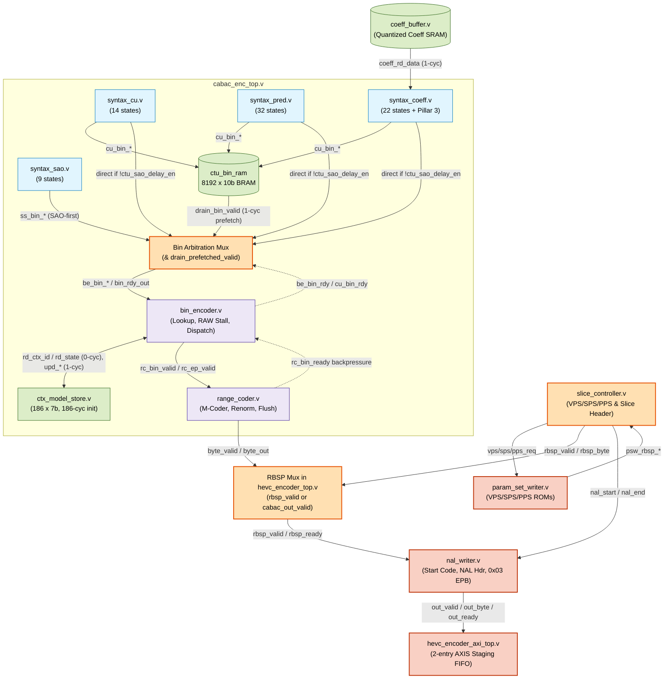

---

## 2. `cabac_enc_top.v` — Bin Arbitration, `ctu_bin_ram` Drain & Top-Level CABAC Sequencer

`cabac_enc_top.v` ([`rtl/entropy/cabac_enc_top.v`](file:///d:/UIT_Doc/hevc_hw_encoder/rtl/entropy/cabac_enc_top.v)) has no monolithic `state` register of its own; instead it implements (1) combinational HEVC Clause 8.4.2 intra MPM derivation (`cand0..cand2`, sorted `s0..s2`, `prev_intra_luma_flag`, `intra_mpm_idx`, `intra_rem_mode` at L263–307), (2) the **8192 × 10b CTU-delayed bin RAM** with 1-cycle lookahead drain tracking (`drain_prefetched_valid` at L410–473), and (3) dual-mode bin arbitration feeding `bin_encoder` (L475–498). Upstream request sequencing is driven by `cabac_state[3:0]` in [`hevc_encoder_top.v`](file:///d:/UIT_Doc/hevc_hw_encoder/rtl/top/hevc_encoder_top.v#L268-L281) (L3235–3429).

### 2a. `ctu_bin_ram` Drain & Top-Level `cabac_state` Flowchart

```mermaid
flowchart TD
    classDef state fill:#e1f5fe,stroke:#0277bd,stroke-width:1px,color:#000;
    classDef ram fill:#dcedc8,stroke:#33691e,stroke-width:1px,color:#000;
    classDef ctrl fill:#fff9c4,stroke:#fbc02d,stroke-width:1px,color:#000;

    subgraph TOP_FSM ["hevc_encoder_top.v: cabac_state(3:0)"]
        C_IDLE["CABAC_IDLE (0)"]:::state
        C_CU["CABAC_WAIT_CU_DONE (1)"]:::state
        C_PRED["CABAC_WAIT_PRED (2)"]:::state
        C_PREDD["CABAC_WAIT_PRED_DONE (3)"]:::state
        C_COEFF["CABAC_WAIT_COEFF (4)"]:::state
        C_COEFFD["CABAC_WAIT_COEFF_DONE (6)"]:::state
        C_SAOS["CABAC_WAIT_SAO_STATS (10)"]:::state
        C_SAOD["CABAC_WAIT_SAO_DONE (9)"]:::state
        C_DRAIN["CABAC_DRAIN_CTU_BINS (11)<br/>ctu_bin_drain_en = 1"]:::state
        C_TRM["CABAC_TRM_CTU (5)<br/>top_trm_req = !cabac_enc_busy"]:::state

        C_IDLE -->|"trigger_cu"| C_CU
        C_CU -->|"cabac_cu_done &amp;&amp; split"| C_IDLE
        C_CU -->|"cabac_cu_done &amp;&amp; skip &amp;&amp; last_cu"| C_SAOS
        C_CU -->|"cabac_cu_done &amp;&amp; merge"| C_COEFF
        C_CU -->|"cabac_cu_done &amp;&amp; normal"| C_PRED --> C_PREDD
        C_PREDD -->|"cabac_pred_done"| C_COEFF
        C_COEFF -->|"cabac_coeff_ready"| C_COEFFD
        C_COEFFD -->|"cabac_coeff_done &amp;&amp; more TUs"| C_COEFF
        C_COEFFD -->|"cabac_coeff_done &amp;&amp; last_cu &amp;&amp; sao"| C_SAOS
        C_COEFFD -->|"cabac_coeff_done &amp;&amp; last_cu &amp;&amp; !sao"| C_TRM
        C_SAOS -->|"sao_stats_done"| C_SAOD
        C_SAOD -->|"cabac_sao_done"| C_DRAIN
        C_DRAIN -->|"ctu_bin_drain_done &amp;&amp; !enc_busy"| C_TRM
        C_TRM -->|"!cabac_enc_busy"| C_IDLE
    end

    subgraph BIN_RAM ["cabac_enc_top.v: ctu_bin_ram (8192 x 10b)"]
        WR["Write Path:<br/>bin_ram_we = delay_en &amp;&amp; cu_bin_valid &amp;&amp; cu_bin_rdy<br/>ctu_bin_ram(bin_wr_ptr) &le; (ep, val, ctx)"]:::ram
        PRE["Lookahead Prefetch:<br/>bin_rd_addr_mux = drain_bin_fire ? rd_ptr+1 : rd_ptr<br/>bin_ram_rdata_q &le; ctu_bin_ram(bin_rd_addr_mux)<br/>drain_prefetched_valid &le; (bin_rd_addr_mux &lt; bin_wr_ptr)"]:::ctrl
        ARB["Arbitration Output (be_bin_*):<br/>if delay_en: ss_bin_valid &gt; drain_bin_valid<br/>else: cu_bin_valid (sc &gt; sp &gt; sf) &gt; ss_bin_valid"]:::ctrl
        WR --> PRE --> ARB
    end
```

### 2b. Register, Storage & `cabac_state` Encoding Table

| Register / Localparam | Module | Width / Encoding | Responsibility & Latency |
|:---|:---|:---:|:---|
| `ctu_bin_ram [0:8191]` | `cabac_enc_top` | `8192 × 10b` | Synchronous Block RAM (`M10K` / `block`). Stores `{cu_bin_is_ep[9], cu_bin_value[8], cu_bin_ctx_id[7:0]}`. 1-cycle synchronous read latency. |
| `bin_wr_ptr` | `cabac_enc_top` | `reg [12:0]` | Next write slot (`0..8191`). Cleared on `!rst_n` or `slice_init \|\| trm_req`. |
| `bin_rd_ptr` | `cabac_enc_top` | `reg [12:0]` | Current drain read slot (`0..8191`). Advances on `drain_bin_fire`. |
| `bin_ram_rdata_q` | `cabac_enc_top` | `reg [9:0]` | Registered BRAM read word at `bin_rd_addr_mux` (1-cycle read pipeline). |
| `drain_prefetched_valid` | `cabac_enc_top` | `reg` (1b) | High iff `bin_ram_rdata_q` holds committed RAM data from `(bin_rd_addr_mux < bin_wr_ptr)`. |
| `CABAC_IDLE` | `hevc_encoder_top` | `4'd0` | Waits for `trigger_cu` to assert `wire_cu_req`. |
| `CABAC_WAIT_CU_DONE` | `hevc_encoder_top` | `4'd1` | Waits for `cabac_cu_done` from `syntax_cu`. |
| `CABAC_WAIT_PRED` | `hevc_encoder_top` | `4'd2` | 1-cycle state asserting `wire_pred_req` to `syntax_pred`. |
| `CABAC_WAIT_PRED_DONE` | `hevc_encoder_top` | `4'd3` | Waits for `cabac_pred_done` from `syntax_pred`. |
| `CABAC_WAIT_COEFF` | `hevc_encoder_top` | `4'd4` | Waits for `cabac_coeff_ready` (`quant_out_last`) to pulse `wire_coeff_req`. |
| `CABAC_TRM_CTU` | `hevc_encoder_top` | `4'd5` | Waits for `!cabac_enc_busy`, asserts `top_trm_req` (`top_trm_bin_val = is_last_slice_ctu`), returns to `CABAC_IDLE`. |
| `CABAC_WAIT_COEFF_DONE` | `hevc_encoder_top` | `4'd6` | Waits for `cabac_coeff_done`; loops to `CABAC_WAIT_COEFF` for remaining TUs or exits to CTU end. |
| `CABAC_WAIT_SAO_DONE` | `hevc_encoder_top` | `4'd9` | Clears `cabac_sao_req_r`, waits for `cabac_sao_done` from `syntax_sao`. |
| `CABAC_WAIT_SAO_STATS` | `hevc_encoder_top` | `4'd10` | Waits for `sao_stats_done_latched \|\| inloop_sao_stats_done`, pulses `cabac_sao_req_r`. |
| `CABAC_DRAIN_CTU_BINS` | `hevc_encoder_top` | `4'd11` | Drives `ctu_bin_drain_en = 1` until `cabac_bin_drain_done && !cabac_enc_busy`. |
| *(Reserved unused slots)* | `hevc_encoder_top` | `4'd7`, `4'd8` | Formerly `CABAC_TRM_SLICE` (`4'd7`) / `CABAC_FLUSH` (`4'd8`), removed in remediation; slice termination uses `CABAC_TRM_CTU` with `is_last_slice_ctu`, and `flush_req` is pulsed by `cabac_flush_state` timer (`2'd2`, `cabac_idle_timer == 99`). |

### 2c. Control & Arbitration Condition Table

| Signal / Action | Guard Condition | Effect |
|:---|:---|:---|
| `bin_ram_we` | `eff_ctu_sao_delay_en && cu_bin_valid && cu_bin_rdy` | Writes `{cu_bin_is_ep, cu_bin_value, cu_bin_ctx_id}` at `bin_wr_ptr`; increments `bin_wr_ptr`. |
| `cu_bin_rdy` | `eff_ctu_sao_delay_en ? (bin_wr_ptr < 13'd8191) : be_bin_rdy` | Backpressures `syntax_cu`/`pred`/`coeff` when RAM reaches 8191 entries (`delay_en=1`) or directly from `bin_encoder` (`delay_en=0`). |
| `drain_bin_valid` | `eff_ctu_sao_delay_en && eff_ctu_bin_drain_en && !ss_bin_valid && (bin_rd_ptr < bin_wr_ptr) && drain_prefetched_valid` | Presents `bin_ram_rdata_q` to `bin_encoder`. |
| `drain_bin_fire` | `drain_bin_valid && be_bin_rdy` | Increments `bin_rd_ptr <= bin_rd_ptr + 1`; sets `bin_rd_addr_mux = bin_rd_ptr + 1` for zero-bubble prefetch. |
| `ctu_bin_drain_done` | `eff_ctu_sao_delay_en ? (eff_ctu_bin_drain_en && !(bin_rd_ptr < bin_wr_ptr) && !bin_ram_we) : 1'b1` | Signals all CTU-buffered bins have been drained to `bin_encoder`. |
| `be_bin_*` mux | `eff_ctu_sao_delay_en == 1` | Strict priority `ss_bin_valid` (SAO) > `drain_bin_valid` (CTU RAM). |
| `be_bin_*` mux | `eff_ctu_sao_delay_en == 0` | Direct priority `sc_bin_valid` > `sp_bin_valid` > `sf_bin_valid` > `ss_bin_valid`. |
| Pointer reset | `!rst_n \|\| slice_init \|\| trm_req` | Resets `bin_wr_ptr`, `bin_rd_ptr`, `drain_prefetched_valid` to `0`. |

### 2d. Reset, Backpressure & Corner-Case Behavior

- **4-State Safe Control Signals:** `eff_ctu_sao_delay_en = (ctu_sao_delay_en === 1'b1)` and `eff_ctu_bin_drain_en = (ctu_bin_drain_en === 1'b1)` prevent unknown (`X`/`Z`) control inputs in unit testbenches from enabling the CTU delay queue.
- **1-Cycle Lookahead Prefetch Alignment (`drain_prefetched_valid`):** Because `bin_ram_rdata_q` reads `ctu_bin_ram[bin_rd_addr_mux]` synchronously on `posedge clk`, if `bin_wr_ptr` writes address `0` at cycle $T$, `bin_ram_rdata_q` at $T+1$ still holds stale RAM data from before the write. `drain_prefetched_valid <= (bin_rd_addr_mux < bin_wr_ptr)` evaluates `0 < 0` (false) at $T$, `0 < 1` (true) at $T+1$, so `drain_prefetched_valid` rises at $T+2$ — the exact cycle `bin_ram_rdata_q` holds the committed RAM word at `bin_rd_ptr`. On every accepted beat (`drain_bin_fire`), `bin_rd_addr_mux` advances to `bin_rd_ptr + 1` in the same cycle `bin_rd_ptr` increments, sustaining **1 bin/cycle** throughput without bubbles. When `be_bin_rdy == 0`, `drain_bin_fire == 0`, holding `bin_rd_addr_mux = bin_rd_ptr` so `bin_ram_rdata_q` preserves the stalled bin.
- **Capacity Guard (`bin_wr_ptr < 13'd8191`):** Usable depth is 8,191 bins per CTU; at `8191`, `cu_bin_rdy` drops to `0` (emitting a simulation warning at L513–515) to prevent 13-bit pointer wraparound.
- **SAO Backpressure Port:** `syntax_sao` receives `be_bin_rdy` directly (L406) instead of `cu_bin_rdy`, allowing SAO parameters to stream straight into `bin_encoder` while `coding_quadtree()` bins wait in `ctu_bin_ram`.
- **`enc_busy` Coverage:** Asserted while `(eff_ctu_sao_delay_en ? (drain_bin_valid | ss_bin_valid) : (cu_bin_valid | ss_bin_valid)) | ctx_init_busy | rc_coder_busy`. Note that in `CABAC_DRAIN_CTU_BINS`, `hevc_encoder_top` waits for `cabac_bin_drain_done && !cabac_enc_busy` before firing `trm_req`, ensuring `bin_encoder` and `range_coder` finish the last drained bin before `trm_req` resets `bin_wr_ptr`/`bin_rd_ptr`.

---

## 3. `ctx_model_store.v` — 186-Context Model Store & Init Sequencer

[`rtl/entropy/ctx_model_store.v`](file:///d:/UIT_Doc/hevc_hw_encoder/rtl/entropy/ctx_model_store.v) stores **186 × 7-bit** probability states (`ctx 0..185`, `N_CTX = 186`, `CTX_W = 7`, `CTX_ID_W = 8`) in `ctx_mem[0:185]`, where bit `[6:1]` is `pStateIdx` (`0..62`) and bit `[0]` is `valMPS`.

### 3a. Init & Update Sequencer Flowchart

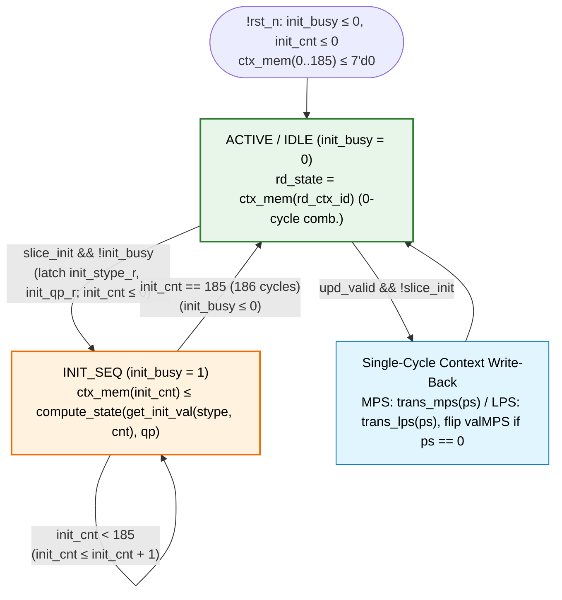

### 3b. Sequencer Register & Context Map Table

| Register / Block | Encoding / Range | Responsibility & Latency |
|:---|:---|:---|
| `init_busy` | `1'b0` (Active/Idle), `1'b1` (186-cycle Init) | Gates `bin_encoder.bin_rdy_out` and blocks `upd_valid` writes during slice context initialization. |
| `init_cnt` | `reg [7:0]` (`8'd0..8'd185`) | Iterates one context index per cycle across `0..185` (`N_CTX = 186` cycles total). |
| `init_stype_r` | `reg [1:0]` (`0=B, 1=P, 2=I`) | Latched `slice_type` at `slice_init`; maps `2'd0 -> iv_B`, `2'd1 -> iv_P`, `default -> iv_I` in `get_init_val()`. |
| `init_qp_r` | `reg [6:0]` (`0..51`) | Latched `qp_in` used in `compute_state()` (`initState = clamp(((slope * qp) >>> 4) + offset, 1, 126)`). |
| `ctx_mem [0:185]` | `186 × 7-bit` (`{pStateIdx[5:0], valMPS}`) | 1,302 total state bits. Combinational read (`rd_state = ctx_mem[rd_ctx_id]`, 0-cycle); registered write-back (1-cycle). |
| Context Index Map (`0..185`) | `0..2` Split, `3..5` Skip, `6` Merge, `7` MergeIdx, `8..11` Part, `12` PredMode, `13` IntraPrev, `14..15` IntraChroma, `16..18` DeltaQP, `19..23` InterDir, `24..25` RefIdx, `26..27` MVD, `28..37` QT_CBF, `38..40` TransSubdiv, `41` QTRootCBF, `42..45` CodedSubBlk, `46..89` SigCoeff, `90..119` LastXPre, `120..149` LastYPre, `150..173` GT1, `174..179` GT2, `180` MVP, `181` SAOMerge, `182` SAOType, `183..184` TransSkip, `185` TransquantBypass | 186 total entries initialized from [`init_tables.vh`](file:///d:/UIT_Doc/hevc_hw_encoder/rtl/common/init_tables.vh) (151 active non-CNU entries + 35 unused HM CNU default slots; 146 indices statically referenced by `syntax_*` across `0..182`). |

### 3c. Transition & Guard Condition Table

| Current Mode | Guard Condition | Next Mode / Action |
|:---|:---|:---|
| `init_busy == 0` | `slice_init == 1'b1` | Latch `init_stype_r <= slice_type`, `init_qp_r <= qp_in`, `init_cnt <= 8'd0`, `init_busy <= 1'b1`. |
| `init_busy == 1` | `init_cnt < 8'd185` | Compute and write `ctx_mem[init_cnt]`; `init_cnt <= init_cnt + 1`. |
| `init_busy == 1` | `init_cnt == 8'd185` | Compute and write `ctx_mem[185]`; `init_busy <= 1'b0`. |
| `init_busy == 0` | `!slice_init && upd_valid` | Read `ps = ctx_mem[upd_ctx_id][6:1]`, `mps = ctx_mem[upd_ctx_id][0]`; write `{trans_mps(ps), mps}` if `upd_bin == mps`, else `{trans_lps(ps), (ps == 0) ? ~mps : mps}`. |

### 3d. Reset, Backpressure & Corner-Case Behavior

- **Asynchronous Cold Reset (`!rst_n`):** Clears `init_busy <= 0`, `init_cnt <= 0`, and initializes all 186 entries of `ctx_mem[0:185]` to `7'd0` (`pStateIdx=0, valMPS=0`).
- **`slice_init` During Init:** Because the condition is `if (slice_init && !init_busy)`, a second `slice_init` pulse while `init_busy == 1` is ignored (emitting a simulation warning at L270–271).
- **Update Suppression During Init:** `else if (init_busy)` precedes `else if (upd_valid)`, preventing stale write-backs from corrupting newly initialized contexts, while `init_busy` simultaneously stalls `bin_encoder`.
- **Slice-Type Polarity (`REMEDIATION`):** Under `` `define REMEDIATION ``, `slice_type` follows HEVC Table 7-23 (`0=B, 1=P, 2=I`), matching `get_init_val()` (`2'd0 -> iv_B, 2'd1 -> iv_P, default -> iv_I`).

---

## 4. `bin_encoder.v` — Context Lookup, RAW Hazard Stall & Dispatch Stage

[`rtl/entropy/bin_encoder.v`](file:///d:/UIT_Doc/hevc_hw_encoder/rtl/entropy/bin_encoder.v) implements a 2-phase bin dispatch pipeline: a combinational `ACCEPT` stage (forwarding regular or EP bins to `range_coder` in cycle $T$) paired with a 1-cycle registered `UPDATE` stage (driving `upd_valid` write-back to `ctx_model_store` at cycle $T+1$).

### 4a. Dispatch & RAW Hazard Pipeline Flowchart

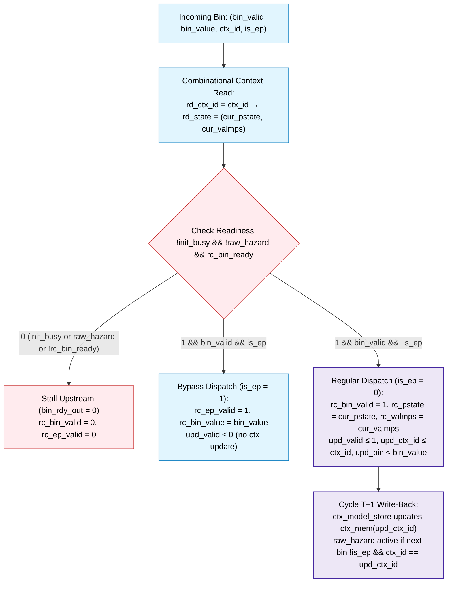

### 4b. Register & Combinational Interface Table

| Signal / Register | Width / Type | Responsibility & Latency |
|:---|:---:|:---|
| `rd_ctx_id` / `rd_state` | `8b` out / `7b` in | Combinational (0-cycle) lookup into `ctx_model_store`; extracts `cur_pstate = rd_state[6:1]`, `cur_valmps = rd_state[0]`. |
| `raw_hazard` | `wire` (1b) | `!is_ep && upd_valid && (ctx_id == upd_ctx_id)`. Enforces a 1-cycle stall when consecutive regular bins hit the same `ctx_id`. |
| `bin_rdy_out` | `wire` (1b) | `!init_busy && !raw_hazard && rc_bin_ready`. Propagated upstream as `be_bin_rdy`. |
| `rc_bin_valid`, `rc_ep_valid` | `reg` (comb. `always @*`) | Mutually exclusive 0-cycle combinational strobes asserted when `bin_valid && bin_rdy_out`. |
| `upd_valid`, `upd_ctx_id`, `upd_bin` | `reg` (`1b`, `8b`, `1b`) | Registered on `posedge clk` for accepted regular bins (`!is_ep`), driving `ctx_model_store` write-back on cycle $T+1$ (auto-clears after 1 cycle). |

### 4c. Dispatch & Stall Condition Table

| Condition | `bin_rdy_out` | `rc_bin_valid` / `rc_ep_valid` | Registered Action (`posedge clk`) |
|:---|:---:|:---:|:---|
| `init_busy == 1` | `0` | `0 / 0` | `upd_valid <= 0` (stalls until 186-cycle init finishes). |
| `!is_ep && upd_valid && (ctx_id == upd_ctx_id)` | `0` | `0 / 0` | `upd_valid <= 0` (1-cycle RAW bubble while `ctx_mem[upd_ctx_id]` commits). |
| `rc_bin_ready == 0` | `0` | `0 / 0` | `upd_valid <= 0` (`range_coder` busy in renorm/writeout/flush). |
| `bin_valid && bin_rdy_out && is_ep` | `1` | `0 / 1` | `upd_valid <= 0` (bypass bin, no context model update). |
| `bin_valid && bin_rdy_out && !is_ep` | `1` | `1 / 0` | `upd_valid <= 1`, `upd_ctx_id <= ctx_id`, `upd_bin <= bin_value`. |

### 4d. Reset, Backpressure & Corner-Case Behavior

- **RAW Hazard Timing (`bin_encoder.v`):** Because `ctx_model_store` executes its write on `posedge clk` of cycle $T+1$ (from `upd_valid` latched at cycle $T$), `ctx_mem[K]` still holds the pre-update state during cycle $T+1$. Consequently, RTL asserts `raw_hazard` (`!is_ep && upd_valid && (ctx_id == upd_ctx_id)`) to insert a **1-cycle stall** before the second consecutive regular bin to context `K` is dispatched (`bin_rdy_out = !init_busy && !raw_hazard && rc_bin_ready`, aligned with the updated header comments in `bin_encoder.v`).
- **EP Throughput:** Equiprobable bypass bins (`is_ep == 1`) neither assert `upd_valid` nor check `raw_hazard`, sustaining **1 bin/cycle** whenever `rc_bin_ready == 1`.
- **Reset (`!rst_n`):** Clears `upd_valid <= 0`, `upd_ctx_id <= 0`, `upd_bin <= 0`.

---

## 5. `syntax_cu.v` — CU-Level CABAC Syntax FSM (`state[4:0]`, 14 States)

[`rtl/entropy/syntax_cu.v`](file:///d:/UIT_Doc/hevc_hw_encoder/rtl/entropy/syntax_cu.v) serializes CU-level syntax (`split_cu_flag`, `cu_skip_flag`, `merge_flag`, `merge_idx`, `pred_mode_flag`, `part_mode`) into 1 bin per cycle (`bin_valid` driven combinationally by `always @*` from `state`).

### 5a. `syntax_cu` FSM Flowchart

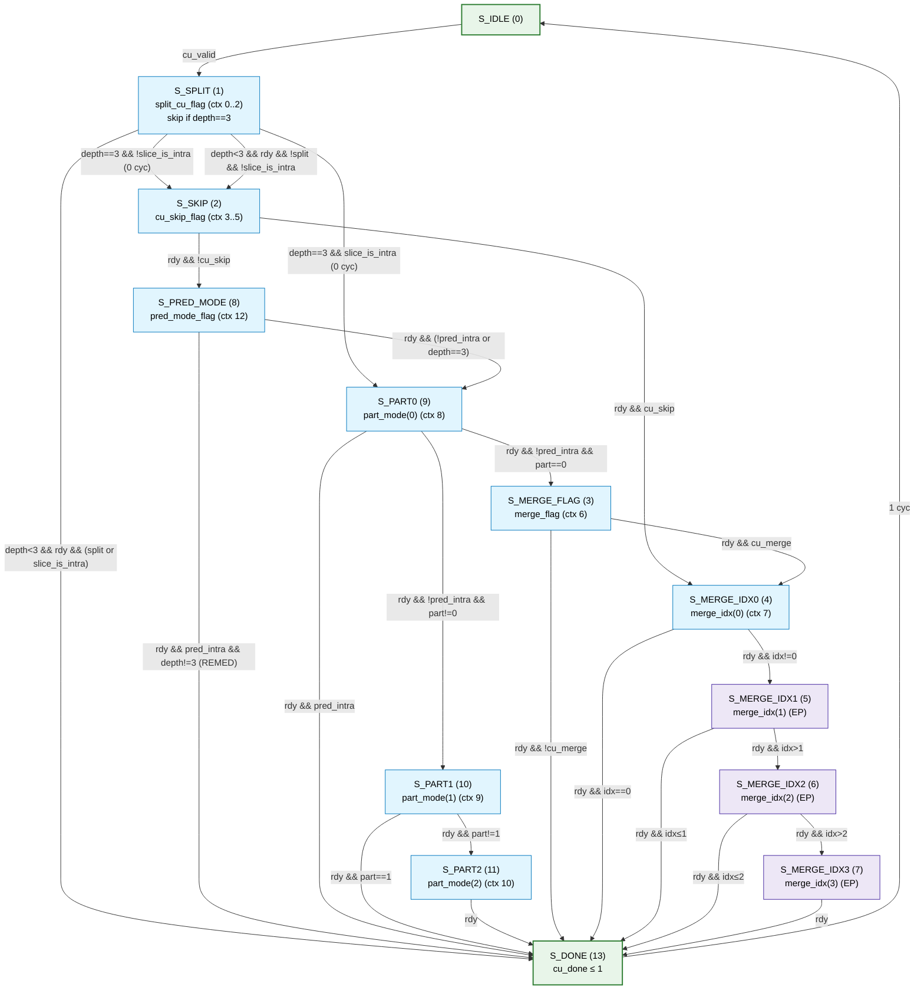

### 5b. State Encoding & Responsibility Table

| State (`localparam [4:0]`) | Encoding | Bin Syntax / Context ID (`is_ep`) | Latency (cycles) | Responsibility |
|:---|:---:|:---|:---:|:---|
| `S_IDLE` | `5'd0` | `bin_valid=0` | `>= 1` | Waits for `cu_valid` pulse. |
| `S_SPLIT` | `5'd1` | `cu_is_split`, ctx `0 + cu_split_ctx` (`0..2`, `is_ep=0`) | `1` (or `0` at depth 3) | Emits `split_cu_flag` if `cu_depth != 2'd3`; skipped with `bin_valid=0` at `cu_depth == 3`. |
| `S_SKIP` | `5'd2` | `cu_skip`, ctx `3 + cu_skip_ctx` (`3..5`, `is_ep=0`) | `1` | Emits `cu_skip_flag` (inter slices only). |
| `S_MERGE_FLAG` | `5'd3` | `cu_merge`, ctx `6` (`is_ep=0`) | `1` | Emits `merge_flag` after `part_mode = 2Nx2N`. |
| `S_MERGE_IDX0` | `5'd4` | `cu_merge_idx != 0`, ctx `7` (`is_ep=0`) | `1` | First bin of truncated unary `merge_idx`. |
| `S_MERGE_IDX1` | `5'd5` | `cu_merge_idx > 1` (`is_ep=1`) | `1` | Second bin of `merge_idx` (EP bypass). |
| `S_MERGE_IDX2` | `5'd6` | `cu_merge_idx > 2` (`is_ep=1`) | `1` | Third bin of `merge_idx` (EP bypass). |
| `S_MERGE_IDX3` | `5'd7` | `cu_merge_idx > 3` (`is_ep=1`) | `1` | Fourth bin of `merge_idx` (EP bypass, `cMax=4`). |
| `S_PRED_MODE` | `5'd8` | `cu_pred_intra`, ctx `12` (`is_ep=0`) | `1` | Emits `pred_mode_flag` (`0=inter, 1=intra`). |
| `S_PART0` | `5'd9` | `cu_part_mode == 0`, ctx `8` (`is_ep=0`) | `1` | Emits `part_mode` bin 0 (`2Nx2N=1`). |
| `S_PART1` | `5'd10` | `cu_part_mode == 1`, ctx `9` (`is_ep=0`) | `1` | Emits `part_mode` bin 1 (`2NxN=1`). |
| `S_PART2` | `5'd11` | `cu_part_mode == 2`, ctx `10` (`is_ep=0`) | `1` | Emits `part_mode` bin 2 (`Nx2N=1, NxN=0`) (`5'd12` reserved; `rqt_root_cbf` handled in `syntax_coeff.v`). |
| `S_DONE` | `5'd13` | `bin_valid=0`, `cu_done <= 1` | `1` | Pulses `cu_done` for 1 clock and returns to `S_IDLE`. |

### 5c. Transition & Guard Condition Table

| Current State | Guard Condition | Next State |
|:---|:---|:---|
| `S_IDLE` | `cu_valid` | `S_SPLIT` |
| `S_SPLIT` | `cu_depth == 2'd3` | `slice_is_intra ? S_PART0 : S_SKIP` (no `bin_rdy` check) |
| `S_SPLIT` | `cu_depth != 2'd3 && bin_rdy && (cu_is_split \|\| slice_is_intra)` | `S_DONE` |
| `S_SPLIT` | `cu_depth != 2'd3 && bin_rdy && !cu_is_split && !slice_is_intra` | `S_SKIP` |
| `S_SKIP` | `bin_rdy` | `cu_skip ? S_MERGE_IDX0 : S_PRED_MODE` |
| `S_MERGE_FLAG` | `bin_rdy` | `cu_merge ? S_MERGE_IDX0 : S_DONE` |
| `S_MERGE_IDX0` | `bin_rdy` | `(cu_merge_idx == 3'd0) ? S_DONE : S_MERGE_IDX1` |
| `S_MERGE_IDX1` | `bin_rdy` | `(cu_merge_idx <= 3'd1) ? S_DONE : S_MERGE_IDX2` |
| `S_MERGE_IDX2` | `bin_rdy` | `(cu_merge_idx <= 3'd2) ? S_DONE : S_MERGE_IDX3` |
| `S_MERGE_IDX3` | `bin_rdy` | `S_DONE` |
| `S_PRED_MODE` | `bin_rdy` (`REMEDIATION`) | `(cu_pred_intra && cu_depth != 2'd3) ? S_DONE : S_PART0` |
| `S_PRED_MODE` | `bin_rdy` (`!REMEDIATION`) | `cu_pred_intra ? S_DONE : S_PART0` |
| `S_PART0` | `bin_rdy && cu_pred_intra` | `S_DONE` |
| `S_PART0` | `bin_rdy && !cu_pred_intra && cu_part_mode == 2'd0` | `S_MERGE_FLAG` |
| `S_PART0` | `bin_rdy && !cu_pred_intra && cu_part_mode != 2'd0` | `S_PART1` |
| `S_PART1` | `bin_rdy` | `(cu_part_mode == 2'd1) ? S_DONE : S_PART2` |
| `S_PART2` | `bin_rdy` | `S_DONE` |
| `S_DONE` | Unconditional | `S_IDLE` (`cu_done <= 1'b1`) |

### 5d. Reset, Backpressure & Corner-Case Behavior

- **Asynchronous Reset (`!rst_n`):** Sets `state <= S_IDLE`, `cu_done <= 0`. Inputs (`cu_depth`, `cu_is_split`, etc.) are NOT latched inside `syntax_cu`; caller must hold them stable from `cu_valid` through `cu_done`.
- **Backpressure (`bin_rdy`):** Every bin-emitting state stalls in place until `bin_rdy == 1`. At `cu_depth == 2'd3`, `S_SPLIT` sets `bin_valid = 0` and transitions **without** checking `bin_rdy`.
- **`REMEDIATION` Intra `part_mode` Fix:** At `cu_depth == 3` (`8×8` CU), HEVC codes `part_mode` even for intra CUs; under `REMEDIATION`, `S_PRED_MODE` enters `S_PART0` when `cu_pred_intra && cu_depth == 2'd3` (whereas legacy skipped `S_PART0` for all intra CUs in inter slices).
- **Context ID Authority:** The `localparam` constants (`CTX_SKIP_0=3`, `CTX_MERGE=6`, `CTX_MERGE_IDX=7`, `CTX_PART_0=8..10`, `CTX_PRED=12`) match [`ctx_model_store.v`](file:///d:/UIT_Doc/hevc_hw_encoder/rtl/entropy/ctx_model_store.v#L33-L38) and override the stale header comments at L40–46 of `syntax_cu.v`.

---

## 6. `syntax_pred.v` — Prediction Syntax FSM (`state[4:0]`, 32 States)

[`rtl/entropy/syntax_pred.v`](file:///d:/UIT_Doc/hevc_hw_encoder/rtl/entropy/syntax_pred.v) uses all 32 encodings (`5'd0..5'd31`) of `state[4:0]` to encode either intra prediction modes (`S_INTRA_PREV`..`S_INTRA_CHROMA`) or inter prediction syntax (`inter_dir`, `ref_idx`, interleaved `mvd_coding`, `mvp_flag`) for L0 and (in B-slice Bi-pred) L1.

### 6a. `syntax_pred` FSM Flowchart

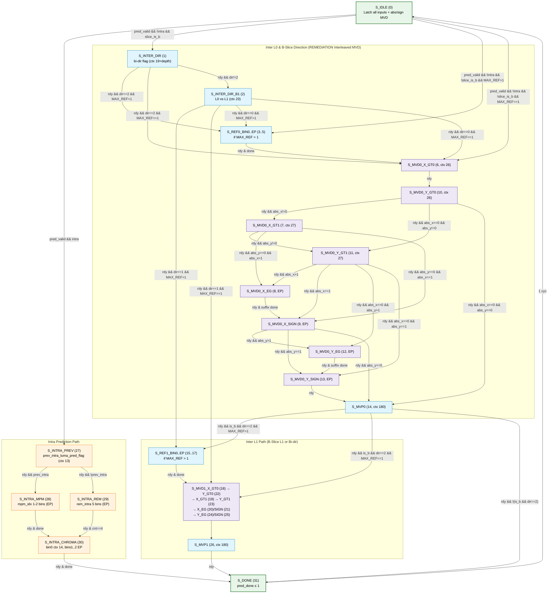

### 6b. State Encoding & Responsibility Table

| State (`localparam [4:0]`) | Encoding | Bin Value / Context ID (`is_ep`) | Cycle Latency | Responsibility |
|:---|:---:|:---|:---:|:---|
| `S_IDLE` | `5'd0` | `bin_valid=0` | `>= 1` | Latches prediction inputs, computes `abs_mvd_*` and `sign_mvd_*` on `pred_valid`. |
| `S_INTER_DIR` | `5'd1` | `inter_dir_r == 2`, ctx `19 + depth_r` (`19..22`, `is_ep=0`) | `1` | First `inter_pred_idc` bin (Bi-dir flag in B-slices). |
| `S_INTER_DIR_B1` | `5'd2` | `inter_dir_r == 1`, ctx `23` (`is_ep=0`) | `1` | Second `inter_pred_idc` bin (`0=L0, 1=L1`). |
| `S_REF0_BIN0` / `S_REF1_BIN0` | `5'd3` / `5'd15` | `ref_lX_r != 0`, ctx `24` (`is_ep=0`) | `1` | First unary bin of `ref_idx_l0/l1` (skipped when `MAX_REF == 1`). |
| `S_REF0_BIN1` / `S_REF1_BIN1` | `5'd4` / `5'd16` | `ref_lX_r > 1`, ctx `25` (`is_ep=0`) | `1` | Second unary bin of `ref_idx_l0/l1`. |
| `S_REF0_EP` / `S_REF1_EP` | `5'd5` / `5'd17` | `ref_ep_cnt < ref_ep_refidx` (`is_ep=1`) | `1..6` | Remaining truncated unary EP bins for `ref_idx >= 2`. |
| `S_MVD0_X_GT0` / `S_MVD1_X_GT0` | `5'd6` / `5'd18` | `abs_mvd_lX_x != 0`, ctx `26` (`is_ep=0`) | `1` | `abs_mvd_greater0_flag` for X component. |
| `S_MVD0_X_GT1` / `S_MVD1_X_GT1` | `5'd7` / `5'd19` | `abs_mvd_lX_x > 1`, ctx `27` (`is_ep=0`) | `1` | `abs_mvd_greater1_flag` for X component. |
| `S_MVD0_X_EG` / `S_MVD1_X_EG` | `5'd8` / `5'd20` | Prefix `(eg_symbol >= eg_count)` then suffix MSB-first (`is_ep=1`) | `2..24` | Order-1 Exp-Golomb for `abs_mvd_minus2` (X). |
| `S_MVD0_X_SIGN` / `S_MVD1_X_SIGN` | `5'd9` / `5'd21` | `sign_mvd_lX_x` (`is_ep=1`) | `1` | Sign bit of X MVD (`1` = negative). |
| `S_MVD0_Y_GT0` / `S_MVD1_Y_GT0` | `5'd10` / `5'd22` | `abs_mvd_lX_y != 0`, ctx `26` (`is_ep=0`) | `1` | `abs_mvd_greater0_flag` for Y component. |
| `S_MVD0_Y_GT1` / `S_MVD1_Y_GT1` | `5'd11` / `5'd23` | `abs_mvd_lX_y > 1`, ctx `27` (`is_ep=0`) | `1` | `abs_mvd_greater1_flag` for Y component. |
| `S_MVD0_Y_EG` / `S_MVD1_Y_EG` | `5'd12` / `5'd24` | Order-1 Exp-Golomb (`is_ep=1`) | `2..24` | Order-1 Exp-Golomb for `abs_mvd_minus2` (Y). |
| `S_MVD0_Y_SIGN` / `S_MVD1_Y_SIGN` | `5'd13` / `5'd25` | `sign_mvd_lX_y` (`is_ep=1`) | `1` | Sign bit of Y MVD. |
| `S_MVP0` / `S_MVP1` | `5'd14` / `5'd26` | `mvp_lX_r`, ctx `180` (`is_ep=0`) | `1` | `mvp_l0_flag` / `mvp_l1_flag` (coded after MVD per HEVC). |
| `S_INTRA_PREV` | `5'd27` | `prev_intra_r`, ctx `13` (`is_ep=0`) | `1` | `prev_intra_luma_pred_flag`. |
| `S_INTRA_MPM` | `5'd28` | `mpm_idx` truncated unary via `eg_symbol` `0..1` (`is_ep=1`) | `1..2` | Bin 0: `mpm_idx != 0`; bin 1: `mpm_idx == 2`. |
| `S_INTRA_REM` | `5'd29` | `rem_intra_r[4 - eg_symbol]`, `eg_symbol=0..4` (`is_ep=1`) | `5` | 5-bit fixed-length `rem_intra_luma_pred_mode` MSB-first. |
| `S_INTRA_CHROMA` | `5'd30` | `eg_symbol=0`: `chroma_mode_r != 4` ctx `14` (`is_ep=0`); `1..2`: `chroma_mode_r[2 - eg_symbol]` (`is_ep=1`) | `1` or `3` | `intra_chroma_pred_mode` (`DM_CHROMA=4` is 1 bin `0`; modes `0..3` are 3 bins). |
| `S_DONE` | `5'd31` | `bin_valid=0`, `pred_done <= 1` | `1` | Pulses `pred_done` for 1 cycle and returns to `S_IDLE`. |

### 6c. Transition & Guard Condition Table

| Current State | Guard Condition | Next State |
|:---|:---|:---|
| `S_IDLE` | `pred_valid && cu_pred_intra` | `S_INTRA_PREV` |
| `S_IDLE` | `pred_valid && !cu_pred_intra` | `slice_is_b ? S_INTER_DIR : (MAX_REF > 1 ? S_REF0_BIN0 : S_MVD0_X_GT0)` |
| `S_INTER_DIR` | `bin_rdy` | `(inter_dir_r == 2'd2) ? (MAX_REF > 1 ? S_REF0_BIN0 : S_MVD0_X_GT0) : S_INTER_DIR_B1` |
| `S_INTER_DIR_B1` | `bin_rdy` | `(inter_dir_r == 2'd1) ? (MAX_REF > 1 ? S_REF1_BIN0 : S_MVD1_X_GT0) : (MAX_REF > 1 ? S_REF0_BIN0 : S_MVD0_X_GT0)` |
| `S_REF0_BIN0` / `1_BIN0` | `bin_rdy` | `(ref_lX_r == 0) ? S_MVDX_X_GT0 : S_REFX_BIN1` |
| `S_REF0_BIN1` / `1_BIN1` | `bin_rdy` | `(ref_lX_r <= 1) ? S_MVDX_X_GT0 : S_REFX_EP` (`ref_ep_cnt <= 2`) |
| `S_REF0_EP` / `1_EP` | `bin_rdy && ref_ep_cnt >= ref_ep_refidx` | `S_MVDX_X_GT0` (else increment `ref_ep_cnt`) |
| `S_MVDX_X_GT0` | `bin_rdy` (`REMEDIATION`) | `S_MVDX_Y_GT0` (legacy `else`: `(abs_x == 0) ? S_MVDX_Y_GT0 : S_MVDX_X_GT1`) |
| `S_MVDX_Y_GT0` | `bin_rdy` (`REMEDIATION`) | `abs_x != 0` &rarr; `S_MVDX_X_GT1`; else `abs_y != 0` &rarr; `S_MVDX_Y_GT1`; else `S_MVPX` |
| `S_MVDX_X_GT1` | `bin_rdy` (`REMEDIATION`) | `abs_y != 0` &rarr; `S_MVDX_Y_GT1`; else `abs_x > 1` &rarr; `S_MVDX_X_EG` (`eg_count <= 2`); else `S_MVDX_X_SIGN` |
| `S_MVDX_Y_GT1` | `bin_rdy` (`REMEDIATION`) | If `abs_x != 0`: (`abs_x > 1` ? `S_MVDX_X_EG` : `S_MVDX_X_SIGN`); else (`abs_y > 1` ? `S_MVDX_Y_EG` : `S_MVDX_Y_SIGN`) |
| `S_MVDX_X_EG` / `Y_EG` | `bin_rdy && !eg_in_suffix` | If `eg_symbol >= eg_count`: `eg_symbol -= eg_count`, `eg_count <<= 1`; else `eg_suffix_cnt <= eg_count_log2`, `eg_in_suffix <= 1` |
| `S_MVDX_X_EG` / `Y_EG` | `bin_rdy && eg_in_suffix` | Decrement `eg_suffix_cnt`; when `eg_suffix_cnt <= 1` &rarr; `S_MVDX_X_SIGN` / `Y_SIGN` |
| `S_MVDX_X_SIGN` | `bin_rdy` (`REMEDIATION`) | `abs_y > 1` &rarr; `S_MVDX_Y_EG`; else `abs_y != 0` &rarr; `S_MVDX_Y_SIGN`; else `S_MVPX` |
| `S_MVDX_Y_SIGN` | `bin_rdy` | `S_MVPX` |
| `S_MVP0` | `bin_rdy` | `(is_b_r && inter_dir_r == 2'd2) ? (MAX_REF > 1 ? S_REF1_BIN0 : S_MVD1_X_GT0) : S_DONE` |
| `S_MVP1` | `bin_rdy` | `S_DONE` |
| `S_INTRA_PREV` | `bin_rdy` | `eg_symbol <= 0`; `prev_intra_r ? S_INTRA_MPM : S_INTRA_REM` |
| `S_INTRA_MPM` | `bin_rdy` | `(eg_symbol == 0 && mpm_idx_r == 0) \|\| (eg_symbol != 0)` &rarr; `S_INTRA_CHROMA` (`eg_symbol <= 0`), else `eg_symbol <= 1` |
| `S_INTRA_REM` | `bin_rdy` | `(eg_symbol == 4)` &rarr; `S_INTRA_CHROMA` (`eg_symbol <= 0`), else `eg_symbol <= eg_symbol + 1` |
| `S_INTRA_CHROMA` | `bin_rdy` | `(eg_symbol == 0 && chroma_mode_r == 4) \|\| (eg_symbol == 2)` &rarr; `S_DONE`, else `eg_symbol <= eg_symbol + 1` |
| `S_DONE` | Unconditional | `S_IDLE` (`pred_done <= 1'b1`) |

### 6d. Reset, Backpressure & Corner-Case Behavior

- **Asynchronous Reset (`!rst_n`):** Resets `state <= S_IDLE`, `pred_done <= 0`, and clears all latched MVD/EG/ref/intra registers (note `pred_intra_r`, `prev_intra_r`, `mpm_idx_r`, `rem_intra_r`, `chroma_mode_r` are freshly loaded whenever `pred_valid` fires with `cu_pred_intra == 1`).
- **Default `MAX_REF = 1` Bypass:** In `cabac_enc_top.v` / `hevc_encoder_top.v`, `syntax_pred` uses the default `MAX_REF = 1`, which compiles out transitions into `S_REF0_*` and `S_REF1_*` (`num_ref_idx_lX_active_minus1 == 0` in HEVC).
- **`REMEDIATION` Interleaved MVD Order:** Under `REMEDIATION`, `syntax_pred` interleaves `mvd_coding()` bins (`x_gt0 -> y_gt0 -> x_gt1 -> y_gt1 -> x_eg/sign -> y_eg/sign`) matching HEVC Section 7.3.8.6, whereas legacy (`!REMEDIATION`) emits all X bins before Y bins.
- **4-State Safe MVD Latching & EG Order 1:** At `S_IDLE` (L471–478), `abs_mvd_*` uses `=== 1'b1` and `^mvd === 1'bx` guards to treat unknown MVDs safely as `0`. Exp-Golomb order-1 initializes `eg_count <= 12'd2` so `eg_count_log2 >= 1`, guaranteeing at least 1 suffix bit in `S_MVD*_EG`.
- **Context IDs:** `CTX_INTER_DIR_BASE=19`, `CTX_REF_IDX_0=24`, `CTX_REF_IDX_1=25`, `CTX_MVD_GT0=26`, `CTX_MVD_GT1=27`, `CTX_MVP_FLAG=180`, `S_INTRA_PREV=13`, `S_INTRA_CHROMA[0]=14` match `ctx_model_store.v` directly.

---

## 7. `syntax_coeff.v` — Residual & Coefficient Group Scan FSM (`state[4:0]` + `c1_state[1:0]`)

[`rtl/entropy/syntax_coeff.v`](file:///d:/UIT_Doc/hevc_hw_encoder/rtl/entropy/syntax_coeff.v) encodes TU-level CBF/split stubs, `last_sig_coeff_x/y`, and reverse-diagonal/horizontal/vertical 4×4 Coefficient Group (CG) passes (`coded_sub_block_flag`, `sig_coeff_flag`, `greater1`, `greater2`, `sign`, and Rice/Exp-Golomb `remaining`) across 4×4, 8×8, 16×16, and 32×32 TUs.

### 7a. `syntax_coeff` FSM Flowchart

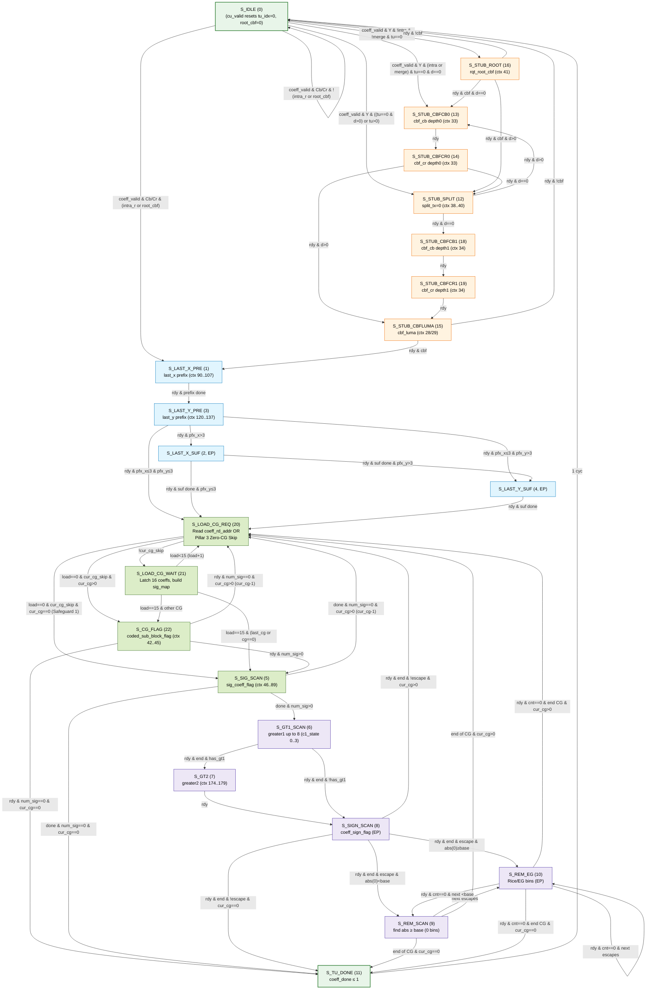

### 7b. State Encoding, `c1_state` & Context Table

| State / Reg | Encoding | Context IDs / Output (`is_ep`) | Cycle Latency | Responsibility |
|:---|:---:|:---|:---:|:---|
| `S_IDLE` | `5'd0` | `bin_valid=0` | `>= 1` | Latches TU params (`eff_last_x/y`, `last_cg_idx`, `max_pfx_len`); routes Luma vs Chroma. |
| `S_LAST_X_PRE` | `5'd1` | Ctx `90..104` (Y) / `105..107` (C), `is_ep=0` | `1..9` | Truncated unary prefix of `last_sig_x_r` (`max_pfx_len = tu_size_log2 * 2`). |
| `S_LAST_X_SUF` | `5'd2` | `suf_val[suf_cnt]`, `is_ep=1` | `1..3` | Fixed-length EP suffix for `last_pfx_x > 3` (`suf_len = (last_pfx_x - 2) >> 1`). |
| `S_LAST_Y_PRE` | `5'd3` | Ctx `120..134` (Y) / `135..137` (C), `is_ep=0` | `1..9` | Truncated unary prefix of `last_sig_y_r`. |
| `S_LAST_Y_SUF` | `5'd4` | `suf_val[suf_cnt]`, `is_ep=1` | `1..3` | Fixed-length EP suffix for `last_pfx_y > 3`. |
| `S_SIG_SCAN` | `5'd5` | Ctx `46..73` (Y) / `74..89` (C), `is_ep=0` | `1..16` | Reverse scan `scan_ptr` down to `0`; suppresses `bin_valid` on inferred-1 positions. |
| `S_GT1_SCAN` | `5'd6` | Ctx `150 + 4*ctx_set + c1_state` (Y) / `166 + 4*ctx_set + c1_state` (C) | `1..8` | Codes up to 8 `greater1` bins (`gt1_ptr < 8`) and updates `c1_state`. |
| `S_GT2` | `5'd7` | Ctx `174 + ctx_set` (Y) / `178 + ctx_set` (C) | `1` | Codes `greater2` for `first_gt1_idx` when any coeff in CG had `abs > 1`. |
| `S_SIGN_SCAN` | `5'd8` | `sig_val_list[sign_ptr][15]`, `is_ep=1` | `1..16` | Emits sign bit for each non-zero coeff in active CG (`0..cg_num_sig-1`). |
| `S_REM_SCAN` | `5'd9` | `bin_valid=0` | `1..16` | Scans `rem_ptr` without emitting bins until an escaping coeff or CG end. |
| `S_REM_EG` | `5'd10` | `rem_val[rem_cnt]`, `is_ep=1` | `>= 1` | Emits Rice/Exp-Golomb remaining-level bins (`calc_rice_eg`, `MAX_RICE=4`). |
| `S_TU_DONE` | `5'd11` | `bin_valid=0`, `coeff_done <= 1` | `1` | Increments `tu_idx` when `comp_r == 2` (Cr), pulses `coeff_done`, returns to `S_IDLE`. |
| `S_STUB_SPLIT` | `5'd12` | `bin_value=0`, ctx `38..40` | `1` | Emits `split_transform_flag = 0`. |
| `S_STUB_CBFCB0` | `5'd13` | `bin_value=1`, ctx `33` | `1` | Stubs `cbf_cb = 1` at TU depth 0. |
| `S_STUB_CBFCR0` | `5'd14` | `bin_value=1`, ctx `33` | `1` | Stubs `cbf_cr = 1` at TU depth 0. |
| `S_STUB_CBFLUMA` | `5'd15` | `bin_value=cbf_r`, ctx `28` (`d==0`) / `29` (`d>0`) | `1` | Emits `cbf_luma`; skips to `S_IDLE` (`coeff_done<=1`) if `0`. |
| `S_STUB_ROOT` | `5'd16` | `bin_value=cbf_r`, ctx `41` | `1` | Emits `rqt_root_cbf` for non-intra non-merge first TU (`tu_idx == 0`). |
| *(Unassigned)* | `5'd17` | — | — | Unused state encoding gap between `S_STUB_ROOT` and `S_STUB_CBFCB1`. |
| `S_STUB_CBFCB1` | `5'd18` | `bin_value=1`, ctx `34` | `1` | Stubs `cbf_cb = 1` at TU depth 1. |
| `S_STUB_CBFCR1` | `5'd19` | `bin_value=1`, ctx `34` | `1` | Stubs `cbf_cr = 1` at TU depth 1. |
| `S_LOAD_CG_REQ` | `5'd20` | `coeff_rd_en`, `coeff_rd_addr = {cur_cg, load_cnt}` | `16` reads (`1` on Pillar 3 skip) | Drives SRAM read address or executes 1-cycle zero-CG fast-skip (`cur_cg_skip`). |
| `S_LOAD_CG_WAIT` | `5'd21` | `bin_valid=0` | `16` per active CG | Captures `coeff_rd_data`; on `load_cnt==15` builds `cg_sig_map`, `sig_*_list`, `ctx_set`, `cg_flags`. |
| `S_CG_FLAG` | `5'd22` | `cg_num_sig != 0`, ctx `42..43` (Y) / `44..45` (C) | `1` | Emits `coded_sub_block_flag` and updates `cg_flags[raster(cur_cg)]`. |
| `c1_state` | `reg [1:0]` | Context offset `0..3` for `S_GT1_SCAN` | Reset `2'd1` per CG | Resets to `1` at `S_SIG_SCAN` exit. On `abs > 1`: `c1_state <= 0`; on `abs == 1` with `0 < c1_state < 3`: `c1_state <= c1_state + 1` (`1 -> 2 -> 3`). |
| `ctx_set` | `reg [1:0]` | `0..3` (Y), `0..1` (Cb/Cr) | Latched per CG | Y: `(cur_cg > 0 ? 2 : 0) + prev_cg_had_gt1`; Cb/Cr: `{1'b0, prev_cg_had_gt1}`. |

### 7c. Transition & Guard Condition Table

| Current State | Guard Condition | Next State |
|:---|:---|:---|
| *(Any state)* | `cu_valid` | Resets `tu_idx <= 0`, `cu_root_cbf_latched <= 0`, `cu_depth_r <= cu_depth`. |
| `S_IDLE` | `coeff_valid && comp_id == 0 && !is_intra && !is_merge && tu_idx == 0` | `S_STUB_ROOT` |
| `S_IDLE` | `coeff_valid && comp_id == 0 && (is_intra \|\| is_merge) && tu_idx == 0` | `cu_root_cbf_latched <= 1`; `(cu_depth_r == 0) ? S_STUB_CBFCB0 : S_STUB_SPLIT` |
| `S_IDLE` | `coeff_valid && comp_id == 0 && tu_idx != 0` | `S_STUB_SPLIT` |
| `S_IDLE` | `coeff_valid && comp_id != 0` | `(is_intra_r \|\| cu_root_cbf_latched) ? S_LAST_X_PRE : S_IDLE` (`coeff_done<=1`, `tu_idx+1` if Cr) |
| `S_STUB_ROOT` | `bin_rdy` | `cbf_r` &rarr; `cu_root_cbf_latched<=1`, `(d==0 ? S_STUB_CBFCB0 : S_STUB_SPLIT)`; `!cbf_r` &rarr; `S_IDLE` (`coeff_done<=1`, `tu_idx+1`) |
| `S_STUB_CBFCB0` / `CR0` | `bin_rdy` | `S_STUB_CBFCB0` &rarr; `S_STUB_CBFCR0` &rarr; `(cu_depth_r == 0 ? S_STUB_SPLIT : S_STUB_CBFLUMA)` |
| `S_STUB_SPLIT` | `bin_rdy` | `(cu_depth_r == 0) ? S_STUB_CBFCB1 : S_STUB_CBFCB0` |
| `S_STUB_CBFCB1` / `CR1` | `bin_rdy` | `S_STUB_CBFCB1` &rarr; `S_STUB_CBFCR1` &rarr; `S_STUB_CBFLUMA` |
| `S_STUB_CBFLUMA` | `bin_rdy` | `cbf_r ? S_LAST_X_PRE : S_IDLE` (`coeff_done<=1` when `!cbf_r`) |
| `S_LAST_X_PRE` | `bin_rdy && !((pfx_cnt+1 < last_pfx_x) \|\| (pfx_cnt < last_pfx_x && last_pfx_x < max_pfx_len-1))` | `S_LAST_Y_PRE` (`pfx_cnt <= 0`; else `pfx_cnt <= pfx_cnt + 1`) |
| `S_LAST_Y_PRE` | `bin_rdy && prefix done` | `(last_pfx_x > 3) ? S_LAST_X_SUF : (last_pfx_y > 3) ? S_LAST_Y_SUF : S_LOAD_CG_REQ` |
| `S_LAST_X_SUF` | `bin_rdy && suf_cnt == 0` | `(last_pfx_y > 3) ? S_LAST_Y_SUF : S_LOAD_CG_REQ` |
| `S_LAST_Y_SUF` | `bin_rdy && suf_cnt == 0` | `S_LOAD_CG_REQ` (`load_cnt <= 0`) |
| `S_LOAD_CG_REQ` | `(load_cnt == 0) && cur_cg_skip` (`REMEDIATION`) | `(cur_cg == 0) ? S_SIG_SCAN : S_CG_FLAG` (1-cycle fast-skip; sets `cg_flags` if `cur_cg == 0`) |
| `S_LOAD_CG_REQ` | Else | `S_LOAD_CG_WAIT` |
| `S_LOAD_CG_WAIT` | `load_cnt < 4'd15` | `load_cnt <= load_cnt + 1`, `S_LOAD_CG_REQ` |
| `S_LOAD_CG_WAIT` | `load_cnt == 4'd15` | `(cur_cg == last_cg_idx \|\| cur_cg == 0) ? S_SIG_SCAN : S_CG_FLAG` |
| `S_CG_FLAG` | `bin_rdy` | `cg_num_sig != 0` &rarr; `S_SIG_SCAN`; else `(cur_cg > 0) ? S_LOAD_CG_REQ (cur_cg-1) : S_TU_DONE` |
| `S_SIG_SCAN` | `bin_rdy \|\| inferred_1_pos` | If `scan_ptr > 0` decrement; else `(cg_num_sig > 0) ? S_GT1_SCAN : (cur_cg > 0 ? S_LOAD_CG_REQ : S_TU_DONE)` |
| `S_GT1_SCAN` | `bin_rdy && end of GT1 (gt1_ptr+1 == cg_num_sig \|\| gt1_ptr == 7)` | `(first_gt1_found \|\| cur > 1) ? S_GT2 : S_SIGN_SCAN` |
| `S_GT2` | `bin_rdy` | `S_SIGN_SCAN` (`sign_ptr <= 0`) |
| `S_SIGN_SCAN` | `bin_rdy && sign_ptr + 1 == cg_num_sig` | `!escape_data_present` &rarr; next CG / `S_TU_DONE`; else `abs(0) >= base(0)` &rarr; `S_REM_EG` else `S_REM_SCAN` |
| `S_REM_SCAN` | `rem_ptr + 1 < cg_num_sig` | `abs(rem_ptr+1) >= base` &rarr; `S_REM_EG`; else stay in `S_REM_SCAN` |
| `S_REM_SCAN` | `rem_ptr + 1 >= cg_num_sig` | `(cur_cg > 0) ? S_LOAD_CG_REQ (cur_cg-1) : S_TU_DONE` |
| `S_REM_EG` | `bin_rdy && rem_cnt == 0` | Inspect `rem_ptr+1`: escape &rarr; `S_REM_EG`, no escape &rarr; `S_REM_SCAN`, CG end &rarr; next CG / `S_TU_DONE` |
| `S_TU_DONE` | Unconditional | `S_IDLE` (`coeff_done <= 1`, `tu_idx <= tu_idx + 1` if `comp_r == 2`) |

### 7d. Pillar 3 Zero-CG Safeguards, Backpressure & Corner Cases

Under `REMEDIATION`, `syntax_coeff` and `hevc_encoder_top` accelerate zero-subblock scanning in 1 cycle per empty AC CG (`cur_cg_skip`) using **all four mandatory Pillar 3 Zero-CG safeguards**:

1. **Safeguard 1 — DC Sub-Block (`cur_cg == 0`) Inferred `coded_sub_block_flag = 1` Entering `S_SIG_SCAN` ([`syntax_coeff.v`](file:///d:/UIT_Doc/hevc_hw_encoder/rtl/entropy/syntax_coeff.v#L1070-L1080)):** In HEVC Clause 7.3.8.11, `coded_sub_block_flag` is never coded for CG 0 (DC sub-block) and is always inferred `1`. When `(load_cnt == 0) && cur_cg_skip` hits with `cur_cg == 6'd0`, `S_LOAD_CG_REQ` marks `cg_flags` at the DC raster location as `1'b1` and transitions directly to `S_SIG_SCAN` (emitting 16 `sig_coeff_flag = 0` bins) instead of entering `S_CG_FLAG`. Only `cur_cg > 0` transitions to `S_CG_FLAG` to emit `coded_sub_block_flag = 0`.
2. **Safeguard 2 — Three Per-CU Component Masks ([`hevc_encoder_top.v`](file:///d:/UIT_Doc/hevc_hw_encoder/rtl/top/hevc_encoder_top.v#L3172-L3225)):** Separate registers `tu_cg_nonzero_mask_y [63:0]`, `tu_cg_nonzero_mask_cb [15:0]`, and `tu_cg_nonzero_mask_cr [15:0]` prevent cross-component mask interference across Y, Cb, and Cr TUs. `trigger_leaf_cu` clears all three masks, whereas `CABAC_WAIT_COEFF_DONE && cabac_coeff_done` clears only the finished component's mask (`reg_tu_comp`), and `cabac_tu_cg_nonzero_mask` selects the active component mask.
3. **Safeguard 3 — Scan-Order Indexing ([`hevc_encoder_top.v`](file:///d:/UIT_Doc/hevc_hw_encoder/rtl/top/hevc_encoder_top.v#L3207-L3211), [`syntax_coeff.v`](file:///d:/UIT_Doc/hevc_hw_encoder/rtl/entropy/syntax_coeff.v#L928-L929)):** `quant_out_scan_idx` is generated in active scan order (`0` = diagonal, `1` = horizontal, `2` = vertical). `hevc_encoder_top` sets bits using `quant_out_scan_idx[9:4]` (Y, `0..63`) and `quant_out_scan_idx[7:4]` (Cb/Cr, `0..15`), directly matching `last_cg_idx <= last_sig_pos >> 4` and `cur_cg` in `syntax_coeff`. Meanwhile, `cg_flags` neighbor-context lookups still convert scan-order `cur_cg` into raster coordinates via `get_cg_raster(tu_size_log2_r, get_cg_col(..., scan_mode_r), get_cg_row(..., scan_mode_r))`.
4. **Safeguard 4 — `tu_cg_mask_en` Default-Ones Guard ([`syntax_coeff.v`](file:///d:/UIT_Doc/hevc_hw_encoder/rtl/entropy/syntax_coeff.v#L411-L421)):** Under simulation (`!SYNTHESIS`), `eff_tu_cg_mask_en = (tu_cg_mask_en === 1'b1)`, `eff_tu_cg_mask = eff_tu_cg_mask_en ? tu_cg_nonzero_mask : 64'hFFFF_FFFF_FFFF_FFFF`, and `cur_cg_skip = eff_tu_cg_mask_en && (cur_cg != last_cg_idx) && (eff_tu_cg_mask[cur_cg] === 1'b0)` (with 2-state equivalents under `SYNTHESIS`). Standalone unit testbenches leaving `tu_cg_mask_en` low or unconnected (`X`/`Z`) fall back to all-ones and read all CGs from SRAM, and `cur_cg != last_cg_idx` prevents ever skipping the last significant CG.

**Additional Corner Cases:**
- **Inferred `sig_coeff_flag` Suppression:** In `S_SIG_SCAN` (L717–721, L1179), `bin_valid` is suppressed and `bin_rdy` is bypassed when `(cur_cg == last_cg_idx && scan_ptr == last_sig_pos_r[3:0])` (last significant coeff is inferred `1`) or `(cur_cg > 0 && scan_ptr == 0 && cg_sig_map[15:1] == 0)` (position 0 of a non-zero AC CG is inferred `1` if bits `15:1` are all zero).
- **Empty Last-CG Defensive Guard:** In `S_LOAD_CG_WAIT` (L1122–1127), if `v_num_sig == 0 && cur_cg == last_cg_idx`, `syntax_coeff` forces `v_sig_map[0]=1, v_pos_list[0]=0, v_val_list[0]=1, v_num_sig=1` to keep downstream `S_GT1_SCAN`/`S_SIGN_SCAN` consistent.
- **Zero-Cycle Scan in `S_REM_SCAN`:** `S_REM_SCAN` outputs `bin_valid = 0` and steps `rem_ptr` once per clock independent of `bin_rdy`.

---

## 8. `syntax_sao.v` — SAO Syntax FSM (`state[3:0]`, 9 States)

[`rtl/entropy/syntax_sao.v`](file:///d:/UIT_Doc/hevc_hw_encoder/rtl/entropy/syntax_sao.v) implements ITU-T H.265 Clause 7.3.8.3 SAO syntax per CTU using **registered** bin outputs (`bin_valid`, `bin_value`, `bin_ctx_id`, `bin_is_ep`). In RTL, `cur_type` encodes `0=OFF`, `1=EO`, and `2=BO`.

### 8a. `syntax_sao` FSM Flowchart

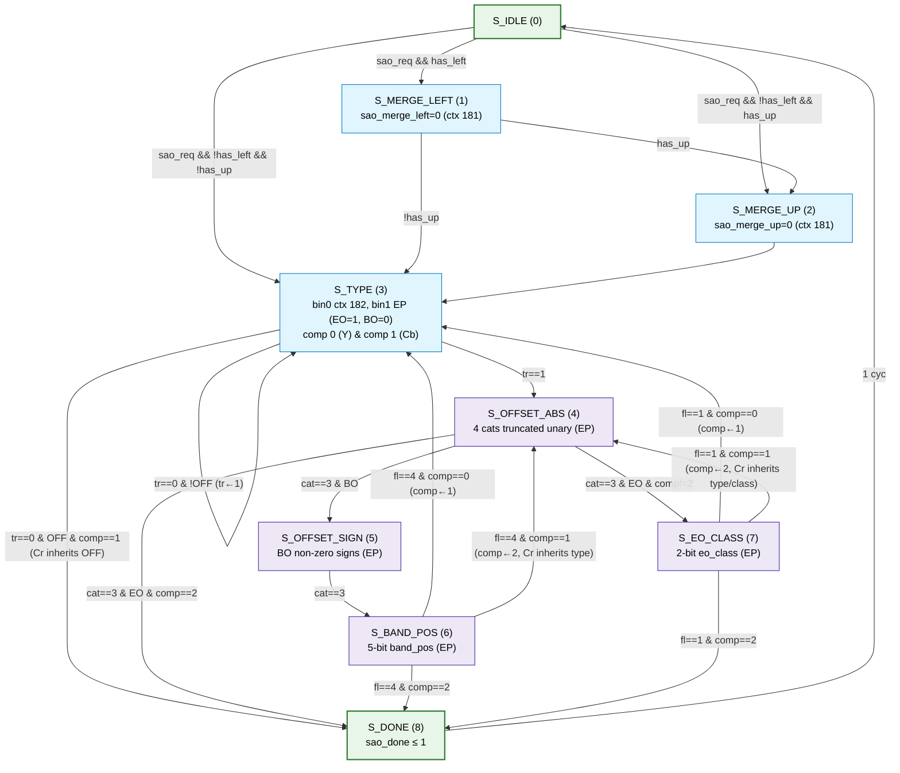

*(All non-`S_IDLE`/`S_DONE` transitions above advance only when `!(bin_valid && !bin_rdy)`.)*

### 8b. State Encoding & Responsibility Table

| State (`localparam`) | Encoding | Bin Output / Context ID (`is_ep`) | Cycle Latency | Responsibility |
|:---|:---:|:---|:---:|:---|
| `S_IDLE` | `4'd0` | `bin_valid <= 0` | `>= 1` | Waits for `sao_req`; resets `cur_comp`, `cur_cat`, `tr_count`, `fl_count`. |
| `S_MERGE_LEFT` | `4'd1` | `0`, ctx `181` (`is_ep=0`) | `1` | Emits `sao_merge_left_flag = 0` when `has_left == 1`. |
| `S_MERGE_UP` | `4'd2` | `0`, ctx `181` (`is_ep=0`) | `1` | Emits `sao_merge_up_flag = 0` when `has_up == 1`. |
| `S_TYPE` | `4'd3` | `tr_count==0`: `cur_type!=0` ctx `182` (`is_ep=0`); `tr_count==1`: `cur_type==1` (`is_ep=1`) | `1` (OFF) or `2` (EO/BO) | Codes `sao_type_idx_luma` (`comp 0`) or `sao_type_idx_chroma` (`comp 1`; Cr inherits Cb). |
| `S_OFFSET_ABS` | `4'd4` | Truncated unary `cMax=31` (`is_ep=1`) | `4..128` | Emits 4 category magnitudes (`cur_cat = 0..3`) for active `cur_comp`. |
| `S_OFFSET_SIGN` | `4'd5` | `sign_offset` if `abs_offset != 0` (`is_ep=1`), else `bin_valid<=0` | `4` | BO only: emits sign bit for each non-zero offset across `cur_cat = 0..3`. |
| `S_BAND_POS` | `4'd6` | `cur_band_pos[4 - fl_count]` (`is_ep=1`) | `5` | BO only: 5-bit fixed-length band start position MSB-first. |
| `S_EO_CLASS` | `4'd7` | `cur_eo_class[1 - fl_count]` (`is_ep=1`) | `2` | EO only (`comp 0` or `1`): 2-bit `sao_eo_class` MSB-first (Cr inherits Cb). |
| `S_DONE` | `4'd8` | `bin_valid <= 0`, `sao_done <= 1` | `1` | Pulses `sao_done` for 1 cycle and returns to `S_IDLE`. |

### 8c. Transition & Guard Condition Table

| Current State | Guard Condition | Next State & Counter Updates |
|:---|:---|:---|
| *(Active stall)* | `bin_valid && !bin_rdy` | Holds `state` and all registered bin outputs unchanged. |
| `S_IDLE` | `sao_req` | `has_left` &rarr; `S_MERGE_LEFT`; else `has_up` &rarr; `S_MERGE_UP`; else `S_TYPE`. |
| `S_MERGE_LEFT` | `!(bin_valid && !bin_rdy)` | `has_up ? S_MERGE_UP : S_TYPE`. |
| `S_MERGE_UP` | `!(bin_valid && !bin_rdy)` | `S_TYPE`. |
| `S_TYPE` | `tr_count == 0 && cur_type == 0` | `cur_comp == 0` &rarr; `cur_comp <= 1`, stay `S_TYPE`; else (`comp 1`) &rarr; `S_DONE`. |
| `S_TYPE` | `tr_count == 0 && cur_type != 0` | `tr_count <= 1`, stay `S_TYPE`. |
| `S_TYPE` | `tr_count != 0` | `cur_cat <= 0`, `tr_count <= 0`, `S_OFFSET_ABS`. |
| `S_OFFSET_ABS` | `tr_count < abs_offset` | `tr_count <= tr_count + 1` (emits `1`). |
| `S_OFFSET_ABS` | `tr_count >= abs_offset && cur_cat < 3` | `tr_count <= 0`, `cur_cat <= cur_cat + 1`. |
| `S_OFFSET_ABS` | `tr_count >= abs_offset && cur_cat == 3` | `tr_count <= 0`, `cur_cat <= 0`; if `EO`: `(comp != 2 ? S_EO_CLASS : S_DONE)`; else (`BO`): `S_OFFSET_SIGN`. |
| `S_OFFSET_SIGN` | `cur_cat == 3` | `fl_count <= 0`, `S_BAND_POS` (else `cur_cat <= cur_cat + 1`). |
| `S_BAND_POS` | `fl_count == 3'd4` | `comp==0` &rarr; `comp<=1, S_TYPE`; `comp==1` &rarr; `comp<=2, S_OFFSET_ABS`; `comp==2` &rarr; `S_DONE`. |
| `S_EO_CLASS` | `fl_count == 3'd1` | `comp==0` &rarr; `comp<=1, S_TYPE`; `comp==1` &rarr; `comp<=2, S_OFFSET_ABS`; `comp==2` &rarr; `S_DONE`. |
| `S_DONE` | `!(bin_valid && !bin_rdy)` | `sao_done <= 1`, `S_IDLE`. |

### 8d. Reset, Backpressure & Corner-Case Behavior

- **Registered Output Backpressure:** Because `bin_valid` and payload registers are synchronous, `syntax_sao` freezes all state/counter registers whenever `bin_valid && !bin_rdy` (1-cycle pipeline latency from state transition to `bin_valid == 1`).
- **4-State Safe Neighbor Check:** `has_left = (|ctu_x === 1'b1)` and `has_up = (|ctu_y === 1'b1)` ensure unconnected testbench `ctu_x`/`ctu_y` ports evaluate to `0` rather than `X`.
- **Chroma Inheritance & EO Offset Layout:** Cr (`cur_comp == 2`) inherits Cb's `sao_type_idx` (and `eo_class` for EO), jumping directly from `Cb`'s `S_BAND_POS`/`S_EO_CLASS` to `S_OFFSET_ABS` (or from `Cb`'s `OFF` directly to `S_DONE`). In `eo_offset[74:0]`, `cur_cat = 0..3` maps to categories 1, 2, 3, 4 (skipping the 5-bit `cat2` slot `[14:10]`, `[39:35]`, `[64:60]`, which is always 0).
- **Zero-Offset BO Sign Skipping:** In `S_OFFSET_SIGN`, when `abs_offset == 0`, `bin_valid <= 0` skips emitting a sign bin in 1 cycle without waiting for `bin_rdy` once `bin_valid` is clear.

---

## 9. `range_coder.v` — M-Coder Arithmetic Engine (`state[3:0]` + `ret_state[3:0]`, 9 States)

[`rtl/entropy/range_coder.v`](file:///d:/UIT_Doc/hevc_hw_encoder/rtl/entropy/range_coder.v) executes HEVC M-coder arithmetic interval subdivision (`g_aucLPSTable[64][4]`), Leading-Zero-Count LPS renormalization (`renorm_shift_lzc`), buffered-byte carry resolution (`0xFF` counter `num_ff`), terminating bins (`trm_valid`), and slice-end bit flushing (`flush_valid`).

### 9a. `range_coder` FSM Flowchart

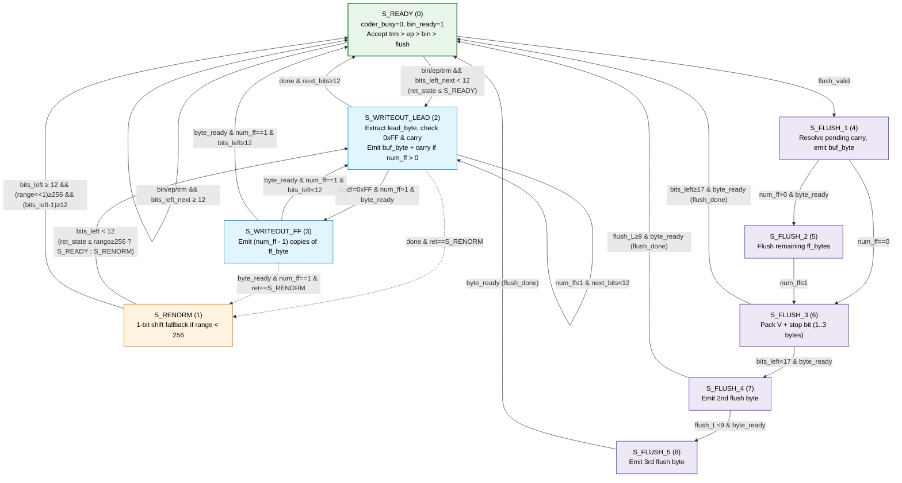

*(Synchronous `coder_init == 1` in any state immediately resets `state <= S_READY`, `range_r <= 510`, `low_r <= 0`, `bits_left <= 23`, `buf_byte <= 8'hFF`, `num_ff <= 0`, `bin_ready <= 1`.)*

### 9b. State Encoding & Register Table

| State (`localparam [3:0]`) / Reg | Encoding / Width | Responsibility & Latency |
|:---|:---:|:---|
| `S_READY` | `4'd0` | `coder_busy=0`; processes `trm_valid`, `ep_valid`, `bin_valid`, or `flush_valid` in 1 cycle (triggers `S_WRITEOUT_LEAD` if `bits_left_next < 12`). |
| `S_RENORM` | `4'd1` | Shifts `range_r`/`low_r` by 1 bit/cycle until `range_r >= 256` (defensive fallback; `S_READY` already normalizes MPS in 1 cycle and LPS via `renorm_shift_lzc` in 1 cycle). |
| `S_WRITEOUT_LEAD` | `4'd2` | Extracts 9-bit `lead_byte = (low_r >> (24 - bits_left[5:0])) & 9'h1FF`; buffers `0xFF` or outputs `buf_byte + carry` (`1` cycle per byte + `byte_ready` wait). |
| `S_WRITEOUT_FF` | `4'd3` | Emits `num_ff - 1` carry-resolved `ff_byte` (`0x00` or `0xFF`) bytes (`1` cycle per byte + `byte_ready` wait). |
| `S_FLUSH_1` | `4'd4` | Checks final carry (`low_r >> (32 - bits_left[5:0])`); outputs `buf_byte + carry` if `num_ff > 0`. |
| `S_FLUSH_2` | `4'd5` | Drains remaining `num_ff - 1` `ff_byte` bytes before final bits. |
| `S_FLUSH_3` | `4'd6` | Appends stop bit `1` to remaining `V` (`bits_left` determines 1, 2, or 3 output bytes); emits byte 0. |
| `S_FLUSH_4` | `4'd7` | Emits 2nd flush byte (`ff_byte`); completes flush if `flush_L >= 9`. |
| `S_FLUSH_5` | `4'd8` | Emits 3rd flush byte (`flush_extra_byte`) when `flush_L < 9`; asserts `flush_done <= 1` and re-inits coder. |
| `ret_state` | `reg [3:0]` | Return target (`S_READY` or `S_RENORM`) after `S_WRITEOUT_LEAD`/`S_WRITEOUT_FF` finishes. |
| `range_r`, `low_r` | `reg [8:0]`, `reg [31:0]` | M-coder interval `[256..510]` and base register. |
| `bits_left`, `num_ff` | `reg signed [6:0]`, `reg [15:0]` | Under `REMEDIATION`: 7-bit signed bit counter (init `23`) and 16-bit buffered `0xFF` counter (init `0`). |
| `buf_byte`, `ff_byte`, `flush_extra_byte`, `flush_L` | `8b`, `8b`, `8b`, `5b` | Carry-buffered leading byte (`8'hFF` initial dummy), `0x00`/`0xFF` fill byte, 3rd flush byte, and latched `bits_left[4:0]` across flush states. |

### 9c. Transition & Guard Condition Table

| Current State | Guard Condition | Next State & Key Updates |
|:---|:---|:---|
| *(Any)* | `coder_init` | `S_READY`, `ret_state <= S_READY`, `range_r <= 510`, `low_r <= 0`, `bits_left <= 23`, `buf_byte <= 8'hFF`, `num_ff <= 0`, `bin_ready <= 1`. |
| `S_READY` | `trm_valid && bin_value == 1` | `low_r <= (low_r + range_r - 2) << 7`, `range_r <= 256`, `bits_left -= 7`; if `< 12` &rarr; `S_WRITEOUT_LEAD` (`ret=S_READY`) else `S_READY` (`bin_ready<=1`). |
| `S_READY` | `trm_valid && bin_value == 0` | `new = range_r - 2`; if `< 256` shift 1 bit & check `bits_left - 1 < 12` &rarr; `S_WRITEOUT_LEAD`; else `range_r <= new`. |
| `S_READY` | `ep_valid` | `low_r <= (low_r << 1) + (bin_value ? range_r : 0)`, `bits_left -= 1`; if `< 12` &rarr; `S_WRITEOUT_LEAD` else `S_READY`. |
| `S_READY` | `bin_valid && bin_value == bin_valmps` | `new = range_r - lps`; if `< 256` shift 1 & check `bits_left - 1 < 12` &rarr; `S_WRITEOUT_LEAD`; else `range_r <= new`. |
| `S_READY` | `bin_valid && bin_value != bin_valmps` | `sh = renorm_shift_lzc(lps)` (`1..7`); shift `low_r`, `range_r`; `bits_left -= sh`; if `< 12` &rarr; `S_WRITEOUT_LEAD` else `S_READY`. |
| `S_READY` | `flush_valid` | `bin_ready <= 0`, `S_FLUSH_1`. |
| `S_WRITEOUT_LEAD` | `lead_byte == 9'h0FF` | `num_ff += 1`, `bits_left += 8`; if `next_bits < 12` stay, else `ret_state`. |
| `S_WRITEOUT_LEAD` | `lead_byte != 9'h0FF && num_ff > 0 && byte_valid && byte_ready` | Clears `byte_valid`; if `num_ff > 1` &rarr; `S_WRITEOUT_FF` (`num_ff-1`); else `num_ff<=1` & check `next_bits < 12`. |
| `S_WRITEOUT_LEAD` | `lead_byte != 9'h0FF && num_ff == 0` | Captures first `buf_byte <= lead_byte[7:0]`, `num_ff <= 1` (suppresses dummy `0xFF`); checks `next_bits < 12`. |
| `S_WRITEOUT_FF` | `byte_valid && byte_ready && num_ff == 1` | `num_ff <= 1`; `(bits_left < 12) ? S_WRITEOUT_LEAD : ret_state`. |
| `S_FLUSH_1` | `num_ff > 0 && byte_valid && byte_ready` (or `num_ff == 0`) | `num_ff > 0` &rarr; `S_FLUSH_2`; `num_ff == 0` &rarr; `S_FLUSH_3`. |
| `S_FLUSH_2` | `num_ff <= 1` | `S_FLUSH_3` (while `num_ff > 1`, emits `ff_byte` and decrements `num_ff`). |
| `S_FLUSH_3` | `byte_valid && byte_ready` | If `bits_left >= 17` &rarr; `S_READY` (`flush_done<=1`, reset coder); else &rarr; `S_FLUSH_4`. |
| `S_FLUSH_4` | `byte_valid && byte_ready` | If `flush_L >= 9` &rarr; `S_READY` (`flush_done<=1`, reset coder); else &rarr; `S_FLUSH_5`. |
| `S_FLUSH_5` | `byte_valid && byte_ready` | `S_READY` (`flush_done<=1`, reset coder). |

### 9d. Reset, Backpressure & Corner-Case Behavior

- **Upstream & Downstream Backpressure:** `bin_ready` drops to `0` immediately on the cycle `S_READY` accepts any valid bin/flush request (`trm_valid`, `ep_valid`, `bin_valid`, `flush_valid`), returning to `1` on the next clock if no byte writeout is required, or remaining `0` throughout `S_WRITEOUT_*`, `S_RENORM`, and `S_FLUSH_*`. Whenever `byte_ready == 0`, `S_WRITEOUT_LEAD`, `S_WRITEOUT_FF`, and `S_FLUSH_1..5` hold `byte_valid == 1` and `bin_ready == 0`.
- **`REMEDIATION` Fixes vs Legacy (`!REMEDIATION`):**
  1. `renorm_shift_lzc()` replaces the truncated 32-entry `renorm_table()` (`lps >> 3`), which shifted by 6 instead of 7 when `lps_val < 4` (e.g., `lps_val = 2`), leaving `range_r = 128 < 256`.
  2. `bits_left` is signed 7-bit (`reg signed [6:0]`) instead of unsigned 6-bit, avoiding unsigned underflow wrap when subtracting up to 7 shift bits.
  3. `num_ff` is 16-bit instead of 8-bit, preventing overflow on runs of `>= 256` consecutive `0xFF` bytes.
- **First-Byte Suppression:** At initialization `buf_byte = 8'hFF` and `num_ff = 0`; the first non-`0xFF` `lead_byte` moves into `buf_byte` and sets `num_ff = 1` without emitting the initial dummy `0xFF` byte.

---

## 10. `param_set_writer.v` & `nal_writer.v` — Parameter Sets & Annex B NAL Framing

### 10.1 `param_set_writer.v` (`state[2:0]`, 4 States)

[`rtl/entropy/param_set_writer.v`](file:///d:/UIT_Doc/hevc_hw_encoder/rtl/entropy/param_set_writer.v) streams pre-computed Main10 RBSP ROMs (`vps_rom`, `sps_rom`, `pps_rom`) to `slice_controller` prior to I/CRA slices.

#### 10.1a. `param_set_writer` FSM Flowchart

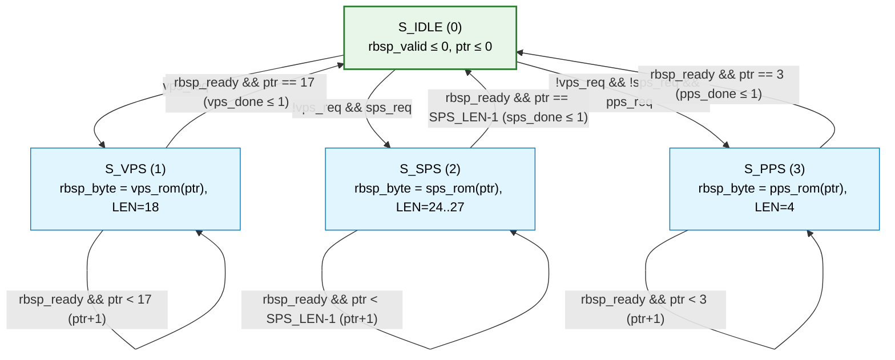

#### 10.1b. State Encoding & Responsibility Table

| State (`localparam`) | Encoding | ROM Source & Length | Cycle Latency | Responsibility |
|:---|:---:|:---|:---:|:---|
| `S_IDLE` | `3'd0` | `rbsp_byte = 8'd0` | `>= 1` | Priority arbitration `vps_req > sps_req > pps_req`; resets `ptr <= 7'd0`. |
| `S_VPS` | `3'd1` | `vps_rom[0:17]` (`VPS_LEN = 18`) | `>= 18` | Streams NAL Type 32 Main10 VPS RBSP bytes; pulses `vps_done`. |
| `S_SPS` | `3'd2` | `sps_rom[0:SPS_LEN-1]` (`24` for 64×64; `25` for 128×128, 256×256; `26` for 1920×1080, 1920×1088; `27` for 3840×2160) | `>= SPS_LEN` | Streams resolution-parameterized NAL Type 33 SPS RBSP bytes; pulses `sps_done`. |
| `S_PPS` | `3'd3` | `pps_rom[0:3]` (`PPS_LEN = 4`) | `>= 4` | Streams NAL Type 34 PPS RBSP bytes (`init_qp=26`); pulses `pps_done`. |

#### 10.1c. Transition & Guard Condition Table

| Current State | Guard Condition | Next State & Outputs |
|:---|:---|:---|
| `S_IDLE` | `vps_req` / `sps_req` / `pps_req` | `S_VPS` / `S_SPS` / `S_PPS` (`ptr <= 7'd0`, priority `vps > sps > pps`). |
| `S_VPS` / `S_SPS` / `S_PPS` | `!rbsp_ready` | Holds `state` and `ptr`; asserts `rbsp_valid <= 1'b1`. |
| `S_VPS` / `S_SPS` / `S_PPS` | `rbsp_ready && ptr < LEN - 1` | `ptr <= ptr + 7'd1`, `rbsp_valid <= 1'b1`. |
| `S_VPS` / `S_SPS` / `S_PPS` | `rbsp_ready && ptr == LEN - 1` | `S_IDLE`, pulses `vps_done`/`sps_done`/`pps_done <= 1'b1`. |

#### 10.1d. Reset, Backpressure & Corner-Case Behavior

- **Elaboration Resolution Guard (L33–40):** `initial` check triggers `$fatal` if `FRAME_WIDTH` is not in `{64, 128, 256, 1920, 3840}` or `FRAME_HEIGHT` is not in `{64, 128, 256, 1080, 1088, 2160}`.
- **`rbsp_last` & `rbsp_valid` Handshake:** `rbsp_last` is always driven `1'b0`; `slice_controller` instead asserts `nal_end <= 1'b1` upon receiving `psw_*_done`. Because `rbsp_valid <= 1'b1` is registered in `S_VPS`/`S_SPS`/`S_PPS` and `nal_writer` deasserts `rbsp_ready` during its 6-cycle start-code + NAL-header preamble, `ptr` never advances before `rbsp_valid` settles. On the cycle `ptr == LEN - 1 && rbsp_ready` transitions to `S_IDLE`, `rbsp_valid <= 1'b1` remains scheduled for 1 cycle while `rbsp_byte` falls back to `8'd0` until `S_IDLE` clears `rbsp_valid <= 1'b0`.

---

### 10.2 `nal_writer.v` (`state[3:0]`, 7 `localparam`s / 6 Active States)

[`rtl/input_output/nal_writer.v`](file:///d:/UIT_Doc/hevc_hw_encoder/rtl/input_output/nal_writer.v) frames RBSP byte streams into Annex B NAL units with 4-byte start codes (`00 00 00 01`), 2-byte HEVC NAL unit headers, and inline `0x03` RBSP emulation prevention.

#### 10.2a. `nal_writer` FSM Flowchart

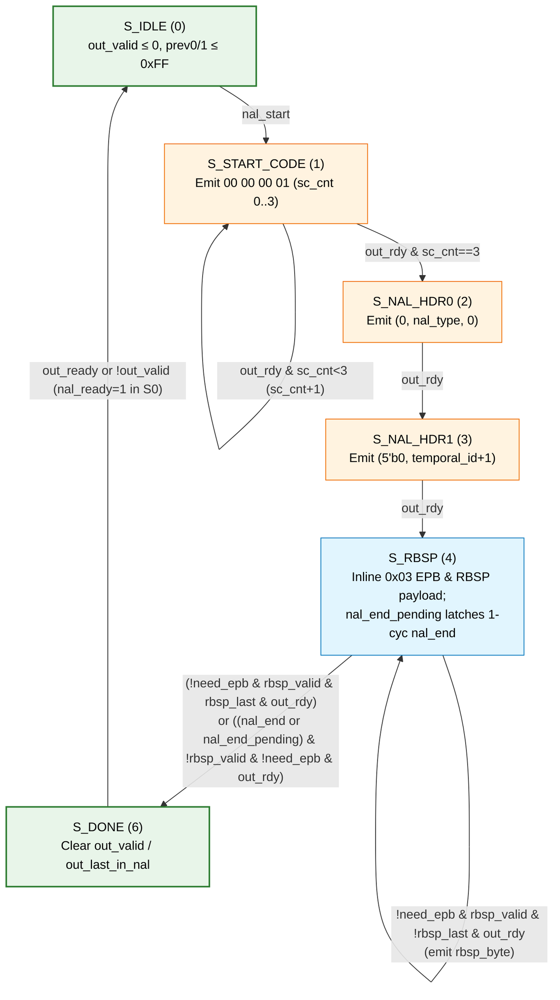

#### 10.2b. State Encoding & Responsibility Table

| State (`localparam`) | Encoding | `out_byte` / `rbsp_ready` | Cycle Latency | Responsibility |
|:---|:---:|:---|:---:|:---|
| `S_IDLE` | `4'd0` | `out_valid <= 0` / `rbsp_ready = 0` (`nal_ready = !nal_start`) | `>= 1` | Waits for `nal_start`; latches `cur_nal_type`, `cur_temp_id`, resets `sc_cnt`, `nal_byte_count`, `nal_end_pending`, and sets `prev0/1 <= 8'hFF`. |
| `S_START_CODE` | `4'd1` | `00, 00, 00, 01` / `rbsp_ready = 0` | `4` | Emits 4-byte Annex B start code (`sc_cnt = 0..3`). |
| `S_NAL_HDR0` | `4'd2` | `{1'b0, cur_nal_type, 1'b0}` / `rbsp_ready = 0` | `1` | Emits first byte of 2-byte HEVC NAL header. |
| `S_NAL_HDR1` | `4'd3` | `{5'b0, cur_temp_id + 3'd1}` / `rbsp_ready = 0` | `1` | Emits second byte of HEVC NAL header (`nuh_layer_id = 0`). |
| `S_RBSP` | `4'd4` | `8'h03` or `rbsp_byte` / `!need_epb && (out_ready \|\| !out_valid)` | `>= 1` per byte | Streams RBSP payload and inserts `0x03` emulation-prevention bytes inline when `prev0==0 && prev1==0 && rbsp_byte<=3` (`4'd5` retired). |
| `S_DONE` | `4'd6` | `out_valid <= 0` / `rbsp_ready = 0` | `1` | Clears `nal_end_pending`, waits for final byte acceptance if valid (`out_ready \|\| !out_valid`), returns to `S_IDLE`. |

#### 10.2c. Transition & Guard Condition Table

| Current State | Guard Condition | Next State & Key Updates |
|:---|:---|:---|
| `S_IDLE` | `nal_start` | `S_START_CODE` (`cur_nal_type <= nal_type`, `cur_temp_id <= temporal_id`, `sc_cnt <= 0`, `nal_byte_count <= 0`, `prev0/1 <= 8'hFF`). |
| `S_START_CODE` | `(out_ready \|\| !out_valid) && sc_cnt < 2'd3` | Stay `S_START_CODE` (`sc_cnt <= sc_cnt + 1`, `nal_byte_count <= nal_byte_count + 1`). |
| `S_START_CODE` | `(out_ready \|\| !out_valid) && sc_cnt == 2'd3` | `S_NAL_HDR0` (`sc_cnt <= 0`). |
| `S_NAL_HDR0` | `out_ready \|\| !out_valid` | `S_NAL_HDR1` (`out_byte <= nal_hdr_b0`). |
| `S_NAL_HDR1` | `out_ready \|\| !out_valid` | `S_RBSP` (`out_byte <= nal_hdr_b1`). |
| `S_RBSP` | `(nal_end \|\| nal_end_pending) && !rbsp_valid && !need_epb && (!out_valid \|\| out_ready)` | `S_DONE` (`out_valid <= 0`, `out_last_in_nal <= 0`, `nal_end_pending <= 0`, `total_nal_count <= total_nal_count + 1`). |
| `S_RBSP` | `(out_ready \|\| !out_valid) && need_epb && !inserting_epb` | Stay `S_RBSP`; emits `out_byte <= 8'h03`, `prev1 <= prev0`, `prev0 <= 8'h03`, `inserting_epb <= 1'b1` (`rbsp_ready = 0` stalls upstream). |
| `S_RBSP` | `(out_ready \|\| !out_valid) && !(need_epb && !inserting_epb) && rbsp_valid` | `inserting_epb <= 0`; emits `rbsp_byte`, shifts `prev1 <= prev0`, `prev0 <= rbsp_byte`; if `rbsp_last` &rarr; `S_DONE` (`total_nal_count <= total_nal_count + 1`). |
| `S_RBSP` | `(out_ready \|\| !out_valid) && !(need_epb && !inserting_epb) && !rbsp_valid` | Stay `S_RBSP`; `inserting_epb <= 0`, `out_valid <= 0`. |
| `S_DONE` | `out_ready \|\| !out_valid` | `S_IDLE` (`nal_end_pending <= 0`, `out_valid <= 0`, `out_last_in_nal <= 0`). |
| `default` | Illegal state | `S_IDLE` (`out_valid <= 0`, `out_last_in_nal <= 0`, `nal_end_pending <= 0`). |

#### 10.2d. Reset, Backpressure & Corner-Case Behavior

- **Synchronous Reset (`always @(posedge clk)`):** Clears `state <= S_IDLE`, `out_valid <= 0`, `nal_byte_count <= 0`, `total_nal_count <= 0`, `prev0/1 <= 8'hFF`, `inserting_epb <= 0`, and `nal_end_pending <= 0`.
- **Inline EPB & `nal_end_pending` Overlap Safeguard:** `need_epb = (prev0 == 8'h00) && (prev1 == 8'h00) && (rbsp_byte <= 8'h03) && rbsp_valid` gates `rbsp_ready` low via `!need_epb`, holding the triggering RBSP byte for 1 cycle while `8'h03` is emitted (`prev0 <= 8'h03`). Meanwhile `nal_end_pending` latches any 1-cycle `nal_end` pulse arriving while `state != S_IDLE && state != S_DONE`, and `S_RBSP -> S_DONE` checks `&& !need_epb` and clears `out_valid <= 0` so a final-byte `0x03` EPB under downstream stall is neither truncated nor duplicated in `S_DONE`. Notice `rbsp_ready` intentionally does **not** gate on `!nal_end`/`!nal_end_pending` so a concurrent final `rbsp_valid` beat cannot deadlock.
- **Downstream Backpressure & `nal_ready`:** All output states use `(out_ready || !out_valid)` so downstream stalls (`out_ready == 0 && out_valid == 1`) freeze both `state` and `rbsp_ready`. `nal_ready = (state == S_IDLE) && !nal_start` feeds `slice_controller.nal_ready` so inter-NAL parameter-set transitions never collide with a stalled teardown.
