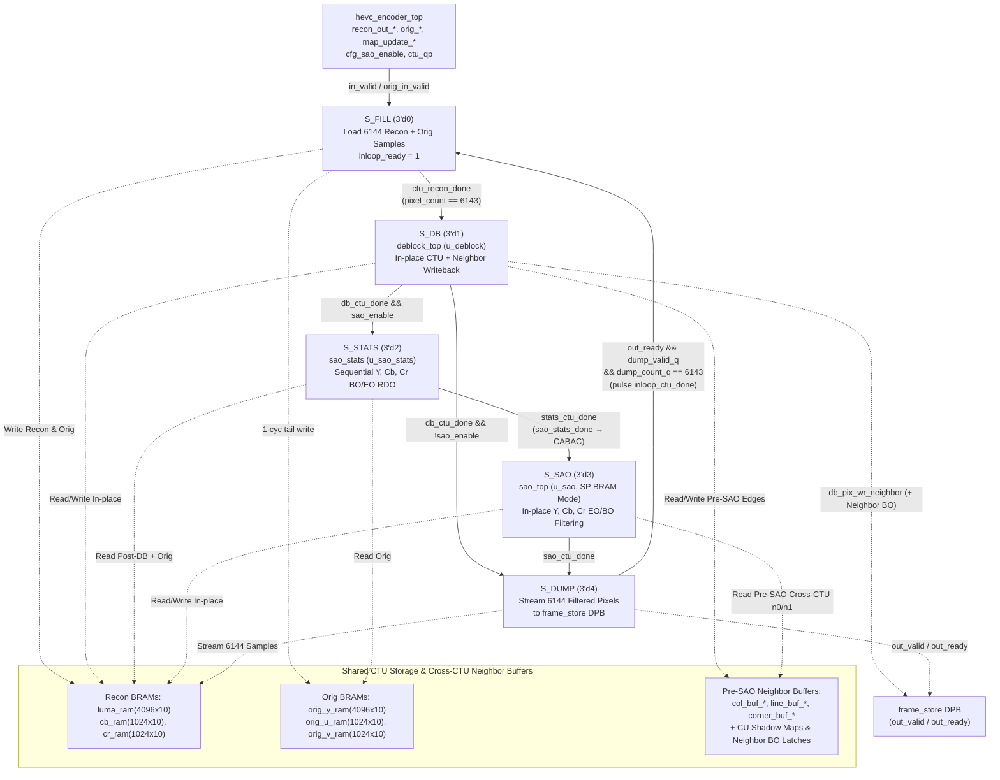
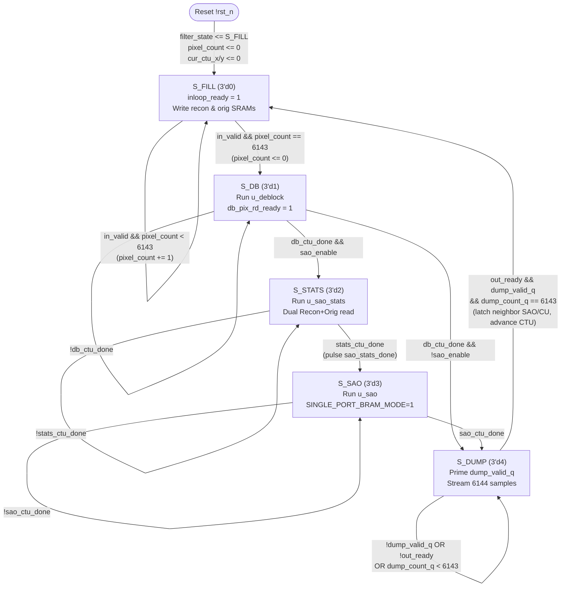
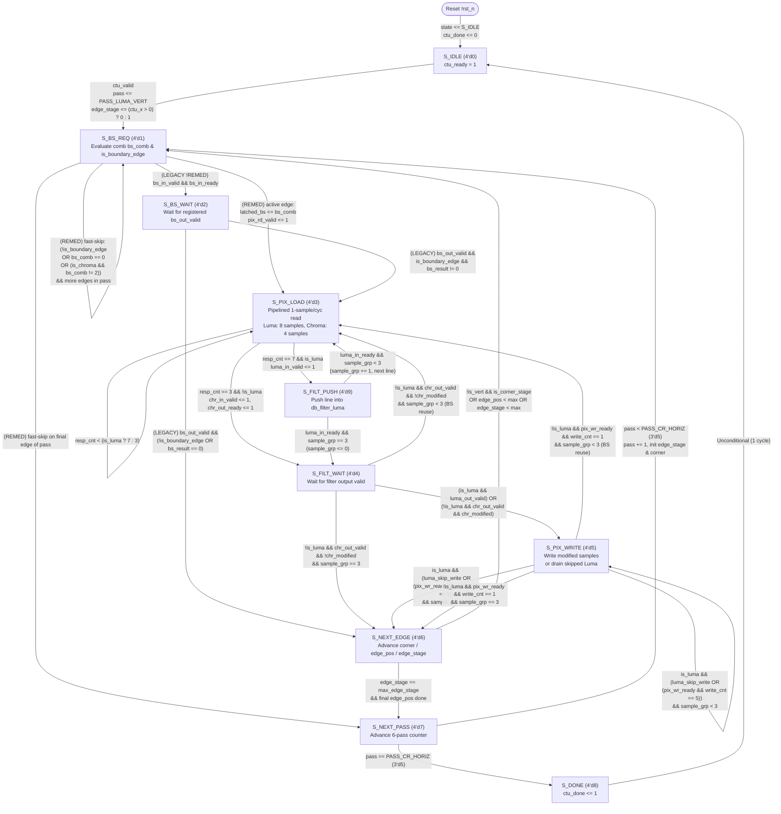
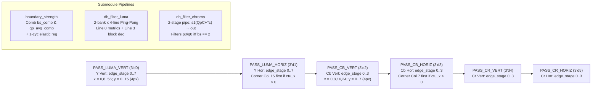
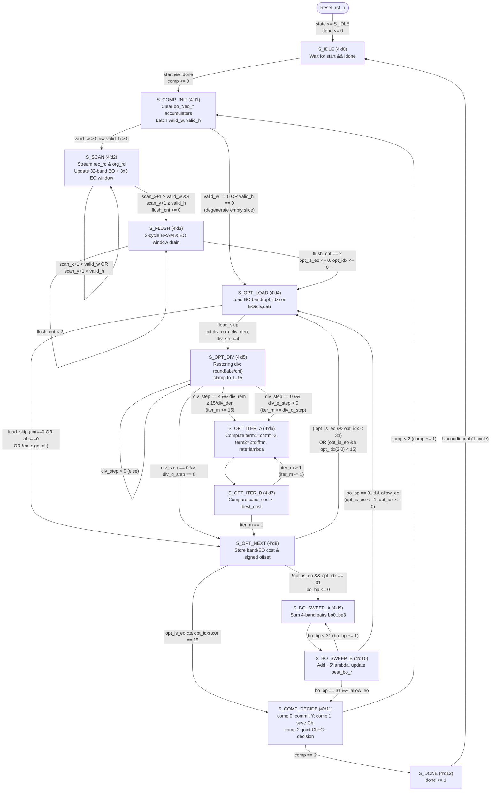
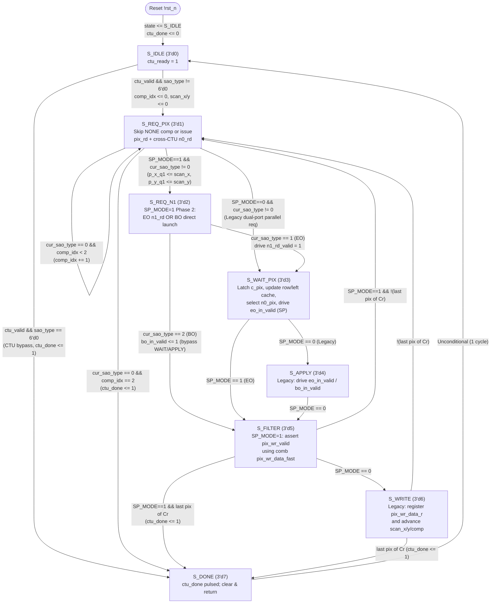

# In-Loop Filters FSM Reference (`decoder_inloop_filters`, Deblocking & SAO)

This document details every Finite State Machine (FSM) and stateful hardware pipeline inside the HEVC Main10 in-loop filter subsystem of `d:\UIT_Doc\hevc_hw_encoder`:

- **Top-Level In-Loop Orchestrator**: [`rtl/top/decoder_inloop_filters.v`](file:///d:/UIT_Doc/hevc_hw_encoder/rtl/top/decoder_inloop_filters.v) (`filter_state[2:0]`)
- **Deblocking Filter Controller & Datapath**: [`rtl/inloop_filters/deblock_top.v`](file:///d:/UIT_Doc/hevc_hw_encoder/rtl/inloop_filters/deblock_top.v) (`state[3:0]`, `pass[2:0]`), [`rtl/inloop_filters/boundary_strength.v`](file:///d:/UIT_Doc/hevc_hw_encoder/rtl/inloop_filters/boundary_strength.v), [`rtl/inloop_filters/db_filter_luma.v`](file:///d:/UIT_Doc/hevc_hw_encoder/rtl/inloop_filters/db_filter_luma.v), [`rtl/inloop_filters/db_filter_chroma.v`](file:///d:/UIT_Doc/hevc_hw_encoder/rtl/inloop_filters/db_filter_chroma.v)
- **SAO Statistics & RDO Optimizer**: [`rtl/inloop_filters/sao_stats.v`](file:///d:/UIT_Doc/hevc_hw_encoder/rtl/inloop_filters/sao_stats.v) (`state[3:0]`)
- **SAO Filter Controller & Datapath**: [`rtl/inloop_filters/sao_top.v`](file:///d:/UIT_Doc/hevc_hw_encoder/rtl/inloop_filters/sao_top.v) (`state[2:0]`), [`rtl/inloop_filters/sao_edge_offset.v`](file:///d:/UIT_Doc/hevc_hw_encoder/rtl/inloop_filters/sao_edge_offset.v), [`rtl/inloop_filters/sao_band_offset.v`](file:///d:/UIT_Doc/hevc_hw_encoder/rtl/inloop_filters/sao_band_offset.v)

> [!NOTE]
> [`rtl/common/parameter_pkg.vh`](file:///d:/UIT_Doc/hevc_hw_encoder/rtl/common/parameter_pkg.vh) defines `` `define REMEDIATION 1 `` whenever `NO_REMEDIATION` is not defined. Unless explicitly marked as legacy (`!REMEDIATION`), descriptions below document the active production/synthesis `REMEDIATION` behavior.

---

## 1. In-Loop Filter Orchestration Overview (`S_FILL` -> `S_DB` -> `S_STATS` -> `S_SAO` -> `S_DUMP`)

[`decoder_inloop_filters.v`](file:///d:/UIT_Doc/hevc_hw_encoder/rtl/top/decoder_inloop_filters.v) processes one $64 \times 64$ Coding Tree Unit (CTU) at a time ($6{,}144$ 10-bit samples: $4{,}096$ Y + $1{,}024$ Cb + $1{,}024$ Cr) in five mutually exclusive phases controlled by `filter_state[2:0]`. Because reconstructed CTU samples reside in single-port block RAMs (`luma_ram`, `cb_ram`, `cr_ram`), `filter_state` acts as the exclusive BRAM read/write arbiter across fill, deblocking, SAO RDO statistics, SAO filtering, and DPB dump.

### Top-Level Submodule Ownership & Handshakes

| Stage (`filter_state`) | Active Submodule | Start / Enable Condition | Completion Signal | BRAM Read Master | BRAM Write Master |
| :--- | :--- | :--- | :--- | :--- | :--- |
| `S_FILL` (`3'd0`) | Wrapper fill logic | Reset or post-`S_DUMP` (`inloop_ready = 1`) | `ctu_recon_done` (`in_valid && pixel_count == 13'd6143`) | Idle | `in_valid` (Recon), `orig_in_valid` (Orig, +1-cycle tail) |
| `S_DB` (`3'd1`) | `u_deblock` (`deblock_top`) | `ctu_valid = (filter_state == S_DB && !db_ctu_done)` | `db_ctu_done` (`u_deblock.ctu_done`) | `db_pix_rd_*` | `db_pix_wr_*` (Recon SRAM + Pre-SAO neighbor buffers + DPB neighbor output) |
| `S_STATS` (`3'd2`) | `u_sao_stats` (`sao_stats`) | `start = (filter_state == S_STATS && !stats_ctu_done)` | `stats_ctu_done` (`sao_stats_done` exported to CABAC) | `stats_rec_rd_*` & `stats_org_rd_*` | None (read-only RDO analysis) |
| `S_SAO` (`3'd3`) | `u_sao` (`sao_top`) | `ctu_valid = (filter_state == S_SAO && !sao_ctu_done)` | `sao_ctu_done` (`u_sao.ctu_done`) | `sao_pix_rd_*` / `sao_n1_rd_*` (BRAM) + `sao_n0/n1` (neighbor buf) | `sao_pix_wr_*` (Recon SRAM in-place) |
| `S_DUMP` (`3'd4`) | Synchronous dump pipeline | Entry from `S_DB` (`!sao_enable`) or `S_SAO` | `out_ready && dump_valid_q && dump_count_q == 13'd6143` | `dump_rd_addr[12:0]` (`luma/cb/cr_ram`) | None (updates CU/SAO neighbor latches at final sample) |

---

## 2. `decoder_inloop_filters` (`rtl/top/decoder_inloop_filters.v`)

### 2.1 Mermaid Diagram

### 2.2 State Encoding & Responsibility Table

| Register / `localparam` | Encoding | Width | Responsibility | Typical Cycle Latency |
| :--- | :---: | :---: | :--- | :--- |
| `filter_state` / `S_FILL` | `3'd0` | 3 | Asserts `inloop_ready`; writes $6{,}144$ reconstructed samples (`in_valid`) into `luma_ram`/`cb_ram`/`cr_ram` and pre-populates CTU-0 edge buffers (`col_buf_*`, `line_buf_*`, `corner_buf_*`). Also writes `orig_y/u/v_ram` via 1-cycle delayed `in_x_d`/`in_y_d`/`in_comp_d`/`in_valid_fill_d`. | $\ge 6{,}144$ cycles (1 pixel per `in_valid` pulse) |
| `filter_state` / `S_DB` | `3'd1` | 3 | Drives `u_deblock.ctu_valid`; muxes `db_pix_rd_*` to `syn_*_rd_addr` or `col_buf`/`line_buf`/`corner_buf`; routes `db_pix_wr_*` to internal SRAMs and (when `db_pix_wr_neighbor`) applies latched neighbor BO onto `out_pixel` for `frame_store`. | Variable per CTU (`deblock_top` edge activity) |
| `filter_state` / `S_STATS` | `3'd2` | 3 | Drives `u_sao_stats.start`; routes `stats_rec_rd_*` to `syn_*_rd_addr` and `stats_org_rd_*` to `orig_y/u/v_ram`; exports `sao_stats_done` and SAO syntax outputs (`out_sao_type`, `out_eo_class`, `out_eo_offset`, `out_band_pos`, `out_bo_offset`). | $\sim 6{,}800$–$12{,}000+$ cycles (depends on CTU border skip & RDO iterations) |
| `filter_state` / `S_SAO` | `3'd3` | 3 | Drives `u_sao.ctu_valid`; muxes `sao_pix_rd_*`/`sao_n1_rd_*` to `syn_*_rd_addr` and `sao_n0_rd_*`/`sao_n1_rd_*` to pre-SAO neighbor buffers (`sao_n*_is_nbr`, `sao_n*_oob`); writes `sao_pix_wr_*` back to Recon SRAMs. | $1$ cycle (`sao_type==0`) up to $\sim 24{,}600$ cycles |
| `filter_state` / `S_DUMP` | `3'd4` | 3 | Primes `dump_rd_addr` (`1` ahead of `dump_count_q`); streams $6{,}144$ pixels (`0..4095` Y, `4096..5119` Cb, `5120..6143` Cr) over `out_valid`/`out_ready`; clears per-CTU CBF/edge maps, latches neighbor CU/SAO state, advances `(cur_ctu_x, cur_ctu_y)`, and pulses `inloop_ctu_done`. | $6{,}145$ cycles (1 prime + $6{,}144$ beats when `out_ready == 1`) |

### 2.3 Transition & Guard Condition Table

| Current State | Next State | Guard Condition | Actions / Side Effects |
| :--- | :--- | :--- | :--- |
| `S_FILL` | `S_FILL` | `in_valid && (pixel_count != 13'd6143)` | `pixel_count <= pixel_count + 13'd1`; writes Recon SRAM (and `orig_*_ram` on 1-cycle delay). |
| `S_FILL` | `S_DB` | `in_valid && (pixel_count == 13'd6143)` (`ctu_recon_done`) | `pixel_count <= 13'd0`; `in_valid_fill_d` remains `1` for 1 cycle so `orig_*_ram` captures pixel `6143`. |
| `S_DB` | `S_STATS` | `db_ctu_done && sao_enable` | Starts SAO RDO statistics on post-deblocked CTU pixels. |
| `S_DB` | `S_DUMP` | `db_ctu_done && !sao_enable` | Bypasses `S_STATS` and `S_SAO`; enters DPB stream-out directly. |
| `S_STATS` | `S_SAO` | `stats_ctu_done` | `sao_stats_done` asserted; `u_sao` receives decided `out_sao_type`/offsets. |
| `S_SAO` | `S_DUMP` | `sao_ctu_done` | Starts 6,144-pixel DPB dump. |
| `S_DUMP` | `S_DUMP` | `!(out_ready && dump_valid_q && dump_count_q == 13'd6143)` | On first cycle (`!dump_valid_q`): latches `luma/cb/cr_ram[0]`, sets `dump_valid_q <= 1`, `dump_count_q <= 0`, `dump_rd_addr <= 1`. On `out_ready`: increments `dump_count_q` and `dump_rd_addr`. |
| `S_DUMP` | `S_FILL` | `out_ready && dump_valid_q && (dump_count_q == 13'd6143)` | Clears `cu_map_cbf_*`/`cu_map_edge_*`; updates `left_map_*`, `top_map_*`, `corner_*`, `left_sao_*`, `top_left_sao_*`, `top_sao_*[cur_ctu_x]`; increments `(cur_ctu_x, cur_ctu_y)` wrapping on `(frame_width_px >> 6) - 1` and `(frame_height_px >> 6) - 1`; pulses `inloop_ctu_done <= 1'b1`. |

### 2.4 Reset, Backpressure, BRAM Muxing & Corner-Case Behavior

- **Reset (`!rst_n`)**: Async active-low reset initializes `filter_state <= S_FILL`, `pixel_count <= 13'd0`, `cur_ctu_x/y <= 0`, `inloop_ctu_done <= 1'b0`, `dump_valid_q <= 1'b0`, all `cu_map_*` / `left_map_*` / `top_map_*` / `corner_*` caches, and all `left_sao_*` / `top_left_sao_*` / `top_sao_*[0:63]` latches. (`line_buf_*`, `col_buf_*`, and `corner_buf_cb/cr` are zero-initialized in an `initial` block).
- **Synchronous CTU BRAM Muxing & Read Latency Alignment**:
  - `syn_luma_rd_addr`, `syn_cb_rd_addr`, and `syn_cr_rd_addr` select `dump_rd_addr` in `S_DUMP` and `{rd_y, rd_x}` in `S_DB`/`S_STATS`/`S_SAO`.
  - In `S_DB` (under `REMEDIATION`), `db_pix_rd_ready = 1'b1` continuously and `db_pix_resp_valid_q <= (filter_state == S_DB && db_pix_rd_valid && db_pix_rd_ready)`, supporting pipelined 1-sample/cycle reads (vs. legacy `!REMEDIATION`, where `db_rd_pending` gates `db_pix_rd_ready = db_pix_rd_valid && !db_rd_pending`, limiting throughput to 1 read every 2 cycles).
  - In `S_SAO`, `sao_n1_rd_valid && !sao_n1_oob` takes priority over `sao_pix_rd_*` on the shared `rd_x`/`rd_y`/`rd_comp` bus because Phase 1 reads `pix_rd` while Phase 2 (`S_REQ_N1`) asserts `n1_rd_valid` (`sao_pix_rd_valid` is deasserted in `S_REQ_N1`).
  - `db_rd_neighbor_q`, `sao_n0_is_nbr_q`, `sao_n1_is_nbr_q`, `sao_n0_oob_q`, `sao_n1_oob_q`, and `rd_comp_q` delay control qualifiers by 1 cycle to align with `luma_rd_q`/`cb_rd_q`/`cr_rd_q` and `db_nbr_rd_q`/`sao_nbr_n0_q`/`sao_nbr_n1_q`.
- **Backpressure (`out_ready`)**:
  - During `S_DUMP`, `dump_stall = (filter_state == S_DUMP) && dump_valid_q && !out_ready` freezes `luma_rd_q`/`cb_rd_q`/`cr_rd_q` and holds `dump_count_q`/`dump_rd_addr` while `out_valid` stays `1`.
  - During `S_DB`, `db_pix_wr_ready = db_pix_wr_neighbor ? out_ready : 1'b1`. Internal CTU BRAM writes never stall; cross-CTU neighbor writes (`db_pix_wr_neighbor`) stall `deblock_top` in `S_PIX_WRITE` whenever `frame_store` deasserts `out_ready`.
  - `S_FILL` has no `in_ready` handshake (`inloop_ready` signals state readiness); upstream `recon_unit` must respect `inloop_ready`. Note `orig_in_valid` relies on `(filter_state == S_FILL || in_valid_fill_d)` to capture pixel `6143` one cycle after transitioning to `S_DB`.
- **Pre-SAO Neighbor Buffers & Neighbor BO Forwarding**:
  - `col_buf_*`, `line_buf_*`, and `corner_buf_*` stay **post-deblocked, pre-SAO** (updated in `S_DB` by `db_pix_wr_*`, untouched by `sao_pix_wr_*`).
  - When `db_pix_wr_valid && db_pix_wr_neighbor` drives `out_valid = 1` during `S_DB`, `db_nbr_sao_pixel` applies the latched neighbor CTU's BO parameters (`left_sao_*`, `top_sao_*[cur_ctu_x]`, or `top_left_sao_*`, gated by `sao_enable`) onto the DPB-bound `out_pixel` only.
- **Corner Cases**:
  - **CU Map Update Timing**: `map_update_valid` can write `cu_map_*` continuously during `S_FILL`; `cu_map_cbf_*` and `cu_map_edge_*` are cleared at the end of `S_DUMP` (`dump_count_q == 13'd6143`) rather than on reset of each CTU.
  - **Buffer Sizing**: `line_buf_luma` (`[0:3][0:127]`) and `line_buf_cb/cr` (`[0:1][0:63]`) along with `top_map_*` (`[31:0]`) are sized for 2 CTUs wide (`cur_ctu_x[0]` indexing in `top_map_*`, linear `cur_ctu_x << 6` in `line_buf_*`), whereas `top_sao_*` supports up to 64 CTUs wide (`[0:63]`).
  - **Missing `default` in `case (filter_state)`**: Only encodings `3'd0..3'd4` are handled; `3'd5..3'd7` have no `default` recovery branch.

---

## 3. Deblocking Filter (`deblock_top`, `boundary_strength`, `db_filter_luma`, `db_filter_chroma`)

[`deblock_top.v`](file:///d:/UIT_Doc/hevc_hw_encoder/rtl/inloop_filters/deblock_top.v) executes 6 sequential filtering passes per CTU (`PASS_LUMA_VERT` through `PASS_CR_HORIZ`), stepping across the $8 \times 8$ sample grid (`+2` 4x4 blocks per `edge_stage`) and orchestrating [`boundary_strength.v`](file:///d:/UIT_Doc/hevc_hw_encoder/rtl/inloop_filters/boundary_strength.v), [`db_filter_luma.v`](file:///d:/UIT_Doc/hevc_hw_encoder/rtl/inloop_filters/db_filter_luma.v), and [`db_filter_chroma.v`](file:///d:/UIT_Doc/hevc_hw_encoder/rtl/inloop_filters/db_filter_chroma.v).

### 3.1 Mermaid Diagrams

#### `deblock_top.v` Control FSM (`state[3:0]`)

#### 6-Pass Sequence & Submodule Datapath (`pass[2:0]`, `db_filter_luma`, `db_filter_chroma`)

### 3.2 State Encoding & Responsibility Table

#### `deblock_top.v` Main FSM (`state[3:0]`)

| Register / `localparam` | Encoding | Width | Responsibility | Latency |
| :--- | :---: | :---: | :--- | :--- |
| `state` / `S_IDLE` | `4'd0` | 4 | Asserts `ctu_ready`. On `ctu_valid`, latches `cur_ctu_addr`, `cur_ctu_x/y`, `cur_frame_w/h`, sets `pass <= PASS_LUMA_VERT`, `edge_stage <= (ctu_x > 0) ? 0 : 1`, clears `is_corner_stage`, `edge_pos`, `sample_grp`. | 1 cycle after `ctu_valid` |
| `state` / `S_BS_REQ` | `4'd1` | 4 | (`REMEDIATION`): Evaluates combinational `is_boundary_edge`, `bs_comb`, `qp_avg_comb`. Fast-skips inactive/Bs=0/(Chroma Bs!=2) edges in 1 cycle; otherwise latches `latched_bs`/`latched_edge_qp`, starts `pix_rd_valid` and enters `S_PIX_LOAD`. (`!REMEDIATION`): Handshakes `bs_in_valid && bs_in_ready` to `S_BS_WAIT`. | 1 cycle/edge (skipped) or 1 cycle setup |
| `state` / `S_BS_WAIT` | `4'd2` | 4 | Legacy `!REMEDIATION` only (bypassed under `REMEDIATION`): waits for `bs_out_valid`, latches `bs_result`/`bs_edge_qp`, branches to `S_NEXT_EDGE` (`bs==0`) or `S_PIX_LOAD`. | 1+ cycles (unused under `REMEDIATION`) |
| `state` / `S_PIX_LOAD` | `4'd3` | 4 | (`REMEDIATION`): Decoupled `req_cnt` (`0..7` Luma / `0..3` Chroma) issues 1 read/cycle while `resp_cnt` fills `px_p[0..3]`/`px_q[0..3]` (or `[0..1]` Chroma) when `pix_resp_valid && pix_resp_ready`. Triggers `luma_in_valid` or `chr_in_valid` on last sample. | 9 cycles (Luma) / 5 cycles (Chroma) with 1-cyc BRAM |
| `state` / `S_FILT_PUSH` | `4'd9` | 4 | Luma-only: holds `luma_in_valid` until `luma_in_ready`. Cycles back to `S_PIX_LOAD` for `sample_grp = 0, 1, 2`; resets `sample_grp <= 0` and enters `S_FILT_WAIT` on `sample_grp == 3`. | 1 cycle per line (4 lines/edge) |
| `state` / `S_FILT_WAIT` | `4'd4` | 4 | Luma: waits for `luma_out_valid` (`db_filter_luma` bank ready). Chroma: waits for `chr_out_valid` (`db_filter_chroma`); if `!chr_modified` (`REMEDIATION`), skips `S_PIX_WRITE` and advances `sample_grp` directly to `S_PIX_LOAD` or `S_NEXT_EDGE`. | 1 cycle (Luma) / 2 cycles (Chroma) |
| `state` / `S_PIX_WRITE` | `4'd5` | 4 | Luma (`REMEDIATION`): if `luma_skip_write`, drains all 4 lines (`sample_grp = 0..3`) in 4 cycles with `pix_wr_valid = 0`; else writes 6 samples/line (`write_cnt = 0..5`: `p0f..p2f`, `q0f..q2f`) across `sample_grp = 0..3`. Chroma: writes 2 samples (`chr_p0f`, `chr_q0f`) and jumps directly to `S_PIX_LOAD` for `sample_grp < 3`. | Luma: 4 cyc (skip) or 24 cyc; Chroma: 2 cyc/line |
| `state` / `S_NEXT_EDGE` | `4'd6` | 4 | Clears `sample_grp`; advances `is_corner_stage -> 0`, then `edge_pos` (`0..max_pos`/`max_col_pos`), then `edge_stage` (`0..max_edge_stage`), or transitions to `S_NEXT_PASS`. (`!REMEDIATION` also loops `sample_grp` here for Chroma). | 1 cycle per processed edge |
| `state` / `S_NEXT_PASS` | `4'd7` | 4 | Checks `pass == PASS_CR_HORIZ` (`3'd5`); otherwise increments `pass`, initializes `edge_stage` (`next_has_ctu_boundary ? 0 : 1`) and `is_corner_stage` (`!next_is_vert && has_left_neighbor` under `REMEDIATION`), and returns to `S_BS_REQ`. | 1 cycle per pass |
| `state` / `S_DONE` | `4'd8` | 4 | Asserts 1-cycle `ctu_done <= 1'b1` and returns to `S_IDLE`. | 1 cycle |

#### Pass Counter (`pass[2:0]`) & Submodule Pipelines

| Module / Register | Encodings / Stages | Width | Grid & Scope |
| :--- | :--- | :---: | :--- |
| `deblock_top.pass` | `PASS_LUMA_VERT=3'd0`, `PASS_LUMA_HORIZ=3'd1`, `PASS_CB_VERT=3'd2`, `PASS_CB_HORIZ=3'd3`, `PASS_CR_VERT=3'd4`, `PASS_CR_HORIZ=3'd5` | 3 | Luma: `edge_stage` `0..7` (`+2` 4x4 blocks = `+8` luma px), `edge_pos` `0..15` (`max_col_pos = 14` if `has_right_neighbor && !is_vert`). Chroma: `edge_stage` `0..3` (`+2` 4x4 chroma blocks = `+8` chroma px = `+4` in 16x16 luma CU map via `{edge_col[2:0], 1'b0}`), `edge_pos` `0..7` (`max_col_pos = 6` if `has_right_neighbor && !is_vert`). |
| `boundary_strength` | No FSM; combinational `bs_comb`/`qp_avg_comb` + 1-stage `out_valid`/`bs`/`edge_qp` register | 2 (`bs`) / 6 (`edge_qp`) | `bs_comb = 2` (intra P or Q), `1` (inter with CBF!=0, ref count/idx mismatch, or `\|delta_MV\| >= 4` qpel), `0` otherwise. `in_ready = out_ready \| ~out_valid`. |
| `db_filter_luma` | No enumerated FSM; ping-pong 2-bank (`wr_bank`, `rd_bank`) x 4-line (`wr_idx[1:0]`, `rd_idx[1:0]`, `b_ready[0:1]`) storage | 1-bit bank / 2-bit idx | `in_ready = !b_ready[wr_bank]`. Captures line-0 thresholds/strong check (`in_st0`, `b_dp0`, `b_dq0`), evaluates 4-line block decision (`blk_filter_en`, `blk_strong`, `blk_weak`) at `wr_idx == 2'd3`, sets `b_ready[wr_bank] <= 1`, and outputs 4 lines (`out_valid`, `modified_p`, `modified_q`). |
| `db_filter_chroma` | No enumerated FSM; 2-stage pipeline (`s1_valid` -> `out_valid`) | 1-bit valid per stage | `in_ready = !s1_valid \|\| (out_ready \| ~out_valid)`. Stage 1 maps `edge_qp` via `chroma_qp_table` and `tc_table(qpc + 2)`, setting `s1_filter_enable = (bs == 2'd2)`. Stage 2 computes `p0_f`/`q0_f` (`p1`/`q1` unmodified) and `modified <= (s1_tc != 0)` when enabled. |

### 3.3 Transition & Guard Condition Table (`deblock_top.v`)

| Current State | Next State | Guard Condition (`REMEDIATION` active unless noted) | Key Actions |
| :--- | :--- | :--- | :--- |
| `S_IDLE` | `S_BS_REQ` | `ctu_valid` | Latches CTU geometry; `pass <= PASS_LUMA_VERT`; `edge_stage <= (ctu_x > 0) ? 3'd0 : 3'd1`; `is_corner_stage <= 0`. |
| `S_BS_REQ` | `S_BS_REQ` | `fast_skip && ( (!is_vert && is_corner_stage) OR (edge_pos < pos_lim) OR (edge_stage < max_edge_stage) )` | `fast_skip` = `!is_boundary_edge \|\| bs_comb == 2'd0 \|\| (is_chroma && bs_comb != 2'd2)`. Advances corner/pos/stage in 1 cycle (`pos_lim = is_vert ? max_pos : max_col_pos`). |
| `S_BS_REQ` | `S_NEXT_PASS` | `fast_skip && !(!is_vert && is_corner_stage) && (edge_pos >= pos_lim) && (edge_stage >= max_edge_stage)` | Completes final edge of current pass via fast-skip. |
| `S_BS_REQ` | `S_PIX_LOAD` | `!fast_skip` | Latches `latched_bs <= bs_comb`, `latched_edge_qp <= qp_avg_comb`; resets `req_cnt`, `resp_cnt`, `sample_grp`; asserts `pix_rd_valid <= 1`. |
| `S_BS_REQ` | `S_BS_WAIT` | (`!REMEDIATION` only) `bs_in_valid && bs_in_ready` | Legacy registered BS handshake. |
| `S_BS_WAIT` | `S_NEXT_EDGE` / `S_PIX_LOAD` | (`!REMEDIATION` only) `bs_out_valid` | Goes to `S_NEXT_EDGE` if `!is_boundary_edge \|\| bs_result == 0`; else `S_PIX_LOAD`. |
| `S_PIX_LOAD` | `S_FILT_PUSH` | `pix_resp_valid && pix_resp_ready && (resp_cnt == 3'd7) && is_luma` | Stores final `px_q[3]`; clears `req_cnt/resp_cnt/pix_rd_valid`; pulses `luma_in_valid <= 1`. |
| `S_PIX_LOAD` | `S_FILT_WAIT` | `pix_resp_valid && pix_resp_ready && (resp_cnt == 3'd3) && !is_luma` | Stores final `px_q[1]`; clears `req_cnt/resp_cnt/pix_rd_valid`; pulses `chr_in_valid <= 1`; sets `chr_out_ready <= 1`. |
| `S_FILT_PUSH` | `S_PIX_LOAD` | `is_luma && luma_in_ready && (sample_grp < 3'd3)` | Clears `luma_in_valid`; `sample_grp <= sample_grp + 1`; resets `req_cnt/resp_cnt`; asserts `pix_rd_valid <= 1`. |
| `S_FILT_PUSH` | `S_FILT_WAIT` | `is_luma && luma_in_ready && (sample_grp == 3'd3)` | Clears `luma_in_valid`; `sample_grp <= 3'd0`. |
| `S_FILT_WAIT` | `S_PIX_WRITE` | `(is_luma && luma_out_valid) \|\| (!is_luma && chr_out_valid && chr_modified)` | `write_cnt <= 3'd0`; clears `chr_out_ready`. |
| `S_FILT_WAIT` | `S_PIX_LOAD` | `!is_luma && chr_out_valid && !chr_modified && (sample_grp < 3'd3)` | Skips Chroma writeback; increments `sample_grp`; sets `pix_rd_valid <= 1` reusing `latched_bs`. |
| `S_FILT_WAIT` | `S_NEXT_EDGE` | `!is_luma && chr_out_valid && !chr_modified && (sample_grp == 3'd3)` | Skips Chroma writeback on final sample of 4-pixel edge. |
| `S_PIX_WRITE` | `S_PIX_WRITE` | `is_luma && (luma_skip_write \|\| (pix_wr_ready && write_cnt == 3'd5)) && (sample_grp < 3'd3)` | Drains/writes line `sample_grp`, increments `sample_grp`, resets `write_cnt <= 0`. |
| `S_PIX_WRITE` | `S_PIX_LOAD` | `!is_luma && pix_wr_ready && (write_cnt == 3'd1) && (sample_grp < 3'd3)` | Increments `sample_grp`, resets `write_cnt/req_cnt/resp_cnt`, sets `pix_rd_valid <= 1` reusing `latched_bs`. |
| `S_PIX_WRITE` | `S_NEXT_EDGE` | `(is_luma && (luma_skip_write \|\| (pix_wr_ready && write_cnt == 3'd5)) && sample_grp == 3'd3) \|\| (!is_luma && pix_wr_ready && write_cnt == 3'd1 && sample_grp == 3'd3)` | All 4 lines along the 4x4 block edge written or drained. |
| `S_NEXT_EDGE` | `S_BS_REQ` | `(!is_vert && is_corner_stage) \|\| (edge_pos < pos_lim) \|\| (edge_stage < max_edge_stage)` | Clears `sample_grp`; transitions corner->col 0, increments `edge_pos`, or increments `edge_stage` (arming `is_corner_stage` if `!is_vert && has_left_neighbor`). |
| `S_NEXT_EDGE` | `S_NEXT_PASS` | `!(!is_vert && is_corner_stage) && (edge_pos >= pos_lim) && (edge_stage >= max_edge_stage)` | Finished all edges in current pass. |
| `S_NEXT_PASS` | `S_BS_REQ` | `pass != PASS_CR_HORIZ` | Increments `pass`; sets `edge_stage <= next_has_ctu_boundary ? 0 : 1`, `is_corner_stage <= (!next_is_vert && has_left_neighbor)`, `edge_pos <= 0`, `sample_grp <= 0`. |
| `S_NEXT_PASS` | `S_DONE` | `pass == PASS_CR_HORIZ` | All 6 passes complete. |
| `S_DONE` | `S_IDLE` | Unconditional | Pulses `ctu_done <= 1'b1`. |

### 3.4 Reset, Backpressure, Pillar 4 Optimizations & Corner-Case Behavior

- **Reset (`!rst_n`)**: Resets `state <= S_IDLE`, `pass <= PASS_LUMA_VERT`, `edge_stage <= 1'b1` (zero-extended to `3'd1` under `REMEDIATION`; properly initialized on `ctu_valid` in `S_IDLE`), `is_corner_stage <= 1'b0`, `ctu_done <= 1'b0`, and all valid/ready/counter registers to `0`.
- **Backpressure**:
  - `S_PIX_LOAD`: `req_cnt` only advances on `pix_rd_valid && pix_rd_ready`; `resp_cnt` only advances on `pix_resp_valid && pix_resp_ready` (`state == S_PIX_LOAD`).
  - `S_FILT_PUSH`: holds `luma_in_valid` high until `luma_in_ready` (`!b_ready[wr_bank]` in `db_filter_luma`).
  - `S_PIX_WRITE`: when `!luma_skip_write`, `write_cnt` stalls whenever `pix_wr_ready == 0` (occurs on cross-CTU neighbor writes when `frame_store` deasserts `out_ready`).
- **Pillar 4 Optimizations (`REMEDIATION`)**:
  1. **1-Cycle `bs_comb == 0` & Chroma `bs != 2` Fast-Skip**: `S_BS_REQ` reads `bs_comb` and `qp_avg_comb` combinationally from `boundary_strength` and skips `!is_boundary_edge`, `bs_comb == 2'd0`, or `(is_chroma && bs_comb != 2'd2)` in 1 cycle directly in `S_BS_REQ`, completely bypassing `S_BS_WAIT` and `S_NEXT_EDGE`.
  2. **`+2` / `+4` Grid Stepping**: `edge_stage` steps `0..7` (Luma) or `0..3` (Chroma) with `cur_edge_block = {edge_stage, 1'b0}` (`+2` 4x4 blocks = `+8` samples per stage), while `edge_col_cu` / `edge_row_cu` left-shifts Chroma block indices by 1 (`+4` in the $16 \times 16$ luma CU map).
  3. **Pipelined 1-Sample/Cycle `S_PIX_LOAD`**: Decoupled `req_cnt` and `resp_cnt` issue back-to-back reads every cycle (9 cycles for 8 Luma samples vs. 16 cycles in `!REMEDIATION`; 5 cycles for 4 Chroma samples vs. 8 cycles).
  4. **Write-Back Skip & Chroma BS Reuse**:
     - Luma: `luma_skip_write = is_luma && !luma_mod_p && !luma_mod_q` suppresses `pix_wr_valid` and pulses `luma_out_ready = 1` in `S_PIX_WRITE`, draining all 4 buffered lines in 4 cycles instead of 24 write cycles whenever `blk_filter_en == 0` (`d >= beta`).
     - Chroma: when `!chr_modified` (`tc == 0`), `S_FILT_WAIT` skips `S_PIX_WRITE` completely. For `sample_grp = 0..2`, both `S_FILT_WAIT` (`!chr_modified`) and `S_PIX_WRITE` jump straight to `S_PIX_LOAD` reusing `latched_bs` and `latched_edge_qp` instead of looping through `S_NEXT_EDGE -> S_BS_REQ`.
- **Corner Cases**:
  - **Delayed Left-Corner Horizontal Filtering (`is_corner_stage` & `max_col_pos`)**: When `has_right_neighbor && !is_vert`, horizontal passes stop at `max_col_pos = max_pos - 1` (col 14 Luma / col 6 Chroma) so that the rightmost column is filtered only *after* vertical deblocking on the right CTU boundary completes. The next horizontal CTU (`has_left_neighbor`) runs `is_corner_stage = 1` before `edge_pos = 0` on every horizontal `edge_stage`, filtering col 15/7 of the left CTU (`pix_rd_corner = 1`, `pix_wr_corner = 1`).
  - **Chroma Saturation (`REMEDIATION`)**: `db_filter_chroma` clamps `qpy > 51` to `6'd45` and `tc_idx > 53` to `7'd53` so high-QP chroma edges never fall into a zero `default` case.

---

## 4. SAO Statistics & RDO Optimizer (`sao_stats.v`)

[`sao_stats.v`](file:///d:/UIT_Doc/hevc_hw_encoder/rtl/inloop_filters/sao_stats.v) (`SINGLE_PASS_CAUSAL_SYNC = 0`) sequentially processes `Y (comp=0) -> Cb (comp=1) -> Cr (comp=2)` per CTU, collecting 32-band BO statistics on all CTUs and 4-class EO statistics on the bottom-right CTU (`allow_eo = (SINGLE_PASS_CAUSAL_SYNC == 0) && is_last_col && is_last_row`), then runs a shared restoring-divider + iterative RDO optimizer (`[-15, +15]` offsets) and joint `Cb + Cr` mode decision.

### 4.1 Mermaid Diagram

### 4.2 State Encoding & Responsibility Table (`REMEDIATION`)

| Register / `localparam` | Encoding | Width | Responsibility | Latency per Visit |
| :--- | :---: | :---: | :--- | :--- |
| `state` / `S_IDLE` | `4'd0` | 4 | Clears `done`, `rec_rd_valid`, `org_rd_valid`, `rd_req_d1`. On `start && !done`, starts `comp <= 2'd0` (Y). | 1 cycle after `start` |
| `state` / `S_COMP_INIT` | `4'd1` | 4 | Resets `bo_cnt/bo_diff` `[0:31]`, `eo_cls_cost` `[0:3]`, `eo_cnt/eo_diff` `[0:3][0:3]`, scan coordinates, and pipeline flags; selects component `valid_w`/`valid_h` (`active_w_y/h_y` or `active_w_c/h_c`). | 1 cycle (3 per CTU) |
| `state` / `S_SCAN` | `4'd2` | 4 | Streams paired `rec_rd_*` and `org_rd_*` requests across `valid_w x valid_h`; pipeline stages `rd_req_d1 -> rd_req_d2` accumulate `bo_cnt`/`bo_diff` and feed the `row_m1_rec`/`row_m2_rec`/`row_m1_diff` $3 \times 3$ EO sliding window (`eo_win_valid_q`). | `valid_w * valid_h` cycles (e.g., 3600 or 4096 for Y; 840 or 1024 for Cb/Cr) |
| `state` / `S_FLUSH` | `4'd3` | 4 | Deasserts `rec_rd_valid`/`org_rd_valid`/`rd_req_d1` and waits 3 cycles (`flush_cnt = 0, 1, 2`) so the final pixel traverses `rd_req_d1 -> rd_req_d2 -> eo_win_valid_q` into `bo_*`/`eo_*`. | 3 cycles |
| `state` / `S_OPT_LOAD` | `4'd4` | 4 | Reads `load_cnt_w`/`load_diff_w` for BO band `opt_idx[4:0]` (`0..31`) or EO `(class=opt_idx[3:2], slot=opt_idx[1:0])` (`0..15`). Checks `load_skip`; else seeds restoring divider `div_rem = 2*abs + cnt`, `div_den = 2*cnt`, `div_step = 4`. | 1 cycle |
| `state` / `S_OPT_DIV` | `4'd5` | 4 | Computes rounded initial offset magnitude `clamp(round(abs_diff / cnt), 0..15)`: fast-saturates to `15` on `div_step == 4` if `div_rem >= 15*div_den`, else executes 4 binary steps (`div_step = 3..0`). | 1 cycle (if $\ge 15$) or 5 cycles |
| `state` / `S_OPT_ITER_A` | `4'd6` | 4 | Pipelined RD cost stage 1 for magnitude `iter_m`: `pipe_term1 = opt_cnt * sq_4b(iter_m)`, `pipe_term2 = 2 * opt_diff_abs * iter_m`, `pipe_rate_cost = cur_iter_rate * lambda_cur_q8` (`m+1` EO, `m+2` BO). | 1 cycle per candidate `iter_m` |
| `state` / `S_OPT_ITER_B` | `4'd7` | 4 | Pipelined RD cost stage 2: evaluates `pipe_cand_cost = ((pipe_term1 - pipe_term2) << 8) + pipe_rate_cost`; updates `iter_best_cost`/`iter_best_mag` if lower; decrements `iter_m` down to `1`. | 1 cycle per candidate `iter_m` |
| `state` / `S_OPT_NEXT` | `4'd8` | 4 | Stores `bo_band_off[opt_idx]`/`bo_band_cost[opt_idx]` or accumulates `eo_cls_off`/`eo_cls_cost`; steps `opt_idx` across 32 BO bands or 16 EO class-categories. | 1 cycle |
| `state` / `S_BO_SWEEP_A` | `4'd9` | 4 | Sums two pairs of cyclic 4-band costs (`sweep_pair0 = cost[bp0] + cost[bp1]`, `sweep_pair1 = cost[bp2] + cost[bp3]`, mod 32 via 5-bit `bo_bp`). | 1 cycle x 32 bands |
| `state` / `S_BO_SWEEP_B` | `4'd10` | 4 | Computes `cur_bo_tot_cost = sweep_pair0 + sweep_pair1 + 5*lambda_cur_q8`; updates `best_bo_cost`/`best_bo_bp`/`best_bo_off0..3`. After `bo_bp == 31`, launches EO optimization if `allow_eo`, else `S_COMP_DECIDE`. | 1 cycle x 32 bands |
| `state` / `S_COMP_DECIDE` | `4'd11` | 4 | `comp==0` (Y): commits `sao_type[1:0]`, `eo_class[1:0]`, `eo_offset[24:0]`, `band_pos[4:0]`, `bo_offset[19:0]`. `comp==1` (Cb): saves `cb_bo_*`/`cb_eo_*`. `comp==2` (Cr): commits joint Cb+Cr winner `[5:2]`/`[74:25]`/`[14:5]`/`[59:20]`. | 1 cycle x 3 components |
| `state` / `S_DONE` | `4'd12` | 4 | Pulses `done <= 1'b1` (`sao_stats_done`) for 1 cycle and returns to `S_IDLE`. | 1 cycle |

### 4.3 Transition & Guard Condition Table (`sao_stats.v`)

| Current State | Next State | Guard Condition | Key Actions |
| :--- | :--- | :--- | :--- |
| `S_IDLE` | `S_COMP_INIT` | `start && !done` | `comp <= 2'd0` (start with Y). |
| `S_COMP_INIT` | `S_SCAN` | `valid_w != 7'd0 && valid_h != 7'd0` | `valid_w`/`valid_h` latched; accumulators cleared. |
| `S_COMP_INIT` | `S_OPT_LOAD` | `valid_w == 7'd0 \|\| valid_h == 7'd0` | Degenerate empty-slice bypass with zeroed accumulators (`opt_is_eo <= 0`, `opt_idx <= 0`). |
| `S_SCAN` | `S_SCAN` | `({1'b0, scan_x} + 7'd1 < valid_w) \|\| ({1'b0, scan_y} + 7'd1 < valid_h)` | Advances raster `(scan_x, scan_y)` and feeds 2-stage BRAM read pipeline. |
| `S_SCAN` | `S_FLUSH` | `({1'b0, scan_x} + 7'd1 >= valid_w) && ({1'b0, scan_y} + 7'd1 >= valid_h)` | Clears `scan_x`, `scan_y`, `flush_cnt <= 2'd0`. |
| `S_FLUSH` | `S_OPT_LOAD` | `flush_cnt == 2'd2` | Pipeline drained; sets `opt_is_eo <= 0`, `opt_idx <= 5'd0`. |
| `S_OPT_LOAD` | `S_OPT_NEXT` | `load_skip` | `iter_best_mag <= 4'd0`, `iter_best_cost <= signed_lambda_cur`, `opt_neg <= 0`. |
| `S_OPT_LOAD` | `S_OPT_DIV` | `!load_skip` | Seeds divider & baseline `iter_best_cost <= signed_lambda_cur`. |
| `S_OPT_DIV` | `S_OPT_ITER_A` | `(div_step == 3'd4 && {1'b0, div_rem} >= {8'd0, div_den_x15}) \|\| (div_step == 3'd0 && div_q_step != 4'd0)` | Sets `iter_m` (`4'd15` on saturation or `div_q_step`). |
| `S_OPT_DIV` | `S_OPT_NEXT` | `div_step == 3'd0 && div_q_step == 4'd0` | Rounded initial offset is 0; skips iteration loop. |
| `S_OPT_ITER_A` | `S_OPT_ITER_B` | Unconditional | Registers `pipe_term1`, `pipe_term2`, `pipe_rate_cost`. |
| `S_OPT_ITER_B` | `S_OPT_ITER_A` | `iter_m > 4'd1` | Updates `iter_best_cost`/`iter_best_mag`, decrements `iter_m`. |
| `S_OPT_ITER_B` | `S_OPT_NEXT` | `iter_m <= 4'd1` | Finalized optimal magnitude `iter_best_mag` (`0..15`). |
| `S_OPT_NEXT` | `S_OPT_LOAD` | `(!opt_is_eo && opt_idx != 5'd31) \|\| (opt_is_eo && opt_idx[3:0] != 4'd15)` | Stores cost/offset and increments `opt_idx`. |
| `S_OPT_NEXT` | `S_BO_SWEEP_A` | `!opt_is_eo && opt_idx == 5'd31` | `bo_bp <= 5'd0`; starts 32-band sliding window sweep. |
| `S_OPT_NEXT` | `S_COMP_DECIDE` | `opt_is_eo && opt_idx[3:0] == 4'd15` | All 4 EO classes x 4 active categories optimized. |
| `S_BO_SWEEP_A` | `S_BO_SWEEP_B` | Unconditional | Latches `sweep_pair0`, `sweep_pair1`. |
| `S_BO_SWEEP_B` | `S_BO_SWEEP_A` | `bo_bp != 5'd31` | `bo_bp <= bo_bp + 5'd1`. |
| `S_BO_SWEEP_B` | `S_OPT_LOAD` | `(bo_bp == 5'd31) && allow_eo` | `opt_is_eo <= 1'b1`, `opt_idx <= 5'd0`. |
| `S_BO_SWEEP_B` | `S_COMP_DECIDE` | `(bo_bp == 5'd31) && !allow_eo` | Skips EO optimization on non-last CTUs. |
| `S_COMP_DECIDE` | `S_COMP_INIT` | `comp != 2'd2` | Commits Y (`comp==0`) or saves Cb (`comp==1`); advances `comp <= comp + 2'd1`. |
| `S_COMP_DECIDE` | `S_DONE` | `comp == 2'd2` | Commits joint Cb+Cr decision. |
| `S_DONE` | `S_IDLE` | Unconditional | Pulses `done <= 1'b1`. |

### 4.4 Reset, Timing Assumptions, Causal Sync & Corner-Case Behavior

- **Reset & Backpressure**: Active-low `rst_n` resets `state <= S_IDLE`, `done <= 0`, all read valid signals, pipeline registers, accumulators, and SAO parameter outputs. `sao_stats.v` has **no ready/stall ports**; it assumes deterministic 1-cycle BRAM read latency aligned via `rd_req_d1 -> rd_req_d2` and the 3-cycle `S_FLUSH`.
- **Single-Pass Causal Sync (`SINGLE_PASS_CAUSAL_SYNC = 0`)**:
  - For non-last CTUs (`!(is_last_col && is_last_row)`), `allow_eo = 0` and border pixels potentially modified by future right/bottom neighbor CTU deblocking are excluded from statistics: `active_w_y <= 60`, `active_h_y <= 60`, `active_w_c <= 28`, `active_h_c <= 30`.
  - On the bottom-right CTU (`is_last_col && is_last_row`, `SINGLE_PASS_CAUSAL_SYNC == 0`), `allow_eo = 1` enables all 4 EO directions (`0°, 90°, 135°, 45°`) over interior $3 \times 3$ window centers (`rd_x_d2 >= 2 && rd_y_d2 >= 2`) using `64`-entry line buffers (`row_m1_rec`, `row_m2_rec`, `row_m1_diff`), without clipping border pixels at `60`/`28`/`30`.
- **Symmetrical `[-15, +15]` Clamp, Lambda LUT & Joint Cb+Cr RDO**:
  - Divider saturation `iter_m <= 4'd15` restricts offsets to `[-15, +15]`, matching 5-bit signed `eo_offset`/`bo_offset` and `syntax_sao.v` truncated-unary `cMax = 31`.
  - EO enforces HEVC sign constraints via `eo_sign_ok`: slots `0,1` (categories 0,1) require positive `diff`; slots `2,3` (categories 3,4) require negative `diff`. Category 2 is fixed at `5'sd0`.
  - `get_lambda_q8` provides a 52-entry 10-bit Q8 lambda LUT (`round(0.57 * 2^(qp/3) * 256)`), indexed directly by `eff_qp` for Y and `get_qpc(eff_qp)` (HEVC Table 8-10) for Cb/Cr. Joint Cb+Cr mode scoring (`c_cost_*`) adds shared syntax overhead (`+2*lambda_c` for BO, `+4*lambda_c` for EO) to match `syntax_sao.v`.
- **Corner Cases**:
  - **X/Z-Safe Conditioning**: Unknown `frame_width_px`/`frame_height_px` (or `0`) default to `128x128`; unknown `ctu_x`/`ctu_y` default to `(0,0)`; unknown or `> 51` `ctu_qp` defaults to `6'd29`.
  - **Legacy `!REMEDIATION` Mode**: Compiles to a 1-cycle zero-stub (`done <= 1`, all SAO outputs `0`, `sao_type = 0`).

---

## 5. SAO Filter Controller (`sao_top.v`, `sao_edge_offset.v`, `sao_band_offset.v`)

[`sao_top.v`](file:///d:/UIT_Doc/hevc_hw_encoder/rtl/inloop_filters/sao_top.v) applies the decided SAO parameters per component (`Y -> Cb -> Cr`) in raster order, driving [`sao_edge_offset.v`](file:///d:/UIT_Doc/hevc_hw_encoder/rtl/inloop_filters/sao_edge_offset.v) and [`sao_band_offset.v`](file:///d:/UIT_Doc/hevc_hw_encoder/rtl/inloop_filters/sao_band_offset.v). Inside `decoder_inloop_filters.v`, `u_sao` is instantiated with **`SINGLE_PORT_BRAM_MODE = 1`**, which enables the 2-phase single-port BRAM neighbor read path and bypasses `S_APPLY` and `S_WRITE`.

### 5.1 Mermaid Diagram

### 5.2 State Encoding & Responsibility Table

| Module / Register / `localparam` | Encoding | Width | Responsibility | Latency |
| :--- | :---: | :---: | :--- | :--- |
| `sao_top.state` / `S_IDLE` | `3'd0` | 3 | Asserts `ctu_ready`. On `ctu_valid`: if `sao_type == 6'd0`, asserts `ctu_done <= 1` and jumps to `S_DONE` (1-cycle CTU bypass); else sets `comp_idx <= 0`, `scan_x/y <= 0` and enters `S_REQ_PIX`. | 1 cycle after `ctu_valid` |
| `sao_top.state` / `S_REQ_PIX` | `3'd1` | 3 | Clears `pix_wr_valid`. If `cur_sao_type == 2'd0` (`NONE`), skips component in 1 cycle (`comp_idx + 1` or `S_DONE`). In `SINGLE_PORT_BRAM_MODE=1`, drives `pix_rd_valid <= 1` and (for EO) `n0_rd_valid <= 1` only when `n0` crosses out of current CTU; enters `S_REQ_N1`. (Legacy `MODE=0` asserts `pix_rd`, `n0_rd`, `n1_rd` simultaneously and goes to `S_WAIT_PIX`). | 1 cycle/pixel (or 1 cycle/NONE comp) |
| `sao_top.state` / `S_REQ_N1` | `3'd2` | 3 | `SINGLE_PORT_BRAM_MODE=1` only: clears `pix_rd_valid` and `n0_rd_valid`. For EO (`cur_sao_type == 2'd1`), drives `n1_rd_valid <= 1` and transitions to `S_WAIT_PIX`. For BO (`2'd2`), bypasses `S_WAIT_PIX`/`S_APPLY` by pulsing `bo_in_valid <= 1` directly into `S_FILTER`. | 1 cycle/pixel |
| `sao_top.state` / `S_WAIT_PIX` | `3'd3` | 3 | Clears read valids. In `MODE=1` (EO): latches `c_pix <= pix_resp_data`, updates `pre_sao_row_buf[p_x_q1]`, `cur_row_left`, `prev_row_left_d`, muxes `n0_pix` (internal cache vs. `n0_resp_data`), asserts `eo_in_valid <= 1`, jumps to `S_FILTER`. (In `MODE=0`, waits 1 cycle for BRAM response and enters `S_APPLY`). | 1 cycle/pixel |
| `sao_top.state` / `S_APPLY` | `3'd4` | 3 | Legacy `SINGLE_PORT_BRAM_MODE=0` only (bypassed in `MODE=1`): latches `n1_pix <= n1_resp_data` and pulses `eo_in_valid` or `bo_in_valid`, entering `S_FILTER`. | 1 cycle (unused in `MODE=1`) |
| `sao_top.state` / `S_FILTER` | `3'd5` | 3 | Clears `eo_in_valid`/`bo_in_valid`. In `MODE=1`, submodule `u_sao_eo`/`u_sao_bo` finishes in this cycle, so `sao_top` immediately asserts `pix_wr_valid <= 1` (combinational `pix_wr_data = pix_wr_data_fast`), advances `scan_x`/`scan_y`/`comp_idx`, and returns to `S_REQ_PIX` (or `S_DONE` on final Cr pixel). (In `MODE=0`, proceeds to `S_WRITE`). | 1 cycle/pixel (BO total: 3 cyc/px; EO total: 4 cyc/px) |
| `sao_top.state` / `S_WRITE` | `3'd6` | 3 | Legacy `SINGLE_PORT_BRAM_MODE=0` only (bypassed in `MODE=1`): registers `pix_wr_data_r`, asserts `pix_wr_valid <= 1`, advances `scan_x`/`scan_y`/`comp_idx`. | 1 cycle (unused in `MODE=1`) |
| `sao_top.state` / `S_DONE` | `3'd7` | 3 | Clears `pix_wr_valid <= 0` and `ctu_done <= 0` (pulsed on transition into `S_DONE`), returns to `S_IDLE`. | 1 cycle |
| `sao_edge_offset` | No FSM; 1-stage output register (`out_valid`, `pixel_out`, `out_last`) | — | `in_ready = out_ready \| ~out_valid`. Computes `s0 = sign(p-n0)`, `s1 = sign(p-n1)`, `category = s0 + s1 + 2` (`0..4`), `pixel_out = clip1(pixel_in + offset_array[category])`. | 1 clock cycle |
| `sao_band_offset` | No FSM; 1-stage output register (`out_valid`, `pixel_out`, `out_last`) | — | `in_ready = out_ready \| ~out_valid`. Computes `band_diff = pixel_in[9:5] - band_position`; selects `offset_array[band_diff[1:0]]` if `band_diff < 5'd4` else `5'sd0`, and clamps to `[0, 1023]`. | 1 clock cycle |

### 5.3 Transition & Guard Condition Table (`sao_top.v`, `SINGLE_PORT_BRAM_MODE = 1`)

| Current State | Next State | Guard Condition | Key Actions |
| :--- | :--- | :--- | :--- |
| `S_IDLE` | `S_DONE` | `ctu_valid && (sao_type == 6'd0)` | 1-cycle CTU bypass; pulses `ctu_done <= 1'b1`. |
| `S_IDLE` | `S_REQ_PIX` | `ctu_valid && (sao_type != 6'd0)` | `comp_idx <= 2'd0`, `scan_x <= 6'd0`, `scan_y <= 6'd0`. |
| `S_REQ_PIX` | `S_REQ_PIX` | `(cur_sao_type == 2'd0) && (comp_idx != 2'd2)` | Skips `NONE` component without reading pixels (`comp_idx <= comp_idx + 1`, `scan_x/y <= 0`). |
| `S_REQ_PIX` | `S_DONE` | `(cur_sao_type == 2'd0) && (comp_idx == 2'd2)` | Skips final `NONE` component (Cr); pulses `ctu_done <= 1'b1`. |
| `S_REQ_PIX` | `S_REQ_N1` | `cur_sao_type != 2'd0` (`SINGLE_PORT_BRAM_MODE == 1`) | Asserts `pix_rd_valid <= 1` (`scan_x, scan_y, comp_idx`); latches `p_x_q1`, `p_y_q1`, `p_comp_q1`; asserts `n0_rd_valid` iff EO & cross-CTU `n0`. |
| `S_REQ_N1` | `S_WAIT_PIX` | `cur_sao_type == 2'd1` (EO) | Clears `pix_rd_valid`, `n0_rd_valid`; drives `n1_rd_valid <= 1` for `(x+1,y)`, `(x,y+1)`, `(x+1,y+1)`, or `(x-1,y+1)`. |
| `S_REQ_N1` | `S_FILTER` | `cur_sao_type != 2'd1` (BO, `2'd2`) | Clears `pix_rd_valid`, `n0_rd_valid`, `n1_rd_valid`; skips `S_WAIT_PIX` and `S_APPLY`; pulses `bo_in_valid <= 1` (receiving `pix_resp_data` from Phase 1). |
| `S_WAIT_PIX` | `S_FILTER` | `SINGLE_PORT_BRAM_MODE == 1` | Clears `n1_rd_valid`; stores `c_pix <= pix_resp_data` and updates pre-SAO `pre_sao_row_buf`/`cur_row_left`/`prev_row_left_d`; selects `n0_pix`; pulses `eo_in_valid <= 1`. |
| `S_FILTER` | `S_REQ_PIX` | `(SINGLE_PORT_BRAM_MODE == 1) && !(scan_x == max_dim && scan_y == max_dim && comp_idx == 2'd2)` | Clears `eo_in_valid`/`bo_in_valid`; asserts `pix_wr_valid <= 1` (`p_x_q1, p_y_q1, p_comp_q1`) with `pix_wr_data_fast`; increments `scan_x` -> `scan_y` -> `comp_idx`. |
| `S_FILTER` | `S_DONE` | `(SINGLE_PORT_BRAM_MODE == 1) && (scan_x == max_dim) && (scan_y == max_dim) && (comp_idx == 2'd2)` | Asserts final `pix_wr_valid <= 1`; pulses `ctu_done <= 1'b1`. |
| `S_DONE` | `S_IDLE` | Unconditional | Clears `pix_wr_valid <= 0` and `ctu_done <= 0`. |

### 5.4 Reset, Timing Assumptions, Optimizations & Corner-Case Behavior

- **Reset & Backpressure**:
  - Active-low `rst_n` resets `state <= S_IDLE`, `ctu_done <= 1'b0`, `comp_idx`, `scan_x`/`scan_y`, all read/write valids, `eo_in_valid`/`bo_in_valid`, and pixel cache registers (`c_pix`, `n0_pix`, `n1_pix`, `cur_row_left`, `prev_row_left_d`).
  - `sao_top.v` checks **zero** ready/valid backpressure signals (`pix_rd_ready`, `n0_rd_ready`, `n1_rd_ready`, `pix_wr_ready`, `eo_in_ready`, `bo_in_ready`, `*_resp_valid`, `*_out_valid`) in its state transitions. `decoder_inloop_filters.v` ties all four ready inputs to `1'b1` and guarantees 1-cycle synchronous BRAM read latency.
- **2-Phase Single-Port BRAM Neighbor Read & Pre-SAO Caching (`SINGLE_PORT_BRAM_MODE = 1`)**:
  - Because `luma_ram`/`cb_ram`/`cr_ram` are single-port and modified in-place by `sao_pix_wr_*`, reading `n0` (left/above/above-left/above-right neighbor) after writing `(scan_x - 1, scan_y)` or `(scan_x, scan_y - 1)` would otherwise read post-SAO values and corrupt EO classification.
  - `sao_top.v` solves this in two phases: `S_REQ_PIX` reads center pixel `c` (plus cross-CTU `n0` from pre-SAO `col_buf`/`line_buf`/`corner_buf` when on a CTU edge), and `S_REQ_N1` reads `n1` (forward neighbor not yet modified by raster scan) while `S_WAIT_PIX` caches unmodified `c_pix` into `cur_row_left`, `pre_sao_row_buf[p_x_q1]`, and `prev_row_left_d` before `S_FILTER` writes the filtered sample back.
  - **`EO_45` (`2'd3`) Right-Border Guard**: When `cur_eo_class == 2'd3` (`n0 = (x+1, y-1)`), `S_REQ_PIX` checks `if (scan_y == 6'd0 || scan_x == max_dim)` to assert `n0_rd_valid`, allowing top-row (`y=0`) and top-right-corner lookups to fetch from `line_buf_*` via `sao_n0_top_right` (`has_right_ctu`), while interior rows with `scan_x < max_dim` reuse `pre_sao_row_buf[p_x_q1 + 1]`.
- **Zero-Offset / `NONE` Bypass & BO Fast-Path**:
  - **CTU-Level Bypass (`sao_type == 6'd0`)**: Skips the entire CTU in 1 cycle (`S_IDLE -> S_DONE` with `ctu_done <= 1`).
  - **Component-Level Skip (`cur_sao_type == 2'd0`)**: Skips any `NONE` component (`Y`, `Cb`, or `Cr`) in 1 cycle inside `S_REQ_PIX` without reading/writing SRAM.
  - **BO Pipeline Shortcut (`cur_sao_type == 2'd2`)**: Under `SINGLE_PORT_BRAM_MODE = 1`, `S_REQ_N1` skips `S_WAIT_PIX` and `S_APPLY`, feeding `pix_resp_data` straight to `u_sao_bo` in `S_FILTER`, and `S_FILTER` bypasses `S_WRITE` using combinational `pix_wr_data_fast = bo_pixel_out` (`3` cycles/pixel vs. `5` in legacy mode).
  - **Zero-Offset Data Path**: Inside `sao_band_offset.v`, pixels outside the 4 active bands (`band_diff >= 5'd4`) select `sao_off = 5'sd0` (pass-through); inside `sao_stats.v`, candidate offsets of all-zero never beat `SAO_NONE` because BO/EO RDO adds fixed header rate penalties (`+2*lambda`, `+5*lambda`, or `+4*lambda`).
- **Corner Cases**:
  - **Picture Boundary Clamping (`eo_pic_boundary`)**: In `sao_top.v`, when `cur_abs_x == 0`/`max_pic_x` or `cur_abs_y == 0`/`max_pic_y` lies on the active picture border for the selected `cur_eo_class` (using `128x128` fallback if `frame_width_px == 0`), `eo_n0_mux` and `eo_n1_mux` force `neigh0 = neigh1 = eo_in_pix_mux`, producing EO category 2 (`offset[2] = 0`) per HEVC Clause 8.7.3.2.
  - **Out-of-Bounds Neighbor Reads (`sao_n*_oob`)**: In `decoder_inloop_filters.v`, frame-border or unbuffered right/bottom CTU-border neighbor fetches (`x < 0` at `cur_ctu_x == 0`, `y < 0` at `cur_ctu_y == 0`, `y > max_dim`, or `x > max_dim` when `y >= 0 || !has_right_ctu`) return `10'd0` (`sao_n*_oob_q`), and `sao_n1_rd_valid` is masked by `!sao_n1_oob` so OOB reads do not hijack the BRAM read address mux.
  - **Scan Bounds vs. Partial Frame CTUs**: `sao_top.v` always scans full `0..max_dim` (`64x64` Y / `32x32` Cb/Cr) per active component rather than clipping `scan_x`/`scan_y` to `active_w`/`active_h` (`sao_stats.v` handles partial-CTU frame dimensions via `rem_w_y`/`rem_h_y`, while `eo_pic_boundary` protects picture-edge pixels).
