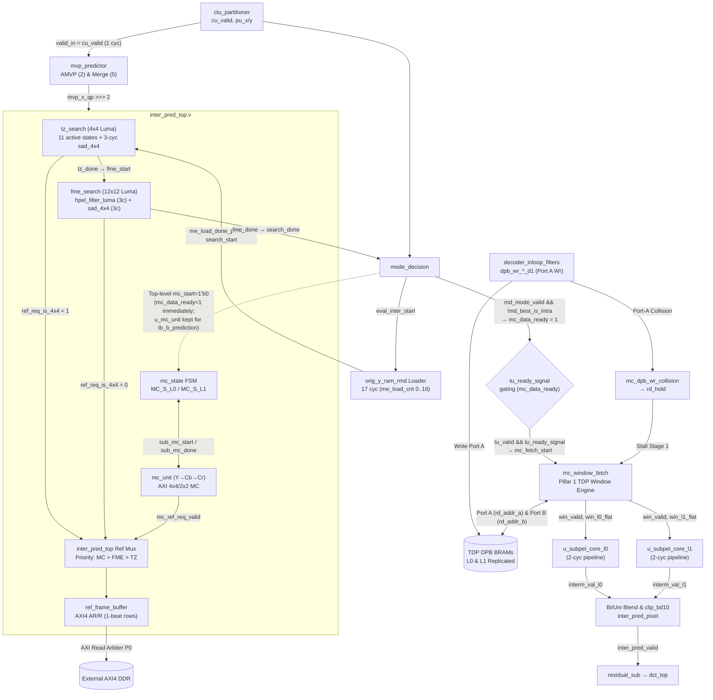
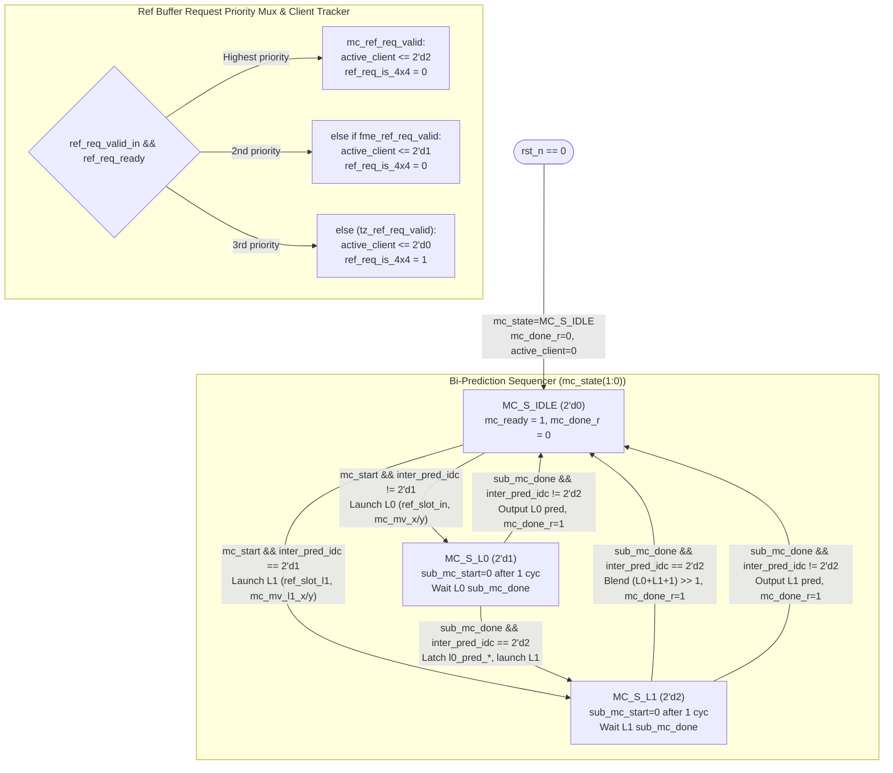
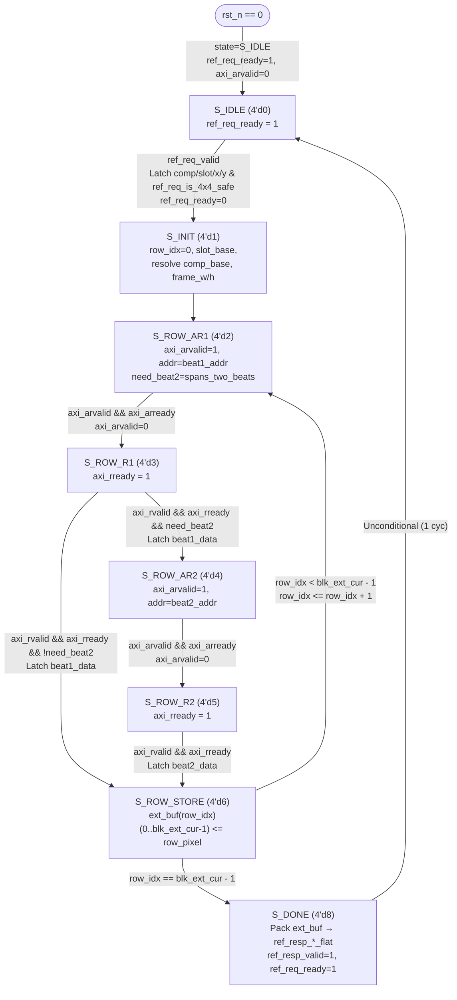
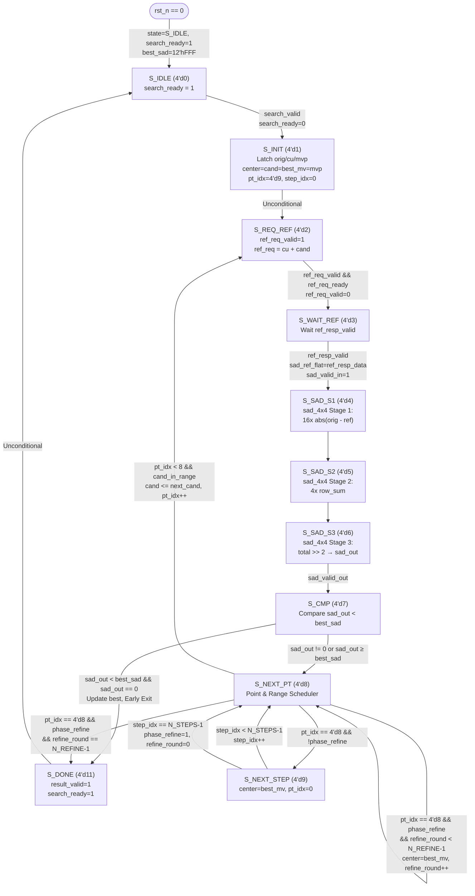
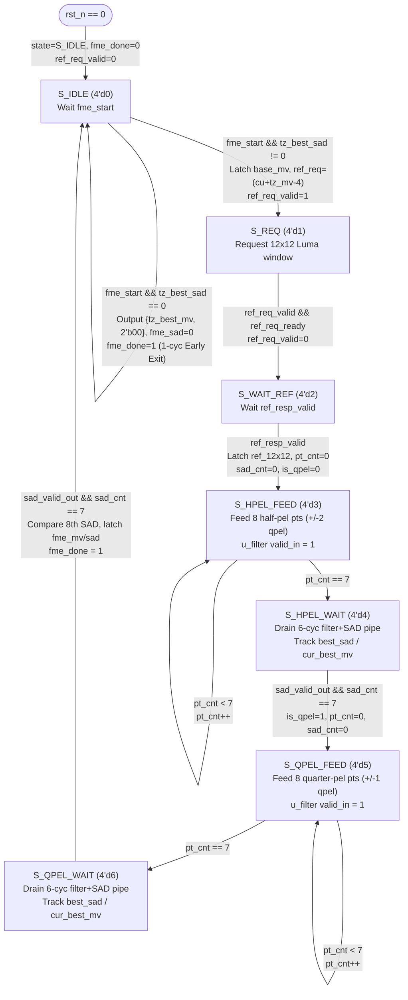
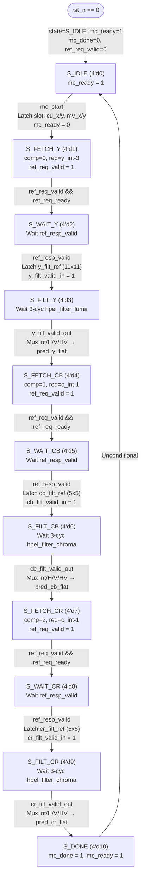
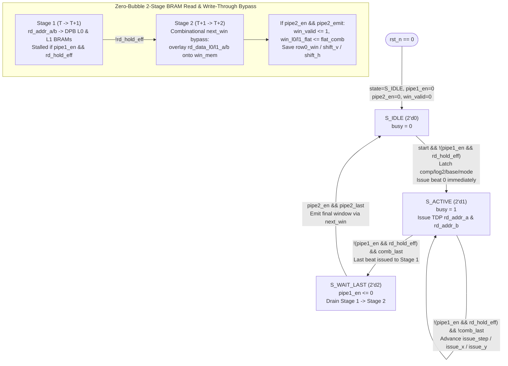
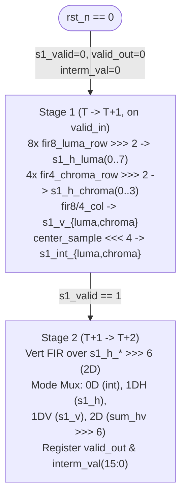
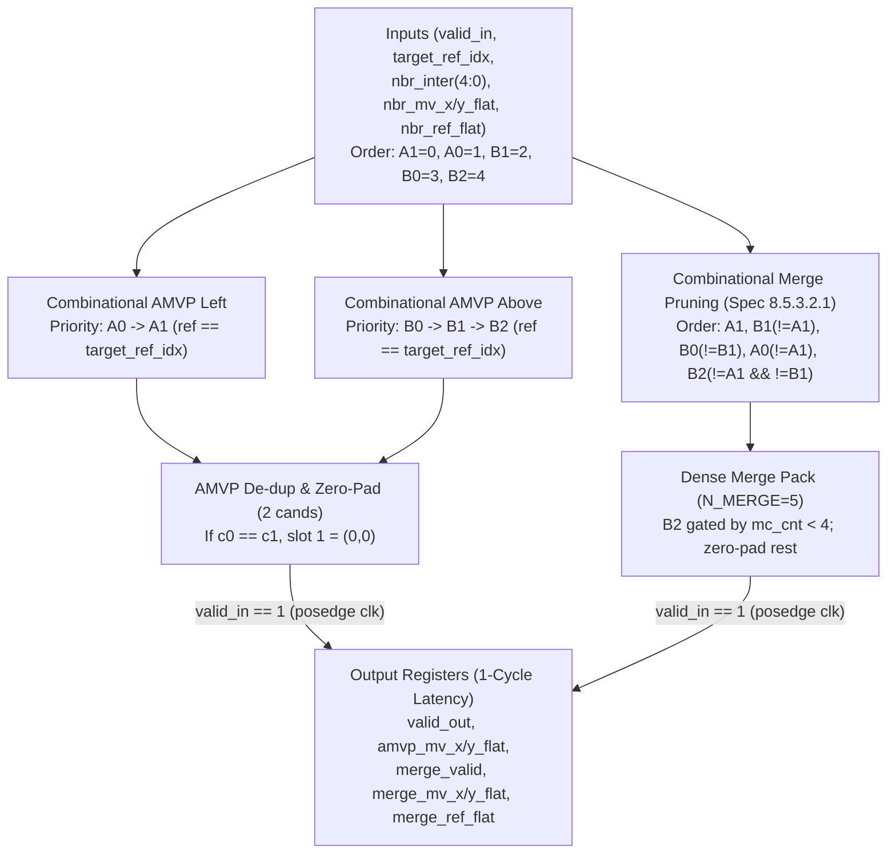

# Inter Prediction & Motion Compensation FSM Reference

This document details every Finite State Machine (FSM), stateful pipeline, and arbitration/stall controller across the Inter Prediction subsystem (`rtl/inter/*`) and its top-level DPB/Pillar-1 wiring in [`rtl/top/hevc_encoder_top.v`](file:///d:/UIT_Doc/hevc_hw_encoder/rtl/top/hevc_encoder_top.v).

## Module Index

| Module | Source File | Control Type | State Register / Stages | Primary Role |
|:---|:---|:---|:---|:---|
| [`inter_pred_top`](#2-inter_pred_top-rtlinterinter_pred_topv) | [`rtl/inter/inter_pred_top.v`](file:///d:/UIT_Doc/hevc_hw_encoder/rtl/inter/inter_pred_top.v) | FSM + Fixed-Priority Arbiter | `mc_state[1:0]`, `active_client[1:0]` | Top-level ME (`tz_search` &rarr; `fme_search`), AXI ref arbiter, and L0/L1/BI MC sequencer |
| [`ref_frame_buffer`](#3-ref_frame_buffer-rtlinterref_frame_bufferv) | [`rtl/inter/ref_frame_buffer.v`](file:///d:/UIT_Doc/hevc_hw_encoder/rtl/inter/ref_frame_buffer.v) | AXI4 Read Master FSM | `state[3:0]` (9 `localparam`s, 8 active) | Row-by-row DDR window fetch, border clamping, `4x4` Luma bypass (`ref_req_is_4x4_safe`) |
| [`tz_search` & `sad_4x4`](#4-tz_search--sad_4x4-rtlintertz_searchv-rtlintersad_4x4v) | [`rtl/inter/tz_search.v`](file:///d:/UIT_Doc/hevc_hw_encoder/rtl/inter/tz_search.v), [`rtl/inter/sad_4x4.v`](file:///d:/UIT_Doc/hevc_hw_encoder/rtl/inter/sad_4x4.v) | Search FSM + 3-Stage Pipe | `state[3:0]` (12 `localparam`s, 11 active) + 3-stage SAD | Integer-pel Test Zone diamond/square search and 3-cycle 4x4 Main10 SAD |
| [`fme_search`](#5-fme_search-rtlinterfme_searchv) | [`rtl/inter/fme_search.v`](file:///d:/UIT_Doc/hevc_hw_encoder/rtl/inter/fme_search.v) | Refinement FSM | `state[3:0]` (8 `localparam`s, 7 active) | 12x12 Luma fetch + 8-pt half-pel & 8-pt quarter-pel SAD refinement |
| [`mc_unit`](#6-mc_unit-rtlintermc_unitv) | [`rtl/inter/mc_unit.v`](file:///d:/UIT_Doc/hevc_hw_encoder/rtl/inter/mc_unit.v) | Sequential MC FSM | `state[3:0]` (11 active states) | Sequential Y (11x11) &rarr; Cb (5x5) &rarr; Cr (5x5) AXI-backed 4x4/2x2 interpolation |
| [`mc_window_fetch`](#7-mc_window_fetch-rtlintermc_window_fetchv--pillar-1-tdp-engine) | [`rtl/inter/mc_window_fetch.v`](file:///d:/UIT_Doc/hevc_hw_encoder/rtl/inter/mc_window_fetch.v) | Pillar 1 TDP Fetch FSM + 2-Stage Pipe | `state[1:0]` (3 states), `pipe1`/`pipe2` | True Dual-Port DPB sliding-column fetcher (`4x4..32x32` TU), `rd_hold` stall, `next_win` bypass, `row0_win` reuse |
| [`subpel_interpolation_core`](#81-subpel_interpolation_core-rtlintersubpel_interpolation_corev) | [`rtl/inter/subpel_interpolation_core.v`](file:///d:/UIT_Doc/hevc_hw_encoder/rtl/inter/subpel_interpolation_core.v) | 2-Stage Feed-Forward Pipe | `s1_valid` &rarr; `valid_out` | 1-sample/cycle H.265 8-tap Luma / 4-tap Chroma unclipped 16-bit interpolation |
| [`mvp_predictor`](#82-mvp_predictor-rtlintermvp_predictorv) | [`rtl/inter/mvp_predictor.v`](file:///d:/UIT_Doc/hevc_hw_encoder/rtl/inter/mvp_predictor.v) | 1-Cycle Registered Pipe | `valid_in` &rarr; `valid_out` | Combinational AMVP (`A0,A1,B0,B1,B2`) & spatial Merge (`N_MERGE=5`) list builder |

---

## 1. Inter ME &rarr; FME &rarr; TDP MC Window Fetch Pipeline Overview

In [`rtl/top/hevc_encoder_top.v`](file:///d:/UIT_Doc/hevc_hw_encoder/rtl/top/hevc_encoder_top.v#L700-L2461), Inter prediction spans two cooperating datapaths:

1. **Motion Estimation & Mode Decision Control Path (`mvp_predictor` &rarr; `inter_pred_top` [`tz_search` &rarr; `fme_search`] &rarr; `mode_decision` &rarr; `mc_unit`)**:
   - On `cu_valid` from `ctu_partitioner`, [`u_mvp_predictor`](file:///d:/UIT_Doc/hevc_hw_encoder/rtl/top/hevc_encoder_top.v#L873-L894) computes 2 AMVP candidates and up to 5 spatial Merge candidates in 1 cycle (`amvp_mv_x/y_flat`, `merge_*_flat`).
   - When `u_mode_decision` asserts `eval_inter_start`, a 17-cycle loader (`me_load_active`, `me_load_cnt = 0..16`, [`hevc_encoder_top.v:1128-1165`](file:///d:/UIT_Doc/hevc_hw_encoder/rtl/top/hevc_encoder_top.v#L1128-L1165)) reads the 4x4 Luma original pixels at `(pu_x, pu_y)` from `orig_y_ram_rmd` into `search_orig_flat` and pulses `me_load_done_pulse` (`u_inter_pred.search_start`).
   - Inside `inter_pred_top`, `u_tz_search` executes integer-pel TZ search using the **4x4 Luma bypass** (`ref_req_is_4x4 = 1`) on `u_ref_frame_buffer` (Port 0 of `axi_read_arbiter`), then pulses `tz_done` to launch `u_fme_search` (which fetches one 12x12 Luma window unless `tz_best_sad == 0`). `fme_done` drives `search_done` to `u_mode_decision`.
   - Note that in [`hevc_encoder_top.v`](file:///d:/UIT_Doc/hevc_hw_encoder/rtl/top/hevc_encoder_top.v), `u_inter_pred.mc_start` is tied `1'b0` (`mc_data_ready <= 1'b1` immediately on `md_mode_valid && !md_best_is_intra`), eliminating the redundant post-MD `u_mc_unit` AXI read stall because `mc_pred_*_flat` outputs are unused at top level and actual Inter TU prediction runs through Pillar 1 `u_mc_window_fetch` + dual `u_subpel_core_l0/l1` (`u_mc_unit` remains intact inside `inter_pred_top.v` for unit testbench `tb_b_prediction`).
2. **Pillar 1 Streaming TDP DPB Motion Compensation Path (`mc_window_fetch` &rarr; dual `subpel_interpolation_core` &rarr; `residual_sub`)**:
   - Note that `u_inter_pred.mc_pred_*_flat` outputs are left unconnected to the TU residual path in `hevc_encoder_top.v`; actual `4x4..32x32` Y/Cb/Cr prediction samples for `u_residual_sub` are generated by the Pillar 1 streaming DPB engine ([`hevc_encoder_top.v:2154-2461`](file:///d:/UIT_Doc/hevc_hw_encoder/rtl/top/hevc_encoder_top.v#L2154-L2461)).
   - For each accepted Inter TU (`tu_valid && tu_ready_signal && !latched_cu_is_intra`), `mc_fetch_start` triggers `u_mc_window_fetch`, which reads replicated True Dual-Port L0 and L1 DPB BRAMs (`dpb_{luma,cb,cr}_ram_{l0,l1}`) at up to 2 samples/cycle (`rd_addr_a`, `rd_addr_b`), stalling Stage-1 reads via `rd_hold = mc_dpb_wr_collision` whenever the in-loop filter writes back to Port A of the active component (`dpb_wr_*_d1`).
   - `u_mc_window_fetch` streams phase-aligned 8x8 Luma / 4x4 Chroma windows (`win_valid`, `win_l0_flat`, `win_l1_flat`) in parallel into `u_subpel_core_l0` and `u_subpel_core_l1` (2-cycle pipeline), whose 16-bit signed outputs are blended (`(l0 + l1 + 16) >>> 5` for B-slice bi-prediction, `(l0 + 8) >>> 4` for uni-prediction) and clipped (`clip_bd10`) into `inter_pred_pixel`.

---

## 2. `inter_pred_top` (`rtl/inter/inter_pred_top.v`)

### (a) FSM & Arbitration Diagram

### (b) State Encoding & Responsibility Table

| Register / Signal | Encoding / Width | State Name | Responsibility & Output Actions | Typical / Active Latency |
|:---|:---|:---|:---|:---|
| `mc_state[1:0]` | `2'd0` | `MC_S_IDLE` | Reset state. Drives `mc_ready = 1`, clears `mc_done_r <= 0`. Latches `sub_mc_slot`, `sub_mc_mv_x/y`, pulses `sub_mc_start <= 1` on `mc_start`. | Wait state |
| `mc_state[1:0]` | `2'd1` | `MC_S_L0` | Clears `sub_mc_start <= 0`. Waits for L0 `u_mc_unit` completion (`sub_mc_done`). Captures `l0_pred_{y,cb,cr}` and starts L1 if `inter_pred_idc == 2'd2`, else outputs L0 prediction with `mc_done_r <= 1`. | 1 `u_mc_unit` pass (~85–145 cyc w/ zero-wait AXI) |
| `mc_state[1:0]` | `2'd2` | `MC_S_L1` | Clears `sub_mc_start <= 0`. Waits for L1 `u_mc_unit` completion (`sub_mc_done`). If `inter_pred_idc == 2'd2`, blends `(l0 + sub_pred + 1) >> 1` across 16 Y + 4 Cb + 4 Cr pixels; else passes L1 prediction. Asserts `mc_done_r <= 1`. (`2'd3` reserved; `default: mc_state <= MC_S_IDLE`). | 1 `u_mc_unit` pass |
| `active_client[1:0]` | `2'd0` / `2'd1` / `2'd2` | `0=TZ`, `1=FME`, `2=MC` | Latched on `ref_req_valid_in && ref_req_ready` ([`L111-119`](file:///d:/UIT_Doc/hevc_hw_encoder/rtl/inter/inter_pred_top.v#L111-L119)). Demuxes `ref_resp_valid` exclusively to the requesting client. | Held per request |

### (c) Transition & Guard Condition Table

| Current State | Guard Condition | Next State | Register / Output Updates |
|:---|:---|:---|:---|
| `MC_S_IDLE` | `!mc_start` | `MC_S_IDLE` | `mc_done_r <= 0` |
| `MC_S_IDLE` | `mc_start && (inter_pred_idc == 2'd1)` | `MC_S_L1` | `mc_done_r <= 0`, `sub_mc_start <= 1`, `sub_mc_slot <= ref_slot_l1`, `sub_mc_mv_{x,y} <= mc_mv_l1_{x,y}` |
| `MC_S_IDLE` | `mc_start && (inter_pred_idc != 2'd1)` | `MC_S_L0` | `mc_done_r <= 0`, `sub_mc_start <= 1`, `sub_mc_slot <= ref_slot_in`, `sub_mc_mv_{x,y} <= mc_mv_{x,y}` |
| `MC_S_L0` | `!sub_mc_done` | `MC_S_L0` | `sub_mc_start <= 0` |
| `MC_S_L0` | `sub_mc_done && (inter_pred_idc == 2'd2)` | `MC_S_L1` | `l0_pred_{y,cb,cr} <= sub_pred_*`, `sub_mc_start <= 1`, `sub_mc_slot <= ref_slot_l1`, `sub_mc_mv_{x,y} <= mc_mv_l1_{x,y}` |
| `MC_S_L0` | `sub_mc_done && (inter_pred_idc != 2'd2)` | `MC_S_IDLE` | `mc_pred_{y,cb,cr}_flat <= sub_pred_*`, `mc_done_r <= 1`, `sub_mc_start <= 0` |
| `MC_S_L1` | `!sub_mc_done` | `MC_S_L1` | `sub_mc_start <= 0` |
| `MC_S_L1` | `sub_mc_done && (inter_pred_idc == 2'd2)` | `MC_S_IDLE` | `mc_pred_{y,cb,cr}_flat[px] <= ({1'b0, l0_pred} + {1'b0, sub_pred} + 11'd1) >> 1`, `mc_done_r <= 1` |
| `MC_S_L1` | `sub_mc_done && (inter_pred_idc != 2'd2)` | `MC_S_IDLE` | `mc_pred_{y,cb,cr}_flat <= sub_pred_*`, `mc_done_r <= 1` |

### (d) Reset, Backpressure, Arbitration & `4x4` Luma Search Bypass Behavior

- **Asynchronous Reset (`!rst_n`)**: Resets `mc_state <= MC_S_IDLE`, `active_client <= 2'd0`, `sub_mc_start <= 0`, `mc_done_r <= 0`, and zeros `sub_mc_*`, `l0_pred_*`, and `mc_pred_*_flat`.
- **Priority Arbitration & Backpressure (`L86-96`)**: Combinational priority gives `u_mc_unit` highest priority (`mc_ref_req_ready = ref_req_ready`), `u_fme_search` second (`&& !mc_ref_req_valid`), and `u_tz_search` lowest (`&& !mc_ref_req_valid && !fme_ref_req_valid`). Because `u_ref_frame_buffer` drops `ref_req_ready` immediately upon accepting a request in `S_IDLE` and holds it low until `S_DONE`, `active_client` cannot be corrupted by a second request while an AXI window fetch is active.
- **4x4 Luma Search Bypass (`ref_req_is_4x4`)**: Driven as `(!mc_ref_req_valid && !fme_ref_req_valid && tz_ref_req_valid)`. Only TZ integer search uses 4x4 Luma bypass; `u_ref_frame_buffer` overrides `BLK_EXT_Y` (`12`) down to `4x4` when `ref_req_is_4x4_safe == 1`, and `ext_tz` ([`L122-128`](file:///d:/UIT_Doc/hevc_hw_encoder/rtl/inter/inter_pred_top.v#L122-L128)) extracts rows `0..3`, cols `0..3` from the 12x12-strided `ref_resp_y_flat`. Meanwhile `u_fme_search` receives the full 12x12 `ref_resp_y_flat` (`1440` bits), and `u_mc_unit` extracts the top-left 11x11 slice via `ext_mc` ([`L241-247`](file:///d:/UIT_Doc/hevc_hw_encoder/rtl/inter/inter_pred_top.v#L241-L247)).
- **Corner Cases**:
  - `sub_mc_ready` is wired to `u_mc_unit.mc_ready` ([`L279`](file:///d:/UIT_Doc/hevc_hw_encoder/rtl/inter/inter_pred_top.v#L279)) but not checked in `MC_S_IDLE`/`MC_S_L0`; this is safe only because `u_mc_unit` asserts `mc_done` in `S_DONE` while transitioning unconditionally into `S_IDLE` on the next clock edge, so `sub_mc_start == 1` is always sampled in `u_mc_unit.S_IDLE`.
  - `case (mc_state)` includes `default: mc_state <= MC_S_IDLE;` (unused `MC_S_DONE = 2'd3` removed, preserving active encodings `0/1/2`).

---

## 3. `ref_frame_buffer` (`rtl/inter/ref_frame_buffer.v`)

### (a) FSM Diagram

### (b) State Encoding & Responsibility Table

| Register | Encoding | State Name | Responsibility & Outputs | Latency |
|:---|:---|:---|:---|:---|
| `state[3:0]` | `4'd0` | `S_IDLE` | Holds `ref_req_ready <= 1`. On `ref_req_valid`, clears `ref_req_ready <= 0` and latches `comp_r`, `slot_r`, sign-extended `req_x_r`/`req_y_r`, and `req_is_4x4_r <= ref_req_is_4x4_safe`. | Wait state |
| `state[3:0]` | `4'd1` | `S_INIT` | Resets `row_idx <= 0`; computes `slot_base = slot_r * SLOT_STRIDE`, selects `frame_w`, `frame_h`, `stride`, and `comp_base` (`0` for Y, `CB_OFFSET` for Cb, `CR_OFFSET` for Cr). | 1 cycle |
| `state[3:0]` | `4'd2` | `S_ROW_AR1` | Drives `axi_arvalid <= 1`, `axi_araddr <= beat1_addr` (32B aligned), `axi_arlen <= 0` (1 beat), `axi_arsize <= 3'b101` (32B), `axi_arburst <= 2'b01` (`INCR`), and `need_beat2 <= spans_two_beats`. | 2+ cyc (1 cyc assert + AR wait) |
| `state[3:0]` | `4'd3` | `S_ROW_R1` | Combinationally drives `axi_rready = 1` ([`L137`](file:///d:/UIT_Doc/hevc_hw_encoder/rtl/inter/ref_frame_buffer.v#L137)). Captures `beat1_data <= axi_rdata` on `axi_rvalid && axi_rready`. | 1+ cyc |
| `state[3:0]` | `4'd4` | `S_ROW_AR2` | Issues 2nd single-beat AXI read at `beat2_addr = beat1_addr + 32` when a row crosses a 32-byte boundary (`16` pixels/beat). | 2+ cyc (if `need_beat2`) |
| `state[3:0]` | `4'd5` | `S_ROW_R2` | Combinationally drives `axi_rready = 1`. Captures `beat2_data <= axi_rdata` on `axi_rvalid && axi_rready`. | 1+ cyc (if `need_beat2`) |
| `state[3:0]` | `4'd6` | `S_ROW_STORE` | Stores `row_pixel[0..blk_ext_cur-1]` (combinational border-clamped extraction) into `ext_buf[row_idx][ci]`. Advances `row_idx` or exits to `S_DONE` (`4'd7` reserved). | 1 cycle |
| `state[3:0]` | `4'd8` | `S_DONE` | Zeroes all `ref_resp_*_flat`, packs active component from `ext_buf` (`12x12` Y in `inter_pred_top` or `5x5` C), pulses `ref_resp_valid <= 1`, sets `ref_req_ready <= 1`. | 1 cycle |

**Total Request Latency (zero-wait AXI slave: `axi_arready=1`, `axi_rvalid=1`)**:
- Per row = `2 (AR1) + 1 (R1) + [0 or 3 (AR2+R2)] + 1 (STORE)` = **4 cycles** (1 beat) or **7 cycles** (2 beats).
- **4x4 Luma bypass (`req_is_4x4_r=1`)**: `1 (INIT) + 4*(4..7) + 1 (DONE)` = **18–30 cycles** after acceptance (`S_IDLE->S_INIT`).
- **5x5 Chroma MC (`BLK_EXT_C=5`)**: `1 + 5*(4..7) + 1` = **22–37 cycles**.
- **12x12 Luma FME / MC (`BLK_EXT_Y=12` in `inter_pred_top`)**: `1 + 12*(4..7) + 1` = **50–86 cycles**.

### (c) Transition & Guard Condition Table

| Current State | Guard Condition | Next State | Key Actions |
|:---|:---|:---|:---|
| `S_IDLE` | `ref_req_valid` | `S_INIT` | `ref_req_ready <= 0`, latch request + `req_is_4x4_r <= ref_req_is_4x4_safe` |
| `S_INIT` | Unconditional | `S_ROW_AR1` | `row_idx <= 0`, resolve `slot_base`, `comp_base`, `frame_w/h`, `stride` |
| `S_ROW_AR1` | `axi_arvalid && axi_arready` | `S_ROW_R1` | `axi_arvalid <= 0` |
| `S_ROW_AR1` | `!(axi_arvalid && axi_arready)` | `S_ROW_AR1` | Hold `axi_arvalid <= 1`, `axi_araddr <= beat1_addr`, `need_beat2 <= spans_two_beats` |
| `S_ROW_R1` | `axi_rvalid && axi_rready && need_beat2` | `S_ROW_AR2` | `beat1_data <= axi_rdata` |
| `S_ROW_R1` | `axi_rvalid && axi_rready && !need_beat2` | `S_ROW_STORE` | `beat1_data <= axi_rdata` |
| `S_ROW_AR2` | `axi_arvalid && axi_arready` | `S_ROW_R2` | `axi_arvalid <= 0` |
| `S_ROW_R2` | `axi_rvalid && axi_rready` | `S_ROW_STORE` | `beat2_data <= axi_rdata` |
| `S_ROW_STORE` | `row_idx == blk_ext_cur - 4'd1` | `S_DONE` | Store `ext_buf[row_idx][0..blk_ext_cur-1]` |
| `S_ROW_STORE` | `row_idx != blk_ext_cur - 4'd1` | `S_ROW_AR1` | Store row, `row_idx <= row_idx + 4'd1` |
| `S_DONE` | Unconditional | `S_IDLE` | `ref_resp_valid <= 1`, `ref_req_ready <= 1`, pack `ref_resp_*_flat` |

### (d) Reset, Backpressure, 4x4 Bypass & 4-State Guard Behavior

- **Asynchronous Reset (`!rst_n`)**: Sets `state <= S_IDLE`, `ref_req_ready <= 1`, `ref_resp_valid <= 0`, `axi_arvalid <= 0`, `req_is_4x4_r <= 0`, `need_beat2 <= 0`, and initializes `frame_w/h`/`stride` to `FRAME_W_Y`/`FRAME_H_Y`.
- **Response Interface (No Backpressure)**: `ref_resp_valid` is a single-cycle pulse (`L285` default `0`, `L427` sets `1` in `S_DONE`); there is no `ref_resp_ready` signal, so downstream requesters (`tz_search`, `fme_search`, `mc_unit`) must capture `ref_resp_*_flat` immediately when `ref_resp_valid == 1`. Also note `S_DONE` sets `ref_req_ready <= 1` on the same edge it transitions to `S_IDLE`, allowing back-to-back request acceptance with 1 idle cycle.
- **4x4 Luma Bypass & `ref_req_is_4x4_safe` 4-State Guard (`L165-172`)**: Under `` `ifndef SYNTHESIS ``, `ref_req_is_4x4_safe = (ref_req_is_4x4 === 1'b1)` ensures an undriven or `1'bx` bypass input in simulation defaults safely to full `BLK_EXT_Y` fetch instead of corrupting `blk_ext_cur`. Under `` `ifdef SYNTHESIS ``, it reduces directly to `ref_req_is_4x4` with zero datapath difference. When `comp_r == 2'd0` and `req_is_4x4_r == 1`, `blk_ext_cur` shrinks from `12` to `4`, cutting AXI row loops from 12 rows to 4 rows.
- **Border Clamping & Beat Alignment**: `clamp_coord` saturates signed coordinates (`req_x_r + gci`, `req_y_r + row_idx`) to `[0, frame_w-1]` and `[0, frame_h-1]` per HM `TComPicYuv::extendPicBorder`. Each 256-bit beat packs 16 Main10 samples (`2` pixels per 32-bit word: `[9:0]` even, `[25:16]` odd), so `spans_two_beats` detects whether `px0_addr` and `px_last_addr` cross a 32-byte (`addr[AXI_AW-1:5]`) boundary.

---

## 4. `tz_search` & `sad_4x4` (`rtl/inter/tz_search.v`, `rtl/inter/sad_4x4.v`)

### (a) FSM & SAD Pipeline Diagram

### (b) State Encoding & Responsibility Table

| Module / Register | Encoding / Width | State / Stage | Responsibility & Datapath Actions | Latency |
|:---|:---|:---|:---|:---|
| `tz_search.state[3:0]` | `4'd0` | `S_IDLE` | Holds `search_ready <= 1`; accepts `search_valid`. | Wait state |
| `tz_search.state[3:0]` | `4'd1` | `S_INIT` | Latches `orig_r`, `cu_x_r/y_r`, `mvp_x_r/y_r`; sets `center = cand = best_mv = mvp`, `best_sad = 12'hFFF`, `step_idx = 0` (`step=32`), `pt_idx = 4'd9` (center sentinel), `phase_refine = 0`, `refine_round = 0`. | 1 cycle |
| `tz_search.state[3:0]` | `4'd2` | `S_REQ_REF` | Asserts `ref_req_valid <= 1` with `ref_x_req = $signed({1'b0, cu_x_r}) + cand_x`, `ref_y_req = $signed({1'b0, cu_y_r}) + cand_y`. | 2+ cyc |
| `tz_search.state[3:0]` | `4'd3` | `S_WAIT_REF` | Waits for `ref_resp_valid`; captures `sad_ref_flat <= ref_resp_data` and pulses `sad_valid_in <= 1`. | 18–30 cyc (via `ref_frame_buffer` 4x4 bypass) |
| `tz_search.state[3:0]` | `4'd4` | `S_SAD_S1` | Waits for `sad_4x4` Stage 1 (`s1_abs[0:3][0:3]`: 16× `10`-bit `|orig - ref|`). | 1 cycle |
| `tz_search.state[3:0]` | `4'd5` | `S_SAD_S2` | Waits for `sad_4x4` Stage 2 (`s2_row[0:3]`: 4× `12`-bit row sums). | 1 cycle |
| `tz_search.state[3:0]` | `4'd6` | `S_SAD_S3` | Waits for `sad_4x4` Stage 3 (`sad_valid_out`, `sad_out[11:0] = sad_raw_comb[13:2]` = `>> 2` Main10 shift). | 1 cycle |
| `tz_search.state[3:0]` | `4'd7` | `S_CMP` | Updates `best_sad`, `best_mv_x`, `best_mv_y` if `sad_out < best_sad`; triggers early exit on `sad_out == 0`. | 1 cycle |
| `tz_search.state[3:0]` | `4'd8` | `S_NEXT_PT` | Handles center sentinel (`pt_idx==9` &rarr; `0`), 8-point square offsets (`dx_lut/dy_lut[0..7]` scaled by `step_val`), `cand_in_range` (`mvp ± 32`) skip, and refinement round restarts. | 1 cyc/point (or 1 cyc skip) |
| `tz_search.state[3:0]` | `4'd9` | `S_NEXT_STEP` | Re-centers `center_{x,y} <= best_mv_{x,y}`, resets `pt_idx <= 0`; advances `step_idx` (`32,16,8,4,2,1`) or enables `phase_refine <= 1` (`4'd10` reserved). | 1 cycle |
| `tz_search.state[3:0]` | `4'd11` | `S_DONE` | Pulses `result_valid <= 1`, sets `search_ready <= 1`, returns to `S_IDLE`. | 1 cycle |
| `sad_4x4` (`PIPELINED=1`) | 3 pipe stages | `s1_valid` &rarr; `s2_valid` &rarr; `valid_r` | Stage 1: `diff_signed[10:0]` &rarr; `s1_abs[9:0]`; Stage 2: `s2_row[11:0]`; Stage 3: `sad_raw_comb[13:0] >>> 2` &rarr; `sad_out[11:0]` (max `4092`). | 3 cycles total |

### (c) Transition & Guard Condition Table

| Current State | Guard Condition | Next State | Register / Output Updates |
|:---|:---|:---|:---|
| `S_IDLE` | `search_valid` | `S_INIT` | `search_ready <= 0` |
| `S_INIT` | Unconditional | `S_REQ_REF` | `center <= mvp`, `cand <= mvp`, `best_mv <= mvp`, `best_sad <= 12'hFFF`, `pt_idx <= 4'd9`, `step_idx <= 0`, `phase_refine <= 0` |
| `S_REQ_REF` | `ref_req_valid && ref_req_ready` | `S_WAIT_REF` | `ref_req_valid <= 0` |
| `S_WAIT_REF` | `ref_resp_valid` | `S_SAD_S1` | `sad_ref_flat <= ref_resp_data`, `sad_valid_in <= 1` |
| `S_SAD_S1` / `S_SAD_S2` | Unconditional | `S_SAD_S2` / `S_SAD_S3` | `sad_valid_in <= 0` |
| `S_SAD_S3` | `sad_valid_out` | `S_CMP` | — |
| `S_CMP` | `(sad_out < best_sad) && (sad_out == 0)` | `S_DONE` | `best_sad <= 0`, `best_mv_{x,y} <= cand_{x,y}` |
| `S_CMP` | Otherwise | `S_NEXT_PT` | If `sad_out < best_sad`: update `best_sad`, `best_mv_{x,y}` |
| `S_NEXT_PT` | `pt_idx == 4'd9` | `S_NEXT_PT` | `pt_idx <= 4'd0` |
| `S_NEXT_PT` | `(pt_idx == 4'd8) && !phase_refine` | `S_NEXT_STEP` | — |
| `S_NEXT_PT` | `(pt_idx == 4'd8) && phase_refine && (refine_round == N_REFINE - 1)` | `S_DONE` | — |
| `S_NEXT_PT` | `(pt_idx == 4'd8) && phase_refine && (refine_round < N_REFINE - 1)` | `S_NEXT_PT` | `refine_round++`, `center <= best_mv`, `pt_idx <= 0` |
| `S_NEXT_PT` | `(pt_idx < 4'd8) && cand_in_range` | `S_REQ_REF` | `pt_idx++`, `cand <= next_cand` |
| `S_NEXT_PT` | `(pt_idx < 4'd8) && !cand_in_range` | `S_NEXT_PT` | `pt_idx++` (skip out-of-range point) |
| `S_NEXT_STEP` | `step_idx == N_STEPS - 1` | `S_NEXT_PT` | `center <= best_mv`, `pt_idx <= 0`, `phase_refine <= 1`, `refine_round <= 0` |
| `S_NEXT_STEP` | `step_idx < N_STEPS - 1` | `S_NEXT_PT` | `center <= best_mv`, `pt_idx <= 0`, `step_idx++` |
| `S_DONE` | Unconditional | `S_IDLE` | `result_valid <= 1`, `search_ready <= 1` |

### (d) Reset, Backpressure, Search Bounds & Corner-Case Behavior

- **Asynchronous Reset (`!rst_n`)**: Sets `state <= S_IDLE`, `search_ready <= 1`, `result_valid <= 0`, `ref_req_valid <= 0`, `sad_valid_in <= 0`, `best_sad <= 12'hFFF`, and clears MV/index registers.
- **Ref-Buffer Handshake & Backpressure**: `S_REQ_REF` holds `ref_req_valid = 1` until `ref_req_valid && ref_req_ready`, stalling cleanly if `inter_pred_top` arbitrates `u_mc_unit` or `u_fme_search` ahead of `u_tz_search`. `S_WAIT_REF` supports arbitrary AXI latency on `ref_resp_valid`.
- **Search Range Guard (`cand_in_range`, `L232-241`)**: Both `mvp_{x,y}_r` and `next_cand_{x,y}` are sign-extended to `MV_W+1` bits (`11`-bit signed) before comparing against `mvp ± SRCH_RNG` (`±32`), preventing two's-complement wrap-around false passes at extreme MVs.
- **Candidate Count Nuance**: Although the header comment mentions `53` max candidates, the RTL (`L394-405` + `L435-439`) holds `step_idx == 5` (`step_val = 1`) during `phase_refine == 1` and evaluates all `8` square points (`pt_idx = 0..7`) across all `N_REFINE = 4` rounds (`1 + 6*8 + 4*8 = 81` max candidates unless early-terminated by `sad_out == 0` or clipped by `cand_in_range`).
- **Early Exit**: On `sad_out == 0` in `S_CMP`, `tz_search` jumps straight to `S_DONE` (and `fme_search` likewise exits in 1 cycle when `tz_best_sad == 0`).

---

## 5. `fme_search` (`rtl/inter/fme_search.v`)

### (a) FSM Diagram

### (b) State Encoding & Responsibility Table

| Register / Sub-Block | Encoding / Width | State / Pipeline | Responsibility & Datapath Actions | Latency |
|:---|:---|:---|:---|:---|
| `state[3:0]` | `4'd0` | `S_IDLE` | Waits for `fme_start`. Latches `base_mv_{x,y}`, initializes `cur_best_mv = {tz_best_mv, 2'b00}`, `best_sad = tz_best_sad`. Zero-SAD early exit pulses `fme_done <= 1`; otherwise requests 12x12 window at `(cu + tz_best_mv - 4)`. | Wait state (1 cyc if `tz_best_sad == 0`) |
| `state[3:0]` | `4'd1` | `S_REQ` | Holds `ref_req_valid = 1` until `ref_req_ready == 1`. | 1+ cyc |
| `state[3:0]` | `4'd2` | `S_WAIT_REF` | Captures `ref_resp_y_flat` (`1440` bits = 12x12) into `ref_12x12`; resets `pt_cnt <= 0`, `sad_cnt <= 0`, `is_qpel <= 0`. | 50–86 cyc (via `ref_frame_buffer` 12x12) |
| `state[3:0]` | `4'd3` | `S_HPEL_FEED` | Streams `pt_cnt = 0..7` (`±2` qpel offsets around integer `cur_best_mv`) into `u_filter` (`hpel_filter_luma`, `valid_in = 1`). | 8 cycles |
| `state[3:0]` | `4'd4` | `S_HPEL_WAIT` | Drains remaining `hpel_filter_luma` (3 cyc) + `sad_4x4` (3 cyc) results; increments `sad_cnt` on `sad_valid_out` until `sad_cnt == 7`. | 6 cycles (from `pt_cnt=7` to `sad_cnt=7`) |
| `state[3:0]` | `4'd5` | `S_QPEL_FEED` | Streams `pt_cnt = 0..7` (`±1` qpel offsets around half-pel winner `cur_best_mv`) into `u_filter`. | 8 cycles |
| `state[3:0]` | `4'd6` | `S_QPEL_WAIT` | Drains remaining 6-cycle pipe; on `sad_valid_out && sad_cnt == 7`, evaluates final 8th SAD directly into `fme_mv_{x,y}` / `fme_sad`, pulses `fme_done <= 1`, returns to `S_IDLE` (`4'd7` reserved; `default: state <= S_IDLE`). | 6 cycles |
| `sel_delay[0:2]` & `target_mv_*_delay[0:6]` | 2-bit×3 & 12-bit×7 | Pipeline Align | `sel_delay[2]` aligns `t_sel` (H/V/HV) with 3-cycle `hpel_filter_luma.valid_out`. `target_mv_{x,y}_delay[5]` aligns candidate MV with 6-cycle (`3+3`) `u_sad.valid_out`. | 3 cyc / 6 cyc |

### (c) Transition & Guard Condition Table

| Current State | Guard Condition | Next State | Key Updates |
|:---|:---|:---|:---|
| `S_IDLE` | `fme_start && (tz_best_sad == 0)` | `S_IDLE` | `fme_mv <= {tz_best_mv, 2'b00}`, `fme_sad <= 0`, `fme_done <= 1` |
| `S_IDLE` | `fme_start && (tz_best_sad != 0)` | `S_REQ` | `ref_req_x <= cu_x + tz_best_mv_x - 4`, `ref_req_y <= cu_y + tz_best_mv_y - 4`, `ref_req_valid <= 1` |
| `S_REQ` | `ref_req_valid && ref_req_ready` | `S_WAIT_REF` | `ref_req_valid <= 0` |
| `S_WAIT_REF` | `ref_resp_valid` | `S_HPEL_FEED` | `ref_12x12 <= ref_resp_y_flat`, `pt_cnt <= 0`, `sad_cnt <= 0`, `is_qpel <= 0` |
| `S_HPEL_FEED` | `pt_cnt < 7` | `S_HPEL_FEED` | `pt_cnt <= pt_cnt + 1` |
| `S_HPEL_FEED` | `pt_cnt == 7` | `S_HPEL_WAIT` | — |
| `S_HPEL_WAIT` | `sad_valid_out && (sad_cnt == 7)` | `S_QPEL_FEED` | `is_qpel <= 1`, `pt_cnt <= 0`, `sad_cnt <= 0` |
| `S_QPEL_FEED` | `pt_cnt < 7` | `S_QPEL_FEED` | `pt_cnt <= pt_cnt + 1` |
| `S_QPEL_FEED` | `pt_cnt == 7` | `S_QPEL_WAIT` | — |
| `S_QPEL_WAIT` | `sad_valid_out && (sad_cnt == 7)` | `S_IDLE` | `fme_mv_{x,y}, fme_sad <= (sad_val < best_sad) ? (target_mv_delay[5], sad_val) : (cur_best_mv, best_sad)`, `fme_done <= 1` |

### (d) Reset, Backpressure, 12x12 Window Mux & Corner-Case Behavior

- **Asynchronous Reset (`!rst_n`)**: Clears `state <= S_IDLE`, `fme_done <= 0`, `ref_req_valid <= 0`, counters, `is_qpel`, `best_sad`, `cur_best_mv_{x,y}`, and `fme_*` outputs (note `ref_12x12`, `base_mv_*`, `ref_req_{x,y}`, and delay pipes are loaded on demand).
- **12x12 &rarr; 11x11 Constant-Indexed 4:1 Mux (`L94-123`)**: Because `target_mv` deviates by at most `±3` quarter-pels from `{base_mv, 2'b00}`, `t_int = target_mv >>> 2` is strictly either `base_mv - 1` (`off=0`) or `base_mv` (`off=1`). Since `ref_12x12` starts at `base_mv - 4`, `(off_y, off_x)` selects one of 4 constant-offset 11x11 sub-windows (`px00`, `px01`, `px10`, `px11`) without variable-index slicing!
- **Concurrent SAD Update & Last-Point Handling (`L211-219, 278-280`)**: Because `sad_valid_out` lags `S_HPEL_FEED` by 6 cycles, the first 2 SAD responses actually arrive while `state` is still in `S_HPEL_FEED` (`pt_cnt = 6, 7`). Concurrent update logic at `L212-219` continuously updates `sad_cnt` and `cur_best_mv/best_sad` across both `FEED` and `WAIT` states! On the 8th response (`sad_cnt == 7`) in `S_QPEL_WAIT`, the NBA update to `cur_best_mv` would take effect one cycle too late for `fme_mv`, so `L278-280` explicitly muxes `(sad_val < best_sad) ? target_mv_delay[5] : cur_best_mv`. Note: in `S_HPEL_WAIT -> S_QPEL_FEED`, `cur_best_mv` receives the 8th half-pel winner via NBA on the exact same edge `S_QPEL_FEED` begins (`pt_cnt=0`), so `pt_cnt=0` in `S_QPEL_FEED` reads the updated `cur_best_mv`!
- **No `fme_ready` Signal**: `fme_search` relies on `inter_pred_top` sequencing `tz_search` -> `fme_search` serially via `tz_done`.

---

## 6. `mc_unit` (`rtl/inter/mc_unit.v`)

### (a) FSM Diagram

### (b) State Encoding & Responsibility Table

| Register | Encoding | State Name | Responsibility & Datapath Actions | Latency |
|:---|:---|:---|:---|:---|
| `state[3:0]` | `4'd0` | `S_IDLE` | Holds `mc_ready <= 1`. On `mc_start`, drops `mc_ready <= 0` and latches `slot_r`, `cu_x_r/y_r`, `mv_x_r/y_r`. | Wait state |
| `state[3:0]` | `4'd1` | `S_FETCH_Y` | Requests 11x11 Luma (`comp=0`) at `y_fetch = y_int - 3` (`y_int = cu + (mv >>> 2)`). | 1+ cyc |
| `state[3:0]` | `4'd2` | `S_WAIT_Y` | Waits for `ref_resp_valid`; captures `y_filt_ref <= ref_resp_y_flat` and pulses `y_filt_valid_in <= 1`. | 46–79 cyc (11x11 AXI) |
| `state[3:0]` | `4'd3` | `S_FILT_Y` | Waits for `u_filt_y` (`hpel_filter_luma`) `y_filt_valid_out`; selects `y_int_out`, `y_h_out`, `y_v_out`, or `y_hv_out` into `pred_y_flat`. | 3 cycles |
| `state[3:0]` | `4'd4` | `S_FETCH_CB` | Requests 5x5 Cb (`comp=1`) at `c_fetch = c_int - 1` (`c_int = cu/2 + (mv >>> 3)`). | 1+ cyc |
| `state[3:0]` | `4'd5` | `S_WAIT_CB` | Captures `cb_filt_ref <= ref_resp_cb_flat` and pulses `cb_filt_valid_in <= 1`. | 22–37 cyc (5x5 AXI) |
| `state[3:0]` | `4'd6` | `S_FILT_CB` | Waits for `u_filt_cb` (`hpel_filter_chroma`) `cb_filt_valid_out`; selects `cb_int/h/v/hv` into `pred_cb_flat`. | 3 cycles |
| `state[3:0]` | `4'd7` | `S_FETCH_CR` | Requests 5x5 Cr (`comp=2`) at `c_fetch = c_int - 1`. | 1+ cyc |
| `state[3:0]` | `4'd8` | `S_WAIT_CR` | Captures `cr_filt_ref <= ref_resp_cr_flat` and pulses `cr_filt_valid_in <= 1`. | 22–37 cyc (5x5 AXI) |
| `state[3:0]` | `4'd9` | `S_FILT_CR` | Waits for `u_filt_cr` (`hpel_filter_chroma`) `cr_filt_valid_out`; selects `cr_int/h/v/hv` into `pred_cr_flat`. | 3 cycles |
| `state[3:0]` | `4'd10` | `S_DONE` | Pulses `mc_done <= 1` and re-asserts `mc_ready <= 1` simultaneously before returning to `S_IDLE`. | 1 cycle |

### (c) Transition & Guard Condition Table

| Current State | Guard Condition | Next State | Key Updates |
|:---|:---|:---|:---|
| `S_IDLE` | `mc_start` | `S_FETCH_Y` | `mc_ready <= 0`, latch `slot_r`, `cu_{x,y}_r`, `mv_{x,y}_r` |
| `S_FETCH_Y` / `CB` / `CR` | `ref_req_valid && ref_req_ready` | `S_WAIT_Y` / `CB` / `CR` | `ref_req_valid <= 0` |
| `S_WAIT_Y` / `CB` / `CR` | `ref_resp_valid` | `S_FILT_Y` / `CB` / `CR` | Latch `*_filt_ref <= ref_resp_*_flat`, `*_filt_valid_in <= 1` |
| `S_FILT_Y` | `y_filt_valid_out` | `S_FETCH_CB` | Select `y_is_int/h/v/hv` &rarr; `pred_y_flat` |
| `S_FILT_CB` | `cb_filt_valid_out` | `S_FETCH_CR` | Select `c_is_int/h/v/hv` &rarr; `pred_cb_flat` |
| `S_FILT_CR` | `cr_filt_valid_out` | `S_DONE` | Select `c_is_int/h/v/hv` &rarr; `pred_cr_flat` |
| `S_DONE` | Unconditional | `S_IDLE` | `mc_done <= 1`, `mc_ready <= 1` |

### (d) Reset, Backpressure & Corner-Case Behavior

- **Asynchronous Reset (`!rst_n`)**: Resets `state <= S_IDLE`, `mc_ready <= 1`, `mc_done <= 0`, `ref_req_valid <= 0`, and all `*_filt_valid_in <= 0`.
- **Integer-Pel Filter Wait (`y_is_int`, `c_is_int`)**: Even when fractional bits are zero (`y_frac_x/y == 0` or `c_frac_x/y == 0`), `mc_unit` still pulses `*_filt_valid_in` and waits 3 cycles for `*_filt_valid_out` before selecting the center integer slice (`y_int_out` = `[3..6][3..6]` of 11x11; `cb/cr_int_out` = `[1..2][1..2]` of 5x5).
- **Top-Level Coupling**: In `hevc_encoder_top.v`, `mc_done` sets `mc_data_ready <= 1` so Inter TUs can start (`tu_ready_signal`), while the actual `4x4..32x32` prediction samples consumed by `residual_sub` are fetched from on-chip DPB BRAMs by `mc_window_fetch`.

---

## 7. `mc_window_fetch` (`rtl/inter/mc_window_fetch.v`) — Pillar 1 TDP Engine

### (a) FSM & 2-Stage Pipeline Diagram

### (b) State, Mode & Pipeline Encoding Table

| Signal / Parameter | Encoding / Width | Name | Responsibility & Behavior | Cycle / Beat Cost |
|:---|:---|:---|:---|:---|
| `state[1:0]` | `2'd0` | `S_IDLE` | `busy = 0`. On `start`, latches `reg_comp`, `reg_tu_size_log2`, `reg_base_{x,y}`, `reg_mode <= in_mode`, AND issues Beat 0 directly (`iss_*` muxes live inputs, 0 startup bubbles). | Wait state |
| `state[1:0]` | `2'd1` | `S_ACTIVE` | `busy = 1`. Drives `rd_addr_a`/`rd_addr_b` and `pipe1_*` every cycle unless stalled by `pipe1_en && rd_hold_eff`. | Mode-dependent |
| `state[1:0]` | `2'd2` | `S_WAIT_LAST` | `busy = 1`, `pipe1_en <= 0`. Waits for the final beat to clear BRAM Stage 2 (`pipe2_en && pipe2_last`). | 2 cycles (un-stalled) |
| `reg_mode[1:0]` | `2'd0` | `M_0D` | Integer-pel (`in_fx_zero && in_fy_zero`): Port-A only (`comb_b_en=0`), center tap `(3,3)` Y or `(1,1)` C, `step_max=0`. | `N*N` beats (`1` beat/pel) |
| `reg_mode[1:0]` | `2'd1` | `M_1DH` | 1D Horiz (`!in_fx_zero && in_fy_zero`): at `x=0`, `4` Y / `2` C TDP beats along center row (`3` Y / `1` C); at `x>0`, `1` Port-A read/pel (`PMODE_1DH_SHIFT`). | `N*N + 3N` (Y) / `N*N + N` (C) beats |
| `reg_mode[1:0]` | `2'd2` | `M_1DV` | 1D Vert (`in_fx_zero && !in_fy_zero`): every pel reads center col (`3` Y / `1` C) via 2 vertical taps/cycle (`step_max = 3` Y / `1` C). | `4*N*N` (Y) / `2*N*N` (C) beats |
| `reg_mode[1:0]` | `2'd3` | `M_2D` | Full 2D (`!in_fx_zero && !in_fy_zero`): `(0,0)` full `32` Y / `8` C TDP beats; `(0,y>0)` bottom row only (`4` Y / `2` C); `(x>0,y)` rightmost col only (`4` Y / `2` C). | `4*N*N + 28` (Y) / `2*N*N + 6` (C) beats |
| `pipe1_mode[1:0]` / `pipe2_mode[1:0]` | `2'd0` / `2'd1` | `PMODE_WRITE` / `PMODE_1DH_SHIFT` | `PMODE_WRITE`: writes Port A to `(wya, wxa)` and (if `pipe2_b_en`) Port B to `(wyb, wxb)`. `PMODE_1DH_SHIFT`: shifts row 3 (Y) or row 1 (C) left by 1 and inserts `rd_data_l0/l1_a` at col 7 (Y) or col 3 (C). | Applies in Stage 2 |

*Un-stalled TU Cycle Count = `Total Issue Beats + 2` (2-stage BRAM read + write-through drain).* Example `8x8` Luma TU (`N=8`): `M_0D = 66 cyc`, `M_1DH = 90 cyc`, `M_1DV = 258 cyc`, `M_2D = 286 cyc` (vs `4,096` reads for an unoptimized single-port 8x8-per-pel fetch).

### (c) Transition & Guard Condition Table

| Context / State | Guard Condition | Next State / Effect | Register Updates |
|:---|:---|:---|:---|
| Global Stall | `pipe1_en && rd_hold_eff` | Hold `state`, `issue_*`, `rd_addr_{a,b}`, `pipe1_*` | `pipe2_en <= 0` (bubbles Stage 2 while DPB Port A handles writeback) |
| `S_IDLE` | `start` (and `!(pipe1_en && rd_hold_eff)`) | `S_ACTIVE` | Latch `reg_*`, load `rd_addr_{a,b}`, `pipe1_*`, `pipe1_en <= 1`. If `step_max==0`: `issue_x<=1, issue_y<=0, issue_step<=0`; else `issue_x<=0, issue_y<=0, issue_step<=1` |
| `S_ACTIVE` | `!(pipe1_en && rd_hold_eff) && comb_last` | `S_WAIT_LAST` | Issue final beat into `pipe1_*`, `rd_addr_{a,b}` |
| `S_ACTIVE` | `!(pipe1_en && rd_hold_eff) && !comb_last && (issue_step == step_max)` | `S_ACTIVE` | `issue_step <= 0`; if `iss_last_x`: `issue_x<=0, issue_y<=issue_y+1`; else `issue_x<=issue_x+1` |
| `S_ACTIVE` | `!(pipe1_en && rd_hold_eff) && !comb_last && (issue_step != step_max)` | `S_ACTIVE` | `issue_step <= issue_step + 1` |
| `S_WAIT_LAST` | `!(pipe1_en && rd_hold_eff) && pipe2_en && pipe2_last` | `S_IDLE` | `pipe1_en <= 0`, final window emitted on `win_l0/l1_flat` |
| Stage 2 Emit | `pipe2_en && pipe2_emit` | — | `win_valid <= 1`, `win_x/y <= pipe2_px/py`, `win_last <= pipe2_last`, `win_l0/l1_flat <= flat_l0/l1_comb` |
| Stage 2 Row0 Save | `pipe2_en && pipe2_emit && pipe2_save_row0` | — | `row0_win_l0/l1[0..7][0..7] <= next_win_l0/l1` (runs at every `M_2D` `(0,y)`) |
| Stage 2 Window Shift | `pipe2_en && pipe2_emit && pipe2_shift_v` | — | `win_mem[0..6][0..7] <= row0_win[1..7][0..7]` (`M_2D` at `(N-1, y)` when `!iss_last_y`) |
| Stage 2 Window Shift | `pipe2_en && pipe2_emit && !pipe2_shift_v && pipe2_shift_h` | — | `win_mem[*][0..6/2] <= next_win[*][1..7/3]` (horizontal slide for `(x+1, y)`) |

### (d) Reset, Collision Stall (`rd_hold`), 4-State Guard & Pillar 1 Optimizations

- **Asynchronous Reset (`!rst_n`)**: Clears `state <= S_IDLE`, `reg_tu_size_log2 <= 3'd2`, `reg_mode <= M_2D`, `issue_* <= 0`, `rd_addr_{a,b} <= 0`, `pipe1_* <= 0`, `pipe2_* <= 0`, `win_valid <= 0`, `win_last <= 0`, `win_l0/l1_flat <= 0`, and clears all 64 entries of `win_mem_l0/l1` and `row0_win_l0/l1`.
- **Port-A Write Collision Stall (`rd_hold` / `mc_dpb_wr_collision`)**:
  - In [`hevc_encoder_top.v:2224-2284, 2347-2349`](file:///d:/UIT_Doc/hevc_hw_encoder/rtl/top/hevc_encoder_top.v#L2224-L2284), each DPB RAM (`dpb_{luma,cb,cr}_ram_{l0,l1}`) uses True Dual-Port BRAM with **Port A time-multiplexed** between pipelined in-loop filter writes (`dpb_wr_luma_d1`, `dpb_wr_cb_d1`, `dpb_wr_cr_d1`) and `mc_rd_addr_a`, while **Port B** is dedicated read-only (`mc_rd_addr_b`) — achieving **0 extra BRAM tiles** vs a 3-port design.
  - When `mc_dpb_wr_collision` asserts (`dpb_wr_*_d1` matches `reg_tu_comp`), Port A writes the filter pixel instead of reading `mc_rd_addr_a`. Inside `mc_window_fetch.v`, `if (pipe1_en && rd_hold_eff)` inserts a 1-cycle `pipe2_en <= 0` bubble and freezes `state`, `issue_*`, `pipe1_*`, and `rd_addr_{a,b}` so the interrupted Port-A/Port-B read pair re-issues cleanly once `dpb_wr_*_d1` drops. (Because `S_IDLE` checks `!(pipe1_en && rd_hold_eff)`, a collision during `S_WAIT_LAST` before `pipe1_en` drains also safely holds Stage 1; in `S_IDLE`, `pipe1_en == 0`, so `start` is never masked.)
- **4-State `===` X-Safety Guards (`L136-144`)**: Under `` `ifndef SYNTHESIS ``, `in_fx_zero`, `in_fy_zero`, and `rd_hold_eff` use strict 4-state `===` comparisons (`=== 2'd0`, `=== 3'd0`, `=== 1'b1`). An uninitialized `X` on `frac_x`/`frac_y` falls back safely to `M_2D` (full fetch), and `rd_hold === 1'b1` prevents `1'bx` from locking up the stall check. Under `` `ifdef SYNTHESIS ``, `==` and direct `rd_hold` execute identically in 2-state hardware.
- **Pillar 1 Optimizations**:
  1. **True Dual-Port 2-Sample/Cycle Reads**: Fetches 2 adjacent horizontal taps (`M_1DH` `x=0`, `M_2D` `(0,y)`) or 2 adjacent vertical taps (`M_1DV`, `M_2D` `x>0`) per cycle via `rd_addr_a` and `rd_addr_b`, reading both L0 and L1 DPBs simultaneously.
  2. **1A Phase-Aware Fetch**: Skips unused filter rows/columns in `M_0D`, `M_1DH`, and `M_1DV` (falling back to `M_2D` only when both `frac_x != 0` and `frac_y != 0`).
  3. **1B Zero-Bubble Write-Through Bypass (`next_win`)**: Combinational `next_win_l0/l1` merges `win_mem` with returning BRAM `rd_data_*` in Stage 2 (`L347-399`) and emits directly onto `win_l0/l1_flat`, eliminating any post-read `S_EMIT` cycle.
  4. **1C Vertical Row-Start Reuse (`row0_win`)**: Saves `(0, y)` into `row0_win` (`pipe2_save_row0`) and pre-loads rows `0..6` (Y) / `0..2` (C) from `row0_win[1..7]` at `(N-1, y)` (`pipe2_shift_v`), cutting every `(0, y>0)` fetch from 32 to 4 TDP beats (Luma) and 8 to 2 TDP beats (Chroma).
- **Clause 8.5.3.3.3.1 Boundary Padding**: `clamp_128` (`[0, 127]`, Luma) and `clamp_64` (`[0, 63]`, Chroma) replicate frame edges inside `comb_rd_addr_{a,b}`.

---

## 8. `subpel_interpolation_core` & `mvp_predictor`

### 8.1 `subpel_interpolation_core` (`rtl/inter/subpel_interpolation_core.v`)

#### (a) Pipeline Diagram

#### (b) Pipeline Stage & Filter Encoding Table

| Stage / Register | Bit-Width | Filter / Function | Responsibility & Mathematical Mapping | Latency |
|:---|:---|:---|:---|:---|
| Stage 1 (`s1_*`) | `s1_h_luma[0:7]` (`18`-bit signed), `s1_v_luma`/`s1_int_luma` (`16`-bit) | `coeff_luma` (H.265 Table 8-8) | `2'd0`: `{0,0,0,64,0,0,0,0}`, `2'd1`: `{-1,4,-10,58,17,-5,1,0}`, `2'd2`: `{-1,4,-11,40,40,-11,4,-1}`, `2'd3`: `{0,1,-5,17,58,-10,4,-1}`. Computes `fir8 >>> 2` (plain truncation) for H/V and `sample <<< 4` for 0D. | 1 cycle |
| Stage 1 (`s1_h_chroma`, `s1_v_chroma`, `s1_int_chroma`) | `18`-bit / `16`-bit signed | `coeff_chroma` (H.265 Table 8-9) | `3'd0`: `{0,64,0,0}`, `3'd1`: `{-2,58,10,-2}`, `3'd2`: `{-4,54,16,-2}`, `3'd3`: `{-6,46,28,-4}`, `3'd4`: `{-4,36,36,-4}`, `3'd5`: `{-4,28,46,-6}`, `3'd6`: `{-2,16,54,-4}`, `3'd7`: `{-2,10,58,-2}`. | 1 cycle |
| Stage 2 (`valid_out`, `interm_val`) | `1`-bit, `16`-bit signed | Vertical FIR + Mode Mux | Computes `sum_hv_{luma,chroma} >>> 6` over `s1_h_*`; muxes `0D` (`s1_int`), `1DH` (`s1_h_luma[3]` / `s1_h_chroma[1]`), `1DV` (`s1_v`), or `2D` (`sum_hv >>> 6`), registering unclipped 16-bit `interm_val`. | 1 cycle (2 cyc total) |

#### (c) Mode Mux & (d) Reset, Backpressure & Top-Level Blending

- **Mode Selection Conditions (`L281-298`)**:
  - `(frac_x == 0 && frac_y == 0)` &rarr; `s1_int_{luma,chroma}`
  - `(frac_x != 0 && frac_y == 0)` &rarr; `s1_h_luma[3][15:0]` / `s1_h_chroma[1][15:0]`
  - `(frac_x == 0 && frac_y != 0)` &rarr; `s1_v_{luma,chroma}`
  - `(frac_x != 0 && frac_y != 0)` &rarr; `sum_hv_{luma,chroma} >>> 6`
- **Reset & Backpressure**: Asynchronous `!rst_n` clears `s1_valid`, `valid_out`, `interm_val`, and all `s1_*` registers to `0`. The core has **no backpressure (`ready`) signal** and accepts 1 window per cycle (`valid_in`), synthesized with `(* use_dsp = "no" *)` shift/LUT arithmetic.
- **Top-Level Blending (`hevc_encoder_top.v:2417-2449`)**: `u_subpel_core_l0` and `u_subpel_core_l1` run lockstep from `win_valid`, while `win_x/y/last` are delayed 2 cycles (`win_*_s1 -> win_*_s2`). Top-level blends bi-prediction (`is_bi_pred = (ctu_slice_type == 2'd0)`) via `clip_bd10((interm_val_l0 + interm_val_l1 + 32'sd16) >>> 5)` and uni-prediction via `clip_bd10((interm_val_l0 + 32'sd8) >>> 4)` per HEVC Clause 8.5.3.3.4.2.

---

### 8.2 `mvp_predictor` (`rtl/inter/mvp_predictor.v`)

#### (a) Pipeline Diagram

#### (b) Pipeline Stage & Candidate Derivation Table

| Path / Register | Width | Function / Order | Responsibility & Pruning Rules | Latency |
|:---|:---|:---|:---|:---|
| `amvp_left` / `amvp_above` | `MV_W*2` (`20`-bit) | Left: `A0 &rarr; A1`; Above: `B0 &rarr; B1 &rarr; B2` | Selects first available `avl_N && (ref_N == target_ref_idx)` in each group; if `amvp_dup` (`c0 == c1`), replaces candidate 1 with `(0,0)`; if only above found, shifts into candidate 0; zero-pads remainder. | Combinational |
| `merge_derive` | `N_MERGE=5` | `A1, B1, B0, A0, B2` | `add_A1 = avl_A1`; `add_B1` requires `!(avl_A1 && match_B1_A1)`; `add_B0` requires `!(avl_B1 && match_B0_B1)`; `add_A0` requires `!(avl_A1 && match_A0_A1)`; `add_B2` requires `!(avl_A1 && match_B2_A1) && !(avl_B1 && match_B2_B1)` AND `mc_cnt < 4`. | Combinational |
| `output_reg` | Registered | Output latch | Latches `valid_out <= valid_in`, updates `amvp_*`, `merge_valid`, `merge_mv_*`, `merge_ref_flat` when `valid_in == 1`. | 1 cycle |

#### (c) Condition & (d) Reset, Backpressure & Corner-Case Behavior

- **Asynchronous Reset (`!rst_n`)**: Clears `valid_out`, `amvp_mv_x/y_flat`, `merge_valid`, `merge_mv_x/y_flat`, and `merge_ref_flat` to `0`.
- **No Backpressure / No TMVP**: `mvp_predictor` has no `ready` handshake (always accepts when `valid_in == 1`; retains previous candidate outputs when `valid_in == 0`, while `valid_out` pulses for 1 cycle). Temporal Motion Vector Prediction (TMVP) is intentionally omitted (`spatial only`), and `B2` is capped by `mc_cnt < 4` ([`mvp_predictor.v:304`](file:///d:/UIT_Doc/hevc_hw_encoder/rtl/inter/mvp_predictor.v#L304)) matching the 4-spatial-candidate cap before zero-padding to `N_MERGE = 5`.
- **Top-Level Integration (`hevc_encoder_top.v:873-894`)**: Driven on `cu_valid` using spatial neighbor arrays (`ctu_nbr_*`, `left_col_*`, `above_row_*`) with `target_ref_idx = 4'd0` and `nbr_ref_flat = 20'd0`.
