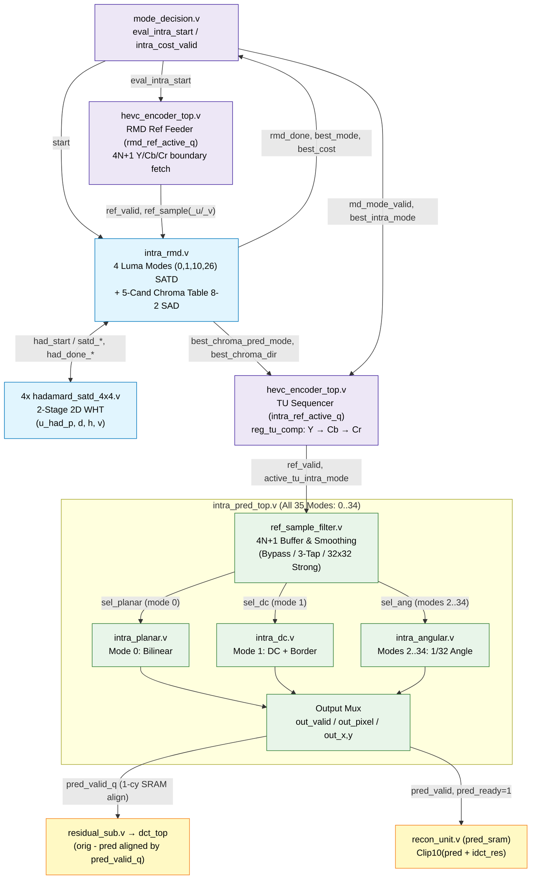
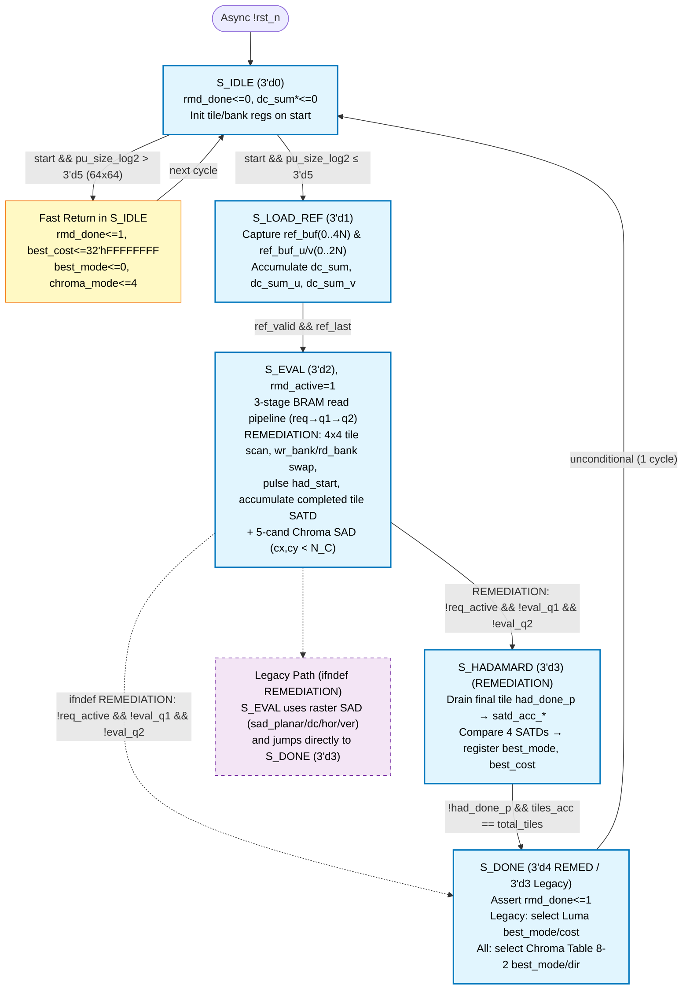
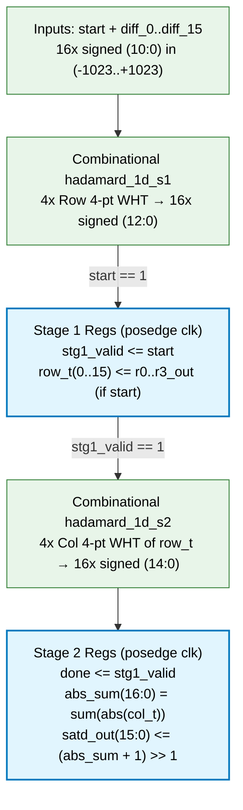
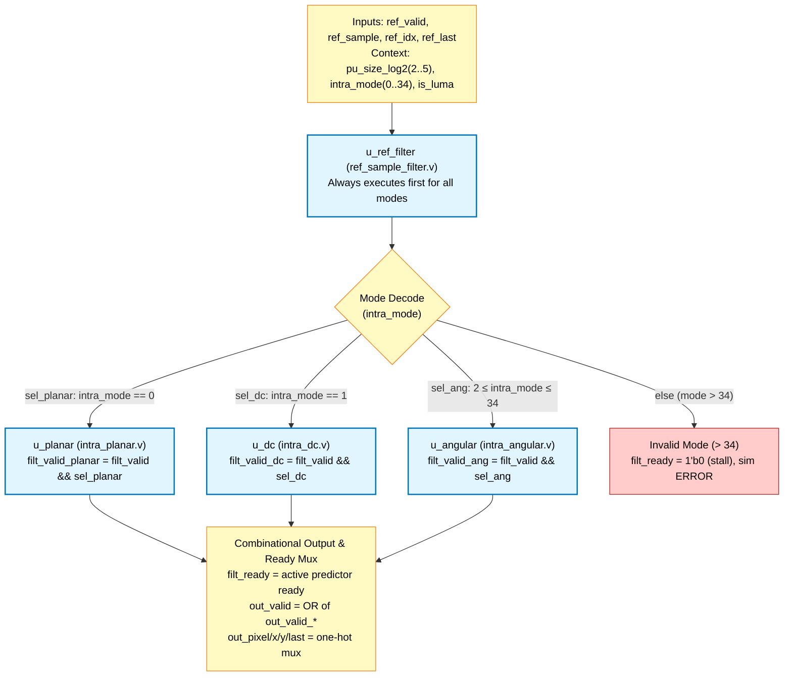
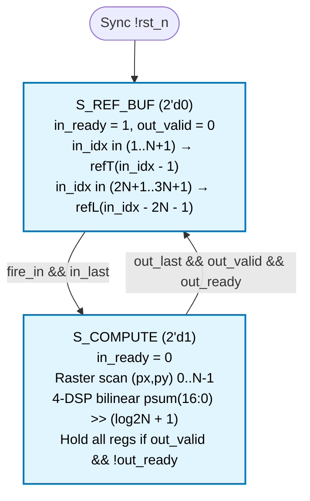
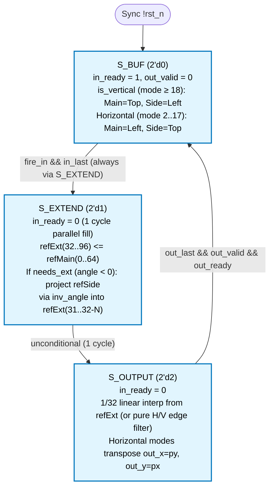

# Intra Prediction Subsystem FSMs (`intra_rmd` to `intra_pred_top`)

This document specifies every finite-state machine (FSM) and deterministic control pipeline across the **Intra Prediction Subsystem** in `d:\UIT_Doc\hevc_hw_encoder`, covering rough mode pre-screening, 4x4 Hadamard SATD evaluation, reference sample filtering, and 35-mode final reconstruction:

- [`rtl/intra/intra_rmd.v`](file:///d:/UIT_Doc/hevc_hw_encoder/rtl/intra/intra_rmd.v) — Intra Rough Mode Decision (`state[2:0]`)
- [`rtl/common/hadamard_satd_4x4.v`](file:///d:/UIT_Doc/hevc_hw_encoder/rtl/common/hadamard_satd_4x4.v) — 2-Stage 2D 4x4 Hadamard SATD Transform Engine
- [`rtl/intra/intra_pred_top.v`](file:///d:/UIT_Doc/hevc_hw_encoder/rtl/intra/intra_pred_top.v) — 35-Mode Intra Reconstruction Dispatcher
- [`rtl/intra/ref_sample_filter.v`](file:///d:/UIT_Doc/hevc_hw_encoder/rtl/intra/ref_sample_filter.v) — Reference Sample Ring Buffer, 3-Tap Smoothing & 32x32 Strong Smoothing FSM
- [`rtl/intra/intra_planar.v`](file:///d:/UIT_Doc/hevc_hw_encoder/rtl/intra/intra_planar.v) — Mode 0 Planar Bilinear Predictor (`state[1:0]`)
- [`rtl/intra/intra_dc.v`](file:///d:/UIT_Doc/hevc_hw_encoder/rtl/intra/intra_dc.v) — Mode 1 DC & Border Filter Predictor (`state[1:0]`)
- [`rtl/intra/intra_angular.v`](file:///d:/UIT_Doc/hevc_hw_encoder/rtl/intra/intra_angular.v) — Modes 2..34 Directional Angular Predictor (`state[1:0]`)

---

## 1. Intra RMD to Final Reconstruction Architecture Overview

Within [`hevc_encoder_top.v`](file:///d:/UIT_Doc/hevc_hw_encoder/rtl/top/hevc_encoder_top.v), Intra coding is cleanly partitioned into two decoupled hardware stages:

1. **Coarse Pre-Screening ([`intra_rmd.v`](file:///d:/UIT_Doc/hevc_hw_encoder/rtl/intra/intra_rmd.v) + [`hadamard_satd_4x4.v`](file:///d:/UIT_Doc/hevc_hw_encoder/rtl/common/hadamard_satd_4x4.v))**:
   - Triggered per CU candidate by `eval_intra_start` from [`mode_decision.v`](file:///d:/UIT_Doc/hevc_hw_encoder/rtl/partition/mode_decision.v) (`L1057`, `L2041` in `hevc_encoder_top.v`).
   - Evaluates **4 Luma Intra modes** (`Planar = 0`, `DC = 1`, `Horizontal = 10`, `Vertical = 26`) using **4x4-tiled 2D Hadamard SATD** (`180 MHz` pipelined `wB_v -> planar_sum_v` stages) across all valid PU/TU widths (`4x4`, `8x8`, `16x16`, `32x32`; `pu_size_log2` `2..5`), utilizing ping-pong double-buffered 16-sample residual banks (`wr_bank` / `rd_bank`).
   - Simultaneously evaluates **5 Chroma Intra RDO candidates** per ITU-T H.265 Clause 8.4.3 Table 8-2 (`Planar = 0`, `Ver = 26`, `Hor = 10`, `DC = 1`, with any Luma-matching slot replaced by diagonal `34`, plus `DM_CHROMA = win_luma_mode`) via spatial L1 SAD on the 4:2:0 Cb/Cr planes (`N_C x N_C`, `2x2..16x16`).
   - Reports `rmd_done`, `best_mode[5:0]`, and `best_cost[31:0]` to `mode_decision.v`, and `best_chroma_pred_mode[2:0]` / `best_chroma_dir[5:0]` to `hevc_encoder_top.v` (`L605-L606`).

2. **Full 35-Mode Final TU Reconstruction ([`intra_pred_top.v`](file:///d:/UIT_Doc/hevc_hw_encoder/rtl/intra/intra_pred_top.v))**:
   - After `mode_decision.v` asserts `md_mode_valid` and selects Intra (`latched_cu_is_intra == 1`), `pu_cu_splitter` sequences each TU (`reg_tu_comp`: `0=Y`, `1=Cb`, `2=Cr`) at `reg_tu_size_log2` (`2..5`).
   - `hevc_encoder_top.v` (`L1534-L1543`, `L2468-L2489`) streams `4N + 1` reconstructed neighbor boundary samples (`0..4N`) into `intra_pred_top.v`, supporting **all 35 Intra modes (`0..34`)** via `active_tu_intra_mode` (`latched_cu_intra_mode` for Luma, `latched_cu_chroma_dir` for Chroma).
   - [`ref_sample_filter.v`](file:///d:/UIT_Doc/hevc_hw_encoder/rtl/intra/ref_sample_filter.v) buffers the `4N + 1` ring, applies 3-tap `[1,2,1]/4` or 32x32 bilinear strong intra smoothing when enabled by mode/size/luma rules, and streams `filt_valid/filt_ready` to the single decoded predictor (`intra_planar`, `intra_dc`, or `intra_angular`).
   - Predicted pixels `(out_pixel, out_x, out_y, out_last)` drive [`residual_sub.v`](file:///d:/UIT_Doc/hevc_hw_encoder/rtl/recon/residual_sub.v) (aligned via 1-cycle `pred_valid_q` against `orig_y/u/v_ram` synchronous reads for 2D transform) and [`recon_unit.v`](file:///d:/UIT_Doc/hevc_hw_encoder/rtl/recon/recon_unit.v) (`pred_sram` for final `pred + IDCT` pixel reconstruction).

### Pipeline Latency Summary (`N = 2^pu_size_log2`, Backpressure-Free)

| Stage / Module | Formula (Active Cycles) | `4x4` (`log2=2`) | `8x8` (`log2=3`) | `16x16` (`log2=4`) | `32x32` (`log2=5`) |
| :--- | :--- | :---: | :---: | :---: | :---: |
| **`intra_rmd` (`REMEDIATION`)** | `(4N+1)` ref + `(N^2+3)` eval + `3` had + `1` done | 40 cy | 104 cy | 328 cy | 1,160 cy |
| **`intra_rmd` (Legacy SAD)** | `(4N+1)` ref + `(N^2+3)` eval + `1` done | 37 cy | 101 cy | 325 cy | 1,157 cy |
| **`ref_sample_filter`** | `(4N+1)` input + `1` arm + `(4N+1)` stream | 35 cy | 67 cy | 131 cy | 259 cy |
| **`intra_planar` (via `intra_pred_top`)** | `(4N+1)` filter-in + `1` arm + `(4N+1)` overlap + `(N^2+1)` compute | 52 cy | 132 cy | 388 cy | 1,284 cy |
| **`intra_dc` (via `intra_pred_top`)** | `(4N+1)` filter-in + `1` arm + `(4N+1)` overlap + `1` calc + `(N^2+1)` out | 53 cy | 133 cy | 389 cy | 1,285 cy |
| **`intra_angular` (via `intra_pred_top`)** | `(4N+1)` filter-in + `1` arm + `(4N+1)` overlap + `1` extend + `(N^2+1)` out | 53 cy | 133 cy | 389 cy | 1,285 cy |

*Note:* Inside [`hevc_encoder_top.v`](file:///d:/UIT_Doc/hevc_hw_encoder/rtl/top/hevc_encoder_top.v#L1798-L2031), `rmd_ref_active_q` and `intra_ref_active_q` have a 1-cycle synchronous neighbor-RAM read delay after `eval_intra_start` / `tu_valid` before `ref_idx = 0` arrives.

---

## 2. `intra_rmd` (`rtl/intra/intra_rmd.v`)

[`intra_rmd.v`](file:///d:/UIT_Doc/hevc_hw_encoder/rtl/intra/intra_rmd.v) is the coarse intra pre-screener. It evaluates **4 Luma modes** (`Planar = 0`, `DC = 1`, `Hor = 10`, `Ver = 26`) plus **5 Chroma candidates** (`Table 8-2`). Under the default `REMEDIATION` macro (`parameter_pkg.vh:28`), it uses a **5-state FSM** driving four parallel 4x4 Hadamard SATD engines with ping-pong residual banks; under `ifndef REMEDIATION`, it compiles to a **4-state spatial SAD FSM**.

### 2.1 Mermaid Diagram (`intra_rmd`)

### 2.2 State Encoding & Responsibility Table

Control registers: `reg [2:0] state, next_state;` (`L57`), pipeline registers `req_active`, `cx_q1/cy_q1/cx_q2/cy_q2[5:0]`, `eval_q1`, `eval_q2`, `eval_c_q1`, `eval_c_q2` (`L91, L108-L110`), ping-pong registers `wr_bank`, `rd_bank`, `had_start`, `sub_x/y[1:0]`, `tile_x/y[2:0]`, `tiles_acc[6:0]` (`L95-L96, L115, L238, L245`).

| State (`localparam`) | Encoding (`REMEDIATION`) | Encoding (Legacy) | Width | Active Outputs / Core Actions | Latency |
| :--- | :---: | :---: | :---: | :--- | :--- |
| `S_IDLE` | `3'd0` | `3'd0` | 3-bit | Clears `rmd_done`, `had_start`, `dc_sum*`. On `start`: fast-returns `best_cost=32'hFFFFFFFF` if `pu_size_log2 > 5`; else latches `lat_pu_x/y`, resets accumulators, banks, and counters. | Wait for `start` (1 cy if `pu_size_log2 > 5`) |
| `S_LOAD_REF` | `3'd1` | `3'd1` | 3-bit | Stores `ref_buf[ref_idx]` (`0..4N`) and `ref_buf_u/v` (`0..2N`). Accumulates `dc_sum` (`1..N`, `2N+1..3N`) and `dc_sum_u/v` (`1..N_C`, `N+1..N+N_C`). | `4N + 1` valid cycles (`17/33/65/129`) |
| `S_EVAL` | `3'd2` | `3'd2` | 3-bit | Asserts `rmd_active = 1`. Drives `orig_rd_addr`/`orig_c_rd_addr` in 4x4-tile scan (`REMEDIATION`) or raster scan (Legacy). At `q2`, writes `diff_*_buf[{wr_bank, cy_q2[1:0], cx_q2[1:0]}]`, swaps banks & pulses `had_start` every 16th pixel, accumulates prior `had_done_p` SATDs, and accumulates 5-mode Chroma SAD (`eval_c_q2`). | `N^2 + 3` cycles (`19/67/259/1027`) |
| `S_HADAMARD` | `3'd3` | *N/A* | 3-bit | (`REMEDIATION` only) Clears `had_start <= 0`. Captures final tile `had_done_p` SATD into `satd_acc_*` (`tiles_acc == total_tiles`), then picks winning Luma mode (`0, 1, 10, 26`) and `best_cost`. | `3` cycles fixed (`1` Stg2 + `1` accum + `1` compare) |
| `S_DONE` | `3'd4` | `3'd3` | 3-bit | Asserts `rmd_done <= 1`. Evaluates 5 Chroma Table 8-2 candidates (`cost_cand0..3 = sad + 8`, `cost_cand4 = sad`) using `win_luma_mode`, registering `best_chroma_pred_mode` and `best_chroma_dir`. (Legacy also picks Luma `best_mode`/`best_cost` here). | `1` cycle (`rmd_done` visible on entry to `S_IDLE`) |

### 2.3 Transition & Guard Condition Table

| Current State | Guard Condition (`always @(*)` / Datapath) | Next State | Registered Side Effects on Edge |
| :--- | :--- | :--- | :--- |
| `S_IDLE` | `!start` | `S_IDLE` | `rmd_done <= 0`, `had_start <= 0`, `dc_sum* <= 0` |
| `S_IDLE` | `start && (pu_size_log2 > 3'd5)` | `S_IDLE` | `rmd_done <= 1`, `best_cost <= 32'hFFFFFFFF`, `best_mode <= 0`, `best_chroma_pred_mode <= 3'd4`, `best_chroma_dir <= 0` |
| `S_IDLE` | `start && (pu_size_log2 <= 3'd5)` | `S_LOAD_REF` | `req_active <= 1`, `lat_pu_x/y <= pu_x/y`, `wr_bank <= 0`, `rd_bank <= 0`, `satd_acc_* <= 0`, `tiles_acc <= 0`, `sad_c_* <= 0` |
| `S_LOAD_REF` | `!(ref_valid && ref_last)` | `S_LOAD_REF` | If `ref_valid`: write `ref_buf[ref_idx]` (and `ref_buf_u/v` for `ref_idx <= 2N`); update `dc_sum*` |
| `S_LOAD_REF` | `ref_valid && ref_last` | `S_EVAL` | Captures final reference sample (`4N`) and DC sum term before starting `S_EVAL` |
| `S_EVAL` | `req_active \|\| eval_q1 \|\| eval_q2` | `S_EVAL` | Issues BRAM reads while `req_active`; clears `req_active` on `(sub_x==3 && sub_y==3 && tile_x==tile_max && tile_y==tile_max)`; swaps `wr_bank/rd_bank` & pulses `had_start` on `(eval_q2 && cx_q2[1:0]==3 && cy_q2[1:0]==3)`; accumulates `satd_*` on `had_done_p` |
| `S_EVAL` | `!req_active && !eval_q1 && !eval_q2` (`REMEDIATION`) | `S_HADAMARD` | Final tile's `had_start` was set on the previous cycle (`eval_q2=1 -> 0`) and is sampled by `u_had_*` at this transition edge |
| `S_EVAL` | `!req_active && !eval_q1 && !eval_q2` (`ifndef REMEDIATION`) | `S_DONE` | All raster spatial SADs accumulated |
| `S_HADAMARD` | `had_done_p \|\| (tiles_acc != total_tiles)` | `S_HADAMARD` | If `had_done_p`: `satd_acc_* += satd_*`, `tiles_acc <= tiles_acc + 1` |
| `S_HADAMARD` | `!had_done_p && (tiles_acc == total_tiles)` | `S_DONE` | Registers winning Luma `best_mode` (`Planar <= DC <= Hor <= Ver`) and `best_cost` |
| `S_DONE` | `1'b1` (Unconditional) | `S_IDLE` | Registers `rmd_done <= 1`, `best_chroma_pred_mode`, `best_chroma_dir` |

### 2.4 Reset, Backpressure, Ping-Pong Tile Isolation & Corner-Case Behavior

- **Reset (`!rst_n`):** Asynchronous active-low (`always @(posedge clk or negedge rst_n)` at `L126, L381`). Resets `state <= S_IDLE`, `rmd_done <= 0`, `req_active <= 0`, `best_chroma_pred_mode <= 3'd4`, all accumulators/pipeline flags, and `wr_bank/rd_bank <= 0`. Under `` `ifndef SYNTHESIS `` (`L65-L85`), `ref_buf[0:128]` and `ref_buf_u/v[0:64]` are initialized to `10'd512` both at time 0 and synchronously on `!rst_n`.
- **Backpressure:** There is **no `ready` input or output** (`ref_ready` absent; downstream `mode_decision` does not stall `rmd_done`). The module assumes `4N + 1` valid reference samples can be absorbed at 1 sample/cycle in `S_LOAD_REF` and `orig_*_ram` has fixed 1-cycle synchronous read latency (`q1 -> q2`).
- **Ping-Pong 4x4 Tile Isolation (`wr_bank` / `rd_bank`):**
  - Each of the 4 Luma candidate arrays (`diff_planar_buf`, `diff_dc_buf`, `diff_hor_buf`, `diff_ver_buf`) contains 32 signed 11-bit entries (`[0:31]` = 2 banks x 16 samples).
  - During `S_EVAL`, `eval_q2` writes pixels `(0..15)` of the current 4x4 tile into `{wr_bank, cy_q2[1:0], cx_q2[1:0]}`.
  - On the 16th write (`cx_q2[1:0] == 3 && cy_q2[1:0] == 3`), the clock edge writes pixel 15 into `wr_bank`, swaps `rd_bank <= wr_bank` and `wr_bank <= ~wr_bank`, and sets `had_start <= 1'b1`.
  - On the immediately following clock edge (`had_start == 1`), `u_had_p/d/h/v` latch all 16 samples from `{rd_bank, 4'd0..15}` into `hadamard_satd_4x4.row_t`, completely isolated from the next tile's pixel 0 being written into `{wr_bank, 4'b0000}`.
  - Because each 4x4 tile streams for 16 cycles while `hadamard_satd_4x4` completes in 2 cycles, all `total_tiles - 1` earlier tiles finish 13 cycles before the next bank swap; only the final tile finishes inside `S_HADAMARD`.
- **Corner Cases:**
  1. **64x64 Fast Return:** If `start` arrives with `pu_size_log2 > 3'd5`, `S_IDLE` does not enter `S_LOAD_REF`, returning `rmd_done = 1` and `best_cost = 32'hFFFFFFFF` in 1 cycle (`hevc_encoder_top.v:1102` caps `cu_size == 64` at `3'd5` externally anyway, while `mode_decision.v` bypasses Depth-0).
  2. **Unlatched `pu_size_log2`:** Unlike `pu_x`/`pu_y` (`lat_pu_x/y`), `pu_size_log2` is read live; `hevc_encoder_top.v:1093` latches `rmd_pu_size_log2` on `cu_valid`.
  3. **Planar Clamping & Tie-Breaking:** `pred_planar` and `pred_planar_u/v` clamp `> 10'd1023` to `10'd1023`. Luma tie-break favors `Planar <= DC <= Hor <= Ver`. Chroma Table 8-2 sets `CHROMA_RATE_LAMBDA = 32'd8` on `dir_cand0..3` (`cand4 = DM_CHROMA` has `0` rate penalty and wins all equal-SAD ties).
  4. **Chroma Coordinate Gating in 4x4 Tile Mode:** `eval_c_q1 = ({2'b00, cy} < N_C && {2'b00, cx} < N_C)` selects the upper-left `N_C x N_C` sub-quadrant (`4`, `16`, `64`, `256` chroma samples for `N = 4, 8, 16, 32`) cleanly despite the 4x4-tiled Luma scan order.

---

## 3. `hadamard_satd_4x4` (`rtl/common/hadamard_satd_4x4.v`)

[`hadamard_satd_4x4.v`](file:///d:/UIT_Doc/hevc_hw_encoder/rtl/common/hadamard_satd_4x4.v) has **no multi-state FSM**; it is a deterministic **2-stage valid-pipelined datapath** (`start -> stg1_valid -> done`) computing `SATD = (sum(|H4 * Diff_4x4 * H4^T|) + 1) >> 1`. Four instances (`u_had_p`, `u_had_d`, `u_had_h`, `u_had_v`) execute in parallel inside `intra_rmd`.

### 3.1 Mermaid Diagram (`hadamard_satd_4x4`)

### 3.2 Pipeline Stage & Control Register Table

| Stage / Register | Bit-Width | Active Function & Arithmetic Bounds | Latency |
| :--- | :---: | :--- | :---: |
| `stg1_valid` | 1-bit | Tracks Stage 1 completion (`stg1_valid <= start`); enables Stage 2 capture on next cycle. | Cycle 1 |
| `row_t[0:15]` | 16 x `signed [12:0]` | Latches 4x 1D row Hadamard results on `start == 1` (`max abs(val) = 4 * 1023 = 4092`, fits `[-4096, +4095]`). | Cycle 1 |
| `col_t[0:15]` (blocking temp) | 16 x `signed [14:0]` | Holds 4x 1D column Hadamard results of `row_t` (`max abs(val) = 16 * 1023 = 16368`, fits `[-16384, +16383]`). | Cycle 2 |
| `abs_sum`, `satd_norm` | `17-bit` unsigned | Sums 16 absolute magnitudes (Parseval bound `<= 64 * 1023 = 65472`) and normalizes `(abs_sum + 1) >> 1` (`<= 32736`). | Cycle 2 |
| `done`, `satd_out` | 1-bit, `16-bit` | `done <= stg1_valid`; `satd_out <= satd_norm[15:0]` (valid 2 clock edges after `start == 1`). | Cycle 2 |

### 3.3 Stage Advance & Guard Condition Table

| Stage | Guard Condition | Action |
| :--- | :--- | :--- |
| Stage 0 -> Stage 1 | `start == 1'b1` | Latches `r0_out..r3_out` into `row_t[0:15]` and sets `stg1_valid <= 1'b1`. |
| Stage 0 -> Stage 1 | `start == 1'b0` | Sets `stg1_valid <= 1'b0`; preserves `row_t[0:15]`. |
| Stage 1 -> Stage 2 | `stg1_valid == 1'b1` | Evaluates `c0_out..c3_out`, computes 17-bit `abs_sum` and `(abs_sum + 1) >> 1`, updates `satd_out`, sets `done <= 1'b1`. |
| Stage 1 -> Stage 2 | `stg1_valid == 1'b0` | Sets `done <= 1'b0`; holds previous `satd_out`. |

### 3.4 Reset, Backpressure & Corner-Case Behavior

- **Reset (`!rst_n`):** Asynchronous active-low (`L88, L115`) clears `stg1_valid <= 1'b0`, `done <= 1'b0`, `satd_out <= 16'd0`. `row_t` is unreset and gated by `stg1_valid`.
- **Backpressure & Throughput:** Zero backpressure (`ready` absent); supports back-to-back `1 tile/cycle` peak throughput with fixed **2-cycle latency**.
- **Critical Timing Isolation:** Registering `row_t` on the `start` clock edge isolates Stage 2 column butterflies and the 16-input absolute-value adder tree from `intra_rmd`'s `diff_*_buf` multiplexer, ensuring bank swapping in `intra_rmd` never corrupts in-flight Hadamard transforms.

---

## 4. `intra_pred_top` (`rtl/intra/intra_pred_top.v`)

[`intra_pred_top.v`](file:///d:/UIT_Doc/hevc_hw_encoder/rtl/intra/intra_pred_top.v) is a **purely structural combinational dispatcher and output multiplexer** (zero internal FSM flip-flops). It chains [`ref_sample_filter.v`](file:///d:/UIT_Doc/hevc_hw_encoder/rtl/intra/ref_sample_filter.v) into the three reconstruction predictors ([`intra_planar.v`](file:///d:/UIT_Doc/hevc_hw_encoder/rtl/intra/intra_planar.v), [`intra_dc.v`](file:///d:/UIT_Doc/hevc_hw_encoder/rtl/intra/intra_dc.v), [`intra_angular.v`](file:///d:/UIT_Doc/hevc_hw_encoder/rtl/intra/intra_angular.v)) to reconstruct **all 35 Intra modes (`0..34`)** for both Luma (`is_luma = 1`) and Chroma (`is_luma = 0`).

### 4.1 Mermaid Diagram (`intra_pred_top`)

### 4.2 Mode Decode & Routing Table

| Decode Signal | Condition (`intra_mode[5:0]`) | Selected Instance | `filt_ready` Driver | `out_*` Mux Priority | Combinational Delay |
| :--- | :--- | :--- | :--- | :--- | :--- |
| `sel_planar` | `intra_mode == 6'd0` (`INTRA_PLANAR`) | `u_planar` (`intra_planar`) | `filt_ready_planar` | `out_valid_planar` | `0` cycles (combinational) |
| `sel_dc` | `intra_mode == 6'd1` (`INTRA_DC`) | `u_dc` (`intra_dc`) | `filt_ready_dc` | `out_valid_dc` | `0` cycles (combinational) |
| `sel_ang` | `6'd2 <= intra_mode <= 6'd34` (`INTRA_ANG_FIRST..LAST`) | `u_angular` (`intra_angular`) | `filt_ready_ang` | `out_valid_ang` | `0` cycles (combinational) |
| *(invalid)* | `intra_mode > 6'd34` | None (all `filt_valid_* = 0`) | `1'b0` (backpressure) | `out_valid = 0`, outputs `0` | Simulation `$display` error (`L74`) |

### 4.3 Dispatch & Output Guard Conditions

| Signal Path | Guard / Mux Equation | Functional Effect |
| :--- | :--- | :--- |
| Input Demux | `filt_valid_* = filt_valid && sel_*` | Ensures only the decoded predictor observes `filt_valid` and exits its input-wait state. |
| Ready Mux | `filt_ready = sel_planar ? filt_ready_planar : sel_dc ? filt_ready_dc : sel_ang ? filt_ready_ang : 1'b0` | Only the selected predictor controls backpressure on `u_ref_filter`. |
| Output Valid & Data Mux | `out_valid = out_valid_planar \| out_valid_dc \| out_valid_ang` | Mutual exclusion guarantees one-hot `out_valid_*` (`L238` checks `(sum > 1)` in simulation). |

### 4.4 Reset, Backpressure & Corner-Case Behavior

- **Reset & Backpressure:** `rst_n` and `out_ready` pass directly to `u_ref_filter`, `u_planar`, `u_dc`, and `u_angular`. Downstream backpressure (`!out_ready`) propagates backwards from the active predictor's output stage through `filt_ready` to `u_ref_filter.in_ready` (`ref_ready`).
- **Top-Level Integration (`hevc_encoder_top.v:2470-2489`):** `ref_ready` is left unconnected (`()`) and `intra_out_ready` comes from `recon_unit.pred_ready` (`1'b1`). Overlap is prevented by `tu_ready_signal` (`L1550`), which keeps new TUs gated until `cabac_coeff_done` completes after the current TU finishes prediction, transform, quantization, and reconstruction.
- **Latched PU Context (`intra_pred_top.v`)**: `intra_pred_top` registers `{pu_size_log2_r, intra_mode_r, is_luma_r}` on `ref_valid && ref_ready && (ref_idx == 8'd0)` (with combinational cycle-0 bypass `eff_*`) and drives `u_ref_filter`, `sel_*`, `u_planar`, `u_dc`, and `u_angular` from `eff_*`, preventing external input changes mid-block from corrupting prediction.

---

## 5. `ref_sample_filter` (`rtl/intra/ref_sample_filter.v`)

[`ref_sample_filter.v`](file:///d:/UIT_Doc/hevc_hw_encoder/rtl/intra/ref_sample_filter.v) implements reference ring buffering (`4N + 1` samples) and HEVC Section 8.4.4.2 smoothing (`Bypass`, 3-tap `[1,2,1]/4`, or 32x32 Strong Intra Smoothing). Rather than an explicit `state` enum, its control logic uses **coupled stateful flags** (`buf_full`, `buf_last`, `flushing`, `out_valid`, `out_last`) with synchronous counters `buf_count[7:0]` and `out_ptr[7:0]`.

### 5.1 Mermaid Diagram (`ref_sample_filter`)

```mermaid
flowchart TD
    classDef stateNode fill:#e1f5fe,stroke:#0277bd,stroke-width:2px,color:#000;
    classDef filtNode fill:#e8f5e9,stroke:#2e7d32,stroke-width:1px,color:#000;

    RST(["Sync !rst_n"]) --> IN_FILL
    IN_FILL["Phase 1: Input Fill<br/>buf_full=0, flushing=0, out_last=0<br/>in_ready = (out_ready &#124;&#124; !out_valid)<br/>On fire_in: ref_buf(in_idx)&lt;=in_sample, buf_count++"]:::stateNode
    ARM["Phase 2: Output Arming (1 cycle)<br/>buf_full=1, flushing=0, out_last=0<br/>in_ready=0; sets flushing&lt;=1, out_ptr&lt;=0"]:::stateNode
    STREAM["Phase 3: Streaming Filtered Samples<br/>buf_full=1, flushing=1<br/>Emit final_out for out_ptr = 0..4N<br/>Freeze if out_valid &amp;&amp; !out_ready"]:::stateNode
    WAIT_ACK["Phase 4: Hold Last Beat<br/>buf_full=1, flushing=0, out_last=1<br/>Hold out_valid/out_last until out_ready=1"]:::stateNode

    FILT_MUX["Combinational final_out Mux<br/>1) !use_filter &rarr; raw ref_buf(out_ptr)<br/>2) use_strong (32x32) &rarr; strong_out bilinear<br/>3) is_boundary_pos (2N or 4N) &rarr; raw<br/>4) else &rarr; 3-tap (1,2,1)/4 flt_out"]:::filtNode

    IN_FILL -->|"fire_in &amp;&amp; (in_last &#124;&#124; buf_count == 4N)"| ARM
    ARM -->|"unconditional (1 cycle)"| STREAM
    STREAM -->|"out_ptr == 4N &amp;&amp; (out_ready &#124;&#124; !out_valid)"| WAIT_ACK
    STREAM -.-> FILT_MUX
    WAIT_ACK -->|"out_last &amp;&amp; out_valid &amp;&amp; out_ready"| IN_FILL
```

### 5.2 Control Registers & Phase Responsibility Table

| Register / Flag | Width | Reset (`!rst_n` Sync) | Responsibility | Cycle Latency |
| :--- | :---: | :---: | :--- | :--- |
| `buf_full` | 1-bit | `1'b0` | Set when all `4N+1` input samples arrive (or `in_last`); gates `in_ready` to `0` until `out_last` handshake completes. | `4N + 1` cycles (`buf_full=0`) |
| `buf_count` | `8-bit` | `8'd0` | Counts accepted input samples (`0..4N`); cleared when `out_last && out_valid && out_ready`. | Increments on `fire_in` |
| `buf_last` | 1-bit | `1'b0` | Latches `in_last` on `fire_in`; cleared on output completion. | — |
| `flushing` | 1-bit | `1'b0` | Set 1 cycle after `buf_full` rises; cleared when last sample `out_ptr == 4N` is launched onto `out_sample`. | `1` arm + `4N + 1` stream |
| `out_ptr` | `8-bit` | `8'd0` | Current read index (`0..4N`) into `ref_buf[0:128]` during `flushing`. | `1` increment per accepted beat |
| `out_valid`, `out_last` | 1-bit | `1'b0` | Output valid/last strobes; held if `!out_ready`, cleared on `out_last && out_valid && out_ready`. | Total = `8N + 3` cycles |
| `out_sample`, `out_idx` | `10-bit`, `8-bit` | `0` | Registered `final_out` and sample index (`0..4N`). | 1-cycle registered output |

### 5.3 Transition, Guard & Filter Selection Table

| Transition / Rule | Exact RTL Condition | Action / Selection |
| :--- | :--- | :--- |
| Input Acceptance (`fire_in`) | `in_valid && !buf_full && (out_ready \|\| !out_valid)` | `ref_buf[in_idx] <= in_sample`, `buf_count <= buf_count + 1` |
| Input Buffer Complete | `fire_in && (in_last \|\| buf_count == ref_count - 8'd1)` | `buf_full <= 1'b1` (note `ref_count = 4N + 1`) |
| Output Flush Start | `!flushing && buf_full && !out_last` | `flushing <= 1'b1`, `out_ptr <= 8'd0` (1-cycle arming latency) |
| Stream Beat Advance | `flushing && (out_ready \|\| !out_valid)` | `out_valid <= 1`, `out_sample <= final_out`, `out_idx <= out_ptr`, `out_last <= (out_ptr == 4N)`; if `out_ptr == 4N` clear `flushing <= 0`, else `out_ptr++` |
| Block Reset & Rearm | `out_last && out_valid && out_ready` | `buf_full <= 0`, `buf_count <= 0`, `buf_last <= 0`, `out_valid <= 0`, `out_last <= 0` |
| `filter_planar` | `(intra_mode == 0) && is_luma && (pu_size_log2 >= 3'd3)` | Planar filtered for Luma `N >= 8` only |
| `filter_angular` | `is_luma && (2 <= intra_mode <= 34) && (mode_dist > ang_thresh)` | `mode_dist = min(\|mode-26\|, \|mode-10\|)`; `ang_thresh = {32 (N=4), 7 (N=8), 1 (N=16), 0 (N=32)}` |
| `use_strong` (32x32) | `use_filter && is_luma && (pu_size_log2 == 3'd5) && (abs_strong_top < 32) && (abs_strong_left < 32)` | Bilinear interpolation `((delta * step + 32) >>> 6) + corner`; corner `0` stays unfiltered |
| 3-Tap `[1,2,1]/4` | `use_filter && !use_strong && !(out_ptr == 2N \|\| out_ptr == 4N)` | `(ref_buf[idx_prev] + 2*ref_buf[out_ptr] + ref_buf[idx_next] + 2) >> 2` |

### 5.4 Reset, Backpressure & Corner-Case Behavior

- **Synchronous Reset (`!rst_n`):** Both input and output `always @(posedge clk)` blocks (`L196, L294`) use **synchronous** active-low reset (unlike `intra_rmd`'s async reset). Under `` `ifndef SYNTHESIS `` (`L95-L107`), `ref_buf[0:128]` initializes to `10'd512` at time 0 and on synchronous `!rst_n`.
- **Backpressure:** When the downstream predictor stalls (`out_valid && !out_ready`), `flushing` pauses updates to `out_ptr`, `out_sample`, `out_idx`, `out_last`, and `out_valid`, while `buf_full == 1` keeps `in_ready == 0`. Note `L303` sets `out_valid <= 0` on `out_valid && out_ready`, overridden by `L313` (`out_valid <= 1`) on every active `flushing` beat for zero-bubble 1 sample/cycle streaming.
- **Corner Cases:**
  1. **`!out_last` Guard Against Double-Flush (`L307`):** Because `buf_full` remains `1` until `out_last && out_valid && out_ready` clears both `buf_full` and `out_last`, checking `!out_last` on `L307` prevents `flushing` from erroneously re-arming if `out_ready == 0` stalls the final `4N` output beat.
  2. **Corner & Endpoint Boundaries in `[1,2,1]/4` vs Strong Smoothing:** Under standard 3-tap filtering, `out_ptr == 0` (corner) IS filtered using `idx_prev = 1` (first top) and `idx_next = 2N + 1` (first left), whereas endpoints `2N` (top-right) and `4N` (bottom-left) are passed unfiltered (`is_boundary_pos`). Under `use_strong`, `out_ptr == 0` passes `ref_buf[0]` unfiltered while `1..2N` and `2N+1..4N` apply bilinear interpolation.
  3. **Pure Vertical/Horizontal Modes (`26`, `10`) & DC (`1`):** `mode_dist == 0` is never `> ang_thresh`, and `filter_dc == 0`, so DC, Chroma, `4x4` Luma, and pure H/V modes always bypass filtering (`final_out = ref_buf[out_ptr]`).

---

## 6. `intra_planar` (`rtl/intra/intra_planar.v`)

[`intra_planar.v`](file:///d:/UIT_Doc/hevc_hw_encoder/rtl/intra/intra_planar.v) implements HEVC Mode 0 (`INTRA_PLANAR`) using a **2-state FSM** (`state[1:0]`).

### 6.1 Mermaid Diagram (`intra_planar`)

### 6.2 State Encoding & Responsibility Table

Control registers: `reg [1:0] state;` (`L101`), scan counters `reg [5:0] px, py;` (`L188-L189`), reference arrays `refT[0:32]` and `refL[0:32]` (`L92-L93`).

| State (`localparam`) | Encoding | Width | Active Signals & Responsibility | Cycle Latency |
| :--- | :---: | :---: | :--- | :--- |
| `S_REF_BUF` | `2'd0` | 2-bit | `in_ready = 1`, `out_valid = 0`, `px = py = 0`. Captures top row + top-right (`refT[0..N]` from `in_idx 1..N+1`) and left col + bottom-left (`refL[0..N]` from `in_idx 2N+1..3N+1`). Discards corner `0` and unused tail indices. | `4N + 1` input cycles (`17/33/65/129`) |
| `S_COMPUTE` | `2'd1` | 2-bit | `in_ready = 0`. Computes `pred_pixel` combinationally via 4 multipliers (`(N-1-px)*refL[py] + (px+1)*refT[N] + (N-1-py)*refT[px] + (py+1)*refL[N] + N`) shifted by `pu_size_log2 + 1`, streaming `N^2` pixels in raster scan. | `N^2 + 1` cycles (`1` fill + `N^2` valid beats: `17/65/257/1025`) |
| *(unused)* | `2'd2`, `2'd3` | 2-bit | Unreachable encodings (`in_ready = 0`, `out_valid = 0`). | — |

### 6.3 Transition & Guard Condition Table

| Current State | Guard Condition | Next State | Datapath Side Effects |
| :--- | :--- | :--- | :--- |
| `S_REF_BUF` | `!(fire_in && in_last)` | `S_REF_BUF` | On `fire_in`: conditionally writes `refT` (`1 <= in_idx <= N+1`) or `refL` (`2N+1 <= in_idx <= 3N+1`). |
| `S_REF_BUF` | `fire_in && in_last` | `S_COMPUTE` | `px, py` start at `(0, 0)` with `out_valid = 0`. |
| `S_COMPUTE` | `!(out_last && out_valid && out_ready)` | `S_COMPUTE` | When `(out_ready \|\| !out_valid)`: registers `out_pixel <= pred_pixel`, `out_x <= px`, `out_y <= py`, `out_last <= (px==N-1 && py==N-1)`, and advances `(px, py)` (wrapping to `(0,0)` on last pixel). |
| `S_COMPUTE` | `out_last && out_valid && out_ready` | `S_REF_BUF` | Clears `out_valid <= 0`, `out_last <= 0`; re-enables `in_ready` on next cycle. |

### 6.4 Reset, Backpressure & Corner-Case Behavior

- **Synchronous Reset (`!rst_n`):** Clears `state <= S_REF_BUF`, `out_valid <= 0`, `out_pixel <= 0`, `out_x/y <= 0`, `out_last <= 0`, `px/py <= 0`. Under `` `ifndef SYNTHESIS `` (`L122-L130`), `refT[0:32]` and `refL[0:32]` are initialized to `0` at time 0.
- **Backpressure:** `in_ready` is `1` throughout `S_REF_BUF` and `0` in `S_COMPUTE`. Downstream stall (`!out_ready`) freezes `S_COMPUTE` cleanly once `out_valid == 1` (`!(out_ready || !out_valid)`), holding `out_pixel`, `out_x`, `out_y`, `out_last`, `px`, `py`, and `state`. Note that on the very first cycle of `S_COMPUTE`, `!out_valid` is true, so pixel `(0,0)` is computed and latched into the output register even if `out_ready == 0`.
- **Corner Cases:** `psum` is explicitly sized to 17 bits (`{11'b0, N}` at `L213`) to hold `2 * 32 * 1023 + 32 = 65,504` (`65,535` max with `16-bit`, `130,976` worst-case uncorrelated) without overflow before right-shifting by `pu_size_log2 + 1`.

---

## 7. `intra_dc` (`rtl/intra/intra_dc.v`)

[`intra_dc.v`](file:///d:/UIT_Doc/hevc_hw_encoder/rtl/intra/intra_dc.v) implements HEVC Mode 1 (`INTRA_DC`) with a **3-state FSM** (`state[1:0]`), separating reference accumulation, DC average division, and border-filtered raster output.

### 7.1 Mermaid Diagram (`intra_dc`)

```mermaid
flowchart TD
    classDef stateNode fill:#e1f5fe,stroke:#0277bd,stroke-width:2px,color:#000;

    RST(["Sync !rst_n"]) --> ACC
    ACC["S_REF_ACC (2'd0)<br/>in_ready = (out_ready &#124;&#124; !out_valid), out_valid = 0<br/>in_idx in (1..N) &rarr; sum_top += in_sample, ref_top<br/>in_idx in (2N+1..3N) &rarr; sum_left += in_sample, ref_left"]:::stateNode
    CALC["S_DC_CALC (2'd1)<br/>in_ready = 0 (1 cycle)<br/>dc_val &lt;= (sum_top + sum_left + N) &gt;&gt; (log2N + 1)<br/>Reset sum_top &lt;= 0, sum_left &lt;= 0"]:::stateNode
    OUT["S_OUTPUT (2'd2)<br/>in_ready = 0<br/>Raster scan (px,py) 0..N-1<br/>Luma &amp;&amp; N &lt; 32: border filter on x=0 or y=0<br/>Chroma or N == 32: constant dc_val"]:::stateNode

    ACC -->|"fire_in &amp;&amp; in_last"| CALC
    CALC -->|"unconditional (1 cycle)"| OUT
    OUT -->|"out_last &amp;&amp; out_valid &amp;&amp; out_ready"| ACC
```

### 7.2 State Encoding & Responsibility Table

Control registers: `reg [1:0] state;` (`L81`), accumulators `sum_top[15:0]`, `sum_left[15:0]` (`L90-L91`), `dc_val[9:0]` (`L101`), border arrays `ref_top[0:31]`, `ref_left[0:31]` (`L95-L96`), scan counters `px[5:0], py[5:0]` (`L184-L185`).

| State (`localparam`) | Encoding | Width | Active Signals & Responsibility | Cycle Latency |
| :--- | :---: | :---: | :--- | :--- |
| `S_REF_ACC` | `2'd0` | 2-bit | `in_ready = (out_ready \|\| !out_valid)`, `out_valid = 0`. Accumulates `sum_top` and `ref_top[0..N-1]` for `in_idx in [1..N]`; accumulates `sum_left` and `ref_left[0..N-1]` for `in_idx in [2N+1..3N]`. Ignores corner `0`, `N+1..2N`, `3N+1..4N`. | `4N + 1` input cycles (`17/33/65/129`) |
| `S_DC_CALC` | `2'd1` | 2-bit | `in_ready = 0`. Computes rounded average `dc_val <= (sum_top + sum_left + N) >> (pu_size_log2 + 1)` using 17-bit addition (`max 65504`), clears `sum_top/sum_left <= 0`. | `1` cycle fixed |
| `S_OUTPUT` | `2'd2` | 2-bit | `in_ready = 0`. Emits `N^2` raster pixels; applies HEVC Section 8.4.4.2.5 DC border smoothing when `is_luma && (pu_size_log2 < 3'd5)` (`N in {4, 8, 16}`). | `N^2 + 1` cycles (`1` fill + `N^2` valid beats: `17/65/257/1025`) |
| *(unused)* | `2'd3` | 2-bit | Unreachable encoding (`in_ready = 0`, `out_valid = 0`). | — |

### 7.3 Transition & Guard Condition Table

| Current State | Guard Condition | Next State | Datapath Side Effects |
| :--- | :--- | :--- | :--- |
| `S_REF_ACC` | `!(fire_in && in_last)` | `S_REF_ACC` | Accumulates `sum_top` / `ref_top` (`1..N`) and `sum_left` / `ref_left` (`2N+1..3N`) on `fire_in`. |
| `S_REF_ACC` | `fire_in && in_last` | `S_DC_CALC` | Final reference sample (`4N`) accepted (outside `3N`, so sums already final). |
| `S_DC_CALC` | `1'b1` (Unconditional) | `S_OUTPUT` | Registers `dc_val`, resets `sum_top <= 0`, `sum_left <= 0`. |
| `S_OUTPUT` | `!(out_last && out_valid && out_ready)` | `S_OUTPUT` | Under `(out_ready \|\| !out_valid)`: registers `pred_pixel` (`dc_corner`/`dc_top_x`/`dc_left_y`/`dc_val`), `out_x/y`, `out_last`, and advances `(px, py)`. |
| `S_OUTPUT` | `out_last && out_valid && out_ready` | `S_REF_ACC` | Clears `out_valid <= 0`, `out_last <= 0`; `px, py` wrapped to `(0,0)` when last beat was registered. |

### 7.4 Reset, Backpressure & Corner-Case Behavior

- **Synchronous Reset (`!rst_n`):** Clears `state <= S_REF_ACC`, `sum_top <= 0`, `sum_left <= 0`, `dc_val <= 0`, ALL `32` entries of `ref_top` and `ref_left` to `0` (`L121-L124`, active in synthesis as well), plus `out_*` and `px/py`.
- **Backpressure:** `in_ready` includes `(out_ready || !out_valid)` (`L106`) alongside `state == S_REF_ACC` (harmlessly `1` during `S_REF_ACC` since `out_valid == 0`). In `S_OUTPUT`, `!out_ready` freezes `px`, `py`, `out_*`, and `state` once `out_valid == 1`.
- **Corner Cases:**
  1. **DC Filter Scope (`L187` vs Comment `L178`):** RTL implements `apply_dc_filter = is_luma && (pu_size_log2 < 3'd5)`, filtering `(0,0)`, `(x,0)`, and `(0,y)` for **Luma `4x4`, `8x8`, and `16x16`** while skipping `32x32` and all Chroma blocks per HEVC Section 8.4.4.2.5 (note the inline comment at `L178` stating "skip for 4x4 blocks" is obsolete relative to `L21` and `L187`).
  2. **Boundary Smoothing Equations (`L190-L207`):** `(0,0)` uses `(ref_top[0] + ref_left[0] + 2*dc_val + 2) >> 2`; `(x>0, 0)` uses `(ref_top[px] + 3*dc_val + 2) >> 2`; `(0, y>0)` uses `(ref_left[py] + 3*dc_val + 2) >> 2`.

---

## 8. `intra_angular` (`rtl/intra/intra_angular.v`)

[`intra_angular.v`](file:///d:/UIT_Doc/hevc_hw_encoder/rtl/intra/intra_angular.v) implements all **33 directional Intra modes (`2..34`)** via a **3-state FSM** (`state[1:0]`), unifying vertical-like (`18..34`) and horizontal-like (`2..17`) modes with a single projection datapath and output coordinate transposition.

### 8.1 Mermaid Diagram (`intra_angular`)

### 8.2 State Encoding & Responsibility Table

Control registers: `reg [1:0] state;` (`L182`), scan counters `reg [5:0] px, py;` (`L311-L312`), arrays `refMain[0:64]`, `refSide[0:64]`, `refExt[0:127]` (`L170-L172`).

| State (`localparam`) | Encoding | Width | Active Signals & Responsibility | Cycle Latency |
| :--- | :---: | :---: | :--- | :--- |
| `S_BUF` | `2'd0` | 2-bit | `in_ready = 1`, `out_valid = 0`, `px = py = 0`. Routes incoming `0..4N` samples into `refMain[0..2N]` and `refSide[0..2N]`, swapping top/left assignment when `!is_vertical` (`intra_mode < 18`). | `4N + 1` input cycles (`17/33/65/129`) |
| `S_EXTEND` | `2'd1` | 2-bit | `in_ready = 0`. Parallel 1-cycle copy of `refMain[0..64]` into `refExt[32..96]`; if `needs_ext` (`pred_angle < 0`, modes `11..17` and `19..25`), projects `k = 0..N-1` from `refSide` via `inv_angle` into `refExt[31..32-N]`. | `1` cycle fixed (parallel unrolled copy) |
| `S_OUTPUT` | `2'd2` | 2-bit | `in_ready = 0`. Scans `(px, py)` `0..N-1`, computes `deltaPos = (py + 1) * angle`, reads `refExt[33 + px + (deltaPos >>> 5)]` and `+1`, interpolates 1/32 frac (or applies pure H/V edge filter), transposes `(out_x, out_y)` if `!is_vertical`. | `N^2 + 1` cycles (`1` fill + `N^2` valid beats: `17/65/257/1025`) |
| *(unused)* | `2'd3` | 2-bit | Unreachable encoding (`in_ready = 0`, `out_valid = 0`). | — |

### 8.3 Transition & Guard Condition Table

| Current State | Guard Condition | Next State | Datapath Side Effects |
| :--- | :--- | :--- | :--- |
| `S_BUF` | `!(fire_in && in_last)` | `S_BUF` | Stores `refMain` & `refSide` on `fire_in` (`is_vertical ? (0..2N->Main, 0/2N+1..4N->Side) : (0/2N+1..4N->Main, 0..2N->Side)`). |
| `S_BUF` | `fire_in && in_last` | `S_EXTEND` | Always routes through `S_EXTEND` regardless of `needs_ext` (`L258`) to anchor `refMain` at `refExt[32]`. |
| `S_EXTEND` | `1'b1` (Unconditional) | `S_OUTPUT` | Writes `refExt[32..96]` and (when `needs_ext`) `refExt[31..32-N]` in parallel in 1 clock edge. |
| `S_OUTPUT` | `!(out_last && out_valid && out_ready)` | `S_OUTPUT` | Under `(out_ready \|\| !out_valid)`: registers `out_pixel <= ang_pred`, `out_x <= is_vertical ? px : py`, `out_y <= is_vertical ? py : px`, `out_last`, and advances `(px, py)`. |
| `S_OUTPUT` | `out_last && out_valid && out_ready` | `S_BUF` | Clears `out_valid <= 0`, `out_last <= 0`; `px, py` wrapped to `(0,0)`. |

### 8.4 Reset, Backpressure & Corner-Case Behavior

- **Synchronous Reset (`!rst_n`):** Clears `state <= S_BUF`, `out_valid <= 0`, `out_pixel <= 0`, `out_x/y <= 0`, `out_last <= 0`, `px/py <= 0`. Under `` `ifndef SYNTHESIS `` (`L202-L212`), `refMain[0:64]`, `refSide[0:64]`, and `refExt[0:127]` initialize to `0` at time 0.
- **Backpressure:** `in_ready` is `1` only in `S_BUF`. Downstream stall (`!out_ready`) freezes `S_OUTPUT` once `out_valid == 1`, preserving `refExt`, `px`, `py`, `out_*`, and `state`.
- **Corner Cases:**
  1. **1-Cycle `S_EXTEND` vs Header Comment:** While comment `L45` mentions `(N cycles max)`, `S_EXTEND` unrolls both the `0..64` copy and `0..31` extension loops in hardware (`L272-L281`) and completes in **1 clock cycle** for all block sizes (`4..32`), always executing even when `needs_ext == 0` so `refExt` holds the `refMain` offset-32 image.
  2. **Horizontal Transposition Alignment (`L392-L393`):** For modes `2..17` (`!is_vertical`), pixels are emitted in column-major raster order (`out_x = py`, `out_y = px`). Downstream [`hevc_encoder_top.v`](file:///d:/UIT_Doc/hevc_hw_encoder/rtl/top/hevc_encoder_top.v#L1246-L1281) addresses `orig_y/u/v_ram` using `active_pred_x/y` (which follow `intra_out_x/y`) and aligns `pred_valid_q` to the 1-cycle synchronous SRAM read before writing `residual_buffer[y][x]`, while [`recon_unit.v`](file:///d:/UIT_Doc/hevc_hw_encoder/rtl/recon/recon_unit.v#L99) writes `pred_sram[{pred_y, pred_x}]` directly by coordinate.
  3. **Pure Vertical/Horizontal Boundary Filtering (`L351-L358`):** For `is_luma && (pu_size_log2 < 3'd5) && (angle == 0)` (modes `10` and `26` at `N = 4, 8, 16`), column `px == 0` (`out_x == 0` for Ver, `out_y == 0` for Hor) applies 2-tap gradient smoothing `clip_10bit(refMain[1] + ((refSide[py+1] - refSide[0]) >>> 1))`, saturating cleanly to `[0, 1023]`.
  4. **Extension Index Clamping (`L278`):** `refSide` lookup in `S_EXTEND` clamps `(((k + 1) * cur_inv_angle + 128) >> 8)` to `N2_w` (`2N`), preventing out-of-bounds reads for steep negative angles (`|angle| = 2`, `inv_angle = 4096`).
