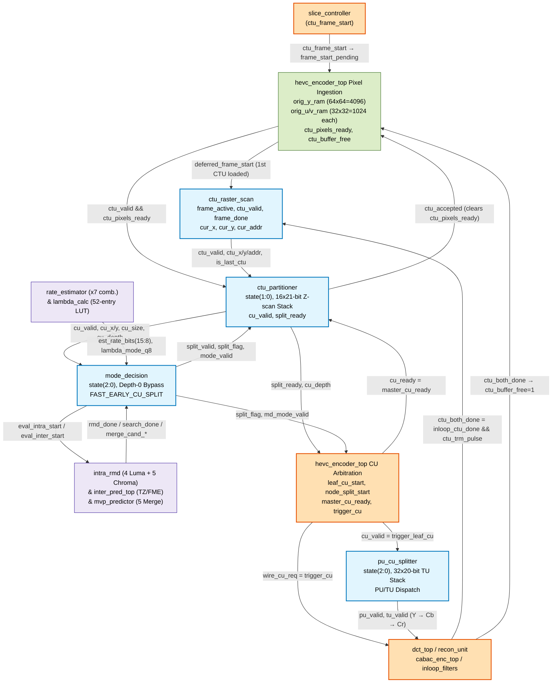
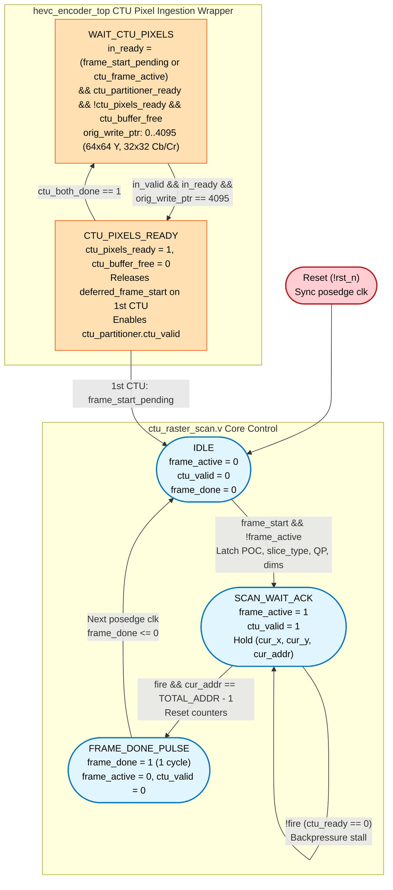
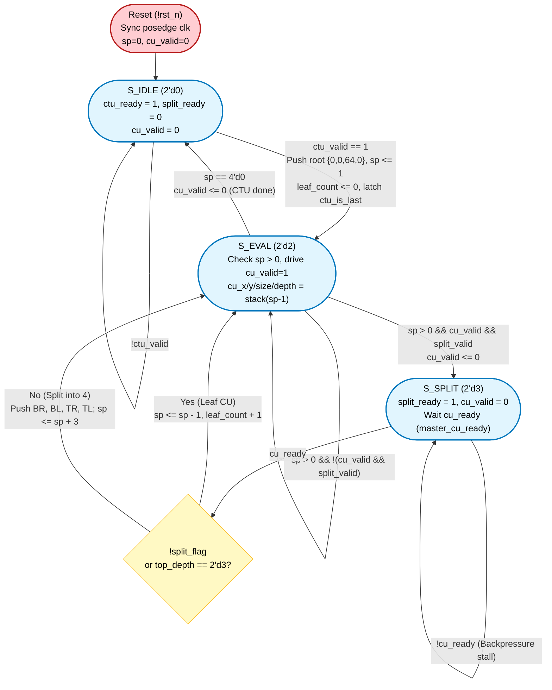
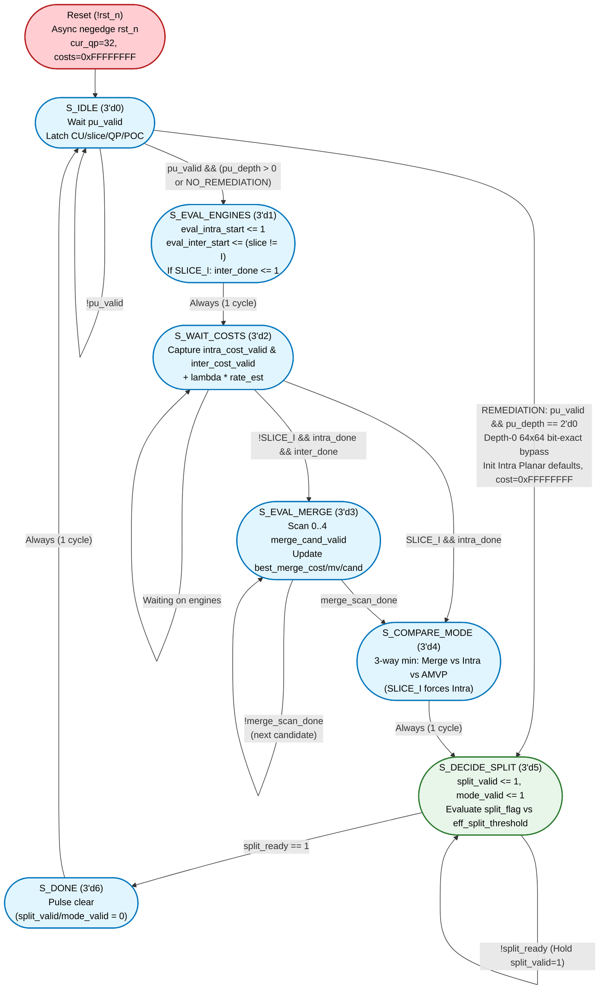
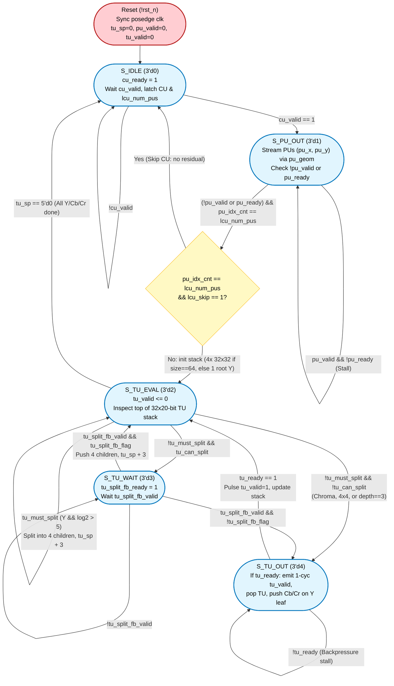
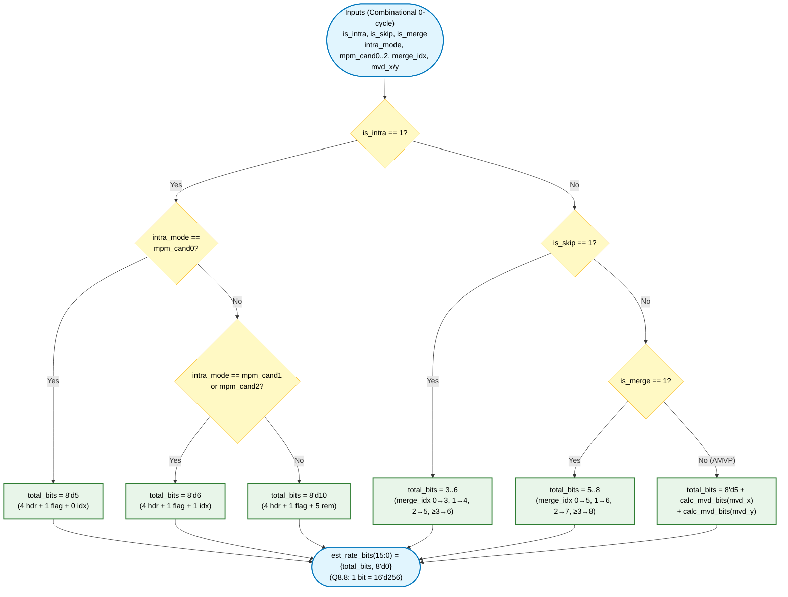

# Partitioning & Mode Decision Subsystem FSMs

This document provides an exact RTL-level reference for all Finite State Machines (FSMs), stack structures, handshake protocols, and combinational decision logic in the partitioning and mode decision subsystem (`rtl/partition/`), together with their top-level orchestration in [`hevc_encoder_top.v`](file:///d:/UIT_Doc/hevc_hw_encoder/rtl/top/hevc_encoder_top.v):

- [`ctu_raster_scan.v`](file:///d:/UIT_Doc/hevc_hw_encoder/rtl/partition/ctu_raster_scan.v) — Frame CTU raster-scan generator (`ctu_valid`/`ctu_ready`, `frame_active`, `frame_done`) and top-level `64x64` Y + `32x32` Cb/Cr CTU pixel ingestion gating
- [`ctu_partitioner.v`](file:///d:/UIT_Doc/hevc_hw_encoder/rtl/partition/ctu_partitioner.v) — Top-down Morton Z-scan quadtree partitioner (`state[1:0]`, 16-deep 21-bit LIFO stack)
- [`mode_decision.v`](file:///d:/UIT_Doc/hevc_hw_encoder/rtl/partition/mode_decision.v) — Lagrangian RDO & FEN split decision FSM (`state[2:0]`, Depth-0 `64x64` bypass, `FAST_EARLY_CU_SPLIT`)
- [`pu_cu_splitter.v`](file:///d:/UIT_Doc/hevc_hw_encoder/rtl/partition/pu_cu_splitter.v) — Leaf-CU PU & TU quadtree dispatcher (`state[2:0]`, 32-deep 20-bit LIFO TU stack, 4:2:0 Chroma scheduling)
- [`rate_estimator.v`](file:///d:/UIT_Doc/hevc_hw_encoder/rtl/partition/rate_estimator.v) — Combinational Q8.8 fixed-point syntax bit-cost estimator

Global constants and bus definitions referenced below reside in [`parameter_pkg.vh`](file:///d:/UIT_Doc/hevc_hw_encoder/rtl/common/parameter_pkg.vh) and [`hevc_interfaces.vh`](file:///d:/UIT_Doc/hevc_hw_encoder/rtl/common/hevc_interfaces.vh) (pure single-path Main10 RTL with `0` `REMEDIATION` directives).

---

## 1. Partitioning & Mode Decision Pipeline Interaction Overview

### 1.1 System Interaction & Handshake Topology

### 1.2 Subsystem Module Summary

| Module | RTL Source | Control / State Reg | Valid Encodings | Storage / Stack | Per-Unit Cycle Latency | Reset Type |
|:---|:---|:---|:---|:---|:---|:---|
| `ctu_raster_scan` | [`ctu_raster_scan.v`](file:///d:/UIT_Doc/hevc_hw_encoder/rtl/partition/ctu_raster_scan.v) | `frame_active`, `ctu_valid`, `frame_done` | 1-bit flags (`0`/`1`) | `cur_x`, `cur_y`, `cur_addr` counters | 1 cycle start; 1 cycle advance on `fire` | Sync active-low |
| `ctu_partitioner` | [`ctu_partitioner.v`](file:///d:/UIT_Doc/hevc_hw_encoder/rtl/partition/ctu_partitioner.v) | `state [1:0]` | `S_IDLE` (`0`), `S_EVAL` (`2`), `S_SPLIT` (`3`) (`2'd1` reserved) | `16 x 21`-bit LIFO stack (`sp [3:0]`) | 2 cycles + `mode_decision` wait per CU node | Sync active-low + `default:` |
| `mode_decision` | [`mode_decision.v`](file:///d:/UIT_Doc/hevc_hw_encoder/rtl/partition/mode_decision.v) | `state [2:0]`, `next_state [2:0]` | `S_IDLE` (`0`) .. `S_DONE` (`6`) | Scalar cost/MV latches (`32`-bit / `12`-bit) | Depth 0 (`REMEDIATION`): 2 cyc to `split_valid` (4–5 cyc total); Depth 1..3: `4 + engine + merge` cyc | Async active-low |
| `pu_cu_splitter` | [`pu_cu_splitter.v`](file:///d:/UIT_Doc/hevc_hw_encoder/rtl/partition/pu_cu_splitter.v) | `state [2:0]` | `S_IDLE` (`0`) .. `S_TU_OUT` (`4`) | `32 x 20`-bit LIFO TU stack (`tu_sp [4:0]`) | `1 + (N_PU+1) + 3*N_Y_split + 2*N_nosplit + 1` cyc per non-skip CU | Sync active-low |
| `rate_estimator` | [`rate_estimator.v`](file:///d:/UIT_Doc/hevc_hw_encoder/rtl/partition/rate_estimator.v) | None (combinational) | 4 mode branches (`always @(*)`) | None | 0 cycles (combinational) | N/A |

### 1.3 Cycle-Accurate `ctu_partitioner` / `mode_decision` / `master_cu_ready` Handshake

In [`hevc_encoder_top.v`](file:///d:/UIT_Doc/hevc_hw_encoder/rtl/top/hevc_encoder_top.v#L533-L719), the closed-loop handshake between `u_ctu_partitioner`, `u_mode_decision`, `u_pu_cu_splitter`, and `u_cabac_enc_top` operates as follows:

1. **CU Presentation (`S_EVAL`)**: `ctu_partitioner` asserts `cu_valid <= 1'b1` with `cu_x`, `cu_y`, `cu_size`, `cu_depth`. `mode_decision` accepts `pu_valid` (`cu_valid`) in `S_IDLE` and begins evaluation while `cu_valid` remains asserted.
2. **Decision Assertion (`S_DECIDE_SPLIT`)**: Upon entering `S_DECIDE_SPLIT`, `mode_decision` registers `split_valid <= 1'b1`, `mode_valid <= 1'b1`, and `split_flag` on the following clock edge (`Tk+1`). Because `ctu_partitioner` is still in `S_EVAL` (`split_ready == 0`) during `[Tk+1, Tk+2)`, `mode_decision` stays in `S_DECIDE_SPLIT` for another cycle (`Tk+2`).
3. **Partitioner Transition (`S_EVAL` &rarr; `S_SPLIT`)**: On clock `Tk+2`, `ctu_partitioner` sees `cu_valid && split_valid`, enters `S_SPLIT` (driving `split_ready = 1`), and clears `cu_valid <= 1'b0`. Simultaneously, `hevc_encoder_top` captures `md_mode_valid` into `md_result_latched <= 1'b1` and `md_latched_*`.
4. **Downstream Gate (`master_cu_ready`)**: While `ctu_partitioner` is in `S_SPLIT`, `split_ready == 1` drives `mode_decision` from `S_DECIDE_SPLIT` &rarr; `S_DONE` &rarr; `S_IDLE` even if `ctu_partitioner` is stalled in `S_SPLIT` by `cu_ready == 0`. `ctu_partitioner` remains safe because `split_flag` is held in `mode_decision` until the next `S_DECIDE_SPLIT`, `md_result_latched` preserves the mode decision in `hevc_encoder_top`, and `master_cu_ready` gates `S_SPLIT` exit as:
   - `node_split_start` (`split_ready && split_flag && cu_depth < 2'd3`): requires `cabac_cu_ready`.
   - `leaf_cu_start` (`split_ready && (!split_flag || cu_depth == 2'd3)`): requires `pu_cu_splitter_cu_ready && cabac_cu_ready && (md_mode_valid || md_result_latched)`.
5. **Dispatch**: When `master_cu_ready == 1`, `trigger_cu` fires CABAC CU coding (`wire_cu_req`), `trigger_leaf_cu` starts `u_pu_cu_splitter` (for leaves only), and `ctu_partitioner` either pops the leaf or pushes 4 Z-scan children and returns to `S_EVAL`.

---

## 2. `ctu_raster_scan` & CTU Pixel Ingestion Control

### 2.1 Mermaid Control Diagram (`flowchart TD`)

> [!NOTE]
> [`ctu_raster_scan.v`](file:///d:/UIT_Doc/hevc_hw_encoder/rtl/partition/ctu_raster_scan.v) does not declare a multi-bit `localparam` `state` register; it encodes its IDLE vs. ACTIVE/WAITING_ACK scan loop via 1-bit registers `frame_active`, `ctu_valid`, and `frame_done`, paired with the `64x64` Y + `32x32` Cb/Cr CTU ingestion gate in [`hevc_encoder_top.v`](file:///d:/UIT_Doc/hevc_hw_encoder/rtl/top/hevc_encoder_top.v#L1167-L1285).

### 2.2 State / Control Register Encoding & Responsibility Table

| Register / Signal | Source File & Width | Reset Value (`!rst_n`) | Semantic State / Role | Cycle Latency |
|:---|:---|:---|:---|:---|
| `frame_active` | `ctu_raster_scan.v`, 1-bit `output reg` | `1'b0` | `0`: IDLE (accepts `frame_start`); `1`: ACTIVE frame scan (ignores `frame_start`) | 1 cyc to assert on `frame_start` |
| `ctu_valid` | `ctu_raster_scan.v`, 1-bit `output reg` | `1'b0` | `1` while presenting valid CTU coordinates in `SCAN_WAIT_ACK` until last CTU handshake | 0-bubble CTU-to-CTU (`ctu_valid` stays `1`) |
| `frame_done` | `ctu_raster_scan.v`, 1-bit `output reg` | `1'b0` | Single-cycle completion pulse when `fire && (cur_addr == TOTAL_ADDR - 1)` | 1 cycle pulse |
| `cur_x`, `cur_y` | `ctu_raster_scan.v`, `CTU_COORD_WIDTH` (`6`-bit) `reg` | `0` | Current CTU column (`0..W_CTUS-1`) and row (`0..H_CTUS-1`) | Registered 1 cyc after `fire` |
| `cur_addr` | `ctu_raster_scan.v`, `CTU_ADDR_WIDTH` (`13`-bit) `reg` | `0` | Linear CTU raster address (`0..TOTAL_CTUS-1`) | Registered 1 cyc after `fire` |
| `poc`, `slice_type`, `qp`, `frame_width_px`, `frame_height_px` | `ctu_raster_scan.v`, `10`b / `2`b / `6`b / `12`b `output reg` | `0` / `` `SLICE_B `` / `` `QP_DEFAULT `` (`29`) / `0` | Frame parameters latched on `frame_start && !frame_active` | Latched on `frame_start` |
| `orig_write_ptr` | `hevc_encoder_top.v`, `12`-bit `reg` | `12'd0` | Counts `0..4095` pixels ingested into `orig_y_ram`/`orig_y_ram_rmd` (`64x64`) & `orig_u/v_ram` (`32x32`) | 4096 accepted cycles/CTU |
| `ctu_pixels_ready` | `hevc_encoder_top.v`, 1-bit `reg` | `1'b0` | Set when `orig_write_ptr == 4095`; gates `u_ctu_partitioner.ctu_valid`; cleared on `ctu_accepted` | 1 cyc after pixel 4095 |
| `ctu_buffer_free` | `hevc_encoder_top.v`, 1-bit `reg` | `1'b1` | `0` from pixel 4095 until `ctu_both_done` (or `ctu_frame_start`) frees the single-CTU RAMs | Single-CTU lock |
| `frame_start_pending`, `deferred_frame_start` | `hevc_encoder_top.v`, 1-bit `reg` | `1'b0` | Delays `u_ctu_raster_scan.frame_start` until the first CTU's 4096 pixels finish loading | 1 cyc pulse when ready |

**Derived Dimension Constants (`ctu_raster_scan.v:86-94`)**:
- `CTU_LOG2 = 6`, `W_CTUS = (FRAME_WIDTH + 63) >> 6`, `H_CTUS = (FRAME_HEIGHT + 63) >> 6`, `TOTAL_CTUS = W_CTUS * H_CTUS`.
- Examples: `3840x2160` (module default) &rarr; `60 x 34 = 2040` CTUs; `128x128` (`DEFAULT_FRAME_WIDTH/HEIGHT`) &rarr; `2 x 2 = 4` CTUs.
- Combinational flags (`L106-108`): `is_first_in_row = (cur_x == 0)`, `is_last_in_row = (cur_x == W_CTUS_COORD - 1)`, `is_last_ctu = (cur_addr == TOTAL_ADDR - 1)`, `fire = ctu_valid && ctu_ready`.

### 2.3 Transition & Guard Condition Table

| Current State / Phase | Condition / Guard | Next State / Phase | Actions & Side Effects |
|:---|:---|:---|:---|
| Any | `!rst_n` (sync `posedge clk`) | `IDLE` (`frame_active=0, ctu_valid=0`) | Clears `frame_done`, counters, `poc`, `frame_width_px/height_px`; sets `slice_type <= SLICE_B`, `qp <= QP_DEFAULT` (`29`) |
| `IDLE` (`!frame_active`) | `frame_start && !frame_active` | `SCAN_WAIT_ACK` (`frame_active=1`) | Sets `cur_x/y/addr <= 0`, latches `poc`, `slice_type`, `qp` (or `QP_DEFAULT` if `frame_qp_in == 0`), `frame_width/height_px`; asserts `ctu_valid <= 1'b1` |
| `SCAN_WAIT_ACK` | `frame_active && fire && (cur_addr != TOTAL_ADDR - 1)` | `SCAN_WAIT_ACK` | `cur_addr <= cur_addr + 1`; if `cur_x == W_CTUS_COORD - 1` then `cur_x <= 0, cur_y <= cur_y + 1` else `cur_x <= cur_x + 1`; keeps `ctu_valid <= 1'b1` |
| `SCAN_WAIT_ACK` | `frame_active && fire && (cur_addr == TOTAL_ADDR - 1)` | `IDLE` (`frame_active=0`) | Clears `ctu_valid <= 0`, resets `cur_x/y/addr <= 0`, pulses `frame_done <= 1'b1` for 1 cycle |
| `SCAN_WAIT_ACK` | `frame_active && !fire` | `SCAN_WAIT_ACK` | Holds `ctu_valid = 1` and current CTU coordinates/metadata unchanged (`frame_done <= 0`) |
| Top `WAIT_CTU_PIXELS` | `in_valid && in_ready && orig_write_ptr == 12'd4095` | Top `CTU_PIXELS_READY` | Sets `ctu_pixels_ready <= 1'b1`, `ctu_buffer_free <= 1'b0`; next cycle `deferred_frame_start <= 1'b1` if `frame_start_pending` |

### 2.4 Reset, Backpressure & Corner-Case Behavior

- **Synchronous Reset**: `always @(posedge clk)` with `if (!rst_n)` clears all outputs and counters synchronously (`L118-131`).
- **Downstream Backpressure**: In `ctu_raster_scan.v`, `ctu_valid` remains asserted continuously during `frame_active` until `ctu_ready` goes high (`fire = ctu_valid && ctu_ready`). In `hevc_encoder_top.v:195`, `ctu_ready` is wired to `ctu_both_done` (not `ctu_partitioner_ready`), ensuring `ctu_raster_scan` holds the current `ctu_x`/`ctu_y`/`ctu_addr`/`ctu_qp` stable for the entire CTU lifetime (mode decision, reconstruction, CABAC, and in-loop filters) and only advances when both `inloop_ctu_done` and `ctu_trm_pulse` have completed.
- **Single-CTU Pixel Buffer Lock & 4:2:0 Subsampling**: `orig_y_ram` / `orig_y_ram_rmd` (`4096` entries) and `orig_u_ram` / `orig_v_ram` (`1024` entries, addressed at `{orig_write_ptr[11:7], orig_write_ptr[5:1]}` in [`hevc_encoder_top.v`](file:///d:/UIT_Doc/hevc_hw_encoder/rtl/top/hevc_encoder_top.v#L1180-L1181)) store one CTU at a time. `in_ready` deasserts as soon as `orig_write_ptr == 4095` sets `ctu_pixels_ready` / clears `ctu_buffer_free`, and re-asserts only after `ctu_both_done` frees the buffer (`L1284`).
- **Corner Cases**:
  - **Spurious `frame_start` during active frame**: Ignored by `if (frame_start && !frame_active)` (`L135`); simulation monitor prints a `WARN` (`L182-184`).
  - **Zero QP fallback**: `qp <= (frame_qp_in != 6'd0) ? frame_qp_in : QP_DEFAULT` (`L145`) maps QP `0` to `29`.
  - **Dimension slicing**: `frame_width_px` and `frame_height_px` are `FRAME_DIM_WIDTH` (`12`) bits wide, while `L146-147` slice `FRAME_WIDTH[13:0]` / `FRAME_HEIGHT[13:0]` (truncating silently to 12 bits, covering up to `4095` px).

---

## 3. `ctu_partitioner` (`rtl/partition/ctu_partitioner.v`)

### 3.1 Mermaid FSM Diagram (`flowchart TD`)

### 3.2 State Encoding, Stack Format & Responsibility Table

| `state [1:0]` `localparam` | Encoding | Outputs Driven (`ctu_ready`, `cu_valid`, `split_ready`) | Responsibilities & Stack Action | Latency |
|:---|:---:|:---:|:---|:---|
| `S_IDLE` | `2'd0` | `ctu_ready = 1`, `cu_valid = 0`, `split_ready = 0` | Waits for `ctu_valid`; on acceptance (`ctu_accepted = ctu_valid`), clears `leaf_count`, latches `cur_is_last_ctu`, pushes Depth-0 root `{6'd0, 6'd0, 7'd64, 2'd0}` to `stack[0]`, sets `sp <= 4'd1`, jumps directly to `S_EVAL` (`2'd1` reserved). | 1 cyc on `ctu_valid` |
| `S_EVAL` | `2'd2` | `ctu_ready = 0`, `cu_valid = (sp>0)`, `split_ready = 0` | If `sp == 0`, returns to `S_IDLE` (CTU complete). Else sets `cu_valid <= 1` with `top_x/y/size/depth` and waits for `cu_valid && split_valid`, then clears `cu_valid <= 0` and enters `S_SPLIT`. | `>= 2` cyc + `mode_decision` wait |
| `S_SPLIT` | `2'd3` | `ctu_ready = 0`, `cu_valid = 0`, `split_ready = 1` | Waits for `cu_ready`. If `!split_flag || top_depth == 2'd3`, pops top entry (`sp - 1`) and increments `leaf_count`. Else pops parent and pushes 4 children in reverse Z-scan order (`sp + 3`), placing Child 0 (TL) on top. | `1` cyc when `cu_ready = 1` |

**16-Deep 21-Bit LIFO Morton Z-Scan Stack (`ctu_partitioner.v:95-116`)**:
- Declaration: `reg [20:0] stack [0:15];` (`STACK_DEPTH = 16`, `STACK_W = 21`) indexed by `reg [3:0] sp;` (`sp == 0` empty, top entry at `stack[sp - 1]`).
- Entry bit layout (`{top_x, top_y, top_size, top_depth}`):

| Bit Slice | Width | Field | Valid Values |
|:---|:---:|:---|:---|
| `[20:15]` (`[STACK_W-1:STACK_W-6]`) | 6 bits | `top_x` | `0..63` (CTU-relative pixel X) |
| `[14:9]` (`[STACK_W-7:STACK_W-12]`) | 6 bits | `top_y` | `0..63` (CTU-relative pixel Y) |
| `[8:2]` (`[STACK_W-13:STACK_W-19]`) | 7 bits | `top_size` | `64`, `32`, `16`, `8` (`half_size = {1'b0, top_size[6:1]}`) |
| `[1:0]` | 2 bits | `top_depth` | `0` (`64x64`), `1` (`32x32`), `2` (`16x16`), `3` (`8x8`) |

- **Reverse Z-Scan Push Mapping (`L205-208`)**:
  - `stack[sp-1+3]` &larr; **Child 0 (TL)**: `(top_x, top_y, half_size, top_depth + 1)` &rarr; new top of stack (`stack[sp_new - 1]`)
  - `stack[sp-1+2]` &larr; **Child 1 (TR)**: `(top_x + half_size, top_y, half_size, top_depth + 1)`
  - `stack[sp-1+1]` &larr; **Child 2 (BL)**: `(top_x, top_y + half_size, half_size, top_depth + 1)`
  - `stack[sp-1]`   &larr; **Child 3 (BR)**: `(top_x + half_size, top_y + half_size, half_size, top_depth + 1)`
  - Total stack occupancy never exceeds `3 levels x 3 pending siblings + 1 = 10` entries (max `sp == 10`), leaving 6 slots headroom in the 16-entry stack.
- **CTU Node/Leaf Bounds**: Minimum CTU traversal (all `32x32` leaves) evaluates `1 + 4 = 5` CUs (`4` leaves); maximum traversal (all `8x8` leaves) evaluates `1 + 4 + 16 + 64 = 85` CUs (`64` leaves).

### 3.3 Transition & Guard Condition Table

| Current State | Condition / Guard | Next State | Register & Stack Updates |
|:---|:---|:---|:---|
| Any | `!rst_n` (sync `posedge clk`) | `S_IDLE` | `sp <= 0`, `cu_valid <= 0`, `leaf_count <= 0`, `cur_is_last_ctu <= 0`, clears `stack[0..15] <= 0` |
| `S_IDLE` | `ctu_valid == 1'b1` | `S_EVAL` | `leaf_count <= 7'd0`, `cur_is_last_ctu <= ctu_is_last`, `stack[0] <= {6'd0,6'd0,7'd64,2'd0}`, `sp <= 4'd1` |
| `S_IDLE` | `ctu_valid == 1'b0` | `S_IDLE` | `cu_valid <= 1'b0` |
| `S_EVAL` | `sp == 4'd0` | `S_IDLE` | `cu_valid <= 1'b0` (CTU finished) |
| `S_EVAL` | `sp != 4'd0 && !(cu_valid && split_valid)` | `S_EVAL` | `cu_valid <= 1'b1`, `cu_x/y/size/depth <= top_x/y/size/depth` |
| `S_EVAL` | `sp != 4'd0 && cu_valid && split_valid` | `S_SPLIT` | `cu_valid <= 1'b0` |
| `S_SPLIT` | `!cu_ready` | `S_SPLIT` | Holds `split_ready = 1`, stack unchanged |
| `S_SPLIT` | `cu_ready && (!split_flag || top_depth == 2'd3)` | `S_EVAL` | `sp <= sp - 4'd1`, `leaf_count <= leaf_count + 7'd1` |
| `S_SPLIT` | `cu_ready && split_flag && (top_depth != 2'd3)` | `S_EVAL` | Writes 4 Z-scan children at `stack[sp-1 .. sp+2]`; `sp <= sp + 4'd3` |

### 3.4 Reset, Backpressure & Corner-Case Behavior

- **Synchronous Reset & Safe State Recovery**: Reset clears all 16 stack entries synchronously, and `case (state)` includes a safe `default: state <= S_IDLE;` recovery branch (unused `2'd1` `S_PUSH_CTU` and `expected_leaves` removed while preserving active encodings `0/2/3`).
- **NBA Stack-Pointer Override (`L204, L209`)**: Inside `S_SPLIT`, `sp <= sp - 4'd1;` (`L204`) is followed by `sp <= sp + 4'd3;` (`L209`) in the same `always @(posedge clk)` block. Under Verilog non-blocking semantics, the second NBA wins (`sp_next = sp + 3`, i.e., `-1 + 4`), while all `stack[sp-1 + k]` RHS index expressions evaluate against the pre-edge `sp`.
- **Max-Depth Forced Leaf (`top_depth == 2'd3`)**: Even if `split_flag == 1`, `top_depth == 2'd3` (`8x8`) forces a leaf pop and triggers the simulation check `WARN [ctu_partitioner] split requested at max depth 3` (`L227-229`).
- **`cu_is_last_in_ctu` Combinational Behavior (`L219`)**: `({1'b0, cu_x} + cu_size == 7'd64) && ({1'b0, cu_y} + cu_size == 7'd64)` asserts on *any* CU touching `(64,64)` (including Depth-0 `64x64` or a split `32x32` at `(32,32)`). In [`hevc_encoder_top.v`](file:///d:/UIT_Doc/hevc_hw_encoder/rtl/top/hevc_encoder_top.v#L3251), `cabac_cu_is_last_in_ctu` qualifies it with `leaf_cu_start && cu_is_last_in_ctu` so non-leaf splits never terminate the CTU early.
- **Stack Overflow Guard (`L230-232`)**: Simulation prints `ERROR` if `sp >= STACK_DEPTH - 1` (`15`).

---

## 4. `mode_decision` (`rtl/partition/mode_decision.v`)

### 4.1 Mermaid FSM Diagram (`flowchart TD`)

### 4.2 State Encoding, Submodules & Responsibility Table

| `state [2:0]` `localparam` | Encoding | Primary Active Outputs | Datapath Operations | Cycle Latency |
|:---|:---:|:---|:---|:---|
| `S_IDLE` | `3'd0` | All control strobes `0` | On `pu_valid`, latches `cur_pu_size/depth/slice_type/qp/poc`, resets `intra_done/inter_done/merge_evaluated/merge_scan_idx` and `latched_*_cost = 32'hFFFFFFFF`. Under `REMEDIATION` with `pu_depth == 0`, initializes `best_*` defaults and jumps straight to `S_DECIDE_SPLIT`. | 1 cyc upon `pu_valid` |
| `S_EVAL_ENGINES` | `3'd1` | `eval_intra_start <= 1`, `eval_inter_start <= (slice != SLICE_I)` | Triggers `intra_rmd` and (for P/B slices) `tz_search` (`me_load_active` prefetcher in top). For `SLICE_I`, sets `inter_done <= 1'b1`. | 1 cyc |
| `S_WAIT_COSTS` | `3'd2` | None (waits on engines) | Global capture block (`L341-359`) latches `intra_rd_cost + lambda_intra_rate_cost` on `intra_cost_valid` and `inter_rd_cost + lambda_amvp_rate_cost` on `inter_cost_valid`. | `max(N_intra, N_inter)` cyc |
| `S_EVAL_MERGE` | `3'd3` | Internal scan (`merge_scan_idx`) | P/B slices only: evaluates 1 candidate/cycle for `merge_cand_valid[merge_scan_idx]`, sets `merge_evaluated <= 1'b1`, sign-extends 10-bit `merge_mv_x/y` to 12-bit qpel. | `2..6` cyc (`N_valid + 2`, cap 6) |
| `S_COMPARE_MODE` | `3'd4` | Updates `best_is_intra`, `best_rd_cost`, `best_intra_mode`, `best_inter_mv_*`, `best_merge_*`, `best_skip_flag` | Three-way RDO comparison (`SLICE_I` forces Intra; else `Merge <= Inter & Intra`, else `Intra <= Inter`, else `AMVP Inter`). | 1 cyc |
| `S_DECIDE_SPLIT` | `3'd5` | `split_valid <= 1`, `mode_valid <= 1`, `split_flag <= ...` | Evaluates Depth-3 leaf clamp, skip check, Depth-0 forced split (`REMEDIATION`), `32'hFFFF0000` saturation guard, and `best_rd_cost > eff_split_threshold`. Holds until `split_ready == 1` (1 cyc to assert `split_valid`, +1 cyc per handshake wait). | `>= 2` cyc (5 cyc total Depth-0 round-trip w/ partitioner) |
| `S_DONE` | `3'd6` | Default pulse clears (`split_valid=0`, `mode_valid=0`) | Single-cycle recovery bubble before returning to `S_IDLE`. | 1 cyc |

*(Encoding `3'd7` is unused; `default: next_state = S_IDLE;` in combinational `always @(*)` at `L301`.)*

**Key Registers & Submodules**:
- **Latched CU Context**: `cur_pu_size [6:0]`, `cur_pu_depth [1:0]`, `cur_slice_type [1:0]`, `cur_qp [5:0]`, `cur_poc [9:0]`.
- **Submodules**:
  - `u_lambda_calc` ([`lambda_calc.v`](file:///d:/UIT_Doc/hevc_hw_encoder/rtl/rate_control/lambda_calc.v)): combinational 52-entry QP LUT producing `lambda_mode_q8` (`[27:0]` under `REMEDIATION`, `[23:0]` otherwise), `lambda_motion_q8` (`[17:0]` / `[15:0]`), and `lambda_chroma_q8`.
  - `u_rate_est_intra`, `u_rate_est_merge[0..4]` (`gen_merge_rate`), `u_rate_est_amvp` ([`rate_estimator.v`](file:///d:/UIT_Doc/hevc_hw_encoder/rtl/partition/rate_estimator.v)): combinational Q8.8 bit estimators whose integer byte `[15:8]` feeds `(lambda_mode_q8 * est_rate_q8[15:8]) >> 8`.

### 4.3 Transition & Guard Condition Table

| Current State | Condition / Guard | Next State | Key Actions |
|:---|:---|:---|:---|
| Any | `!rst_n` (async `negedge rst_n`) | `S_IDLE` | Resets `split_valid/flag`, `mode_valid`, `eval_*_start`, `*_done`, `cur_qp <= 6'd32`, costs `<= 32'hFFFFFFFF` |
| `S_IDLE` | `!pu_valid` | `S_IDLE` | Idle; dynamic cost capture remains active if inputs pulse |
| `S_IDLE` | `` `ifdef REMEDIATION ``: `pu_valid && (pu_depth == 2'd0)` | `S_DECIDE_SPLIT` | Latches CU info; sets `best_rd_cost <= 32'hFFFFFFFF`, `best_is_intra <= 1`, `best_intra_mode <= 0`, MVs/merge/skip `<= 0` |
| `S_IDLE` | `pu_valid && (pu_depth != 2'd0)` (or `` `ifndef REMEDIATION ``) | `S_EVAL_ENGINES` | Latches CU info; clears `intra_done`, `inter_done`, `merge_evaluated`, `merge_scan_idx`; sets cost latches `<= 32'hFFFFFFFF` |
| `S_EVAL_ENGINES` | Unconditional | `S_WAIT_COSTS` | Pulses `eval_intra_start <= 1`; pulses `eval_inter_start <= 1` if `cur_slice_type != SLICE_I`, else `inter_done <= 1` |
| `S_WAIT_COSTS` | `(cur_slice_type == SLICE_I) && intra_done` | `S_COMPARE_MODE` | Skips `S_EVAL_MERGE` for I-slices |
| `S_WAIT_COSTS` | `(cur_slice_type != SLICE_I) && intra_done && inter_done` | `S_EVAL_MERGE` | Proceeds to sequential 5-candidate merge scan |
| `S_EVAL_MERGE` | `!merge_scan_done` (`merge_scan_idx < 5 && !(idx>0 && !valid[idx-1])`) | `S_EVAL_MERGE` | Evaluates `cur_merge_cost` if `merge_cand_valid[merge_scan_idx]`, updates `best_merge_*`, `merge_scan_idx + 1`, `merge_evaluated <= 1` |
| `S_EVAL_MERGE` | `merge_scan_done` | `S_COMPARE_MODE` | Exits merge scan |
| `S_COMPARE_MODE` | Unconditional | `S_DECIDE_SPLIT` | Selects lowest-cost mode (`best_skip_flag <= 1'b0` in all branches) |
| `S_DECIDE_SPLIT` | `!split_ready` | `S_DECIDE_SPLIT` | Asserts `split_valid <= 1'b1`, `mode_valid <= 1'b1`, updates `split_flag` |
| `S_DECIDE_SPLIT` | `split_ready` | `S_DONE` | Handshake accepted by `ctu_partitioner` |
| `S_DONE` | Unconditional | `S_IDLE` | Default pulse clears clear `split_valid` and `mode_valid` |

### 4.4 Reset, Backpressure, Depth-0 Bypass & `FAST_EARLY_CU_SPLIT` Behavior

- **Depth-0 (`64x64`) Bit-Exact Bypass (`ifdef REMEDIATION`, `L267, L380-391, L479-481`)**:
  - Hardware `intra_rmd` and `dct_top` support at most `32x32` TUs (`TU_LOG2_MAX = 5`), so `intra_rmd` returns `best_cost = 32'hFFFFFFFF` for `64x64`.
  - With `REMEDIATION` active (the default), `pu_depth == 2'd0` immediately transitions `S_IDLE -> S_DECIDE_SPLIT` without launching `eval_intra_start` or `eval_inter_start`, sets deterministic Intra Planar defaults (`best_rd_cost <= 32'hFFFFFFFF`, `best_is_intra <= 1'b1`, `best_intra_mode <= 6'd0`), and forces `split_flag <= 1'b1`.
  - Without `REMEDIATION` (`NO_REMEDIATION`), `mode_decision` runs engines at Depth 0 and checks `(best_rd_cost < 32'hFFFF0000 && best_rd_cost > split_threshold)` (`L493`), which evaluates FALSE on `32'hFFFFFFFF` and causes the D-05 `64x64` leaf deadlock.
- **`FAST_EARLY_CU_SPLIT` Parameter (`L22, L213-220`)**:
  - Depth-dependent baseline `split_threshold`:
    - Depth `0` (`64x64`): `32'd250000 + (lambda_mode_q8 >> 4)`
    - Depth `1` (`32x32`): `32'd60000 + (lambda_mode_q8 >> 5)`
    - Depth `2` (`16x16`): `32'd15000 + (lambda_mode_q8 >> 6)`
    - Depth `3` (`8x8`): `32'hFFFFFFFF`
  - Scaled threshold: `split_threshold_scaled = (cur_pu_depth == 2'd3) ? 32'hFFFFFFFF : (split_threshold + (split_threshold >> 1))` (`1.5x` `split_threshold`).
  - `eff_split_threshold = FAST_EARLY_CU_SPLIT ? split_threshold_scaled : split_threshold`.
  - Setting `FAST_EARLY_CU_SPLIT = 1` relaxes the split threshold by `1.5x` (favoring earlier quadtree termination at Depths 1 and 2). In [`hevc_encoder_top.v`](file:///d:/UIT_Doc/hevc_hw_encoder/rtl/top/hevc_encoder_top.v#L1039-L1041), `FAST_EARLY_CU_SPLIT` also selects area-scaled inter SAD `{20'd0, search_best_sad} << ((4'd4 - {2'd0, cu_depth[1:0]}) << 1)` instead of `{12'd0, search_best_sad, 8'd0}`.
- **RDO Decision Priority & Corner Cases**:
  - **Split priority under `REMEDIATION` (`L472-491`)**: (1) `cur_pu_depth == 2'd3` &rarr; `split_flag = 0` (`8x8` forced leaf); (2) `best_skip_flag` &rarr; `0`; (3) `cur_pu_depth == 2'd0` &rarr; `1` (`64x64` forced split); (4) `best_rd_cost >= 32'hFFFF0000` &rarr; `1` (saturated/invalid cost forces split); (5) `best_rd_cost > eff_split_threshold` &rarr; `1`; (6) else &rarr; `0` (FEN early termination).
  - **Saturation Guard (`L343, L352`)**: Prevents `32'hFFFF0000..32'hFFFFFFFF` engine sentinel costs from wrapping around when adding `lambda_*_rate_cost`.
  - **Live `inter_rd_cost` in `S_EVAL_MERGE` (`L413-414`)**: `S_EVAL_MERGE` uses the live `inter_rd_cost` input port (assumed held stable by `inter_pred_top` after `search_done`) rather than `latched_inter_cost`. Notice also `merge_scan_done` checks `merge_cand_valid[merge_scan_idx - 1]` for `merge_scan_idx > 0`, so even if `merge_cand_valid == 5'b00000`, `S_EVAL_MERGE` spends 2 cycles (`idx=0` then `idx=1` exits).
  - **External Rate / Skip Ports**: `S_COMPARE_MODE` sets `best_skip_flag <= 1'b0` in every branch; unused `skip_threshold` and dead `else if (best_skip_flag)` branch in `S_DECIDE_SPLIT` were removed (`rate_cost_valid` and `est_bit_rate` ports remain tied `0` in `hevc_encoder_top.v`).
  - **Asynchronous Reset & Backpressure**: Uses `always @(posedge clk or negedge rst_n)`. Under `split_ready == 0`, `S_DECIDE_SPLIT` keeps pulsing `split_valid <= 1` and `mode_valid <= 1` until `split_ready` arrives.

---

## 5. `pu_cu_splitter` (`rtl/partition/pu_cu_splitter.v`)

### 5.1 Mermaid FSM Diagram (`flowchart TD`)

### 5.2 State Encoding, TU Stack Format & `pu_geom` Table

| `state [2:0]` `localparam` | Encoding | Control Signals | Responsibilities | Cycle Latency |
|:---|:---:|:---|:---|:---|
| `S_IDLE` | `3'd0` | `cu_ready = 1`, `tu_split_fb_ready = 0` | Latches `lcu_x/y/size/depth/part_mode/skip`, computes `lcu_num_pus` (`1` for `2Nx2N`, `4` for `NxN`, `2` otherwise), clears `pu_idx_cnt <= 0`. | 1 cyc on `cu_valid` |
| `S_PU_OUT` | `3'd1` | `cu_ready = 0`, `pu_valid` | Streams `lcu_num_pus` PUs via `pu_geom`. Once `pu_idx_cnt == lcu_num_pus`, returns to `S_IDLE` if `lcu_skip`, else initializes TU stack (`4` pre-split `32x32` TUs if `lcu_size == 64`, else `1` root Luma TU) and goes to `S_TU_EVAL`. | `N_PU + 1` cyc (min) |
| `S_TU_EVAL` | `3'd2` | `tu_valid <= 0` | Exits to `S_IDLE` if `tu_sp == 0`; forces 4-way split in place if `tu_must_split`; goes to `S_TU_OUT` if `!tu_can_split`; else queries `S_TU_WAIT`. | 1 cyc per node |
| `S_TU_WAIT` | `3'd3` | `tu_split_fb_ready = 1` | Waits for `tu_split_fb_valid`. On `tu_split_fb_flag == 1`, pushes 4 Z-scan children (`tu_sp + 3`) and returns to `S_TU_EVAL`; on `0`, proceeds to `S_TU_OUT`. | `>= 1` cyc (1 cyc in top) |
| `S_TU_OUT` | `3'd4` | `tu_valid <= 1` (1-cyc pulse when `tu_ready`) | Waits for `tu_ready == 1`, registers TU descriptor, pops top entry (`tu_sp - 1`), pushes `Cb`/`Cr` if Luma leaf qualifies (`tu_sp + 1` net), sets `tu_is_last_in_cu`, returns to `S_TU_EVAL`. | `>= 1` cyc per TU |

**32-Deep 20-Bit TU Quadtree Stack (`pu_cu_splitter.v:154-164`)**:
- Declaration: `reg [19:0] tu_stack [0:31];` (`TU_STACK_DEPTH = 32`, `TU_STACK_W = 20`; note comment on `L150` refers to an older 17-bit layout before `depth[2:0]` was included) indexed by `reg [4:0] tu_sp;` (`0` = empty, top entry at `tu_stack[tu_sp - 1]`).

| Bit Slice | Width | Signal | Meaning |
|:---|:---:|:---|:---|
| `[19:14]` | 6 bits | `tu_top_x` | CTU-relative X coordinate (Luma pixels for `comp=0`, Chroma pixels for `comp=1,2`) |
| `[13:8]` | 6 bits | `tu_top_y` | CTU-relative Y coordinate (Luma or Chroma pixels) |
| `[7:5]` | 3 bits | `tu_top_log2` | `log2(TU_size)`: `2` (`4x4`), `3` (`8x8`), `4` (`16x16`), `5` (`32x32`) |
| `[4:2]` | 3 bits | `tu_top_depth` | TU depth relative to root CU (`0..3`; `1` after `64x64` pre-split) |
| `[1:0]` | 2 bits | `tu_top_comp` | `2'd0` = Y (Luma), `2'd1` = Cb, `2'd2` = Cr |

**`pu_geom` Partition Function (`pu_cu_splitter.v:116-146`)**:

| `part_mode` | `lcu_num_pus` | `pu_idx` Mapping (`{px, py, pw, ph}`) | Notes |
|:---|:---:|:---|:---|
| `3'd0` (`PART_2Nx2N`) | `3'd1` | `idx=0`: `(0, 0, N, N)` | Hardwired in `hevc_encoder_top.v:731` |
| `3'd1` (`PART_2NxN`) | `3'd2` | `idx=0`: `(0, 0, N, N/2)`; `idx=1`: `(0, N/2, N, N/2)` | Symmetric horizontal |
| `3'd2` (`PART_Nx2N`) | `3'd2` | `idx=0`: `(0, 0, N/2, N)`; `idx=1`: `(N/2, 0, N/2, N)` | Symmetric vertical |
| `3'd3` (`PART_NxN`) | `3'd4` | `idx=0..3`: `(idx[0]*N/2, idx[1]*N/2, N/2, N/2)` | Z-scan quadrants |
| `3'd4..3'd7` (`default`) | `3'd2` | `(0, 0, N, N)` | AMP modes (`2NxnU..nRx2N`) default to `N x N` in `pu_geom` |

### 5.3 Transition & Guard Condition Table

| Current State | Condition / Guard | Next State | Stack & Output Updates |
|:---|:---|:---|:---|
| Any | `!rst_n` (sync `posedge clk`) | `S_IDLE` | `pu_valid <= 0`, `tu_valid <= 0`, `pu_idx_cnt <= 0`, `tu_sp <= 0`, `tu_stack[0..31] <= 0` |
| `S_IDLE` | `cu_valid == 1'b1` | `S_PU_OUT` | Latches `lcu_*`, sets `lcu_num_pus`, resets `pu_idx_cnt <= 0` |
| `S_PU_OUT` | `(!pu_valid \|\| pu_ready) && (pu_idx_cnt < lcu_num_pus)` | `S_PU_OUT` | `pu_valid <= 1`, sets `pu_x/y`, `pu_idx_cnt <= pu_idx_cnt + 1` |
| `S_PU_OUT` | `(!pu_valid \|\| pu_ready) && (pu_idx_cnt == lcu_num_pus) && lcu_skip` | `S_IDLE` | `pu_valid <= 0` (no residual TUs emitted) |
| `S_PU_OUT` | `(!pu_valid \|\| pu_ready) && (pu_idx_cnt == lcu_num_pus) && !lcu_skip` | `S_TU_EVAL` | `pu_valid <= 0`; pushes 4 `32x32` TUs (`tu_sp <= 4`) if `lcu_size==64`, else 1 root Y TU (`tu_sp <= 1`) |
| `S_TU_EVAL` | `tu_sp == 5'd0` | `S_IDLE` | `tu_valid <= 0` |
| `S_TU_EVAL` | `tu_sp != 0 && tu_must_split` (`comp==0 && log2 > 5`) | `S_TU_EVAL` | `tu_valid <= 0`; replaces top with 4 Z-scan children, `tu_sp <= tu_sp + 3` |
| `S_TU_EVAL` | `tu_sp != 0 && !tu_must_split && !tu_can_split` | `S_TU_OUT` | `tu_valid <= 0` (`tu_can_split = (comp==0 && log2 > 2 && depth < 3)`) |
| `S_TU_EVAL` | `tu_sp != 0 && !tu_must_split && tu_can_split` | `S_TU_WAIT` | `tu_valid <= 0` |
| `S_TU_WAIT` | `tu_split_fb_valid && tu_split_fb_flag` | `S_TU_EVAL` | Pushes 4 Z-scan children (`child_log2 = log2-1`, `child_depth = depth+1`), `tu_sp <= tu_sp + 3` |
| `S_TU_WAIT` | `tu_split_fb_valid && !tu_split_fb_flag` | `S_TU_OUT` | Leaf TU ready for emission |
| `S_TU_OUT` | `!tu_ready` | `S_TU_OUT` | Backpressure stall; stack and `tu_valid` (`0`) unchanged |
| `S_TU_OUT` | `tu_ready == 1'b1` | `S_TU_EVAL` | `tu_valid <= 1` (1-cycle pulse), outputs `tu_x/y/size_log2/comp`, pops `tu_sp - 1` (or pushes `Cb, Cr` with `tu_sp + 1`), updates `tu_is_last_in_cu` |

### 5.4 Reset, Backpressure & Corner-Case Behavior

- **Pre-Check Ready-Before-Valid TU Protocol (`L288, L351`)**: `S_TU_OUT` waits for `tu_ready == 1` *before* pulsing `tu_valid <= 1'b1` and immediately enters `S_TU_EVAL`, where `tu_valid <= 1'b0` clears it on the following clock edge. Thus `tu_valid` is always a single-cycle pulse accepted synchronously by `hevc_encoder_top.v:1523` (which drops `tu_ready_signal` on `tu_valid && tu_ready_signal` until `cabac_coeff_done` completes the TU).
- **4:2:0 Chroma TU Grouping (`L365-383`)**:
  - When popping a Luma leaf (`tu_top_comp == 2'd0`):
    - If `tu_top_log2 > 3'd2` (`8x8`, `16x16`, `32x32`), Chroma TUs of size `tu_top_log2 - 1` (`4x4`, `8x8`, `16x16`) are pushed immediately at `(tu_top_x >> 1, tu_top_y >> 1)`: `Cb` (`2'd1`) at `tu_stack[tu_sp]` (popped next) and `Cr` (`2'd2`) at `tu_stack[tu_sp-1]` (popped after `Cb`), net `tu_sp <= tu_sp + 1`.
    - If `tu_top_log2 == 3'd2` (`4x4` Luma), Chroma is deferred until the 4th (bottom-right) `4x4` sub-block of the `8x8` parent (`tu_top_x[2] == 1'b1 && tu_top_y[2] == 1'b1`), pushing one shared `4x4` (`chr_log2 = 3'd2`) `Cb`/`Cr` pair at the `8x8`-aligned Chroma origin `((tu_top_x & ~6'd4) >> 1, (tu_top_y & ~6'd4) >> 1)`.
- **Corner Cases**:
  - **`64x64` CU Pre-Split (`L261-266`)**: Because `TU_SIZE_MAX = 32`, a `64x64` CU initializes `tu_stack[3..0]` directly with four `32x32` (`log2=5, depth=1`) Luma TUs in reverse Z-scan order (`tu_sp <= 5'd4`).
  - **`tu_is_last_in_cu` (`L386-387`)**: Evaluated as `(tu_sp == 5'd1) && (tu_top_comp == 2'd2)`, assuming the last popped TU of every non-skip CU is a `Cr` component (`comp=2`).
  - **Top-Level Ties (`hevc_encoder_top.v:731-738`)**: `part_mode` is tied to `3'd0` (`PART_2Nx2N`), `pu_ready` to `1'b1`, `tu_split_fb_valid` to `1'b1`, and `tu_split_fb_flag` to `1'b0`.
  - **TU Stack Overflow Check (`L402-404`)**: Worst-case depth-3 split across 3 components uses `27` entries (`< 32`); simulation flags `ERROR` if `tu_sp >= 30`.

---

## 6. `rate_estimator` (`rtl/partition/rate_estimator.v`)

### 6.1 Combinational Evaluation Flowchart (`flowchart TD`)

### 6.2 Mode Bit-Cost & `calc_mvd_bits` Specification Table

`rate_estimator` is purely combinational (`always @(*)`, **0-cycle latency**, no clock or reset). It outputs `est_rate_bits [15:0] = {total_bits, 8'd0}` in Q8.8 fixed-point (`1 bit = 8'd256`).

| Category | Priority Condition | `total_bits [7:0]` Formula | `est_rate_bits [15:0]` | Syntax Breakdown (RTL Comments) |
|:---|:---|:---|:---|:---|
| Intra (MPM0) | `is_intra && (intra_mode == mpm_cand0)` | `8'd5` | `16'h0500` (`1280`) | `split_cu(1)+pred_mode(1)+cbf(2)` (`4`) + `mpm_flag(1)` + `0` + `0` |
| Intra (MPM1/2) | `is_intra && (intra_mode == mpm_cand1 \|\| mpm_cand2)` | `8'd6` | `16'h0600` (`1536`) | `4` header + `mpm_flag(1)` + `mpm_idx(1)` |
| Intra (Non-MPM) | `is_intra && !is_mpm` | `8'd10` | `16'h0A00` (`2560`) | `4` header + `mpm_flag(1)` + `rem_mode(5)` |
| Inter Skip | `!is_intra && is_skip` | `3, 4, 5, 6` (`idx=0,1,2,>=3`) | `16'h0300`..`16'h0600` | `split_cu(1)+skip_flag(1)+merge_idx(1..4)` |
| Inter Merge | `!is_intra && !is_skip && is_merge` | `5, 6, 7, 8` (`idx=0,1,2,>=3`) | `16'h0500`..`16'h0800` | `split_cu(1)+skip(0)+merge_flag(1)+merge_idx(1..4)+cbf(1)` |
| Inter AMVP | `!is_intra && !is_skip && !is_merge` | `5 + calc_mvd_bits(mvd_x) + calc_mvd_bits(mvd_y)` | `7..41` bits (`<< 8`) | `5` header + EG-1 MVD bits per component |

**`calc_mvd_bits(signed [11:0] val)` Piece-Wise Exp-Golomb Length (`rate_estimator.v:41-64`)**:

| `abs_val` Range (`\|val\|`) | `suffix = abs_val - 2` | Returned Bit Count (`[7:0]`) | Coding Breakdown |
|:---|:---|:---:|:---|
| `0` | N/A | `8'd1` | `abs_mvd_greater0_flag = 0` |
| `1` | N/A | `8'd3` | `gt0(1) + gt1(0) + sign(1)` |
| `2 .. 3` | `0 .. 1` (`< 2`) | `8'd6` (`3 + 3`) | `gt0 + gt1 + sign` (`3`) + EG-1 (`3`) |
| `4 .. 7` | `2 .. 5` (`< 6`) | `8'd8` (`3 + 5`) | `3` + EG-1 (`5`) |
| `8 .. 15` | `6 .. 13` (`< 14`) | `8'd10` (`3 + 7`) | `3` + EG-1 (`7`) |
| `16 .. 31` | `14 .. 29` (`< 30`) | `8'd12` (`3 + 9`) | `3` + EG-1 (`9`) |
| `32 .. 63` | `30 .. 61` (`< 62`) | `8'd14` (`3 + 11`) | `3` + EG-1 (`11`) |
| `>= 64` | `>= 62` | `8'd18` (`3 + 15`) | `3` + capped EG-1 (`15`) |

### 6.3 Guard Priority & Integration Corner Cases

- **Priority Chain (`L72-104`)**: `if (is_intra)` takes highest priority, followed by `else if (is_skip)`, `else if (is_merge)`, and finally `else` (AMVP).
- **`mode_decision` Coupling & Truncation**: [`mode_decision.v`](file:///d:/UIT_Doc/hevc_hw_encoder/rtl/partition/mode_decision.v#L155-L206) instantiates 7 copies (`u_rate_est_intra`, `u_rate_est_merge[0..4]`, `u_rate_est_amvp`), reads only `est_rate_bits[15:8]` (`total_bits`), and computes `(lambda_mode_q8 * est_rate_bits[15:8]) >> 8`. Because `est_rate_bits[7:0]` is always `8'd0`, Q8.8 fractional bits are unused.
- **Hardcoded MPM & Raw MV Inputs**: `u_rate_est_intra` fixes `mpm_cand0/1/2` to `{6'd0, 6'd1, 6'd10}` (Planar, DC, Horizontal), and `u_rate_est_amvp` passes `inter_best_mv_x/y` directly as `mvd_x/y` (approximating MVD cost using raw MV magnitude).
- **Signed Overflow Edge Case (`L46`)**: `abs_val = (val < 0) ? -val : val` on a 12-bit signed `-2048` (`12'h800`) wraps to `12'h800` (`2048` unsigned, `>= 64`), still hitting the `8'd18` ceiling branch cleanly.
