# Top-Level & Control FSM Specification

This specification documents every finite-state machine (FSM), sequential arbiter, and pipeline synchronization controller across the encoder top-level and SoC integration layers:

- [`hevc_encoder_axi_top.v`](file:///d:/UIT_Doc/hevc_hw_encoder/rtl/top/hevc_encoder_axi_top.v) — SoC wrapper (AXI4-Lite CSR/W1C interrupt controller, soft-reset synchronizer, AXI4-Stream `s_axis_video` / `m_axis_bitstream` 2-entry `TLAST` staging FIFO).
- [`gop_controller.v`](file:///d:/UIT_Doc/hevc_hw_encoder/rtl/top/gop_controller.v) — Frame-level GOP sequencer (`state[2:0]`: `S_IDLE`..`S_DONE`), POC/slice-type assignment, and DPB slot allocation/recycling.
- [`slice_controller.v`](file:///d:/UIT_Doc/hevc_hw_encoder/rtl/top/slice_controller.v) — Slice/NAL orchestrator (`state[4:0]`: `S_IDLE`..`S_DONE`), VPS/SPS/PPS `param_set_writer` sequencing, `slice_cases.vh` header packing, and slice RBSP handoff.
- [`hevc_encoder_top.v`](file:///d:/UIT_Doc/hevc_hw_encoder/rtl/top/hevc_encoder_top.v) — Top-level orchestrator featuring **2-bank CTU Ping-Pong** (`orig_*_ram` banks, `decoder_inloop_filters`, `cabac_enc_top` `ctu_bin_ram_0/1`), **4-entry `cu_fifo` & `tu_meta_fifo`**, **4-bank `coeff_buffer.v` (`DEPTH=4096`)**, decoupled front-end **`cabac_state[3:0]`** & back-end **`cabac_be_state`** FSMs, post-slice flush timer (`cabac_flush_state[1:0]`), `reg_tu_comp` Y/Cb/Cr TU/Transform/Recon interlocks, Pillar 3 `tu_cg_nonzero_mask_y/cb/cr`, Pillar 1 TDP DPB Port-A/Port-B arbitration (`dpb_wr_*_d1`, `mc_dpb_wr_collision`), and CTU/frame completion barriers (`ctu_both_done`, `sync_frame_done_pulse`).
- [`axi_read_arbiter.v`](file:///d:/UIT_Doc/hevc_hw_encoder/rtl/common/axi_read_arbiter.v) — Dual-master L0/L1 AXI4 Read Lock Arbiter (`active_read`, `sel`).

---

## 1. Top-Level Control Hierarchy & Inter-Module Synchronization

Control flows strictly top-down from host AXI4-Lite CSRs through frame/slice controllers into CTU/CU/TU datapath and entropy sequencers, while completion barriers (`ctu_both_done`, `cabac_flush_done`, `sync_frame_done_pulse`) propagate bottom-up to advance CTUs and frames in lockstep.

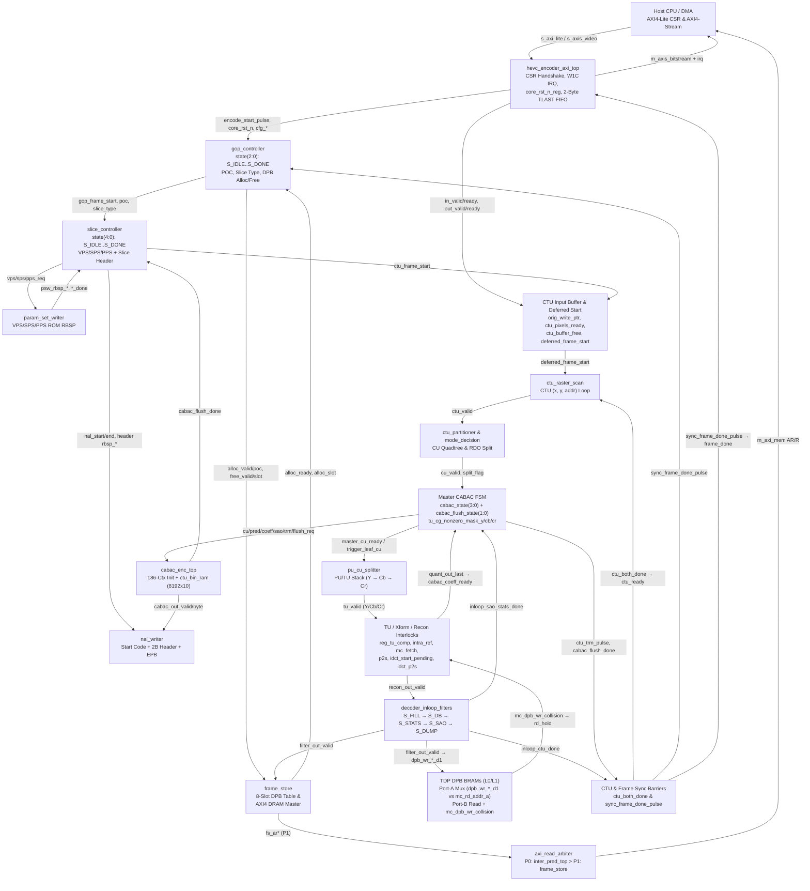

### 1.1 Master FSM & Stateful Sequencer Inventory

| Module | RTL State / Control Register | Width | Encoding / Range | Role |
|:---|:---|:---:|:---|:---|
| [`hevc_encoder_axi_top.v`](file:///d:/UIT_Doc/hevc_hw_encoder/rtl/top/hevc_encoder_axi_top.v) | `axi_awready`, `axi_wready`, `axi_bvalid` | 1b ea | Handshake flags | AXI4-Lite coupled write-channel accept & response |
| [`hevc_encoder_axi_top.v`](file:///d:/UIT_Doc/hevc_hw_encoder/rtl/top/hevc_encoder_axi_top.v) | `axi_arready`, `axi_rvalid` | 1b ea | Handshake flags | AXI4-Lite read-channel accept & response |
| [`hevc_encoder_axi_top.v`](file:///d:/UIT_Doc/hevc_hw_encoder/rtl/top/hevc_encoder_axi_top.v) | `reg_busy`, `reg_done`, `irq_status`, `core_rst_n_reg` | 1b ea | Status / W1C / Sync-reset | Host status, frame/encode W1C interrupt, glitch-free reset |
| [`hevc_encoder_axi_top.v`](file:///d:/UIT_Doc/hevc_hw_encoder/rtl/top/hevc_encoder_axi_top.v) | `bitstream_cnt`, `bitstream_frame_ending` | 2b, 1b | `0..2`, `0..1` | 2-entry `m_axis_bitstream` staging FIFO & `TLAST` alignment |
| [`gop_controller.v`](file:///d:/UIT_Doc/hevc_hw_encoder/rtl/top/gop_controller.v) | `state` / `next_state` | 3b | `S_IDLE(0)`..`S_DONE(6)` | Multi-frame session, POC, slice type, DPB slot alloc/free |
| [`slice_controller.v`](file:///d:/UIT_Doc/hevc_hw_encoder/rtl/top/slice_controller.v) | `state` / `next_state` | 5b | `S_IDLE(0)`..`S_DONE(15)` | VPS/SPS/PPS emission, slice header pack/send, NAL close |
| [`hevc_encoder_top.v`](file:///d:/UIT_Doc/hevc_hw_encoder/rtl/top/hevc_encoder_top.v) | `cabac_state` | 4b | `CABAC_IDLE(0)`..`CABAC_DRAIN_CTU_BINS(11)` | Master CU/Pred/Coeff/SAO/Drain/CTU-TRM CABAC sequencer |
| [`hevc_encoder_top.v`](file:///d:/UIT_Doc/hevc_hw_encoder/rtl/top/hevc_encoder_top.v) | `cabac_flush_state`, `cabac_idle_timer` | 2b, 8b | `0..3`, `0..100` | Post-slice 2x100-cycle drain timer & `cabac_flush_pulse` |
| [`hevc_encoder_top.v`](file:///d:/UIT_Doc/hevc_hw_encoder/rtl/top/hevc_encoder_top.v) | `tu_can_start`, `reg_tu_comp`, `intra_ref_active`, `me_load_active`, `inter_p2s_active`, `p2s_active`, `idct_start_pending`, `idct_active`, `idct_p2s_active` | 1b/2b | Pipeline interlock flags | Y/Cb/Cr TU execution, shared `dct_top`, Pillar 3 CG masks |
| [`hevc_encoder_top.v`](file:///d:/UIT_Doc/hevc_hw_encoder/rtl/top/hevc_encoder_top.v) | `dpb_wr_luma_d1`, `dpb_wr_cb_d1`, `dpb_wr_cr_d1` | 1b ea | 1-cycle registered strobe | Pillar 1 TDP DPB Port-A mux & `mc_dpb_wr_collision` hold |
| [`hevc_encoder_top.v`](file:///d:/UIT_Doc/hevc_hw_encoder/rtl/top/hevc_encoder_top.v) | `ctu_pixels_ready`, `ctu_buffer_free`, `frame_start_pending`, `inloop_done_pending`, `cabac_done_pending`, `cabac_finished`, `recon_finished` | 1b ea | Lockstep sync flags | Input pixel pacing, CTU `ctu_both_done`, `sync_frame_done_pulse` |
| [`axi_read_arbiter.v`](file:///d:/UIT_Doc/hevc_hw_encoder/rtl/common/axi_read_arbiter.v) | `active_read`, `sel` | 1b ea | `0..1` | Dual-master fixed-priority AXI4 read burst lock arbiter |

---

## 2. `hevc_encoder_axi_top.v` — SoC AXI4-Lite, W1C IRQ & AXI4-Stream Wrapper

Located at [`rtl/top/hevc_encoder_axi_top.v`](file:///d:/UIT_Doc/hevc_hw_encoder/rtl/top/hevc_encoder_axi_top.v) (550 lines), this wrapper adapts the core encoder to standard AMBA AXI4-Lite, AXI4-Stream, and AXI4 memory-mapped buses.

### 2.1 AXI4-Lite CSR Handshakes, Soft Reset & W1C Interrupt Logic

#### (a) Mermaid Control Diagram

```mermaid
flowchart TD
    subgraph AXI_WR ["AXI4-Lite Write Channel"]
        W_IDLE["slv_wren == 0<br/>axi_awready=0, axi_wready=0"]
        W_ACC["slv_wren == 1<br/>axi_awready&lt;=1, axi_wready&lt;=1<br/>axi_bvalid&lt;=1 (OKAY), CSR Write"]
        W_WAITB["axi_bvalid == 1<br/>Wait s_axi_lite_bready"]
        W_IDLE -->|"awvalid &amp; wvalid &amp; (!bvalid OR bready)"| W_ACC
        W_ACC --> W_WAITB
        W_WAITB -->|"s_axi_lite_bready"| W_IDLE
    end

    subgraph AXI_RD ["AXI4-Lite Read Channel"]
        R_IDLE["~axi_arready &amp; (~axi_rvalid OR rready)"]
        R_RESP["axi_arready&lt;=1, axi_rvalid&lt;=1<br/>Mux axi_rdata (0x00..0x24)"]
        R_WAIT["axi_rvalid == 1<br/>Wait s_axi_lite_rready"]
        R_IDLE -->|"s_axi_lite_arvalid"| R_RESP
        R_RESP --> R_WAIT
        R_WAIT -->|"s_axi_lite_rready"| R_IDLE
    end

    subgraph STAT_IRQ ["Core Status, Soft Reset &amp; W1C IRQ"]
        IDLE_ST["Idle / Ready<br/>reg_busy=0, reg_done=0 or 1"]
        RUN_ST["Running<br/>reg_busy=1, reg_done=0"]
        IRQ_CLR["irq_status = 0<br/>(irq = 0)"]
        IRQ_SET["irq_status = 1<br/>(irq = reg_irq_en)"]
        IDLE_ST -->|"encode_start_pulse (0x00 bit 0)"| RUN_ST
        RUN_ST -->|"core_encode_done"| IDLE_ST
        RUN_ST -->|"reg_soft_rst == 1"| IDLE_ST
        IRQ_CLR -->|"(core_encode_done &amp; !prev_encode_done) OR (core_frame_done_pulse &amp; mid-frame)"| IRQ_SET
        IRQ_SET -->|"W1C write 0x08 bit 0 OR reg_soft_rst"| IRQ_CLR
    end
```

#### (b) Register Map, Handshake State & Latency Table

| Address (`awaddr[5:2]`) | Register Name | Access | Reset Value | Bit Fields & Functional Responsibility |
|:---|:---|:---:|:---|:---|
| `0x00` (`4'h0`) | Control (`CTRL`) | RW | `3'b000` | `[0]` `START`: writes 1-cycle `encode_start_pulse` (reads `0`); `[1]` `reg_soft_rst` (registered into `core_rst_n_reg`); `[2]` `reg_irq_en` |
| `0x04` (`4'h1`) | Status (`STATUS`) | RO | `3'b100` | `[0]` `reg_done`; `[1]` `reg_busy`; `[2]` `~reg_busy` (`READY`) |
| `0x08` (`4'h2`) | IRQ Status (`IRQ`) | R/W1C | `1'b0` | `[0]` `irq_status`: set on rising `core_encode_done` (aligned with `reg_done`/`~reg_busy`) or mid-frame `core_frame_done_pulse` when `(frame_done_cnt + 1 < reg_total_frames)`; cleared on write `wdata[0]=1` with `wstrb[0]=1` |
| `0x0C` (`4'h3`) | Total Frames | RW | `16'd1` | `[15:0]` `reg_total_frames` (`total_frames` to `u_hevc_encoder_top`) |
| `0x10` (`4'h4`) | Base QP | RW | `BASE_QP` (`29`) | `[5:0]` `reg_base_qp` (`cfg_base_qp`) |
| `0x14` (`4'h5`) | GOP Structure | RW | `GOP_STRUCTURE` (`1`) | `[1:0]` `reg_gop_structure` (`0`=IPP, `1`=IPBB, `2`=Hier-B) |
| `0x18` (`4'h6`) | Target Bitrate | RW | `TARGET_BITRATE_KBPS` (`5000`) | `[15:0]` `reg_target_bitrate_kbps` |
| `0x1C` (`4'h7`) | Feature Enable / Magic ID | WO / RO | `RC_ENABLE[0]`, `sao=0` | **Write**: `[0]` `reg_rc_enable`, `[1]` `reg_sao_enable`. **Read**: constant `32'h48455643` (`"HEVC"`) |
| `0x20` (`4'h8`) | Resolution | RO | `{W, H}` | `[31:16]` `FRAME_WIDTH[15:0]`, `[15:0]` `FRAME_HEIGHT[15:0]` |
| `0x24` (`4'h9`) | VBV Fullness | RO | Live wire | `[15:0]` `status_vbv_fullness_pct` from `u_rate_controller` |

- **AXI4-Lite Transaction Latency**: Minimum **1 clock cycle** from valid request (`slv_wren` / `arvalid`) to `awready`/`wready`/`bvalid` or `arready`/`rvalid`, plus 1 cycle for host `bready`/`rready` retirement (zero wait states when `!bvalid` / `!rvalid`).
- **Soft-Reset Synchronizer Latency**: `core_rst_n_reg` adds **1 clock cycle** from `reg_soft_rst` write to active-low `core_rst_n` assertion/deassertion on `u_hevc_encoder_top` and the output staging FIFO.

#### (c) Transition & Guard Condition Table

| Mechanism | Current Condition | Next Action / Transition | Guard Expression (Exact RTL) |
|:---|:---|:---|:---|
| AXI-Lite Write Accept | Ready for write (`!axi_awready`) | `axi_awready<=1`, `axi_wready<=1`, `axi_bvalid<=1`, `axi_bresp<=0` | `s_axi_lite_awvalid && s_axi_lite_wvalid && (!axi_awready) && (!axi_bvalid &#124;&#124; s_axi_lite_bready)` (`slv_wren`) |
| AXI-Lite B-Channel Clear | `axi_bvalid == 1` & `!slv_wren` | `axi_bvalid <= 1'b0` | `s_axi_lite_bready && axi_bvalid` |
| AXI-Lite Read Accept | Ready for read (`~axi_arready`) | `axi_arready<=1`, `axi_rvalid<=1`, latch `axi_rdata` | `~axi_arready && s_axi_lite_arvalid && (~axi_rvalid &#124;&#124; s_axi_lite_rready)` |
| AXI-Lite R-Channel Clear | `axi_rvalid == 1` | `axi_rvalid <= 1'b0` | `s_axi_lite_rready && axi_rvalid` |
| `reg_busy` / `reg_done` | Any (except `reg_soft_rst`) | `reg_busy<=1, reg_done<=0` | `encode_start_pulse` |
| `reg_busy` / `reg_done` | Running (`!encode_start_pulse`) | `reg_busy<=0, reg_done<=1` | `core_encode_done` |
| `irq_status` Set | `irq_status == 0` or `1` | `irq_status <= 1'b1` | `(core_encode_done && !prev_encode_done) &#124;&#124; (core_frame_done_pulse && ((frame_done_cnt + 16'd1) < reg_total_frames))` |
| `irq_status` Clear | No set event this cycle | `irq_status <= 1'b0` | `slv_wren && (s_axi_lite_awaddr[5:2] == 4'h2) && s_axi_lite_wstrb[0] && s_axi_lite_wdata[0]` |

---

### 2.2 AXI4-Stream Video Input & Bitstream `TLAST` Staging FIFO

#### (a) Mermaid Diagram (`m_axis_bitstream` Staging & `TLAST` FSM)

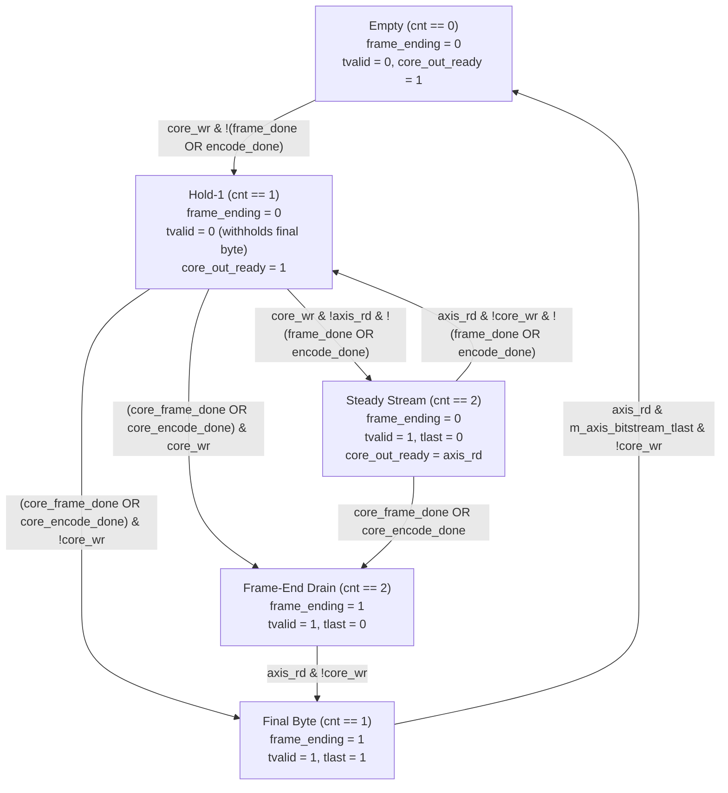

#### (b) State Encoding & Responsibility Table

| Register / Signal | Width | Reset (`!core_rst_n`) | Active Responsibility |
|:---|:---:|:---|:---|
| `bitstream_buf[0:1]` | 2 x 8b | Unreset (overwritten) | 2-byte staging ring buffer holding bytes from `u_hevc_encoder_top.out_byte` |
| `bitstream_cnt` | 2b | `2'd0` | Occupancy (`0`, `1`, `2`); determines `core_out_ready`, `tvalid`, and `tlast` |
| `bitstream_wr_ptr` | 1b | `1'b0` | Write pointer toggled on `core_wr = core_out_valid && core_out_ready` |
| `bitstream_rd_ptr` | 1b | `1'b0` | Read pointer toggled on `axis_rd = m_axis_bitstream_tvalid && m_axis_bitstream_tready` |
| `bitstream_frame_ending` | 1b | `1'b0` | Asserted on `(core_frame_done \|\| core_encode_done)` when `(bitstream_cnt > 0 \|\| core_wr)`; enables draining the final byte with `tlast = 1` |

#### (c) Transition & Guard Condition Table

| Signal / State | Condition / Guard | Next Value / Output Behavior |
|:---|:---|:---|
| `core_out_ready` | Combinational | `(bitstream_cnt < 2'd2) \|\| axis_rd` (accepts 1 byte/cycle even at `cnt == 2` if `axis_rd` pops simultaneously) |
| `m_axis_bitstream_tvalid` | Combinational | `bitstream_frame_ending ? (bitstream_cnt > 2'd0) : (bitstream_cnt >= 2'd2)` |
| `m_axis_bitstream_tlast` | Combinational | `bitstream_frame_ending && (bitstream_cnt == 2'd1)` |
| `bitstream_frame_ending <= 1'b1` | `(core_frame_done \|\| core_encode_done) && (bitstream_cnt > 2'd0 \|\| core_wr)` | Switches FIFO into frame-end flush mode |
| `bitstream_frame_ending <= 1'b0` | `axis_rd && m_axis_bitstream_tlast` | Clears flush flag after final byte of frame transfers |
| `bitstream_cnt` update | `{core_wr, axis_rd} == 2'b10` / `2'b01` / else | `+ 2'd1` / `- 2'd1` / unchanged |

#### (d) Reset, Backpressure & Corner-Case Behavior
- **Glitch-Free Soft Reset (`LUTAR-1` Avoidance)**: Combining `rst_n` and `reg_soft_rst` in combinational logic would drive async preset/clear pins from a LUT. Instead, `core_rst_n_reg` registers `~reg_soft_rst` on `posedge clk` (async-cleared on `!rst_n`), cleanly resetting both `u_hevc_encoder_top` and the `m_axis_bitstream` FIFO without timing/glitch hazards. Note that `reg_soft_rst` also synchronously clears `reg_busy`, `reg_done`, and `irq_status`, while leaving configuration CSRs (`reg_total_frames`, `reg_base_qp`, etc.) intact.
- **AXI4-Lite Backpressure**: Because `slv_wren` requires BOTH `awvalid` and `wvalid` simultaneously, an AXI4-Lite master that separates `AW` and `W` phases across cycles must hold the earlier channel valid until the second arrives; `axi_awready` and `axi_wready` then pulse together for 1 cycle. If a previous `axi_bvalid` has not been accepted (`!s_axi_lite_bready`), `slv_wren` stalls cleanly.
- **Asymmetric `0x1C` Register**: Writing `0x1C` configures `reg_rc_enable` (bit `[0]`) and `reg_sao_enable` (bit `[1]`), whereas reading `0x1C` always returns the ASCII signature `0x48455643` (`"HEVC"`).
- **W1C Interrupt Event Priority**: If a frame/encode completion pulse arrives on the exact same cycle as a W1C write to `0x08`, the `if (...) irq_status <= 1'b1; else if (...) irq_status <= 1'b0;` priority ensures the new interrupt event is never silently lost.
- **Video Stream Framing (`s_axis_video`)**: `s_axis_video_tdata[29:0]` maps directly to `{V[29:20], U[19:10], Y[9:0]}` with `tvalid -> in_valid` and `in_ready -> tready`. Ports `s_axis_video_tlast` and `s_axis_video_tuser` are present at the wrapper boundary but ignored internally; CTU boundaries rely strictly on counting `4096` accepted beats inside `hevc_encoder_top`.
- **Zero-Byte Frame End Guard**: Checking `(bitstream_cnt > 2'd0 || core_wr)` before setting `bitstream_frame_ending` prevents a spurious `TLAST` state if `core_frame_done` fires when the FIFO is empty.

---

## 3. `gop_controller.v` — Frame-Level GOP, POC & DPB Slot FSM

Located at [`rtl/top/gop_controller.v`](file:///d:/UIT_Doc/hevc_hw_encoder/rtl/top/gop_controller.v) (407 lines), `gop_controller` manages multi-frame encoding (`total_frames`), assigns slice types and POCs, allocates/frees DPB slots in `frame_store`, and drives `slice_controller` via `frame_start`.

### (a) Mermaid State Diagram

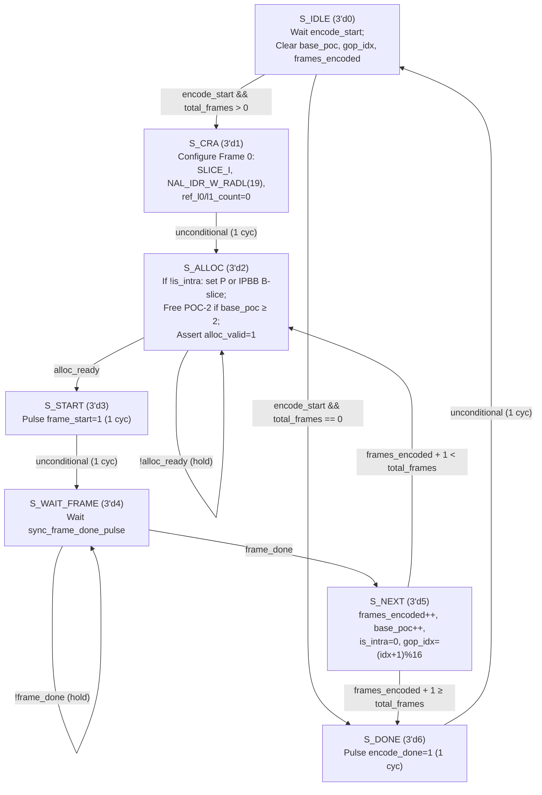

### (b) State Encoding & Responsibility Table (`state[2:0]`)

| State Name | Encoding (`3b`) | Active Outputs & Register Updates | Cycle Latency |
|:---|:---:|:---|:---|
| `S_IDLE` | `3'd0` | On `encode_start`: `base_poc <= 0`, `gop_idx <= 0`, `frames_encoded <= 0`, `is_intra <= 1'b1`. | >= 1 cycle (waits `encode_start`) |
| `S_CRA` | `3'd1` | `frame_slice_type <= SLICE_I (2'd2)`, `frame_poc <= 0`, `temporal_id <= 0`, `nal_type <= NAL_IDR_W_RADL (6'd19)`, `alloc_poc <= 0`, `is_intra <= 1`, `ref_l0_count <= 0`, `ref_l1_count <= 0`. | 1 cycle fixed |
| `S_ALLOC` | `3'd2` | If `!is_intra`: configures `SLICE_B` (`cfg_gop_structure == 1 && frames_encoded >= 2`, `ref_l0/l1_count = 1`, `ref = find_slot(base_poc - 1)`) or `SLICE_P` (`ref_l0_count = 1`, `ref_l1_count = 0`). If `base_poc >= 2`: pulses `free_valid <= 1`, `free_slot <= find_slot(base_poc - 2)`, clears `slot_map_valid`. Drives `alloc_valid <= 1`; on `alloc_ready`, updates `slot_map_valid[alloc_slot] <= 1` and `slot_map_poc[alloc_slot] <= base_poc`. | >= 1 cycle (1 cycle when DPB has free slot) |
| `S_START` | `3'd3` | Pulses `frame_start <= 1'b1` for 1 clock cycle (`gop_frame_start`). | 1 cycle fixed |
| `S_WAIT_FRAME` | `3'd4` | Holds current frame metadata (`frame_poc`, `frame_slice_type`, `ref_l0`, `ref_l1`) stable until `frame_done` arrives. | Full frame duration |
| `S_NEXT` | `3'd5` | `frames_encoded <= frames_encoded + 1`, `base_poc <= base_poc + 1`, `alloc_poc <= base_poc + 1`, `frame_poc <= base_poc + 1`, `is_intra <= 0`, `gop_idx <= (gop_idx == 15) ? 0 : gop_idx + 1`. | 1 cycle fixed |
| `S_DONE` | `3'd6` | Pulses `encode_done <= 1'b1` for 1 clock cycle. | 1 cycle fixed |

### (c) Transition & Guard Condition Table

| Current State | Next State | Guard Condition | Side Effects / Notes |
|:---|:---|:---|:---|
| `S_IDLE` | `S_CRA` | `encode_start && (total_frames != 16'd0)` | Initializes session counters; `is_intra <= 1` |
| `S_IDLE` | `S_DONE` | `encode_start && (total_frames == 16'd0)` | Zero-frame clean completion without encoding Frame 0 |
| `S_CRA` | `S_ALLOC` | Unconditional | Latches I-frame `NAL_IDR_W_RADL` (`6'd19`) metadata |
| `S_ALLOC` | `S_START` | `alloc_ready == 1'b1` | Latches `slot_map_valid[alloc_slot]`, `slot_map_poc[alloc_slot]` |
| `S_START` | `S_WAIT_FRAME` | Unconditional | Asserts 1-cycle `frame_start` to `slice_controller` & `rate_controller` |
| `S_WAIT_FRAME` | `S_NEXT` | `frame_done == 1'b1` | Triggered by `sync_frame_done_pulse` (`cabac_finished && recon_finished`) |
| `S_NEXT` | `S_DONE` | `frames_encoded + 16'd1 >= total_frames` | All requested frames completed |
| `S_NEXT` | `S_ALLOC` | `frames_encoded + 16'd1 < total_frames` | Always enters `S_ALLOC` as P/B (`is_intra <= 0`) |
| `S_DONE` | `S_IDLE` | Unconditional | Fires 1-cycle `encode_done` |
| `default` | `S_IDLE` | Illegal state recovery | Safe combinational `next_state` default |

### (d) Reset, Backpressure, GOP ROM vs. Active Datapath & Corner Cases
- **Reset Behavior**: Async active-low `!rst_n` forces `state <= S_IDLE`, clears all pulse outputs (`frame_start`, `encode_done`, `alloc_valid`, `free_valid`), `is_intra`, `base_poc`, `gop_idx`, `frames_encoded`, and invalidates all 8 `slot_map_valid[0:7]` entries. Note `frame_poc`, `frame_slice_type`, `temporal_id`, `nal_type`, `alloc_poc`, `free_slot`, `ref_l0_count`, `ref_l1_count`, `int_ref_l0`, `int_ref_l1` are assigned inside `S_CRA`/`S_ALLOC`/`S_NEXT` rather than async reset.
- **Sequential IPP / Low-Delay IPBB Datapath**: `gop_controller.v` steps `base_poc` sequentially (`0, 1, 2, ...`) in display order with `temporal_id = 0` and `NAL_TRAIL_R (6'd1)`, running **IPP** (`cfg_gop_structure != 2'd1`) or **Low-Delay IPBB** (`cfg_gop_structure == 2'd1 && frames_encoded >= 2`) with sliding-window RPS `delta = -1` (`ref_l0[0] = ref_l1[0] = find_slot(base_poc - 1)`). (The unused hierarchical-B `rom_*` lookup table and `target_frame_poc` were removed during remediation; `S_NEXT` transitions exclusively to `S_ALLOC`.)
- **DPB Allocation Backpressure & `free_valid` Guard (`S_ALLOC`)**: `S_ALLOC` gates `free_valid <= 1'b1` and `slot_map_valid[find_slot(base_poc - 10'd2)] <= 1'b0` on `alloc_ready && (base_poc >= 10'd2)`, ensuring DPB slot recycling fires exactly once when `frame_store` accepts the allocation.
- **Zero-Frame Request Guard (`total_frames == 0`)**: `S_IDLE` checks `(total_frames == 16'd0) ? S_DONE : S_CRA` on `encode_start`, cleanly pulsing `encode_done` without spuriously encoding Frame 0.

---

## 4. `slice_controller.v` — Parameter Set, Slice Header & NAL FSM

Located at [`rtl/top/slice_controller.v`](file:///d:/UIT_Doc/hevc_hw_encoder/rtl/top/slice_controller.v) (333 lines), `slice_controller` sequences Annex-B parameter sets (for `SLICE_I`) and the slice segment header (via [`rtl/common/slice_cases.vh`](file:///d:/UIT_Doc/hevc_hw_encoder/rtl/common/slice_cases.vh)) into `nal_writer`, then releases `ctu_frame_start` to start CTU encoding.

### (a) Mermaid State Diagram

```mermaid
flowchart TD
    S_IDLE["S_IDLE (5'd0)<br/>Wait frame_start; Latch slice_type,<br/>nal_type, temporal_id, poc, sao_enable"]
    S_VPS_ST["S_VPS_START (5'd1)<br/>nal_start=1, psw_vps_req=1 (type 32)"]
    S_VPS_SN["S_VPS_SEND (5'd2)<br/>Stream VPS RBSP from param_set_writer;<br/>On psw_vps_done: nal_end=1"]
    S_VPS_WT["S_VPS_WAIT (5'd3)<br/>Wait wait_cnt == 3'd3 &amp;&amp; nal_ready"]
    S_SPS_ST["S_SPS_START (5'd4)<br/>nal_start=1, psw_sps_req=1 (type 33)"]
    S_SPS_SN["S_SPS_SEND (5'd5)<br/>Stream SPS RBSP; On psw_sps_done: nal_end=1"]
    S_SPS_WT["S_SPS_WAIT (5'd6)<br/>Wait wait_cnt == 3'd3 &amp;&amp; nal_ready"]
    S_PPS_ST["S_PPS_START (5'd7)<br/>nal_start=1, psw_pps_req=1 (type 34)"]
    S_PPS_SN["S_PPS_SEND (5'd8)<br/>Stream PPS RBSP; On psw_pps_done: nal_end=1"]
    S_PPS_WT["S_PPS_WAIT (5'd9)<br/>Wait wait_cnt == 3'd3 &amp;&amp; nal_ready"]
    S_NAL_ST["S_NAL_START (5'd10)<br/>nal_start=1 (latched_nal_type)"]
    S_HDR_PK["S_HDR_PACK (5'd11)<br/>Pack 16/24/32b header via slice_cases.vh"]
    S_HDR_SN["S_HDR_SEND (5'd12)<br/>Shift 8b/cyc into nal_writer;<br/>Last byte: ctu_frame_start=1"]
    S_CTU_SC["S_CTU_SCAN (5'd13)<br/>CABAC owns RBSP bus;<br/>Wait ctu_frame_done (cabac_flush_done)"]
    S_WT_END["S_WAIT_NAL_END (5'd14)<br/>1-cycle post-flush guard"]
    S_DONE["S_DONE (5'd15)<br/>nal_end=1, frame_done=1"]

    S_IDLE -->|"frame_start &amp; frame_slice_type == SLICE_I"| S_VPS_ST
    S_IDLE -->|"frame_start &amp; frame_slice_type != SLICE_I"| S_NAL_ST
    S_VPS_ST --> S_VPS_SN
    S_VPS_SN -->|"psw_vps_done"| S_VPS_WT
    S_VPS_WT -->|"wait_cnt == 3'd3 &amp;&amp; nal_ready"| S_SPS_ST
    S_SPS_ST --> S_SPS_SN
    S_SPS_SN -->|"psw_sps_done"| S_SPS_WT
    S_SPS_WT -->|"wait_cnt == 3'd3 &amp;&amp; nal_ready"| S_PPS_ST
    S_PPS_ST --> S_PPS_SN
    S_PPS_SN -->|"psw_pps_done"| S_PPS_WT
    S_PPS_WT -->|"wait_cnt == 3'd3 &amp;&amp; nal_ready"| S_NAL_ST
    S_NAL_ST --> S_HDR_PK
    S_HDR_PK --> S_HDR_SN
    S_HDR_SN -->|"rbsp_valid &amp; rbsp_ready &amp; hdr_bits_left &le; 8"| S_CTU_SC
    S_CTU_SC -->|"ctu_frame_done (cabac_flush_done)"| S_WT_END
    S_WT_END --> S_DONE
    S_DONE --> S_IDLE
```

### (b) State Encoding & Responsibility Table (`state[4:0]`)

| State Name | Encoding (`5b`) | Active Outputs & Internal Operations | Cycle Latency |
|:---|:---:|:---|:---|
| `S_IDLE` | `5'd0` | `wait_cnt <= 0`; on `frame_start`, latches `latched_slice_type`, `latched_nal_type`, `latched_temporal_id`, `latched_poc`, `latched_sao_enable <= (sao_enable === 1'b1)`. | >= 1 cycle |
| `S_VPS_START` | `5'd1` | Pulses `nal_start <= 1`, `psw_vps_req <= 1`, `out_nal_type <= 6'd32` (VPS), `out_temporal_id <= 0`. | 1 cycle |
| `S_VPS_SEND` | `5'd2` | Routes `u_param_set_writer` (`psw_rbsp_*`) to `rbsp_*`; pulses `nal_end <= 1` when `psw_vps_done`. | 18 RBSP bytes + `nal_writer` header/EPB stalls |
| `S_VPS_WAIT` | `5'd3` | Saturating `wait_cnt <= wait_cnt + 1` (max `3'd3`) while polling `nal_ready` (`nal_writer` back in `S_IDLE`). | `>= 4` cycles |
| `S_SPS_START` | `5'd4` | Clears `wait_cnt`, pulses `nal_start <= 1`, `psw_sps_req <= 1`, `out_nal_type <= 6'd33` (SPS). | 1 cycle |
| `S_SPS_SEND` | `5'd5` | Streams SPS ROM (`24..27` bytes per resolution) from `param_set_writer`; pulses `nal_end` on `psw_sps_done`. | 24–27 bytes + `nal_writer` overhead |
| `S_SPS_WAIT` | `5'd6` | Saturating `wait_cnt` `0..3` while waiting for `nal_ready` before PPS. | `>= 4` cycles |
| `S_PPS_START` | `5'd7` | Clears `wait_cnt`, pulses `nal_start <= 1`, `psw_pps_req <= 1`, `out_nal_type <= 6'd34` (PPS). | 1 cycle |
| `S_PPS_SEND` | `5'd8` | Streams PPS ROM (`4` bytes) from `param_set_writer`; pulses `nal_end` on `psw_pps_done`. | 4 bytes + `nal_writer` overhead |
| `S_PPS_WAIT` | `5'd9` | Saturating `wait_cnt` `0..3` while waiting for `nal_ready` before slice NAL. | `>= 4` cycles |
| `S_NAL_START` | `5'd10` | Clears `wait_cnt`, pulses `nal_start <= 1`, `out_nal_type <= latched_nal_type` (`19` IDR or `1` TRAIL_R), `out_temporal_id <= latched_temporal_id`. | 1 cycle |
| `S_HDR_PACK` | `5'd11` | `slice_cases.vh` case on live `frame_qp` (`16..44` + default `29`) loads `hdr_shift_reg[63:32/40/48]` and `hdr_bits_left` (`16`, `24`, or `32`). | 1 cycle |
| `S_HDR_SEND` | `5'd12` | Drives `int_rbsp_valid <= 1`, `rbsp_byte = hdr_shift_reg[63:56]`. Shifts `<< 8` per `rbsp_ready`; on final byte (`hdr_bits_left <= 8 && rbsp_ready`), pulses `ctu_frame_start <= 1`, clears `int_rbsp_valid <= 0`. | `>= 2..4` bytes + `nal_writer` startup |
| `S_CTU_SCAN` | `5'd13` | `slice_controller` yields `rbsp_*` (`rbsp_valid = 0`); `cabac_enc_top` drives slice payload into `nal_writer` until `ctu_frame_done` (`cabac_flush_done`). | Full slice CTU & flush duration |
| `S_WAIT_NAL_END` | `5'd14` | 1-cycle settling state keeping `out_nal_type` stable prior to `nal_end`. | 1 cycle |
| `S_DONE` | `5'd15` | Pulses `nal_end <= 1'b1` and `frame_done <= 1'b1` (`slice_frame_done`). | 1 cycle |

### (c) Transition & Guard Condition Table

| Current State | Next State | Guard Condition | Notes |
|:---|:---|:---|:---|
| `S_IDLE` | `S_VPS_START` | `frame_start && (frame_slice_type == SLICE_I)` | Rewrites VPS/SPS/PPS before every Intra frame |
| `S_IDLE` | `S_NAL_START` | `frame_start && (frame_slice_type != SLICE_I)` | P/B frames skip parameter sets straight to slice NAL |
| `S_VPS_START` / `S_SPS_START` / `S_PPS_START` | `S_*_SEND` | Unconditional (1 cycle) | `nal_writer` leaves `S_IDLE` on `nal_start` |
| `S_VPS_SEND` / `S_SPS_SEND` / `S_PPS_SEND` | `S_*_WAIT` | `psw_vps_done` / `psw_sps_done` / `psw_pps_done` | Pulses `nal_end <= 1` on completion |
| `S_VPS_WAIT` / `S_SPS_WAIT` / `S_PPS_WAIT` | `S_SPS_START` / `S_PPS_START` / `S_NAL_START` | `(wait_cnt == 3'd3) && nal_ready` | Handshake-gated wait guarantees `nal_writer` returned to `S_IDLE` even under `out_ready == 0` stalls |
| `S_NAL_START` | `S_HDR_PACK` | Unconditional (1 cycle) | Begins `nal_writer` start code + 2B header |
| `S_HDR_PACK` | `S_HDR_SEND` | Unconditional (1 cycle) | Header MSB-aligned in `hdr_shift_reg[63:0]` |
| `S_HDR_SEND` | `S_CTU_SCAN` | `rbsp_valid && rbsp_ready && (hdr_bits_left <= 8)` | Fires 1-cycle `ctu_frame_start` |
| `S_CTU_SCAN` | `S_WAIT_NAL_END` | `ctu_frame_done` | Driven by `cabac_flush_done` in `hevc_encoder_top` |
| `S_WAIT_NAL_END` | `S_DONE` | Unconditional (1 cycle) | — |
| `S_DONE` | `S_IDLE` | Unconditional (1 cycle) | Fires `nal_end` and `frame_done` |

### (d) Reset, Backpressure & Corner-Case Behavior
- **RBSP Multiplexing & `nal_writer` Startup Alignment**: In `S_NAL_START` (cycle `T`), `nal_start` pulses, causing [`nal_writer.v`](file:///d:/UIT_Doc/hevc_hw_encoder/rtl/input_output/nal_writer.v) to spend 4 cycles emitting `00 00 00 01` (`S_START_CODE`) plus 2 cycles emitting the 2-byte NAL header (`S_NAL_HDR0`, `S_NAL_HDR1`) before raising `rbsp_ready` in `S_RBSP`. Because `S_HDR_SEND` explicitly checks `if (int_rbsp_valid && rbsp_ready)`, `hdr_shift_reg` never shifts before `int_rbsp_valid` rises.
- **Backpressure (`rbsp_ready == 0` & `nal_ready == 0`)**: Both `u_param_set_writer` (`psw_rbsp_ready = rbsp_ready` during `S_*_SEND`) and `S_HDR_SEND` freeze byte counters/shifters whenever `nal_writer` deasserts `rbsp_ready` (either during emulation-prevention `0x03` insertion or downstream `out_ready == 0`).
- **Handshake-Gated Inter-NAL Guard (`S_*_WAIT`)**: Instead of an open-loop 4-cycle delay, `S_*_WAIT` saturates `wait_cnt` at `3'd3` and waits for `(wait_cnt == 3'd3) && nal_ready`, preventing subsequent `nal_start` pulses from colliding with `nal_writer` teardown during early `m_axis_bitstream_tready == 0` stalls (`nal_ready` connected to `nal_writer.nal_ready` in `hevc_encoder_top.v`, and `1'b1` in standalone `tb_slice_controller.v` with zero `` `ifndef SYNTHESIS `` directives).
- **4-State `sao_enable` Latch & Unused `slice_frame_done`**: `S_IDLE` uses `latched_sao_enable <= (sao_enable === 1'b1)` so floating/X inputs safely disable SAO header flags (`{2{latched_sao_enable}}` in `slice_cases.vh`). In `hevc_encoder_top.v`, `slice_controller.frame_done` (`slice_frame_done`) is intentionally ignored for frame completion; `sync_frame_done_pulse` waits for both `cabac_flush_done` and `recon_finished`.
- **QP Lookup Range in `slice_cases.vh`**: `slice_cases.vh` covers `frame_qp` `16..44` explicitly and maps all other QPs to `default` (`QP=29`, `delta=0`), reading `frame_qp` live in `S_HDR_PACK` (stable during slice since `u_rate_controller` updates `rc_frame_qp` at `gop_frame_start`).

---

## 5. `hevc_encoder_top.v` — Master CABAC, TU, DPB & Sync Control FSMs

[`rtl/top/hevc_encoder_top.v`](file:///d:/UIT_Doc/hevc_hw_encoder/rtl/top/hevc_encoder_top.v) (3,764 lines) orchestrates all 27 module instances using five cooperating control state machines/arbiters.

### 5.1 Master CABAC/CTU/CU/TU Control FSM (`cabac_state[3:0]`)

#### (a) Mermaid State Diagram

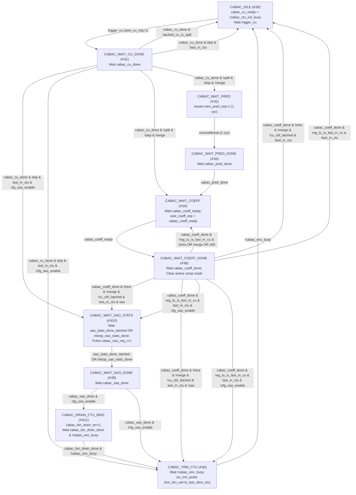

#### (b) State Encoding & Responsibility Table (`cabac_state[3:0]`)

| State Name | Encoding (`4b`) | Active Outputs & Datapath Interactions | Cycle Latency |
|:---|:---:|:---|:---|
| `CABAC_IDLE` | `4'd0` | Asserts `cabac_cu_ready` when `!cabac_ctx_init_busy` (gates `master_cu_ready`). On `trigger_cu`, drives combinational `wire_cu_req = 1` with live `cu_depth`/`node_split_start`/`cu_split_ctx`. | >= 186 cycles after `gop_frame_start`; >= 1 cycle per CU |
| `CABAC_WAIT_CU_DONE` | `4'd1` | Waits for `u_cabac_enc_top.cu_done` (`syntax_cu` emits `split_cu_flag`, `cu_skip_flag`, `merge_flag`/`idx`, `pred_mode_flag`, `part_mode`). | Syntax-dependent (typically 2–10 cycles) |
| `CABAC_WAIT_PRED` | `4'd2` | Drives combinational `wire_pred_req = 1` to start `syntax_pred` (Luma/Chroma Intra modes or Inter dir/MVD). | 1 cycle fixed |
| `CABAC_WAIT_PRED_DONE` | `4'd3` | Waits for `u_cabac_enc_top.pred_done`. | Syntax-dependent |
| `CABAC_WAIT_COEFF` | `4'd4` | Waits for `cabac_coeff_ready` (latched on `quant_out_valid && quant_out_last`); drives `wire_coeff_req = cabac_coeff_ready`. | Waits for active TU quant completion |
| `CABAC_WAIT_COEFF_DONE` | `4'd6` | Waits for `u_cabac_enc_top.coeff_done`; clears `cabac_coeff_ready`, `tu_last_sig_idx`, `tu_has_nonzero`, `cu_cbf_latched`, and active plane's `tu_cg_nonzero_mask_*`. | Syntax + `coeff_buffer` read cycles |
| `CABAC_WAIT_SAO_STATS` | `4'd10` | Entered at end of CTU when `cfg_sao_enable == 1`. Waits for `sao_stats_done_latched \|\| inloop_sao_stats_done`, then pulses `cabac_sao_req_r <= 1`. | Waits for `recon` + `S_DB` + `S_STATS` |
| `CABAC_WAIT_SAO_DONE` | `4'd9` | Clears `cabac_sao_req_r <= 0`; waits for `u_cabac_enc_top.sao_done` while `syntax_sao` encodes SAO header bins directly ahead of delayed CU bins. | Syntax-dependent (`syntax_sao`) |
| `CABAC_DRAIN_CTU_BINS` | `4'd11` | Drives `cabac_bin_drain_en = 1`, draining all buffered CU/Pred/Coeff bins for the CTU from `ctu_bin_ram` (`8192x10`) through `bin_encoder` & `range_coder`. | `>=` buffered CTU bin count + renorm |
| `CABAC_TRM_CTU` | `4'd5` | Waits for `!cabac_enc_busy`. When idle, `ctu_trm_pulse = 1` fires `top_trm_req` with `top_trm_bin_val = is_last_slice_ctu` (`0` mid-slice, `1` final CTU). | >= 1 cycle |
| *(Reserved unused slots)* | `4'd7`, `4'd8` | Formerly `CABAC_TRM_SLICE`/`CABAC_FLUSH` (removed); slice termination uses `CABAC_TRM_CTU` with `is_last_slice_ctu`, and `cabac_flush_state` orchestrates flush. | N/A |

#### (c) Transition & Guard Condition Table

| Current State | Next State | Guard Condition | Notes |
|:---|:---|:---|:---|
| Any | `CABAC_IDLE` | `!rst_n \|\| ctu_frame_start` | Also clears `cabac_sao_req_r <= 0` |
| `CABAC_IDLE` | `CABAC_WAIT_CU_DONE` | `trigger_cu` | `trigger_cu = (leaf_cu_start \|\| node_split_start) && master_cu_ready` |
| `CABAC_WAIT_CU_DONE` | `CABAC_IDLE` | `cabac_cu_done && (latched_cu_is_split \|\| (current_cu_skip && !cabac_cu_is_last_in_ctu))` | Split node or non-final skip CU |
| `CABAC_WAIT_CU_DONE` | `CABAC_WAIT_SAO_STATS` / `CABAC_TRM_CTU` | `cabac_cu_done && !latched_cu_is_split && current_cu_skip && cabac_cu_is_last_in_ctu` | Branches on `cfg_sao_enable` |
| `CABAC_WAIT_CU_DONE` | `CABAC_WAIT_COEFF` | `cabac_cu_done && !latched_cu_is_split && !current_cu_skip && latched_cu_merge` | Merge CU skips `syntax_pred` |
| `CABAC_WAIT_CU_DONE` | `CABAC_WAIT_PRED` | `cabac_cu_done && !latched_cu_is_split && !current_cu_skip && !latched_cu_merge` | Intra or Inter AMVP leaf CU |
| `CABAC_WAIT_PRED` | `CABAC_WAIT_PRED_DONE` | Unconditional | 1-cycle `wire_pred_req` launch |
| `CABAC_WAIT_PRED_DONE` | `CABAC_WAIT_COEFF` | `cabac_pred_done` | Waits for active TU quantization |
| `CABAC_WAIT_COEFF` | `CABAC_WAIT_COEFF_DONE` | `cabac_coeff_ready` | Drives `wire_coeff_req` in same cycle |
| `CABAC_WAIT_COEFF_DONE` | `CABAC_WAIT_COEFF` | `cabac_coeff_done && !reg_tu_is_last_in_cu` | Advances uniformly through `Cb`/`Cr`/sub-TU until last TU in CU (`tu_can_start` safe on zero-CBF AMVP) |
| `CABAC_WAIT_COEFF_DONE` | `CABAC_IDLE` / `CABAC_WAIT_SAO_STATS` / `CABAC_TRM_CTU` | `cabac_coeff_done && reg_tu_is_last_in_cu` | Last CTU CU branches on `cfg_sao_enable` |
| `CABAC_WAIT_SAO_STATS` | `CABAC_WAIT_SAO_DONE` | `sao_stats_done_latched \|\| inloop_sao_stats_done` | Latches `cabac_sao_req_r <= 1` |
| `CABAC_WAIT_SAO_DONE` | `CABAC_DRAIN_CTU_BINS` / `CABAC_TRM_CTU` | `cabac_sao_done` | `CABAC_DRAIN_CTU_BINS` if `cfg_sao_enable`, else `CABAC_TRM_CTU` |
| `CABAC_DRAIN_CTU_BINS` | `CABAC_TRM_CTU` | `cabac_bin_drain_done && !cabac_enc_busy` | Ensures range coder idle before terminating bin |
| `CABAC_TRM_CTU` | `CABAC_IDLE` | `!cabac_enc_busy` | Emits `ctu_trm_pulse`; increments `cabac_ctus_encoded_count` |

#### (d) Master CU Handshake, Pillar 2 Bypass & Corner Cases
- **`master_cu_ready` & Pillar 2 Integration**: When `ctu_partitioner` / `mode_decision` asserts `split_ready`:
  - `node_split_start = split_ready && split_flag && (cu_depth < 2'd3)` requires only `cabac_cu_ready` (no RDO cost wait or `pu_cu_splitter` launch).
  - `leaf_cu_start = split_ready && (!split_flag || cu_depth == 2'd3)` requires `pu_cu_splitter_cu_ready && cabac_cu_ready && (md_mode_valid || md_result_latched)`.
  - Note Pillar 2 (`FAST_EARLY_CU_SPLIT`, default `0`) scales `md_inter_rd_cost` (`{20'd0, search_best_sad} << ((4 - cu_depth) << 1)` when `1`, vs `{12'd0, search_best_sad, 8'd0}` when `0`) and bypasses depth-0 (`64x64`) inside [`rtl/partition/mode_decision.v`](file:///d:/UIT_Doc/hevc_hw_encoder/rtl/partition/mode_decision.v).
- **186-Cycle Context Initialization Gate**: `gop_frame_start` triggers `u_cabac_enc_top.slice_init`, raising `cabac_ctx_init_busy` for 186 cycles (`ctx 0..185` in [`rtl/entropy/ctx_model_store.v`](file:///d:/UIT_Doc/hevc_hw_encoder/rtl/entropy/ctx_model_store.v)). Because `cabac_cu_ready = (cabac_state == CABAC_IDLE) && !cabac_ctx_init_busy`, CU dispatching automatically stalls until context initialization completes.
- **CTU-Delayed SAO Bin Reordering (Pillar 4 / T3-13)**: When `cfg_sao_enable == 1`, HEVC requires `sao()` syntax to precede the CTU's coding quadtree bins in the bitstream, even though hardware `sao_stats` cannot run until all CUs in the CTU finish reconstruction and deblocking. `cabac_enc_top` (`ctu_sao_delay_en = cfg_sao_enable`) therefore buffers all `syntax_cu`/`syntax_pred`/`syntax_coeff` bins for the CTU into `ctu_bin_ram` (`8192x10`) while `CABAC_IDLE..CABAC_WAIT_COEFF_DONE` execute; at CTU end, `CABAC_WAIT_SAO_STATS -> CABAC_WAIT_SAO_DONE` emits `syntax_sao` bins directly to `bin_encoder`, and `CABAC_DRAIN_CTU_BINS` drains the stored CU bins afterward.
- **Inter AMVP Zero-CBF Chroma-Lockstep Fix (`CABAC_WAIT_COEFF_DONE`)**: The premature `!latched_cu_is_intra && !latched_cu_merge && !cu_cbf_latched` early exit in `CABAC_WAIT_COEFF_DONE` was removed so `cabac_state` always advances through `Cb` (`reg_tu_comp == 1`) and `Cr` (`reg_tu_comp == 2`) until `reg_tu_is_last_in_cu == 1`, keeping `tu_can_start` re-armed in lockstep with `pu_cu_splitter` even on zero-CBF Inter AMVP CUs (`syntax_coeff` returns `coeff_done <= 1` with `0` bins emitted when `comp_id != 0 && !cu_root_cbf_latched`).

---

### 5.2 Post-Slice CABAC Flush Timer FSM (`cabac_flush_state[1:0]`)

#### (a) Mermaid State Diagram

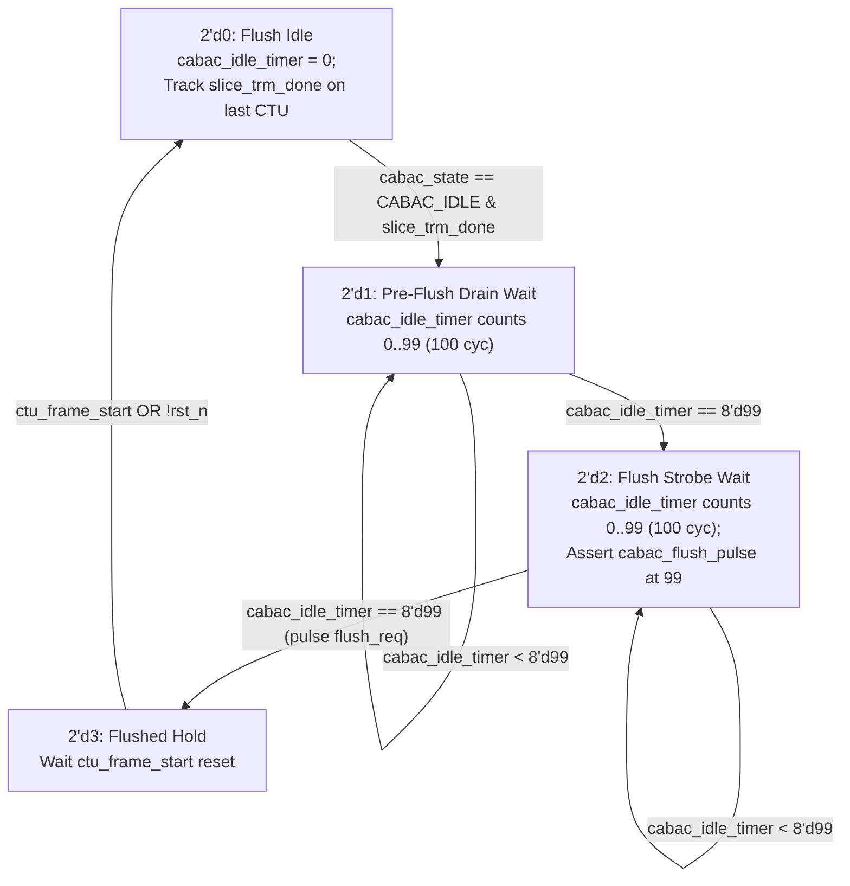

#### (b) State Encoding & Responsibility Table (`cabac_flush_state[1:0]`)

| State (`2b`) | Symbolic Role | Active Operations & Outputs | Cycle Latency |
|:---:|:---|:---|:---|
| `2'd0` | Idle / Active Slice | `cabac_ctus_encoded_count` increments each time `cabac_state == CABAC_TRM_CTU && !cabac_enc_busy`. Sets `slice_trm_done <= 1` when `is_last_slice_ctu` (`cabac_ctus_encoded_count >= total_frame_ctus - 1`). | Full slice duration |
| `2'd1` | Drain Window 1 | Increments `cabac_idle_timer` `0..99` while `range_coder` completes the terminating `end_of_slice_segment_flag=1` bin and any renormalization bytes. | 100 cycles |
| `2'd2` | Drain Window 2 / Pulse | Increments `cabac_idle_timer` `0..99`. On `cabac_idle_timer == 8'd99`, drives combinational `cabac_flush_pulse = 1'b1` (`u_cabac_enc_top.flush_req`). | 100 cycles |
| `2'd3` | Post-Flush Hold | Holds until `ctu_frame_start` (note `cabac_idle_timer` counts to `100` and saturates). Downstream `cabac_flush_done` from `range_coder` drives `cabac_finished` & `slice_controller.ctu_frame_done`. | Until next frame |

#### (c) Transition & Guard Condition Table

| Current State | Next State | Guard Condition | Notes |
|:---|:---|:---|:---|
| Any | `2'd0` | `!rst_n \|\| ctu_frame_start` | Also clears `cabac_idle_timer`, `slice_trm_done`, `cabac_ctus_encoded_count`, `cabac_has_started` |
| `2'd0` | `2'd1` | `(cabac_state == CABAC_IDLE) && slice_trm_done` | Entered 1 cycle after final CTU exits `CABAC_TRM_CTU` |
| `2'd1` | `2'd2` | `cabac_idle_timer == 8'd99` | Resets `cabac_idle_timer <= 8'd0` |
| `2'd2` | `2'd3` | `cabac_idle_timer == 8'd99` | `cabac_flush_pulse` high on this cycle; resets `cabac_idle_timer <= 8'd0` |

#### (d) Reset & Corner-Case Notes
- `cabac_has_started` is declared and reset to `1'b0` on `!rst_n` / `ctu_frame_start` (`lines 3346, 3366, 3371`), but is never set or read elsewhere in `hevc_encoder_top.v`.
- **Backpressure Margin**: The 200-cycle total delay (`2'd1` + `2'd2`) provides fixed drain time for `range_coder` (`<= 7` renorm shifts + `S_WRITEOUT_*` bytes). If `m_axis_bitstream_tready` is held low for >200 cycles so `range_coder` is still busy when `flush_req` pulses, `range_coder` accepts `flush_valid` only in `S_READY` (so under extreme AXI-Stream backpressure, `flush_req` must occur when `range_coder` is in `S_READY`).

---

### 5.3 TU Sequencing (`reg_tu_comp`), Transform/Recon Interlocks & Pillar 3 CG Masking

#### (a) Mermaid Datapath & Interlock Flow

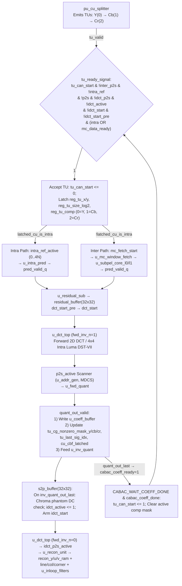

#### (b) Sequencer Registers, Widths & Active Responsibilities

| Signal / Register | Width | Reset (`!rst_n`) | Active Responsibility & Latency |
|:---|:---:|:---|:---|
| `tu_can_start` | 1b | `1'b1` | Cleared on `tu_valid && tu_ready_signal`; restored on `cabac_coeff_done` |
| `reg_tu_comp` | 2b | `2'd0` | Component for active TU: `2'd0` (Y), `2'd1` (Cb), `2'd2` (Cr); routes `orig_pixel_q`, `recon_out_comp`, `cabac_tu_cg_nonzero_mask`, `u_fwd_quant`, `u_inv_quant`, `u_recon_unit`, `u_cabac_enc_top.coeff_comp`, and DPB `mc_window_fetch` |
| `reg_tu_size_log2` | 3b | `3'd0` | `2` (`4x4`), `3` (`8x8`), `4` (`16x16`), `5` (`32x32`); caps Chroma minimum at `2` (`4x4`) |
| `intra_ref_active`, `intra_ref_idx` | 1b, 8b | `0`, `0` | Streams `4N + 1` reference samples (`0..intra_ref_max`, `4N`) with 1-cycle BRAM pipeline (`intra_ref_active_q`) |
| `me_load_active`, `me_load_cnt` | 1b, 5b | `0`, `0` | Triggered on `eval_inter_start`; 17-cycle pre-fetch (`0..16`) filling `search_orig_flat[159:0]` (`4x4` Luma) from `orig_y_ram_rmd` |
| `mc_data_ready` | 1b | `1'b0` | Set immediately on `md_mode_valid && !md_best_is_intra` (`u_inter_pred.mc_start` tied `1'b0`; cleared on `!rst_n`, `ctu_frame_start`, next CU start, or last TU completion) |
| `mc_fetch_start`, `inter_p2s_active` | 1b, 1b | `0`, `0` | Launches `u_mc_window_fetch` on Inter TU accept; `inter_p2s_active` clears when fetch + 2-stage sub-pel window drains |
| `p2s_active`, `p2s_idx`, `p2s_max` | 1b, 10b, 10b | `0`, `0`, `0` | Forward transform coefficient scanner (`0 .. 2^(2*log2)-1`) using MDCS `scan_mode` (`0`=diag, `1`=hor, `2`=vert) |
| `idct_start_pre`, `idct_start`, `idct_start_pending`, `idct_active` | 1b ea | `0` | Coordinates shared `u_dct_top` (`use_idct_bus`) and `dct_out_data` mux (`shared_xform_rd_sample`); `idct_start_pending` holds IDCT until `!idct_p2s_active` |
| `idct_p2s_active`, `idct_p2s_idx` | 1b, 10b | `0`, `0` | Raster-order P2S scanner driving `u_recon_unit` (`res_valid`, stalled via `idct_p2s_ready`) |
| `tu_cg_nonzero_mask_y` | 64b | `64'd0` | **Pillar 3**: 1 bit per 4x4 Luma CG (`quant_out_scan_idx[9:4]`, max 64 CGs for `32x32`) |
| `tu_cg_nonzero_mask_cb` / `_cr` | 16b ea | `16'd0` | **Pillar 3**: 1 bit per 4x4 Chroma CG (`quant_out_scan_idx[7:4]`, max 16 CGs for `16x16`) |
| `tu_last_sig_idx`, `tu_has_nonzero`, `cu_cbf_latched`, `cabac_coeff_ready` | 10b, 1b, 1b, 1b | `0` | Tracks last nonzero scan index, TU CBF, CU root CBF, and triggers CABAC coeff coding |

#### (c) Transition & Guard Condition Table (TU & Pillar 3 Control)

| Sequencer | Event / Guard Condition | Register / Output Action |
|:---|:---|:---|
| TU Accept | `tu_valid && tu_ready_signal` | `tu_can_start<=0`, latch `reg_tu_*`; if Intra: `intra_ref_active<=1, intra_ref_idx<=0`; if Inter: `mc_fetch_start<=1, inter_p2s_active<=1` |
| Shared `u_dct_top` Arbitration | `dct_in_valid` vs `idct_start` | `use_idct_bus = idct_start \|\| (!shared_xform_out_fwd_inv_n && !dct_in_valid)`; `fwd_inv_n = !idct_start`; `shared_xform_rd_sample` gives `idct_p2s_active` priority over `p2s_active` |
| `idct_start_pending` | `inv_quant_out_valid && inv_quant_out_last` | If `!idct_p2s_active`: `idct_start_pre <= 1`; else `idct_start_pending <= 1` (fires when `!idct_p2s_active`) |
| Pillar 3 CG Mask Update | `quant_out_valid && (quant_out_level != 16'd0)` | Sets `tu_has_nonzero<=1`, `tu_last_sig_idx<=quant_out_scan_idx`, and `tu_cg_nonzero_mask_<comp>[idx]` (`[9:4]` Y, `[7:4]` Cb/Cr) |
| Pillar 3 CG Mask Clear (CU) | `trigger_leaf_cu` | Clears `cabac_coeff_ready`, `tu_last_sig_idx`, `tu_has_nonzero`, `cu_cbf_latched`, and all 3 `tu_cg_nonzero_mask_*` |
| Pillar 3 CG Mask Clear (TU) | `(cabac_state == CABAC_WAIT_COEFF_DONE) && cabac_coeff_done` | Clears `cabac_coeff_ready`, `tu_last_sig_idx`, `tu_has_nonzero`, `cu_cbf_latched`, and ONLY `reg_tu_comp`'s `tu_cg_nonzero_mask_*` |
| Chroma Phantom DC Injection | `inv_quant_out_valid && inv_quant_out_last && (reg_tu_comp != 2'd0) && !tu_has_nonzero` | Injects `calc_chroma_level1_dequant(ctu_qp, dct_out_tu_size_log2)` into `s2p_buffer[0][0]` |

#### (d) 4-Pillar & Corner-Case Details
- **Pillar 3 Zero-CG Skipping**: `u_cabac_enc_top` receives `tu_cg_mask_en = 1'b1` and `cabac_tu_cg_nonzero_mask` muxed by `reg_tu_comp` (`{tu_cg_nonzero_mask_y}` for Y, `{48'd0, tu_cg_nonzero_mask_cb/cr}` for Cb/Cr). Inside `syntax_coeff.v`, any 4x4 CG with mask bit `0` (except `cur_cg == 0`, whose `coded_sub_block_flag` is inferred `1` per HEVC Clause 7.3.8.11) bypasses the 32-cycle `coeff_buffer` read sequence without changing output bins.
- **Note on `idct_active` & `tu_ready_signal`**: `tu_ready_signal` blocks accepting the next TU (`Cb` after `Y`, `Cr` after `Cb`) until `cabac_coeff_done` AND `idct_p2s_active == 0` AND `idct_active == 0` — ensuring `u_dct_top`, `s2p_buffer`, and `u_recon_unit` (`comp = reg_tu_comp`) never suffer plane crosstalk between `Y`, `Cb`, and `Cr`. Note also that `cu_cbf_latched` is cleared at each `CABAC_WAIT_COEFF_DONE && cabac_coeff_done` (line 3198), so `cu_cbf_latched` effectively acts as a per-TU CBF latch by the time subsequent Chroma TUs finish.

---

### 5.4 True Dual-Port (TDP) DPB Port-A/Port-B Arbitration (`dpb_wr_*_d1`, `mc_dpb_wr_collision`) — Pillar 1

#### (a) Mermaid Arbitration Diagram

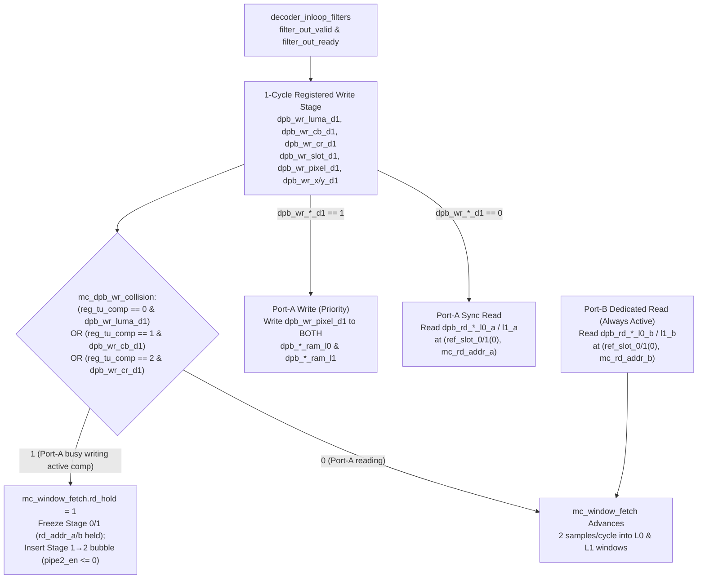

#### (b) Register & Port Allocation Table

| Signal / Register | Width | Role in TDP DPB Architecture |
|:---|:---:|:---|
| `dpb_luma_ram_l0/l1` | 32,768 x 10b | 2-slot `128x128` Luma DPB (1 copy per ref list `L0`/`L1`, 1 RW Port A + 1 R Port B) |
| `dpb_cb_ram_l0/l1`, `dpb_cr_ram_l0/l1` | 8,192 x 10b | 2-slot `64x64` Chroma DPB (`L0`/`L1`, 1 RW Port A + 1 R Port B) |
| `dpb_wr_luma_d1`, `dpb_wr_cb_d1`, `dpb_wr_cr_d1` | 1b ea | Registered Port-A write enables (`filter_out_valid && filter_out_ready && filter_out_comp == 0/1/2`) |
| `dpb_wr_slot_d1`, `dpb_wr_pixel_d1`, `dpb_wr_x_d1`, `dpb_wr_y_d1` | 1b, 10b, 7b, 7b | Registered DPB write payload breaking `deblock -> SAO -> DPB` critical path |
| `dpb_*_addr_l0_a`, `dpb_*_addr_l1_a` | 15b (Y), 13b (C) | Port-A muxed address: write `{dpb_wr_slot_d1, y, x}` vs read `{ref_slot_0/1[0], mc_rd_addr_a}` |
| `mc_rd_addr_b` | 14b | Uncontested Port-B synchronous read address (`dpb_rd_*_l0/l1_b`) |
| `mc_dpb_wr_collision` | 1b | Combinational collision detect (`reg_tu_comp`-qualified `dpb_wr_*_d1`), wired to `u_mc_window_fetch.rd_hold` |

#### (c) Arbitration & Collision Guard Table

| Condition | Port-A Action | Port-B Action | `mc_window_fetch` Pipeline Response |
|:---|:---|:---|:---|
| `dpb_wr_<comp>_d1 == 1` & `comp == reg_tu_comp` | Writes `dpb_wr_pixel_d1` to `_l0` & `_l1`; `dpb_rd_*_a` holds | Reads `mc_rd_addr_b` | `mc_dpb_wr_collision = 1`: Stage 0/1 freezes (`!(pipe1_en && rd_hold_eff)`), Stage 1->2 inserts bubble (`pipe2_en <= 0`) |
| `dpb_wr_<comp>_d1 == 1` & `comp != reg_tu_comp` | Active `reg_tu_comp` BRAM reads `mc_rd_addr_a`; other comp writes | Reads `mc_rd_addr_b` | `mc_dpb_wr_collision = 0`: no stall (independent component BRAMs) |
| `dpb_wr_*_d1 == 0` | Reads `mc_rd_addr_a` across all 6 DPB BRAMs | Reads `mc_rd_addr_b` | `mc_dpb_wr_collision = 0`: 2 samples/cycle TDP throughput |

#### (d) Pillar 1 Optimization & Corner-Case Notes
- **Zero Extra BRAM Tiles**: Replicating `l0`/`l1` provides concurrent bi-prediction (`ref_slot_0` vs `ref_slot_1`) while time-multiplexing Port-A for `inloop_filters` writes and adding Port-B synchronous reads delivers 2 samples/cycle to `mc_window_fetch` with **0 extra BRAM tiles** over single-port reads.
- **1-Cycle Tail Collision Protection**: Because `inloop_ctu_done` fires on the clock edge following `dump_valid_q && out_ready` (when `dpb_wr_*_d1` registers the 6,144th pixel), `dpb_wr_*_d1` remains `1` for 1 cycle into the boundary transition; `mc_dpb_wr_collision` guarantees deterministic Port-A read integrity across any overlap.
- **128x128 On-Chip DPB Scope**: The on-chip `dpb_*_ram_l0/l1` address space is `{slot[0], y[6:0], x[6:0]}` (2 slots of `128x128` Luma / `64x64` Chroma), matching `FRAME_WIDTH=128, FRAME_HEIGHT=128` verification configurations.

---

### 5.5 CTU Input Buffering, Lockstep Barrier (`ctu_both_done`) & Frame Completion (`sync_frame_done_pulse`)

#### (a) Mermaid Synchronization Flow

```mermaid
flowchart TD
    subgraph IN_SYNC ["Input Pixel Buffer &amp; Deferred Frame Start"]
        WAIT_IN["Wait ctu_frame_start &rarr; frame_start_pending=1"]
        FILL_IN["Accept 4096 beats (orig_write_ptr 0..4095)<br/>in_ready = (frame_start_pending OR ctu_frame_active)<br/>&amp; ctu_partitioner_ready &amp; !ctu_pixels_ready &amp; ctu_buffer_free"]
        RDY_IN["orig_write_ptr == 4095:<br/>ctu_pixels_ready &lt;= 1, ctu_buffer_free &lt;= 0"]
        DEF_ST["If frame_start_pending &amp; ctu_pixels_ready:<br/>Pulse deferred_frame_start=1 &rarr; ctu_raster_scan"]
        WAIT_IN --> FILL_IN --> RDY_IN --> DEF_ST
    end

    subgraph CTU_SYNC ["Per-CTU Lockstep Barrier (ctu_both_done)"]
        CAB_PEND["ctu_trm_pulse &rarr; cabac_done_pending=1"]
        INL_PEND["inloop_ctu_done &rarr; inloop_done_pending=1"]
        BOTH["ctu_both_done =<br/>(inloop_ctu_done OR inloop_done_pending)<br/>&amp; (ctu_trm_pulse OR cabac_done_pending)"]
        ADV_CTU["Advance ctu_raster_scan (ctu_ready=1);<br/>Restore ctu_buffer_free &lt;= 1;<br/>Clear sao_stats_done_latched &amp; pending flags"]
        CAB_PEND --> BOTH
        INL_PEND --> BOTH
        BOTH --> ADV_CTU
    end

    subgraph FRM_SYNC ["Per-Frame Sync Barrier (sync_frame_done_pulse)"]
        FCAB["cabac_flush_done &rarr; cabac_finished &lt;= 1"]
        FREC["inloop_ctu_done increments inloop_ctus_done_count;<br/>count + 1 &ge; total_frame_ctus &rarr; recon_finished &lt;= 1"]
        FCOMB["combined_frame_done = cabac_finished &amp; recon_finished"]
        FPULSE["sync_frame_done_pulse = combined_frame_done &amp; !combined_frame_done_d<br/>Drives: frame_done, u_gop_controller, u_rate_controller,<br/>u_frame_store.wr_last, Neighbor line/col/corner reset"]
        FCAB --> FCOMB
        FREC --> FCOMB
        FCOMB --> FPULSE
    end
```

#### (b) Synchronization Registers & Guard Table

| Register / Signal | Width | Reset / `ctu_frame_start` Clear | Set Condition | Clear / Effect |
|:---|:---:|:---|:---|:---|
| `orig_write_ptr` | 12b | `12'd0` | Increments on `in_valid && in_ready` | Cleared on `ctu_done_pulse \|\| ctu_frame_done` |
| `ctu_pixels_ready` | 1b | `1'b0` | `in_valid && in_ready && orig_write_ptr == 12'd4095` | Cleared on `ctu_partitioner_accepted \|\| ctu_done_pulse \|\| ctu_frame_done` |
| `ctu_buffer_free` | 1b | `1'b1` (also `1` on `ctu_frame_start`) | `ctu_both_done` | Cleared to `0` on `orig_write_ptr == 12'd4095` handshake |
| `frame_start_pending` | 1b | `1'b0` | `ctu_frame_start` | Cleared when `frame_start_pending && ctu_pixels_ready` pulses `deferred_frame_start` |
| `inloop_done_pending` | 1b | `1'b0` (`ctu_frame_start`) | `inloop_ctu_done` | Cleared on `ctu_both_done` |
| `cabac_done_pending` | 1b | `1'b0` (`ctu_frame_start`) | `ctu_trm_pulse` (`cabac_state == CABAC_TRM_CTU && !cabac_enc_busy`) | Cleared on `ctu_both_done` |
| `sao_stats_done_latched` | 1b | `1'b0` (`ctu_frame_start`) | `inloop_sao_stats_done` (also latches `latched_sao_*` & `sao_latched_ctu_x/y`) | Cleared on `ctu_both_done` |
| `cabac_finished` | 1b | `1'b0` (`ctu_frame_start`) | `cabac_flush_done` | Held until next `ctu_frame_start` |
| `inloop_ctus_done_count` | 16b | `16'd0` (`ctu_frame_start`) | Increments `+1` on `inloop_ctu_done` | Sets `recon_finished <= 1` when `count + 1 >= total_frame_ctus` |
| `sync_frame_done_pulse` | 1b | Combinational edge | `combined_frame_done && !combined_frame_done_d` | 1-cycle pulse driving `frame_done`, `gop_controller`, `rate_controller`, `frame_store.wr_last`, and resetting intra neighbor line/col/corner buffers |

#### (c) Corner-Case Behavior
- **CTU-0 Deferred Frame Start**: `ctu_frame_start` fires as soon as `slice_controller` finishes transmitting the slice header, potentially before the external video source finishes streaming CTU 0's 4,096 pixels (`4096` beats). `frame_start_pending` holds off `deferred_frame_start` until `ctu_pixels_ready == 1`, preventing `ctu_raster_scan` from timing out or launching on uninitialized `orig_*_ram`.
- **Out-of-Order & Overlapped 2-Bank CTU Ping-Pong (`v3.0`):** `hevc_encoder_top.v` pipelines two active CTUs across dual-bank CTU pixel storage, `decoder_inloop_filters`, `cabac_enc_top` (`ctu_bin_ram_0/1`), 4-bank `coeff_buffer.v` (`DEPTH=4096`), 4-entry `cu_fifo` & `tu_meta_fifo`, and decoupled `cabac_state` (FE) / `cabac_be_state` (BE) FSMs, achieving `Avg CTU Period = 39,970 cyc` and `Stall_CABAC = 0`. Both `inloop_done_pending` and `cabac_done_pending` remain guarded by `ctu_both_done`.

---

## 6. `axi_read_arbiter.v` — Dual-Master L0/L1 AXI4 Read Lock Arbiter

Located at [`rtl/common/axi_read_arbiter.v`](file:///d:/UIT_Doc/hevc_hw_encoder/rtl/common/axi_read_arbiter.v) (86 lines), this module arbitrates two AXI4 read masters—Port 0 (`u_inter_pred`, high priority) and Port 1 (`u_frame_store`, low priority)—onto a single AXI4 read master interface (`m_ar*`, `m_r*`) with full burst locking.

### (a) Mermaid State Diagram

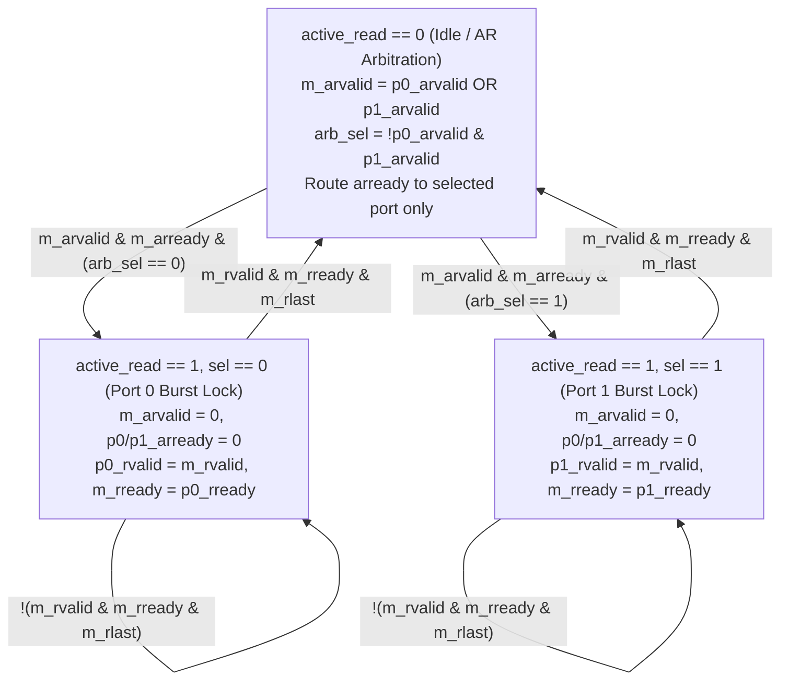

### (b) State Encoding & Responsibility Table

| Register / Signal | Width | Reset (`!rst_n`) | Active Responsibility & Latency |
|:---|:---:|:---|:---|
| `active_read` | 1b | `1'b0` | `0`: AR arbitration enabled (`m_arvalid` unmasked); `1`: R-burst locked (`m_arvalid = 0`, `p0/p1_arready = 0`) until `m_rlast` handshake. |
| `sel` | 1b | `1'b0` | Latches `arb_sel` on `ar_handshake` (`0` = Port 0 `inter_pred_top`, `1` = Port 1 `frame_store`) to route R-channel handshakes. |
| `arb_sel` (wire) | 1b | Comb | `!p0_arvalid && p1_arvalid` (fixed priority to Port 0). |
| Combinational Latency | — | — | **0 cycles** on AR request/ready forwarding and **0 cycles** on R data/valid/ready routing. |

### (c) Transition & Guard Condition Table

| Current State (`{active_read, sel}`) | Next State | Guard Condition | Active Output Routing |
|:---|:---|:---|:---|
| `2'b0x` (`active_read == 0`) | `2'b10` | `m_arvalid && m_arready && !arb_sel` | Grants Port 0 (`p0_arvalid == 1`); latches `sel <= 0, active_read <= 1` |
| `2'b0x` (`active_read == 0`) | `2'b11` | `m_arvalid && m_arready && arb_sel` | Grants Port 1 (`!p0_arvalid && p1_arvalid`); latches `sel <= 1, active_read <= 1` |
| `2'b10` (`LOCK_P0`) | `2'b00` | `m_rvalid && m_rready && m_rlast` | Clears `active_read <= 0` after final beat of Port 0 burst |
| `2'b11` (`LOCK_P1`) | `2'b01` | `m_rvalid && m_rready && m_rlast` | Clears `active_read <= 0` after final beat of Port 1 burst |

### (d) Reset, Backpressure & Corner-Case Behavior
- **Zero-Cycle Combinational Pass-Through**: `m_araddr`, `m_arlen`, `m_arsize`, `m_arburst`, `m_arvalid`, `p0/p1_arready`, `p0/p1_rvalid`, and `m_rready` are all combinational multiplexers/gates. Notice an AXI4 rule nuance: while `active_read == 0`, if Port 1 asserts `p1_arvalid` first and Port 0 asserts `p0_arvalid` before `m_arready` arrives, `arb_sel` combinationally switches `m_araddr` from Port 1 to Port 0 mid-wait (`!p0_arvalid && p1_arvalid`). Once `ar_handshake` occurs, `sel` and `active_read` lock out new ARs cleanly.
- **Single-Outstanding-Transaction Lock**: By blocking `m_arvalid = 0` whenever `active_read == 1`, the arbiter avoids AXI `ARID`/`RID` reordering logic (`m_axi_mem_arid = 1'b0`) and prevents read-data interleaving between Port 0 and Port 1, at the cost of 1 cycle turnaround between `m_rlast` and the next `m_arvalid`.
- **Fixed-Priority Starvation**: Port 0 (`inter_pred_top`) holds strict priority whenever both `p0_arvalid` and `p1_arvalid` are asserted in the same idle cycle; back-to-back Port 0 bursts can delay Port 1 (`frame_store`) indefinitely until Port 0 deasserts `p0_arvalid` for at least 1 cycle.
- **Top-Level Integration Status**: In [`hevc_encoder_top.v`](file:///d:/UIT_Doc/hevc_hw_encoder/rtl/top/hevc_encoder_top.v), `u_frame_store.rd_req_valid` is tied to `1'b0` (line 3067) because Inter MC reads from the on-chip TDP DPB BRAMs via `u_mc_window_fetch`, so `p1_arvalid` (`fs_arvalid`) remains `0` in default builds while `ip_arlen[8:0]` connects to 8-bit `p0_arlen` (MSB truncated).
