# Transform, Quantization, Reconstruction, Frame Store & Rate Control FSM Reference

This document specifies every finite-state machine (FSM), elastic pipeline stage, and stateful control unit across the residual, 2D transform, quantization/dequantization, scan address generation, reconstruction, AXI4 Decoded Picture Buffer (DPB) frame store, and rate-control subsystems of `d:\UIT_Doc\hevc_hw_encoder`.

Covered RTL modules (and their top-level coordination logic in [`hevc_encoder_top.v`](file:///d:/UIT_Doc/hevc_hw_encoder/rtl/top/hevc_encoder_top.v)):
- **2D Transform**: [`dct_top.v`](file:///d:/UIT_Doc/hevc_hw_encoder/rtl/transform/dct_top.v), [`transform_1d_core.v`](file:///d:/UIT_Doc/hevc_hw_encoder/rtl/transform/transform_1d_core.v), [`transpose_ram_32x32.v`](file:///d:/UIT_Doc/hevc_hw_encoder/rtl/transform/transpose_ram_32x32.v)
- **Quantization & Dequantization**: [`fwd_quant.v`](file:///d:/UIT_Doc/hevc_hw_encoder/rtl/quant/fwd_quant.v), [`inv_quant.v`](file:///d:/UIT_Doc/hevc_hw_encoder/rtl/quant/inv_quant.v)
- **MDCS Scan Address Generation**: [`address_generator.v`](file:///d:/UIT_Doc/hevc_hw_encoder/rtl/top/address_generator.v)
- **Residual Subtraction & Reconstruction**: [`residual_sub.v`](file:///d:/UIT_Doc/hevc_hw_encoder/rtl/recon/residual_sub.v), [`recon_unit.v`](file:///d:/UIT_Doc/hevc_hw_encoder/rtl/recon/recon_unit.v)
- **DPB AXI4 Frame Store**: [`frame_store.v`](file:///d:/UIT_Doc/hevc_hw_encoder/rtl/recon/frame_store.v)
- **Rate Control & Lambda Lookup**: [`rate_controller.v`](file:///d:/UIT_Doc/hevc_hw_encoder/rtl/rate_control/rate_controller.v), [`lambda_calc.v`](file:///d:/UIT_Doc/hevc_hw_encoder/rtl/rate_control/lambda_calc.v)

> **Build Configuration Note**: [`parameter_pkg.vh`](file:///d:/UIT_Doc/hevc_hw_encoder/rtl/common/parameter_pkg.vh) defines single-path Main10 parameters (`BIT_DEPTH = 10`, `PIXEL_WIDTH = 10`, `COEFF_WIDTH = 16`, `0` `REMEDIATION` directives in production RTL).

---

## 1. Residual -> 2D Transform -> Quant/IQuant -> Recon & AXI4 Frame Store Overview

Within [`hevc_encoder_top.v`](file:///d:/UIT_Doc/hevc_hw_encoder/rtl/top/hevc_encoder_top.v), transform, quantization, and reconstruction operate serially per Transform Unit (TU) under `tu_ready_signal` mutual exclusion while a single shared [`dct_top`](file:///d:/UIT_Doc/hevc_hw_encoder/rtl/transform/dct_top.v) engine serves both forward (`fwd_inv_n = 1`) and inverse (`fwd_inv_n = 0`) 2D transforms:

1. **Frame QP & RDO Lambda Setup**: [`rate_controller`](file:///d:/UIT_Doc/hevc_hw_encoder/rtl/rate_control/rate_controller.v) updates `current_qp_r` at `frame_done` using VBV occupancy and drives `frame_qp` to `u_ctu_raster_scan` (`ctu_qp`), which feeds forward/inverse quantization and [`lambda_calc`](file:///d:/UIT_Doc/hevc_hw_encoder/rtl/rate_control/lambda_calc.v) inside [`mode_decision.v`](file:///d:/UIT_Doc/hevc_hw_encoder/rtl/partition/mode_decision.v#L146).
2. **Residual Subtraction**: Prediction pixels (`intra_pred_top` or inter MC) are delayed 1 cycle (`pred_valid_q`, `pred_pixel_q`) to align with synchronous reads from `orig_y/u/v_ram`. [`residual_sub`](file:///d:/UIT_Doc/hevc_hw_encoder/rtl/recon/residual_sub.v) outputs 11-bit signed residuals into `residual_buffer[0:31][0:31]`, and `dct_start` fires 2 cycles after `active_pred_last_q`.
3. **Forward 2D Transform & MDCS Quantization**: `u_dct_top` computes the 2-pass 2D DCT-II (`4x4`..`32x32`) or `4x4` Luma DST-VII (`is_dst7`). Top-level P2S scanner (`p2s_active` + `u_addr_gen` [`address_generator`](file:///d:/UIT_Doc/hevc_hw_encoder/rtl/top/address_generator.v)) streams coefficients in Diagonal/Horizontal/Vertical MDCS order into [`fwd_quant`](file:///d:/UIT_Doc/hevc_hw_encoder/rtl/quant/fwd_quant.v). Quantized levels write simultaneously into [`coeff_buffer`](file:///d:/UIT_Doc/hevc_hw_encoder/rtl/entropy/coeff_buffer.v) (for CABAC) and [`inv_quant`](file:///d:/UIT_Doc/hevc_hw_encoder/rtl/quant/inv_quant.v).
4. **Dequantization, Inverse 2D Transform & Main10 Reconstruction**: `u_s2p_addr_gen` scatters `inv_quant` outputs back to 2D `s2p_buffer[0:31][0:31]` (injecting chroma level-1 DC if `!tu_has_nonzero && reg_tu_comp != 0`), then triggers `idct_start` into `u_dct_top`. Raster P2S (`idct_p2s_active`) streams spatial residuals into [`recon_unit`](file:///d:/UIT_Doc/hevc_hw_encoder/rtl/recon/recon_unit.v), which fetches prediction pixels from `pred_sram`, clips `pred + res` to `[0, 1023]`, and updates `recon_*_ram`, CTU line/column neighbor buffers, and `decoder_inloop_filters`.
5. **In-Loop Filtering & DPB Frame Store**: After DB/SAO filtering, `decoder_inloop_filters` streams CTU pixels (`filter_out_valid` / `filter_out_ready`) to [`frame_store`](file:///d:/UIT_Doc/hevc_hw_encoder/rtl/recon/frame_store.v), which writes both the on-chip `line_cache` BRAM and 256-bit single-beat AXI4 write transactions (`wr_state`) to external DRAM DPB slots.

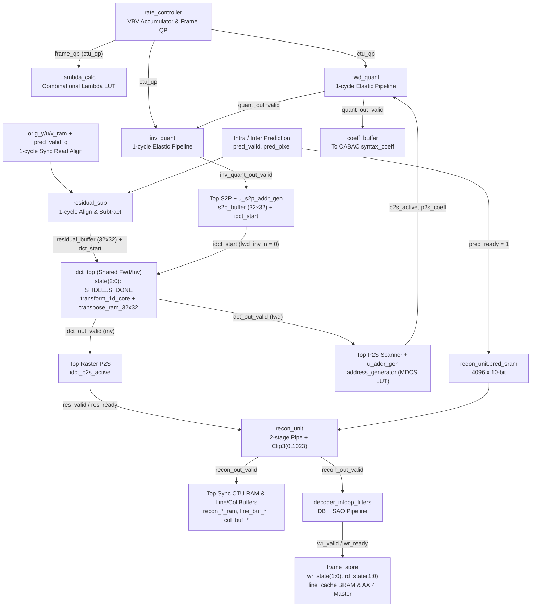

---

## 2. 2D Transform Engine (`dct_top.v`, `transform_1d_core.v`, `transpose_ram_32x32.v`)

### 2.1 `dct_top` Row-Serial 2D FSM (`state[2:0]`)

#### (a) Mermaid State Diagram

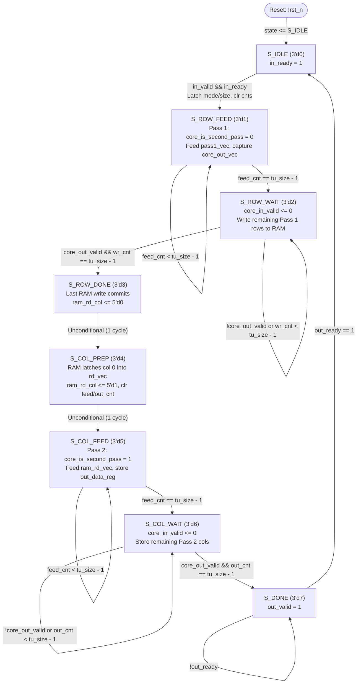

#### (b) State Encoding & Responsibility Table

State register: `reg [2:0] state` ([`dct_top.v:65-74`](file:///d:/UIT_Doc/hevc_hw_encoder/rtl/transform/dct_top.v#L65-L74)). Let $N = 2^{\text{latched\_tu\_size\_log2}} \in \{4, 8, 16, 32\}$.

| `localparam` | Encoding | Width | Active Outputs / Internal Actions | Cycle Latency in State |
|:---|:---:|:---:|:---|:---:|
| `S_IDLE` | `3'd0` | 3-bit | `in_ready = 1`, `out_valid = 0`. Awaits input TU; latches `fwd_inv_n`, `tu_size_log2`, `is_dst7` (under `REMEDIATION`), zeroes `feed_cnt`, `wr_cnt`, `out_cnt`. | $\ge 1$ cycle |
| `S_ROW_FEED` | `3'd1` | 3-bit | Streams $N$ vectors (`pass1_vec`: row if forward, col if inverse) into `u_1d_core` (`core_in_valid <= 1`, `core_is_second_pass <= 0`); captures arriving Pass 1 results (`wr_cnt` `0..N-3`) into `u_transpose_ram`. | $N$ cycles |
| `S_ROW_WAIT` | `3'd2` | 3-bit | Deasserts `core_in_valid <= 0`; drains final 2 Pass 1 `core_out_valid` outputs (`wr_cnt` `N-2`, `N-1`) into `u_transpose_ram` (`ram_wr_en <= 1`). | 2 cycles |
| `S_ROW_DONE` | `3'd3` | 3-bit | Allows registered `ram_wr_en` for row $N-1$ to commit into `u_transpose_ram`; schedules first column read `ram_rd_col <= 5'd0`. | 1 cycle |
| `S_COL_PREP` | `3'd4` | 3-bit | `u_transpose_ram` registers column 0 onto `ram_rd_vec`; schedules lookahead `ram_rd_col <= 5'd1`; resets `feed_cnt <= 0`, `out_cnt <= 0`. | 1 cycle |
| `S_COL_FEED` | `3'd5` | 3-bit | Streams `ram_rd_vec` columns `0..N-1` into `u_1d_core` (`core_is_second_pass <= 1`), prefetches `ram_rd_col <= feed_cnt + 2` while `feed_cnt < tu_size - 2`, stores first $N-2$ Pass 2 outputs into `out_data_reg`. | $N$ cycles |
| `S_COL_WAIT` | `3'd6` | 3-bit | Deasserts `core_in_valid <= 0`; stores final 2 Pass 2 `core_out_valid` vectors (`out_cnt` `N-2`, `N-1`) into `out_data_reg`. | 2 cycles |
| `S_DONE` | `3'd7` | 3-bit | Asserts `out_valid = 1` with `out_tu_size_log2` and `out_fwd_inv_n` valid; holds `out_data` until `out_ready`. | $\ge 1$ cycle |

**Exact End-to-End Cycle Latency** (from the clock edge accepting `in_valid && in_ready` in `S_IDLE` to `out_valid == 1` in `S_DONE`):
- **Formula**: $N + 2 + 1 + 1 + N + 2 = 2N + 6$ clock cycles to `out_valid` (plus 1 cycle in `S_DONE` when `out_ready == 1`, i.e., $2N + 7$ cycles `S_IDLE -> S_IDLE`).
- **Per TU Size**: **14 cycles** (`4x4`), **22 cycles** (`8x8`), **38 cycles** (`16x16`), **70 cycles** (`32x32`), matching [`dct_top.v:17-21`](file:///d:/UIT_Doc/hevc_hw_encoder/rtl/transform/dct_top.v#L17-L21).

#### (c) Transition & Guard Condition Table

| Current State | Next State | Guard Condition (`dct_top.v:215-358`) | State / Register Updates |
|:---|:---|:---|:---|
| `S_IDLE` | `S_ROW_FEED` | `in_valid && in_ready` | `latched_fwd_inv_n <= fwd_inv_n`; `latched_tu_size_log2 <= tu_size_log2`; `latched_is_dst7 <= (is_dst7 === 1'b1)` (`REMEDIATION`); `feed_cnt, wr_cnt, out_cnt <= 0` |
| `S_ROW_FEED` | `S_ROW_FEED` | `feed_cnt != tu_size - 6'd1` | `core_in_valid <= 1`, `core_in_vec <= pass1_vec`, `feed_cnt <= feed_cnt + 1`; if `core_out_valid` write RAM & `wr_cnt <= wr_cnt + 1` |
| `S_ROW_FEED` | `S_ROW_WAIT` | `feed_cnt == tu_size - 6'd1` | Queues final Pass 1 vector `N-1`; writes RAM if `core_out_valid` |
| `S_ROW_WAIT` | `S_ROW_WAIT` | `!(core_out_valid && (wr_cnt == tu_size - 6'd1))` | `core_in_valid <= 0`; if `core_out_valid` write RAM & `wr_cnt <= wr_cnt + 1` |
| `S_ROW_WAIT` | `S_ROW_DONE` | `core_out_valid && (wr_cnt == tu_size - 6'd1)` | Issues final Pass 1 write (`ram_wr_en <= 1`, `ram_wr_row <= N-1`) |
| `S_ROW_DONE` | `S_COL_PREP` | Unconditional | `ram_wr_en <= 0` (last write commits on this posedge); `ram_rd_col <= 5'd0` |
| `S_COL_PREP` | `S_COL_FEED` | Unconditional | `ram_rd_col <= 5'd1`; `feed_cnt <= 0`; `out_cnt <= 0` |
| `S_COL_FEED` | `S_COL_FEED` | `feed_cnt != tu_size - 6'd1` | Feed `ram_rd_vec`; if `feed_cnt < tu_size - 2` set `ram_rd_col <= feed_cnt + 2`; store `core_out_vec` if `core_out_valid` |
| `S_COL_FEED` | `S_COL_WAIT` | `feed_cnt == tu_size - 6'd1` | Feeds column `N-1`; stores `core_out_vec` if `core_out_valid` |
| `S_COL_WAIT` | `S_COL_WAIT` | `!(core_out_valid && (out_cnt == tu_size - 6'd1))` | `core_in_valid <= 0`; stores arriving Pass 2 vectors into `out_data_reg` |
| `S_COL_WAIT` | `S_DONE` | `core_out_valid && (out_cnt == tu_size - 6'd1)` | Stores final column `N-1` into `out_data_reg`; `out_valid` asserts on next cycle |
| `S_DONE` | `S_IDLE` | `out_ready == 1'b1` | Releases output buffer and re-asserts `in_ready` |
| `default` | `S_IDLE` | Illegal state recovery | Returns safely to `S_IDLE` |

#### (d) Reset, Backpressure, Datapath Symmetry & Corner-Case Behavior

- **Reset**: Asynchronous active-low `rst_n` forces `state <= S_IDLE`, `latched_fwd_inv_n <= 1'b1`, `latched_tu_size_log2 <= 3'd2`, `latched_is_dst7 <= 1'b0` (`REMEDIATION`), and clears all counters, `core_in_valid`, `ram_wr_en`, and `ram_rd_col`. Under `` `ifndef SYNTHESIS ``, `out_data_reg` is initialized to zero at time 0.
- **Backpressure**:
  - Input backpressure: `in_ready = (state == S_IDLE)`, stalling any new TU until Pass 1 + Pass 2 complete and `S_DONE` drains.
  - Output backpressure: `S_DONE` holds `out_valid = 1` and `out_data` stable indefinitely until `out_ready = 1`.
  - Internal core backpressure: `dct_top` ties `core_out_ready = 1'b1` (`dct_top.v:127`) and does not check `core_in_ready` because `u_1d_core` accepts 1 vector per cycle whenever `core_out_ready == 1`.
- **Forward vs. Inverse Transpose Asymmetry**:
  - **Forward (`latched_fwd_inv_n == 1`)**: Pass 1 reads **rows** of `in_data` via `pass1_vec[c] = in_data[(feed_cnt*32 + c)*16 +: 16]`, writes transformed rows to `u_transpose_ram` (`mem[wr_cnt][k]`), Pass 2 reads columns (`mem[0..N-1][out_cnt]`), and stores to `out_data_reg[k][out_cnt]` (row $k$, col `out_cnt`).
  - **Inverse (`latched_fwd_inv_n == 0`)**: Pass 1 reads **columns** of `in_data` via `pass1_vec[c] = in_data[(c*32 + feed_cnt)*16 +: 16]`, writes vertical IDCT columns into `mem[wr_cnt][k]`, Pass 2 reads `mem[0..N-1][out_cnt]` (which holds spatial row `out_cnt`), and writes `out_data_reg[out_cnt][k]` (row `out_cnt`, col $k$).
- **Corner Cases & Top-Level Sharing**:
  - **1-Cycle Pipeline Commit Gap (`S_ROW_DONE` -> `S_COL_PREP`)**: Because `ram_wr_en` is registered in `S_ROW_WAIT`, `u_transpose_ram` writes row $N-1$ on the `S_ROW_DONE` clock edge; `S_ROW_DONE` sets `ram_rd_col <= 0` so `S_COL_PREP` reads fresh `mem[0..N-1][0]` after the last write has committed.
  - **Shared Top-Level Instance**: In [`hevc_encoder_top.v:2499-2518`](file:///d:/UIT_Doc/hevc_hw_encoder/rtl/top/hevc_encoder_top.v#L2499-L2518), `u_dct_top` has `in_ready` unconnected and `out_ready` tied to `1'b1`. Mutual exclusion between `dct_in_valid` and `idct_start` is enforced by `tu_ready_signal` (`!p2s_active && !idct_p2s_active && !idct_active && !idct_start && !idct_start_pre`), with `use_idct_bus` giving `idct_start` mux priority.
  - **Invalid `tu_size_log2`**: `tu_size = 6'd1 << latched_tu_size_log2` wraps in 6 bits if `tu_size_log2 > 5` (`6 -> 0`, causing `tu_size - 1` underflow in `S_ROW_FEED`). Callers must keep `tu_size_log2` in `[2, 5]`.

---

### 2.2 `transform_1d_core.v` & `transpose_ram_32x32.v` Pipeline Control

#### (a) Mermaid Pipeline Diagram

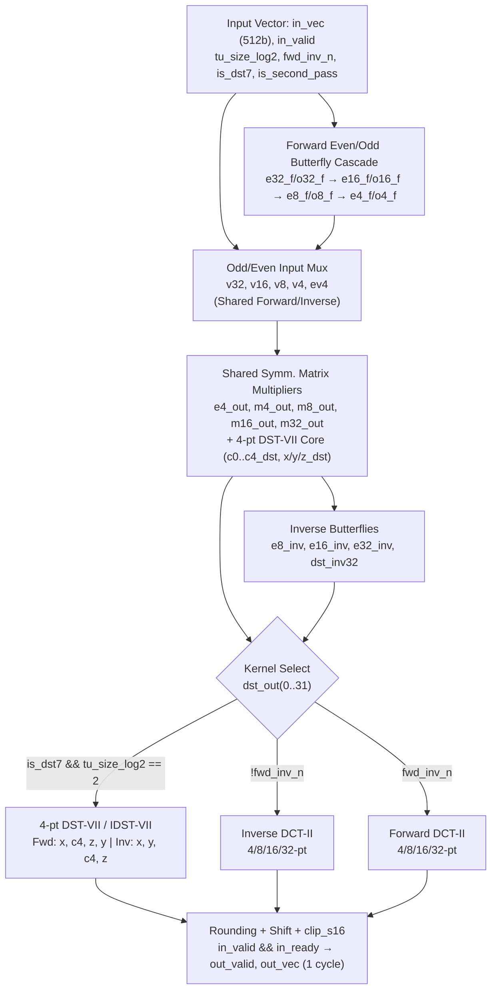

#### (b) Pipeline Register & Shift Configuration Table

- **Registers in [`transform_1d_core.v:34-39, 429-441`](file:///d:/UIT_Doc/hevc_hw_encoder/rtl/transform/transform_1d_core.v#L34-L39)**:
  - `out_valid` (1-bit, async `rst_n` -> `0`): set to `1` on `in_valid && in_ready`; cleared to `0` on `out_ready` when no new input arrives.
  - `out_vec[511:0]` (32 x signed 16-bit, async `rst_n` -> `0`): registered 1-cycle latency from `in_valid && in_ready`.
  - `in_ready` (combinational): `out_ready | ~out_valid`.
- **Registers in [`transpose_ram_32x32.v:25-42`](file:///d:/UIT_Doc/hevc_hw_encoder/rtl/transform/transpose_ram_32x32.v#L25-L42)**:
  - `mem[0:31][0:31]` (32x32 x signed 16-bit, 16 kbits, no reset): synchronous row write on `wr_en` at `wr_row[4:0]`.
  - `rd_vec[511:0]` (32 x signed 16-bit, no reset): unconditional synchronous column read from `mem[0..31][rd_col]` (1-cycle read latency).
- **Dynamic Right-Shift Schedule (`shift_val[4:0]`, `transform_1d_core.v:59-75`, `BIT_DEPTH = 10`)**:

| Mode (`fwd_inv_n`) | Pass (`is_second_pass`) | Formula | `4x4` (`log2=2`) | `8x8` (`log2=3`) | `16x16` (`log2=4`) | `32x32` (`log2=5`) |
|:---:|:---:|:---|:---:|:---:|:---:|:---:|
| `1` (Forward) | `0` (Pass 1) | `tu_size_log2 + (BIT_DEPTH - 9)` | `3` | `4` | `5` | `6` |
| `1` (Forward) | `1` (Pass 2) | `tu_size_log2 + 6` | `8` | `9` | `10` | `11` |
| `0` (Inverse) | `0` (Pass 1) | `7` | `7` | `7` | `7` | `7` |
| `0` (Inverse) | `1` (Pass 2) | `20 - BIT_DEPTH` | `10` | `10` | `10` | `10` |

#### (c) Control, Kernel Selection & Guard Table

| Condition (`transform_1d_core.v:314-440`) | Selected Operation | Output / Error Behavior |
|:---|:---|:---|
| `is_dst7 && (tu_size_log2 == 3'd2)` | 4-pt DST-VII (`fwd_inv_n=1`: `{x_dst, c4_dst, z_dst, y_dst}`) or IDST-VII (`fwd_inv_n=0`: `{x_dst, y_dst, c4_dst, z_dst}`) | `dst_out[4..31] = 32'sd0`; `is_dst7` ignored for `tu_size_log2 != 2` |
| `!(is_dst7 && tu_size_log2 == 3'd2) && !fwd_inv_n` | Inverse DCT-II (`e8_inv`, `e16_inv`, `e32_inv`, `dst_inv32`) | Selects size via `tu_size_log2[2:0]`; `default` emits `$error` in simulation |
| `!(is_dst7 && tu_size_log2 == 3'd2) && fwd_inv_n` | Forward DCT-II (`e4_out` + `m4/m8/m16/m32_out`) | Interleaves even/odd outputs; `default` emits `$error` in simulation |
| `in_valid && in_ready` | Captures rounded/clipped result | `out_valid <= 1'b1`, `out_vec[i*16 +: 16] <= clip_s16((dst_out[i] + (1 << (shift_val-1))) >>> shift_val)` |
| `!(in_valid && in_ready) && out_ready` | Drains output register | `out_valid <= 1'b0`, holds `out_vec` |

#### (d) Reset, Backpressure & Corner-Case Behavior

- **Backpressure**: `in_ready = out_ready | ~out_valid` provides full 1-deep elastic backpressure; if `out_valid == 1` and `out_ready == 0`, `out_vec` holds and `in_ready` drops to `0`. Inside `dct_top`, `core_out_ready` is tied to `1'b1`, so `core_in_ready` is permanently `1'b1`.
- **DST-VII Gating**: In [`dct_top.v:42-44, 135-139`](file:///d:/UIT_Doc/hevc_hw_encoder/rtl/transform/dct_top.v#L42-L44), `is_dst7` is only present when `` `ifdef REMEDIATION `` is defined (default); otherwise `.is_dst7(1'b0)` forces DCT-II for all TUs. Inside [`hevc_encoder_top.v:2507-2508`](file:///d:/UIT_Doc/hevc_hw_encoder/rtl/top/hevc_encoder_top.v#L2507-L2508), `is_dst7` is asserted only when `tu_size_log2 == 3'd2 && latched_cu_is_intra && (reg_tu_comp == 2'd0)` (4x4 Intra Luma).
- **Saturating Arithmetic**: `clip_s16` clamps every shifted 32-bit output sample to `[-32768, 32767]`.

---

## 3. Forward & Inverse Quantization Pipelines (`fwd_quant.v`, `inv_quant.v`)

Neither `fwd_quant` nor `inv_quant` uses a multi-state `state` enum; both are **1-cycle elastic valid/ready streaming pipelines** (`in_ready = out_ready | ~out_valid`), with `fwd_quant` maintaining a stateful `cbf_accum` register across coefficients within each TU.

### 3.1 `fwd_quant.v` Elastic Pipeline & CBF Accumulator

#### (a) Mermaid Pipeline & State Diagram

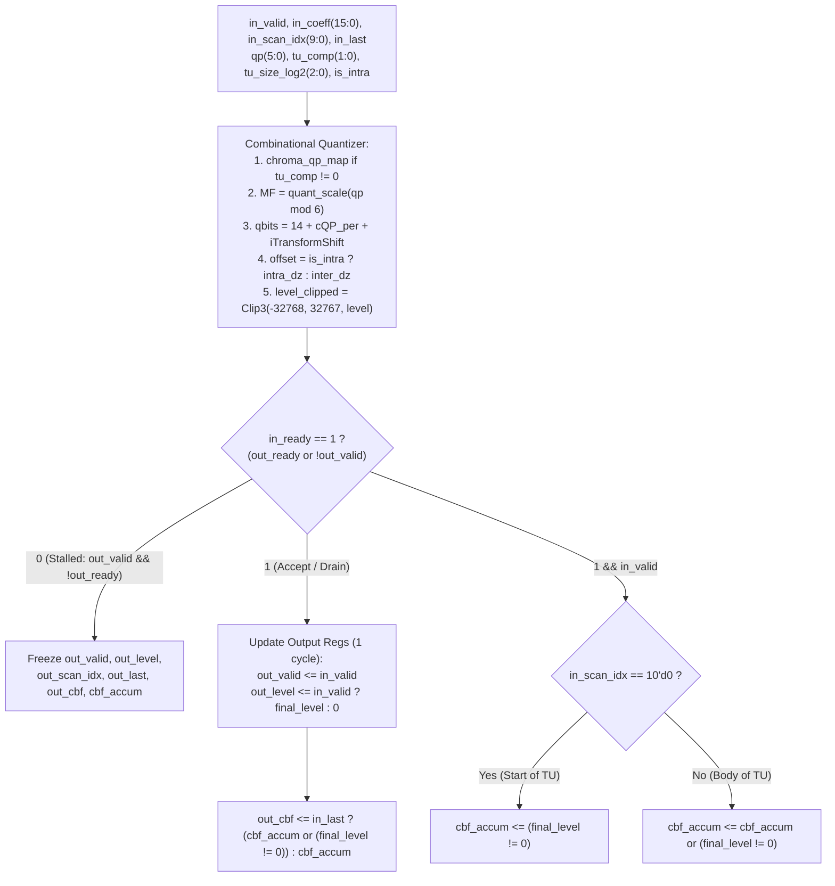

#### (b) Register, Constant & Formula Table

| Register / Signal | Width | Reset (`!rst_n`, sync) | Responsibility & Equation (`fwd_quant.v:82-273`) | Latency |
|:---|:---:|:---:|:---|:---:|
| `out_valid` | 1-bit | `1'b0` | Indicates valid quantized level on output; updates whenever `in_ready == 1`. | 1 cycle |
| `out_level` | 16-bit signed | `16'd0` | Clipped quantized level (`final_level`), zeroed on bubble cycles (`!in_valid && in_ready`). | 1 cycle |
| `out_scan_idx` | 10-bit | `10'd0` | Registered `in_scan_idx` (`0..1023`). | 1 cycle |
| `out_last` | 1-bit | `1'b0` | Registered `in_last` flagging final coefficient of TU. | 1 cycle |
| `out_cbf` | 1-bit | `1'b0` | Coded Block Flag; on `in_last`, evaluates `cbf_accum` &#124; `(final_level != 0)`. | 1 cycle |
| `cbf_accum` | 1-bit | `1'b0` | Sticky non-zero detector within TU; resets on `in_valid && in_ready && (in_scan_idx == 0)`. | State reg |
| `in_ready` | 1-bit | — | Combinational `out_ready` &#124; `~out_valid`. | 0 cycles |

- **Quantization Parameters (`BIT_DEPTH = 10`)**:
  - `actual_qp`: `qp` for Luma (`tu_comp == 0`); HEVC Table 8-10 `chroma_qp_map(qp)` for Cb/Cr (`tu_comp != 0`: identity for `qp < 30`, table `29..37` for `30..43`, `qp - 6` for `44..51`).
  - `MF = quant_scale(qp_mod6)`: `{26214, 23302, 20560, 18396, 16384, 14564}` for `qp_mod6 = 0..5`.
  - `iTransformShift = 15 - BIT_DEPTH - tu_size_log2` (`5 - tu_size_log2` for 10-bit).
  - `qbits = QUANT_SHIFT(14) + (qp_div6 + BIT_DEPTH_ADJ(2)) + iTransformShift` = `21 + qp_div6 - tu_size_log2` (`16..27` for 10-bit).
  - `offset_base = 27'd1 << (qbits - 1)`; `offset_intra = (offset_base * 171) >> 8`; `offset_inter = (offset_base * 85) >> 8`.

#### (c) Transition & Guard Condition Table

| Active Condition (`fwd_quant.v:239-273`) | Action on Pipeline Registers | Action on `cbf_accum` |
|:---|:---|:---|
| `!rst_n` (sync `posedge clk`) | Clears `out_valid`, `out_level`, `out_scan_idx`, `out_last`, `out_cbf` to 0 | `cbf_accum <= 1'b0` |
| `in_ready && in_valid && (in_scan_idx == 10'd0)` | Latches `out_valid <= 1`, `final_level`, `in_scan_idx`, `in_last`, `out_cbf` | `cbf_accum <= (final_level != 16'sd0)` |
| `in_ready && in_valid && (in_scan_idx != 10'd0)` | Latches `out_valid <= 1`, `final_level`, `in_scan_idx`, `in_last`, `out_cbf` | `cbf_accum <= cbf_accum` &#124; `(final_level != 16'sd0)` |
| `in_ready && !in_valid` | Inserts bubble: `out_valid <= 0`, `out_level <= 0`, `out_last <= 0`, `out_cbf <= cbf_accum` | Holds `cbf_accum` |
| `!in_ready` (`out_valid && !out_ready`) | Stalls pipeline: all output registers frozen | Holds `cbf_accum` |

#### (d) Reset, Backpressure & Corner-Case Behavior

- **Elastic Backpressure**: Because `in_ready = out_ready | ~out_valid`, a bubble (`out_valid == 0`) can always be filled even while `out_ready == 0`, and once `out_valid == 1 && !out_ready`, both output registers and `cbf_accum` freeze cleanly without losing a coefficient.
- **Top-Level Integration (`hevc_encoder_top.v:2585-2603, 3159-3225`)**: `in_ready` is left unconnected and `out_ready` is tied to `1'b1`. Note that top-level `coeff_buffer` and `CABAC` consume `tu_has_nonzero` (`hevc_encoder_top.v:3202-3212`) and per-component CG masks `tu_cg_nonzero_mask_y/cb/cr` generated directly from `quant_out_valid`/`quant_out_level` (clearing `tu_has_nonzero` on `trigger_leaf_cu` or `CABAC_WAIT_COEFF_DONE && cabac_coeff_done`), while `cu_cbf_latched` accumulates `quant_out_cbf`.
- **Corner Cases**:
  - `in_last` on the final coefficient combines `cbf_accum | (final_level != 16'sd0)` so a TU whose only non-zero level is the final scanned coefficient still reports `out_cbf = 1`.
  - If `in_scan_idx == 0` never occurs at the start of a TU, `cbf_accum` would retain the prior TU's bit; top-level P2S always starts `p2s_idx` at `0`.

---

### 3.2 `inv_quant.v` Elastic Dequantization Pipeline

#### (a) Mermaid Pipeline Diagram

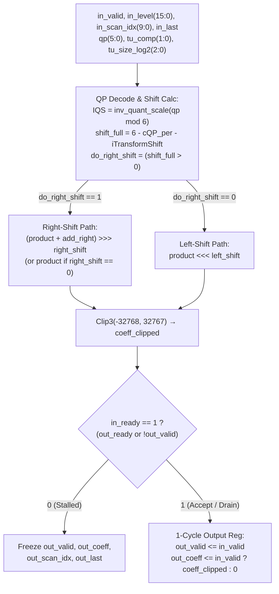

#### (b) Pipeline Register & Scale Table

| Register / Signal | Width | Reset (`!rst_n`, sync) | Responsibility (`inv_quant.v:105-213`) | Latency |
|:---|:---:|:---:|:---|:---:|
| `out_valid` | 1-bit | `1'b0` | Valid flag for dequantized coefficient. | 1 cycle |
| `out_coeff` | 16-bit signed | `16'd0` | Clipped dequantized transform coefficient (`[-32768, 32767]`). | 1 cycle |
| `out_scan_idx` | 10-bit | `10'd0` | Registered `in_scan_idx` (`0..1023`), forwarded to S2P `address_generator`. | 1 cycle |
| `out_last` | 1-bit | `1'b0` | Registered `in_last`. | 1 cycle |
| `in_ready` | 1-bit | — | Combinational `out_ready` &#124; `~out_valid`. | 0 cycles |

- **Inverse Scales (`inv_quant_scale`)**: `qp_mod6 = 0..5` -> `{40, 45, 51, 57, 64, 72}`.
- **Bidirectional Shift**: `shift_full = IQUANT_SHIFT(6) - (qp_div6 + BIT_DEPTH_ADJ) - (15 - BIT_DEPTH - tu_size_log2)` = `tu_size_log2 - 1 - qp_div6` (for `BIT_DEPTH=10`). When `shift_full > 0` (`do_right_shift`), rounds half-up by `1 << (right_shift - 1)` and arithmetically shifts right; when `shift_full <= 0`, arithmetically shifts left by `left_shift = -shift_full`.

#### (c) Transition & Guard Condition Table

| Condition (`inv_quant.v:199-213`) | Pipeline Behavior | Output Values |
|:---|:---|:---|
| `!rst_n` (sync `posedge clk`) | Reset | `out_valid <= 0`, `out_coeff <= 0`, `out_scan_idx <= 0`, `out_last <= 0` |
| `in_ready && in_valid` | Compute & register sample | `out_valid <= 1`, `out_coeff <= coeff_clipped`, `out_scan_idx <= in_scan_idx`, `out_last <= in_last` |
| `in_ready && !in_valid` | Bubble flush | `out_valid <= 0`, `out_coeff <= 0`, latches `in_scan_idx` and `in_last` |
| `!in_ready` (`out_valid && !out_ready`) | Stall | Holds all output registers unchanged |

#### (d) Reset, Backpressure & Corner-Case Behavior

- **Zero-Shift & Left-Shift Boundary**: When `shift_full == 0`, `do_right_shift = 0` and `left_shift = 5'd0`, so `coeff_left = product <<< 0 = product` cleanly handles the `shift_full == 0` boundary without negative shift amounts.
- **Top-Level S2P Scatter, Chroma Phantom DC & IDCT Launch (`hevc_encoder_top.v:2611-2767`)**:
  - `u_inv_quant` runs with `out_ready = 1'b1`, streaming directly into `s2p_buffer[s2p_y][s2p_x]`.
  - If `inv_quant_out_valid && inv_quant_out_last && (reg_tu_comp != 2'd0) && !tu_has_nonzero`, `hevc_encoder_top.v:2743-2749` overwrites `s2p_buffer[0][0]` with `calc_chroma_level1_dequant(ctu_qp, dct_out_tu_size_log2)` (chroma phantom DC reconstruction).
  - Because `s2p_buffer` write commits 1 cycle after `inv_quant_out_last`, `idct_start_pre` (and `idct_start_pending` if `idct_p2s_active` is still draining) delays `idct_start` by 2 cycles (`idct_start <= idct_start_pre`).

---

## 4. MDCS Scan Coordinate Generation (`address_generator.v`) & Top-Level P2S/S2P Scanners

[`address_generator.v`](file:///d:/UIT_Doc/hevc_hw_encoder/rtl/top/address_generator.v) is a **0-cycle combinational** coordinate LUT mapping `(tu_size_log2, scan_mode, scan_idx)` to 2D TU coordinates `(addr_x, addr_y)`. In `hevc_encoder_top.v`, two instances wrap it with stateful top-level scan counters: `u_addr_gen` (with `p2s_active`/`p2s_idx`) for forward P2S, and `u_s2p_addr_gen` for inverse S2P.

#### (a) Mermaid Coordinate Dispatch & Top-Level P2S/S2P Flowchart

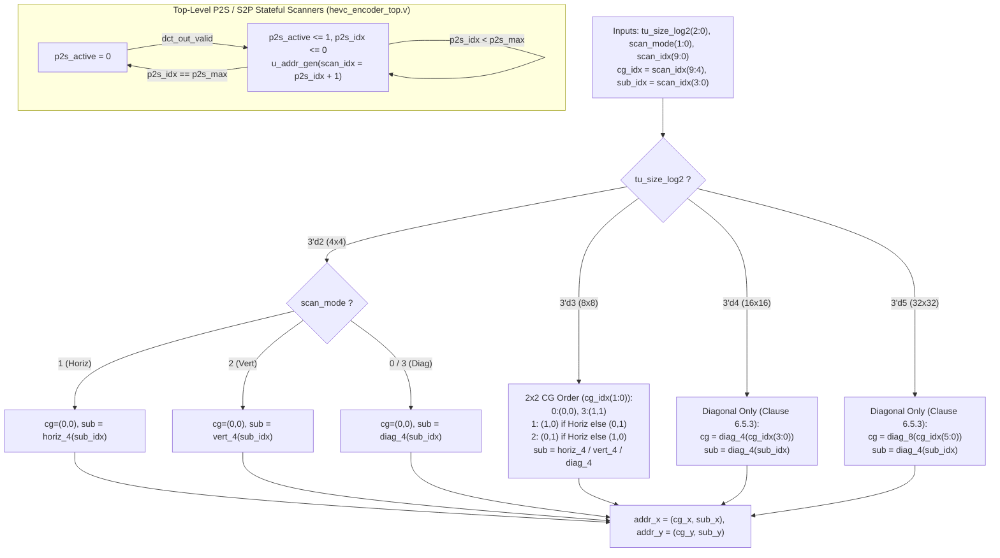

#### (b) LUT Functions & Top-Level Scanner State Table

| Module / Register | Width | Reset (`!rst_n`) | Role (`address_generator.v:11-275`, `hevc_encoder_top.v:2528-2834`) | Latency |
|:---|:---:|:---:|:---|:---:|
| `address_generator` (`addr_x`, `addr_y`) | 5-bit each | Combinational | `{cg_x[2:0], sub_x[1:0]}`, `{cg_y[2:0], sub_y[1:0]}` from `cg_idx = scan_idx[9:4]`, `sub_idx = scan_idx[3:0]`. | 0 cycles |
| `p2s_active` (Fwd P2S) | 1-bit | `1'b0` | Streams forward `dct_out_data` in MDCS order into `u_fwd_quant`. | 1-cycle lookahead |
| `p2s_idx[9:0]`, `p2s_max[9:0]` | 10-bit | `10'd0` | `p2s_idx` counts `0..p2s_max` where `p2s_max = (1 << (dct_out_tu_size_log2 * 2)) - 1` (`15, 63, 255, 1023`). | — |
| `p2s_coeff[15:0]` | 16-bit signed | `16'sd0` | Loaded with `dct_out_data[0][0]` on `dct_out_valid`, then `shared_xform_rd_sample` via `u_addr_gen(p2s_idx + 1)`. | 1 cycle |
| `idct_p2s_active` (Inv Raster P2S) | 1-bit | `1'b0` | Streams `dct_out_data` in raster order (`y, x`) into `u_recon_unit` (`res_valid`), honoring `idct_p2s_ready`. | 1-cycle lookahead |

#### (c) Scan Mode & Transition Table

| `tu_size_log2` | `scan_mode` (`0=Diag, 1=Horiz, 2=Vert`) | CG Coordinate Mapping (`cg_x, cg_y`) | Sub-block 4x4 Mapping (`sub_x, sub_y`) |
|:---:|:---:|:---|:---|
| `3'd2` (`4x4`) | `0`, `1`, `2` (else `0`) | `(0, 0)` | `diag_4` (`0`), `horiz_4` (`1`), `vert_4` (`2`) |
| `3'd3` (`8x8`) | `0` or `2` | `cg_idx[1:0]`: `0->(0,0), 1->(0,1), 2->(1,0), 3->(1,1)` | `diag_4` (`0`), `vert_4` (`2`) |
| `3'd3` (`8x8`) | `1` | `cg_idx[1:0]`: `0->(0,0), 1->(1,0), 2->(0,1), 3->(1,1)` | `horiz_4` (`1`) |
| `3'd4` (`16x16`) | Any (forced Diag) | `diag_4_col(cg_idx[3:0])`, `diag_4_row(cg_idx[3:0])` | `diag_4(sub_idx)` |
| `3'd5` (`32x32`) | Any (forced Diag) | `diag_8_col(cg_idx[5:0])`, `diag_8_row(cg_idx[5:0])` | `diag_4(sub_idx)` |

- **Top-Level MDCS `scan_mode` Derivation (`hevc_encoder_top.v:2541-2553`, `REMEDIATION`)**:
  - `tu_mdcs_eligible = latched_cu_is_intra && ((reg_tu_comp == 0 && dct_out_tu_size_log2 <= 3) || (reg_tu_comp != 0 && dct_out_tu_size_log2 == 2))`.
  - `mdcs_pred_mode_intra` in `[6..14]` -> `2'd2` (Vertical); `[22..30]` -> `2'd1` (Horizontal); otherwise `2'd0` (Diagonal). When `NO_REMEDIATION`, `scan_mode = 2'd0`.

#### (d) Reset, Backpressure & Corner-Case Behavior

- **Up-Right Diagonal Scan Convention & `xsim` Sensitivity Fix**: `diag_4` and `diag_8` implement HEVC forward up-right diagonal order starting from DC `(0,0)` -> `(0,1)` -> `(1,0)` ... to `(N-1, N-1)` using pure `case` / bit-slice mappings inside combinational helper functions with explicit sensitivity `always @(tu_size_log2 or scan_mode or cg_idx or sub_idx)` (eliminating unpacked local LUT arrays that caused Vivado `xsim` `always @*` to drop `sub_idx`).
- **1-Cycle Lookahead & Mux Sharing**: `u_addr_gen` receives `p2s_idx + 10'd1` so `(p2s_x, p2s_y)` addresses `dct_out_data` 1 cycle ahead of `p2s_coeff`. At `p2s_idx == 1023`, `1023 + 1` wraps to `0`, which is ignored because `p2s_idx == p2s_max` clears `p2s_active` on that clock edge.
- **Symmetric Backpressure Flow Control**: Both forward `p2s_active` (`else if (p2s_active && fwd_quant_in_ready)`, wired from `u_fwd_quant.in_ready`) and inverse `idct_p2s_active` (`idct_p2s_ready`) respect downstream `in_ready`. Both scanners share `shared_xform_rd_sample` (`idct_p2s_active` has mux priority; `tu_ready_signal` prevents overlap).

---

## 5. Residual Subtraction, Reconstruction & Synchronous Line-Buffer Control

### 5.1 `residual_sub.v` Align-and-Subtract Stage

#### (a) Mermaid Pipeline Diagram

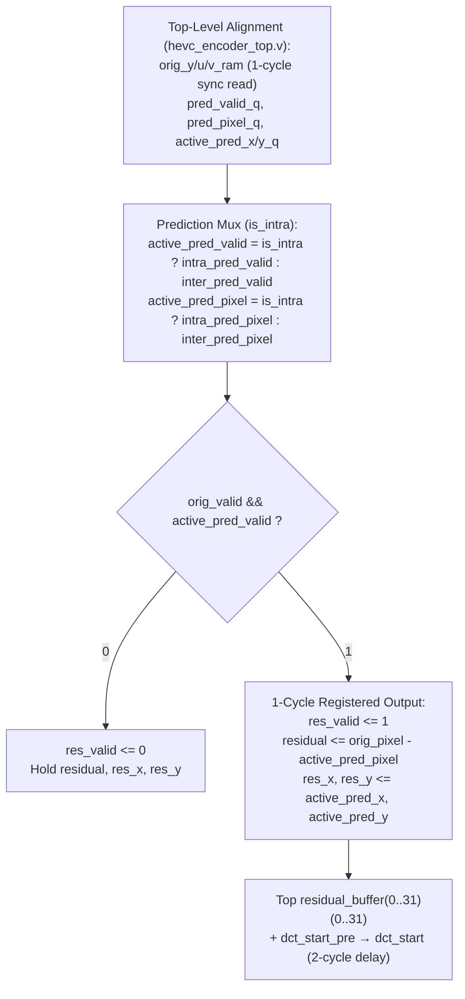

#### (b) Register & Interface Table

| Register / Port | Width | Reset (`!rst_n`, async) | Responsibility (`residual_sub.v:32-60`) | Latency |
|:---|:---:|:---:|:---|:---:|
| `res_valid` | 1-bit | `1'b0` | `orig_valid & active_pred_valid` registered 1 cycle. | 1 cycle |
| `residual` | `RESIDUAL_WIDTH` (11-bit signed) | `11'sd0` | `$signed({1'b0, orig_pixel}) - $signed({1'b0, active_pred_pixel})`, range `[-1023, +1023]`. | 1 cycle |
| `res_x`, `res_y` | 6-bit each | `6'd0` | Multiplexed `intra_pred_x/y` or `inter_pred_x/y`. | 1 cycle |

#### (c) Transition & Guard Condition Table

| Condition (`residual_sub.v:45-60`) | Behavior |
|:---|:---|
| `!rst_n` (async `negedge rst_n`) | Clears `res_valid`, `residual`, `res_x`, `res_y` to `0`. |
| `orig_valid && active_pred_valid` | Sets `res_valid <= 1'b1`; computes 11-bit signed difference and latches coordinates. |
| `!(orig_valid && active_pred_valid)` | Sets `res_valid <= 1'b0`; retains previous `residual`, `res_x`, `res_y` values. |

#### (d) Reset, Backpressure & Corner-Case Behavior

- **No Backpressure Port**: `residual_sub` has no `ready` input or output; upstream must present aligned `orig_pixel` and `active_pred_pixel` on the same clock cycle.
- **Top-Level Synchronization (`hevc_encoder_top.v:1246-1357`)**: Because `orig_y/u/v_ram` have 1-cycle synchronous read latency (`orig_*_data_q`), `hevc_encoder_top.v` delays `pred_valid`, `pred_pixel`, `active_pred_x/y`, `active_pred_last`, and `latched_cu_is_intra` by 1 cycle (`*_q`) and ties both `orig_valid` and `intra/inter_pred_valid` gating to `pred_valid_q`.
- **2-Cycle `dct_start` Alignment**: `dct_start_pre <= (pred_valid_q && active_pred_last_q)` and `dct_start <= dct_start_pre` align `dct_in_valid` to occur 1 cycle after the last `res_sub_valid` writes `residual_buffer[res_sub_y[4:0]][res_sub_x[4:0]]`.

---

### 5.2 `recon_unit.v` 2-Stage Clip1 Main10 Reconstruction Pipeline

#### (a) Mermaid Pipeline Diagram

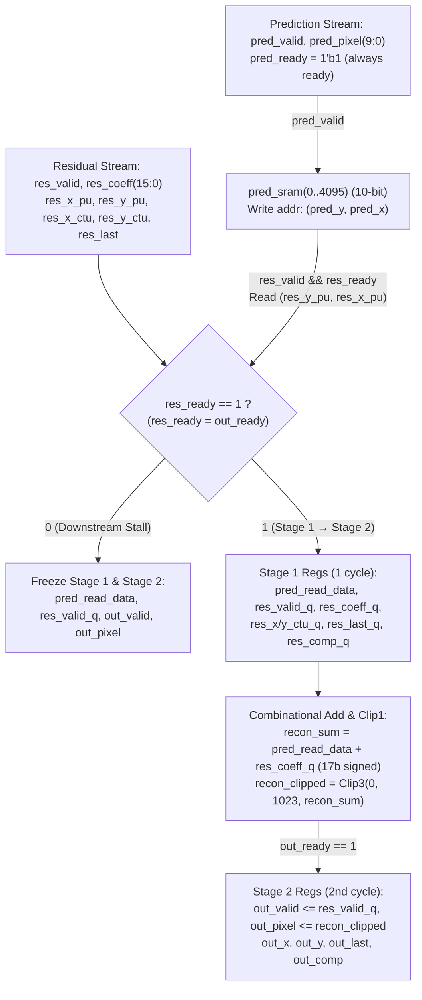

#### (b) Pipeline Register & Storage Table

| Storage / Register | Width / Depth | Reset (`!rst_n`, sync) | Responsibility (`recon_unit.v:80-177`) | Latency |
|:---|:---:|:---:|:---|:---:|
| `pred_sram` | 4096 x 10-bit | None (`512` under `` `ifndef SYNTHESIS ``) | Stores PU prediction block (`64x64` max) at `{pred_y, pred_x}`. | 1 cycle (sync read) |
| `pred_read_data` | 10-bit | None | Stage 1 prediction sample read at `{res_y_pu, res_x_pu}`. | Stage 1 |
| `res_valid_q` | 1-bit | `1'b0` | Stage 1 valid flag. | Stage 1 |
| `res_coeff_q`, `res_x_ctu_q`, `res_y_ctu_q`, `res_last_q`, `res_comp_q` | 16b, 6b, 6b, 1b, 2b | None | Stage 1 aligned residual + CTU coordinates + metadata. | Stage 1 |
| `out_valid`, `out_pixel`, `out_x`, `out_y`, `out_last`, `out_comp` | 1b, 10b, 6b, 6b, 1b, 2b | `0` | Stage 2 Clip1 Main10 `[0, 1023]` output (`CLIP_MAX = (1 << BIT_DEPTH) - 1 = 1023`). | **2 cycles** from `res_valid` |

#### (c) Transition & Guard Condition Table

| Event / Condition (`recon_unit.v:97-177`) | Stage 0 (`pred_sram` Write) | Stage 1 (SRAM Read) | Stage 2 (Clip1 Output) |
|:---|:---|:---|:---|
| `!rst_n` (sync `posedge clk`) | `pred_sram` unchanged | `res_valid_q <= 1'b0` | `out_valid, out_pixel, out_x, out_y, out_last, out_comp <= 0` |
| `pred_valid` | `pred_sram[{pred_y, pred_x}] <= pred_pixel` | Independent | Independent |
| `out_ready && res_valid` | — | Reads `pred_sram[{res_y_pu, res_x_pu}]`; `res_valid_q <= 1` + latches residual/CTU coords | `out_valid <= res_valid_q`; latches `recon_clipped` & `_q` metadata |
| `out_ready && !res_valid` | — | `res_valid_q <= 1'b0` | `out_valid <= res_valid_q`; latches `recon_clipped` & `_q` metadata |
| `!out_ready` (`res_ready == 0`) | `pred_valid` still writes (`pred_ready = 1`) | Freezes `pred_read_data` & all `*_q` registers | Freezes `out_valid` & all `out_*` registers |

#### (d) Reset, Backpressure & Corner-Case Behavior

- **Backpressure Coupling**: `pred_ready` is hardwired `1'b1` while `res_ready = out_ready`. Stall on `out_ready == 0` freezes both pipeline stages identically (`else if (out_ready) res_valid_q <= 1'b0` at `recon_unit.v:135` is structurally redundant because `res_ready == out_ready`).
- **PU vs. CTU Coordinate Split**: Prediction generation writes `pred_sram` in TU/PU-local coordinates (`pred_x, pred_y`), and `idct_p2s` drives `res_x_pu, res_y_pu` for `pred_sram` lookup while passing `reg_tu_x + idct_p2s_x` and `reg_tu_y + idct_p2s_y` on `res_x_ctu, res_y_ctu` so `out_x, out_y` are CTU-relative.
- **No Read/Write SRAM Collision**: `tu_ready_signal` blocks any new TU prediction while `idct_active`, `idct_start`, `idct_start_pre`, or `idct_p2s_active` is active, preventing concurrent prediction writes and residual reads on `pred_sram`.

---

### 5.3 Top-Level Synchronous Line-Buffer & Intra-Reference Control (`hevc_encoder_top.v`)

#### (a) Mermaid Control Diagram

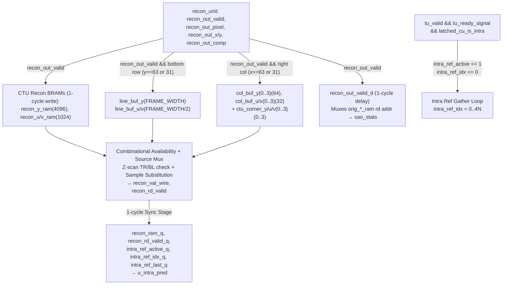

#### (b) Synchronous Buffer & Reference-Feeder State Table

| Storage / Register | Dimensions / Width | Reset (`!rst_n` or `sync_frame_done_pulse`) | Control Logic (`hevc_encoder_top.v:1394-1776`) | Latency |
|:---|:---:|:---:|:---|:---:|
| `recon_y_ram`, `recon_u_ram`, `recon_v_ram` | `4096x10b`, `1024x10b` (x2) | None (`512` under `translate_off`) | Pure synchronous write on `recon_out_valid` at `{recon_out_y, recon_out_x}`. | 1 cycle |
| `line_buf_y`, `line_buf_u/v` | `FRAME_WIDTH x 10b`, `(W/2) x 10b` | `MID_GRAY_SAMPLE` (`512`) | Written on `recon_out_valid` when `recon_out_y == 63` (Y) or `31` (U/V) at `abs_recon_x`. | 1 cycle |
| `col_buf_y`, `col_buf_u/v` | `4 x 64 x 10b`, `4 x 32 x 10b` | `MID_GRAY_SAMPLE` (`512`) | Written on `recon_out_valid` when `recon_out_x == 63` (Y) or `31` (U/V), bank `recon_ctu_x[1:0]`. | 1 cycle |
| `ctu_corner_y/u/v` | `4 x 4 x 10b` (x3) | `MID_GRAY_SAMPLE` (`512`) | Written on bottom-right corner `(63,63)` Y / `(31,31)` U/V, bank `[ctu_x[1:0]][ctu_y[1:0]]`. | 1 cycle |
| `intra_ref_active`, `intra_ref_idx[7:0]` | 1-bit, 8-bit | `0`, `0` (`!rst_n` async) | Streams $4N+1$ samples (`0..intra_ref_max`, `intra_ref_max = 1 << (reg_tu_size_log2+2)`) to `u_intra_pred`. | 1-cycle sync stage |
| `recon_ram_q`, `recon_rd_valid_q`, `intra_ref_*_q` | 10b, 1b, 1b/8b/1b | Unreset (gated by `intra_ref_active_q`) | Breaks combinational `recon_*_ram` read path before `u_intra_pred` (`recon_ram_q` -> `intra_ref_sample`). | 1 cycle |
| `tu_can_start` | 1-bit | `1'b1` (`!rst_n` async) | Cleared on `tu_valid && tu_ready_signal`; re-armed when `cabac_coeff_done` completes TU. | — |

#### (c) Transition & Synchronization Guard Table

| Event / Guard (`hevc_encoder_top.v:1433-1776, 2978-2982`) | State / Buffer Update |
|:---|:---|
| `!rst_n` or `sync_frame_done_pulse` | Resets `line_buf_*`, `col_buf_*`, `ctu_corner_*` to `512` (`MID_GRAY_SAMPLE`); `tu_can_start` & `intra_ref_*` reset only on `!rst_n` |
| `tu_valid && tu_ready_signal` | `tu_can_start <= 0`, latches `reg_tu_*`, `recon_ctu_x/y`; if `latched_cu_is_intra`, sets `intra_ref_active <= 1`, `intra_ref_idx <= 0` |
| `intra_ref_active && (intra_ref_idx == intra_ref_max)` | `intra_ref_active <= 0` (4N+1 samples issued); 1 cycle later `intra_ref_last_q` reaches `u_intra_pred` |
| `intra_ref_active && (intra_ref_idx != intra_ref_max)` | `intra_ref_idx <= intra_ref_idx + 1`; `recon_ram_q <= recon_val_wire` |
| `recon_out_valid` | Updates `recon_*_ram`, boundary `line_buf_*`/`col_buf_*`/`ctu_corner_*`, and sets `recon_out_valid_d <= 1` to align `orig_*_data_q` for `u_inloop_filters` |
| `cabac_coeff_done` (when `!intra_ref_active`) | Re-arms `tu_can_start <= 1'b1` |

#### (d) Corner Cases & Synthesis Alignment Notes

- **Synchronous Read Isolation (`recon_ram_q`)**: Registering `recon_val_wire` into `recon_ram_q` (alongside `intra_ref_active_q`, `intra_ref_idx_q`, `intra_ref_last_q`) prevents combinational loops/timing failure on `recon_*_ram` M10K BRAM reads (`hevc_encoder_top.v:1613, 1768`).
- **Z-Scan Availability & HEVC Sample Substitution**: `check_top_right_avail` and `check_bottom_left_avail` use 4x4 Morton Z-scan indices (`z_scan_idx_4x4`) inside the CTU and frame bounds outside; when only top or left neighbors exist, unavailable entries substitute `first_top_sample` or `first_left_sample` (or `512` if neither exists).
- **SAO Original-Pixel Synchronization**: `orig_ram_rd_x/y` switches to `recon_out_x/y` whenever `recon_out_valid` is asserted, so `orig_in_valid = recon_out_valid_d` arrives 1 cycle later aligned with `orig_y/u/v_data_q` (`hevc_encoder_top.v:1250-1259, 2978-3006`).

---

## 6. AXI4 DPB Frame Store (`frame_store.v`)

[`frame_store.v`](file:///d:/UIT_Doc/hevc_hw_encoder/rtl/recon/frame_store.v) manages 8 external-DRAM DPB slots (`MAX_REF_PICS = 8`), an on-chip 1-CTU-row BRAM `line_cache`, and two independent AXI4 256-bit Master FSMs: `wr_state[1:0]` (Write Engine) and `rd_state[1:0]` (Read Engine).

### 6.1 DPB Slot Allocation Control

- **Registers (`frame_store.v:187-229`, synchronous `rst_n`)**: `slot_valid[7:0]`, `slot_ready[7:0]`, `slot_poc[0:7]` (10-bit each).
- **Combinational Priority Allocation**: `free_slot_idx` picks the lowest slot `0..7` with `!slot_valid[i]`; `any_free = !(&slot_valid)`; `alloc_ready = any_free`; `alloc_slot = free_slot_idx`.
- **Transitions**:
  - `alloc_valid && alloc_ready`: `slot_valid[free_slot_idx] <= 1'b1`, `slot_ready[free_slot_idx] <= 1'b0`, `slot_poc[free_slot_idx] <= alloc_poc`.
  - `free_valid`: `slot_valid[free_slot] <= 1'b0`, `slot_ready[free_slot] <= 1'b0`.
  - `wr_valid && wr_ready && wr_last`: `slot_ready[wr_slot] <= 1'b1`.

---

### 6.2 AXI4 Write DMA FSM (`wr_state[1:0]`)

#### (a) Mermaid State Diagram

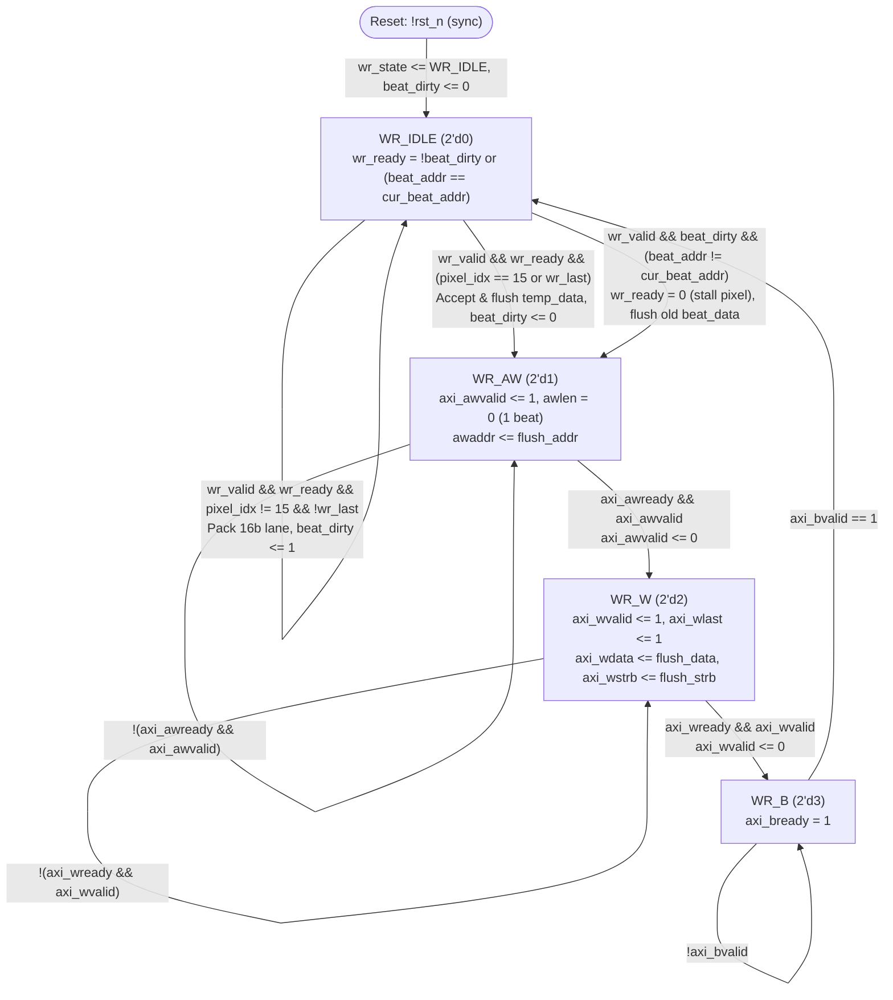

#### (b) State Encoding & Responsibility Table

State register: `reg [1:0] wr_state` ([`frame_store.v:245-259`](file:///d:/UIT_Doc/hevc_hw_encoder/rtl/recon/frame_store.v#L245-L259)).

| `localparam` | Encoding | Width | Active Outputs / Internal Actions | Latency |
|:---|:---:|:---:|:---|:---:|
| `WR_IDLE` | `2'd0` | 2-bit | `wr_ready = !beat_dirty` &#124; `(beat_addr == cur_beat_addr)`. Accumulates up to 16 pixels (`pixel_idx = wr_cx[3:0]`, 16-bit padded `{6'd0, wr_pixel}`, 2-bit `beat_strb` per pixel) into 256-bit `beat_data` / 32-bit `beat_strb`, or flushes `flush_addr/data/strb` on full beat, `wr_last`, or beat-address mismatch. | 1–16 pixel cycles |
| `WR_AW` | `2'd1` | 2-bit | Drives `axi_awvalid <= 1'b1`, `axi_awaddr <= flush_addr`, `axi_awlen <= 8'd0` (1-beat), `axi_awsize <= 3'b101` (32 B), `axi_awburst <= 2'b01` (`INCR`) until `axi_awready && axi_awvalid`. | $\ge 2$ cycles (1 cycle to assert `awvalid`, $\ge 1$ handshake) |
| `WR_W` | `2'd2` | 2-bit | Drives `axi_wvalid <= 1'b1`, `axi_wdata <= flush_data`, `axi_wstrb <= flush_strb`, `axi_wlast <= 1'b1` until `axi_wready && axi_wvalid`. | $\ge 2$ cycles |
| `WR_B` | `2'd3` | 2-bit | `axi_bready` is continuously `1'b1`; waits for `axi_bvalid` write response. | $\ge 1$ cycle |

#### (c) Transition & Guard Condition Table

| Current State | Next State | Guard Condition (`frame_store.v:291-370`) | State / Register Updates |
|:---|:---|:---|:---|
| `WR_IDLE` | `WR_IDLE` | `wr_valid && (!beat_dirty || beat_addr == cur_beat_addr) && !(pixel_idx == 4'd15 || wr_last)` | `beat_dirty <= 1'b1`, `cur_beat_addr <= beat_addr`, updates `beat_data`/`beat_strb` slice `pixel_idx` |
| `WR_IDLE` | `WR_AW` | `wr_valid && (!beat_dirty || beat_addr == cur_beat_addr) && (pixel_idx == 4'd15 || wr_last)` | Accepts pixel (`wr_ready=1`); `flush_addr <= beat_addr`, `flush_data <= temp_data`, `flush_strb <= temp_strb`, `beat_dirty <= 1'b0` |
| `WR_IDLE` | `WR_AW` | `wr_valid && beat_dirty && (beat_addr != cur_beat_addr)` | Holds off pixel (`wr_ready=0`); `flush_addr <= cur_beat_addr`, `flush_data <= beat_data`, `flush_strb <= beat_strb`, `beat_dirty <= 1'b0` |
| `WR_AW` | `WR_W` | `axi_awready && axi_awvalid` | `axi_awvalid <= 1'b0` |
| `WR_W` | `WR_B` | `axi_wready && axi_wvalid` | `axi_wvalid <= 1'b0` |
| `WR_B` | `WR_IDLE` | `axi_bvalid` | Returns to accept new pixels |

#### (d) Reset, Backpressure, AXI4 Write Handshake & Corner-Case Behavior

- **Synchronous Reset**: `always @(posedge clk)` resets `wr_state <= WR_IDLE`, `beat_dirty <= 1'b0`, `axi_awvalid <= 1'b0`, `axi_wvalid <= 1'b0`, `axi_wlast <= 1'b0`.
- **Beat-Mismatch Stall & Flush**: When a partial beat is dirty (`beat_dirty == 1`) and a pixel arrives on a different 32-byte beat (`beat_addr != cur_beat_addr`, e.g., at a row end or component switch), `wr_ready` combinationally drops to `0` to backpressure the producer (`decoder_inloop_filters`), while `WR_IDLE` copies the old dirty beat into `flush_*` and transitions to `WR_AW`. Once `WR_B` finishes and returns to `WR_IDLE` with `beat_dirty == 0`, `wr_ready` returns to `1` and the waiting pixel is accepted.
- **AXI4 Single-Beat Partial Writes**: Every burst is 1 beat (`axi_awlen = 0`, 32 bytes) with byte-granular `axi_wstrb` (`2'b11` per valid 16-bit padded pixel slot), supporting arbitrary non-16-aligned CTU rows or partial ending beats (`wr_last`). `axi_wlast` stays `1'b1` after the first `WR_W` visit (qualified by `axi_wvalid`).

---

### 6.3 AXI4 Read DMA FSM (`rd_state[1:0]`) & On-Chip CTU Line Cache

#### (a) Mermaid State Diagram

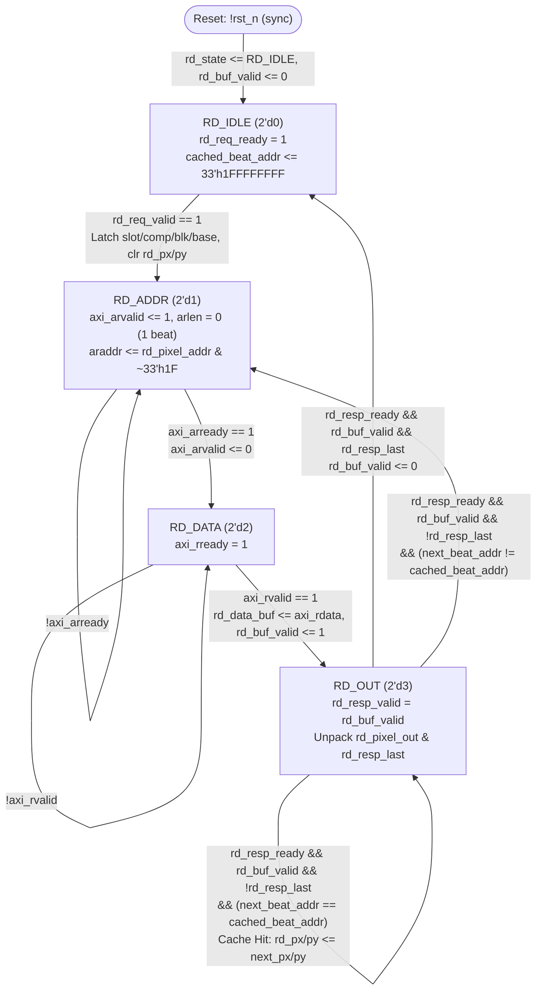

#### (b) State Encoding & On-Chip Cache Table

State register: `reg [1:0] rd_state` ([`frame_store.v:385-568`](file:///d:/UIT_Doc/hevc_hw_encoder/rtl/recon/frame_store.v#L385-L568)).

| `localparam` / Unit | Encoding / Size | Width | Active Outputs / Internal Actions | Latency |
|:---|:---:|:---:|:---|:---:|
| `RD_IDLE` | `2'd0` | 2-bit | `rd_req_ready = 1`, `rd_resp_valid = 0`, `axi_rready = 0`. Clears `rd_buf_valid` and invalidates `cached_beat_addr` (`33'h1FFFFFFFF`). Latches request metadata (`rd_slot_r`, `rd_comp_r`, `rd_blk_w_r`, `rd_blk_h_r`, `rd_base_x`, `rd_base_y`). | $\ge 1$ cycle |
| `RD_ADDR` | `2'd1` | 2-bit | Drives `axi_arvalid <= 1`, `axi_araddr <= rd_pixel_addr & ~33'h1F`, `axi_arlen <= 8'd0`, `axi_arsize <= 3'b101` (32 B), `axi_arburst <= 2'b01` (`INCR`). | $\ge 1$–2 cycles |
| `RD_DATA` | `2'd2` | 2-bit | `axi_rready = 1`. Captures `rd_data_buf <= axi_rdata`, `rd_buf_valid <= 1`, and `cached_beat_addr <= rd_pixel_addr & ~33'h1F` on `axi_rvalid`. | $\ge 1$ cycle |
| `RD_OUT` | `2'd3` | 2-bit | `rd_resp_valid = rd_buf_valid`. Unpacks 10-bit `rd_pixel_out` (`rd_eff_x[0] ? rd_word[25:16] : rd_word[9:0]`). Streams 1 pixel/cycle on beat cache hits; branches to `RD_ADDR` on beat miss or `RD_IDLE` on `rd_resp_last`. | 1–16 cycles/beat |
| `line_cache` BRAM | `368,640 x 10b` (`CACHE_DEPTH + CACHE_DEPTH/2`) | 10-bit | On-chip 1-CTU-row (`CACHE_HEIGHT = 64`, `CACHE_WIDTH = 3840`) BRAM (`Y: 0..245759`, `Cb: +245760`, `Cr: +307200`). Writes on `wr_valid && wr_ready`; `cache_pixel_r` registered read, `cache_valid = 1'b1`. | 1 cycle read |

#### (c) Transition & Guard Condition Table

| Current State | Next State | Guard Condition (`frame_store.v:468-524`) | State / Register Updates |
|:---|:---|:---|:---|
| `RD_IDLE` | `RD_ADDR` | `rd_req_valid == 1'b1` | Latches `rd_slot_r`, `rd_comp_r`, `rd_blk_w_r`, `rd_blk_h_r`, `rd_base_x`, `rd_base_y`; `rd_px <= 0`, `rd_py <= 0` |
| `RD_ADDR` | `RD_DATA` | `axi_arvalid && axi_arready` | `axi_arvalid <= 1'b0` |
| `RD_DATA` | `RD_OUT` | `axi_rvalid == 1'b1` | `rd_data_buf <= axi_rdata`; `rd_buf_valid <= 1'b1`; `cached_beat_addr <= rd_pixel_addr & ~33'h1F` |
| `RD_OUT` | `RD_IDLE` | `rd_resp_ready && rd_buf_valid && rd_resp_last` | Advances `rd_px/py`; `rd_buf_valid <= 1'b0` |
| `RD_OUT` | `RD_ADDR` | `rd_resp_ready && rd_buf_valid && !rd_resp_last && (next_beat_addr != cached_beat_addr)` | Advances `rd_px/py`; `rd_buf_valid <= 1'b0` |
| `RD_OUT` | `RD_OUT` | `rd_resp_ready && rd_buf_valid && !rd_resp_last && (next_beat_addr == cached_beat_addr)` | Advances `rd_px/py`; keeps `rd_buf_valid == 1` (zero-wait intra-beat hit) |

#### (d) Reset, Backpressure, AXI4 Read Handshake & Corner-Case Behavior

- **Boundary Edge Replication (`xPadPicture`)**: Signed 13-bit coordinates `rd_cur_x_raw` / `rd_cur_y_raw` (and lookahead `next_x_raw` / `next_y_raw`) clamp negative values to `0` and `>= max_x/y` to `max_x/y - 1`. When horizontal padding repeats the same boundary pixel across consecutive `rd_px`, `next_beat_addr == cached_beat_addr` remains true and emits padded pixels at 1 pixel/cycle without extra AXI reads.
- **AXI4 `RD_ADDR` Handshake Guard (`frame_store.v`)**: `RD_ADDR -> RD_DATA` requires `if (axi_arvalid && axi_arready)`, preventing premature state transition if a downstream AXI slave asserts `axi_arready = 1` before `axi_arvalid` goes high.
- **Top-Level Integration (`hevc_encoder_top.v:3039-3109`)**: `wr_*` is fed by `u_inloop_filters` (`filter_out_*`) with `wr_last` connected to `sync_frame_done_pulse`, while `rd_req_valid` is tied to `1'b0` and `cache_*` read ports are left unconnected (on-chip `dpb_*_ram_l0/l1` BRAMs handle MC reads and `decoder_inloop_filters` maintains its own deblocking line buffers, while `frame_store` drives external DRAM writes through `axi_aw*/w*/b*` and shares `axi_ar*/r*` via `axi_read_arbiter`).

---

## 7. Rate Control (`rate_controller.v`) & Lambda Lookup (`lambda_calc.v`)

### 7.1 `rate_controller.v` Frame-Level VBV & QP State Machine

`rate_controller` has no explicit `state` enum; instead, it maintains persistent frame-level state registers (`current_qp_r`, `rc_active_d`, `vbv_buffer_bits`, `vbv_buffer_max`, `target_bits_frame`, `target_bits_p`, `target_bits_i`, `vbv_fullness_pct`) controlled by `rc_enable`, `frame_start`, and `frame_done`.

#### (a) Mermaid Control Flowchart

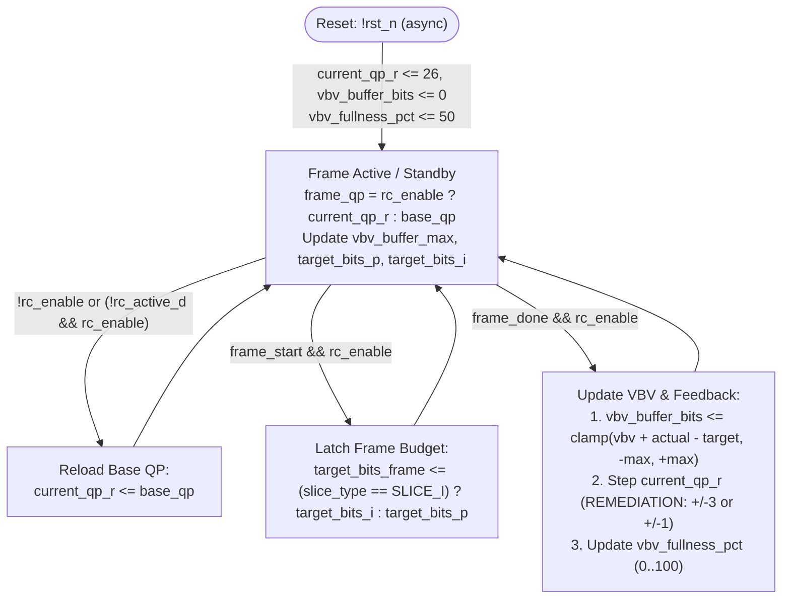

#### (b) State Registers & Encodings Table

| Register / Parameter | Width | Reset (`!rst_n`, async) | Responsibility (`rate_controller.v:42-216`) | Latency |
|:---|:---:|:---:|:---|:---:|
| `SLICE_B`, `SLICE_P`, `SLICE_I` | 2-bit `localparam` | `2'd0`, `2'd1`, `2'd2` | Slice-type encodings matching `gop_controller`. | — |
| `current_qp_r` | 6-bit | `6'd26` | Active closed-loop frame QP when `rc_enable == 1`. | 1 cycle on `frame_done` |
| `rc_active_d` | 1-bit | `1'b0` | Delayed `rc_enable` for rising-edge initialization (`!rc_active_d && rc_enable`). | 1 cycle |
| `vbv_buffer_bits` | 32-bit signed | `32'sd0` | Signed VBV deviation from 50% target, clamped to `[-vbv_buffer_max, +vbv_buffer_max]`. | 1 cycle on `frame_done` |
| `vbv_buffer_max` | 32-bit signed | `32'sd5000000` | 1.0 s buffer capacity = `target_bitrate_kbps * 1000`. | Continuous reg |
| `target_bits_p`, `target_bits_i` | 32-bit signed | `166666`, `500000` | Per-frame P/B and I bit targets (`target_bits_i` = 3x `target_bits_p`). | Continuous reg |
| `target_bits_frame` | 32-bit signed | `32'sd500000` | Selected frame target bit budget latched on `frame_start`. | 1 cycle on `frame_start` |
| `vbv_fullness_pct` | 16-bit | `16'd50` | Estimated buffer fullness `[0..100]%`. | 1 cycle on `frame_done` |
| `frame_qp`, `slice_qp_delta` | 6b, 7b signed | Combinational | `frame_qp = rc_enable ? current_qp_r : base_qp`; `slice_qp_delta = frame_qp - 26`. | **0 cycles** |

#### (c) Transition, Target Budget & QP Feedback Guard Table

| Event / Condition | `` `ifdef REMEDIATION `` (Active Default) | `` `else `` (Legacy Path) |
|:---|:---|:---|
| Every cycle (`!rst_n == 0`) | `vbv_buffer_max <= kbps * 1000`; `target_bits_p <= (kbps * 2184600) >> 16` (30 fps reciprocal, no divider); `target_bits_i <= kbps * 100` | `vbv_buffer_max <= kbps * 1000`; `target_bits_p <= (kbps * 1000) / safe_fps`; `target_bits_i <= ((kbps * 1000) / safe_fps) * 3` |
| `!rc_enable \|\| (!rc_active_d && rc_enable)` | `current_qp_r <= base_qp` | `current_qp_r <= base_qp` |
| `frame_start && rc_enable` | `target_bits_frame <= (slice_type == SLICE_I) ? target_bits_i : target_bits_p` (P and B both use `target_bits_p`) | Same |
| `frame_done && rc_enable`: VBV update | `vbv_buffer_bits <= clamp(vbv_buffer_bits + actual_frame_bits - target_bits_frame, -vbv_buffer_max, +vbv_buffer_max)` | Same |
| `frame_done && rc_enable`: QP `+` high | `(vbv_buffer_bits > (vbv_buffer_max >>> 2)) \|\| (actual_frame_bits > target + (target >> 2))`: `if (current_qp_r < 49) current_qp_r <= current_qp_r + 3` | `(actual_frame_bits > target + (target >> 2))`: `if (current_qp_r < 50) current_qp_r <= current_qp_r + 2` |
| `frame_done && rc_enable`: QP `+` low | `else if (actual_frame_bits > target + (target >> 4))`: `if (current_qp_r < 51) current_qp_r <= current_qp_r + 1` | Same (`+1` if `< 51`) |
| `frame_done && rc_enable`: QP `-` high | `else if ((vbv_buffer_bits < -(vbv_buffer_max >>> 2)) \|\| (actual_frame_bits < target - (target >> 2)))`: `if (current_qp_r > 14) current_qp_r <= current_qp_r - 3` | `else if (actual_frame_bits < target - (target >> 2))`: `if (current_qp_r > 12) current_qp_r <= current_qp_r - 2` |
| `frame_done && rc_enable`: QP `-` low | `else if (actual_frame_bits < target - (target >> 4))`: `if (current_qp_r > 11) current_qp_r <= current_qp_r - 1` | Same (`-1` if `> 11`) |
| `frame_done && rc_enable`: Fullness | `calc_fullness_pct(vbv_buffer_bits, vbv_buffer_max)` shift-threshold tree (`25, 12, 6, 3, 2, 1` around `50`, clamped `[0, 100]`) | `50 + ((vbv_buffer_bits * 50) / vbv_buffer_max)`, clamped `[0, 100]` |

#### (d) Reset, Timing & Corner-Case Behavior

- **Zero-Cycle `frame_qp` Availability**: Because `frame_qp` is driven combinationally from `current_qp_r` / `base_qp`, `u_slice_controller` and `u_ctu_raster_scan` observe the updated QP immediately on `frame_start`.
- **Same-Edge Non-Blocking Evaluation**: On `frame_done && rc_enable`, the QP step and `vbv_fullness_pct` read the *pre-update* `vbv_buffer_bits` in the same clock edge that schedules the new `vbv_buffer_bits <= ...`.
- **Saturation Guard Near QP Limits (Under `REMEDIATION`)**: Because the `+3` step checks `current_qp_r < 6'd49` (rather than clamping to `51`), QP values of `49` or `50` skip the `+3` jump (and QP `12..14` skip `-3`).
- **30 fps Assumption Under `REMEDIATION`**: Under `` `ifdef REMEDIATION ``, `target_bits_p` uses the fixed 30 fps reciprocal `(target_bitrate_kbps * 2184600) >> 16` (`fps` port is ignored; `hevc_encoder_top.v:487` ties `.fps(8'd30)`), and `frame_bit_counter` accumulates `+8` bits per output byte (`out_valid && out_ready`), resetting on `gop_frame_start`.

---

### 7.2 `lambda_calc.v` Combinational Lagrangian Multiplier LUT

#### (a) Mermaid Lookup Flowchart

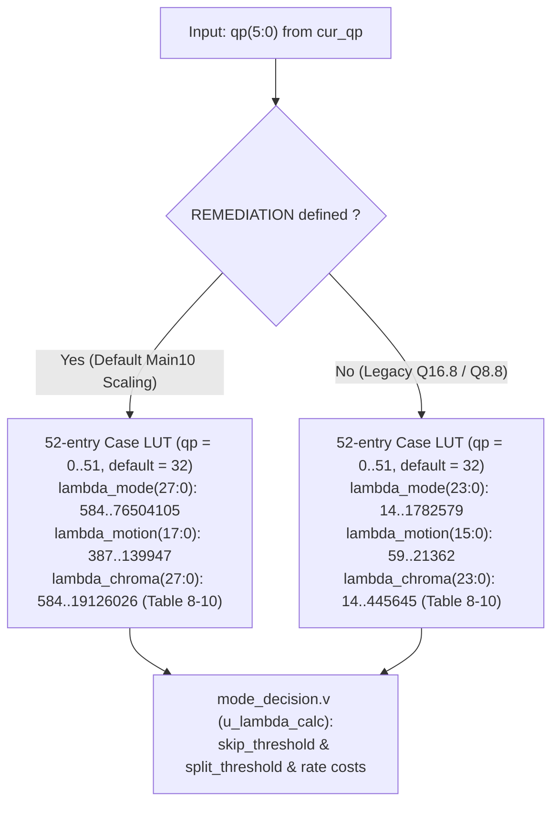

#### (b) Output Port Width, Latency & Key Lookup Values

| Configuration | `lambda_mode` Width & Range | `lambda_motion` Width & Range | `lambda_chroma` Width & Range | Default (`qp > 51`) | Latency |
|:---|:---|:---|:---|:---|:---:|
| `` `ifdef REMEDIATION `` | `28`-bit (`584` @ QP 0 .. `76,504,105` @ QP 51) | `18`-bit (`387` @ QP 0 .. `139,947` @ QP 51) | `28`-bit (`584` @ QP 0 .. `19,126,026` @ QP 51) | QP 32 (`948,771` / `15,598` / `753,040`) | **0 cycles** (comb) |
| `` `else `` (Legacy) | `24`-bit (`14` @ QP 0 .. `1,782,579` @ QP 51) | `16`-bit (`59` @ QP 0 .. `21,362` @ QP 51) | `24`-bit (`14` @ QP 0 .. `445,645` @ QP 51) | QP 32 (`22,107` / `2,379` / `17,546`) | **0 cycles** (comb) |

#### (c) Mapping & Corner-Case Behavior

- **Chroma Table 8-10 Tracking**: For `qp < 30`, `lambda_chroma == lambda_mode`. For `qp >= 30`, `lambda_chroma` indexes the mapped HEVC chroma QP (`qp=30 -> qpC=29`, ..., `qp=43 -> qpC=37`, `qp=44..51 -> qpC=38..45`).
- **Top-Level Consumer**: Instantiated inside [`mode_decision.v:146-151`](file:///d:/UIT_Doc/hevc_hw_encoder/rtl/partition/mode_decision.v#L146-L151) (`u_lambda_calc`), where `lambda_mode_q8` drives `lambda_intra_rate_cost`, `lambda_amvp_rate_cost`, and depth-dependent `split_threshold` (unused `skip_threshold` removed).
