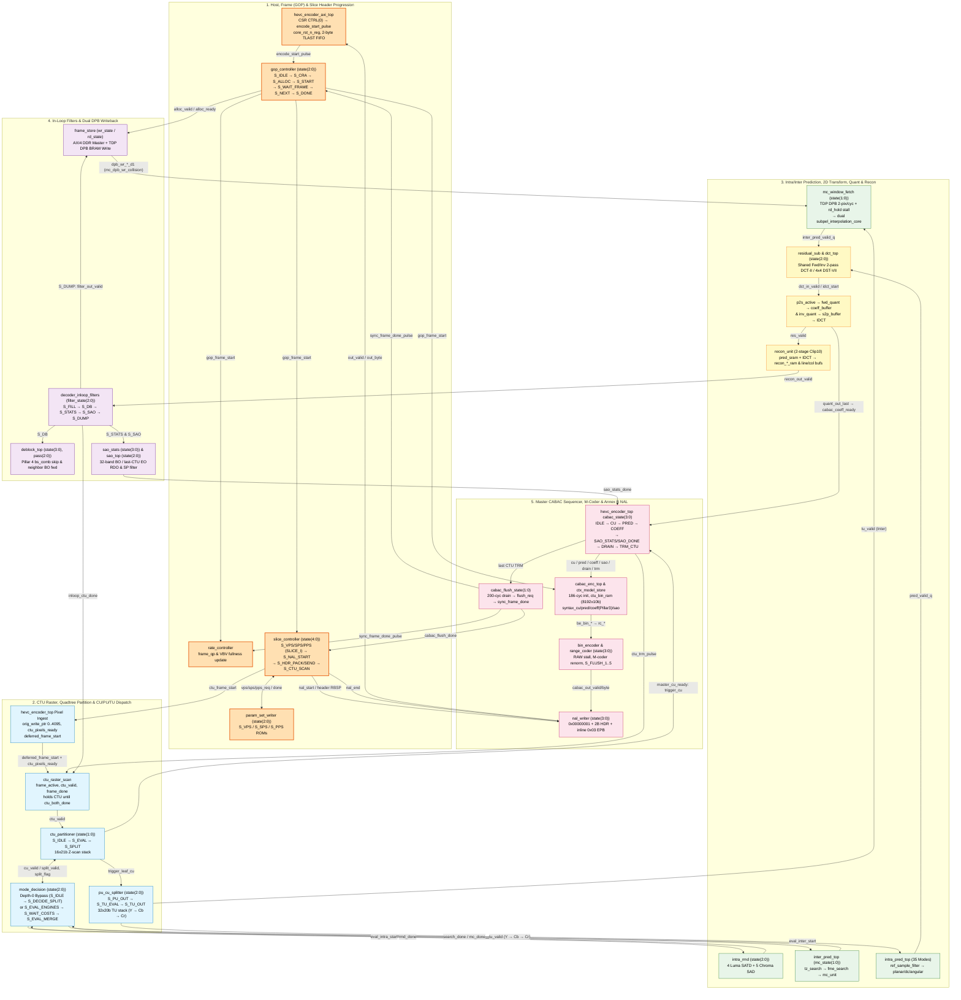

# HEVC Hardware Encoder — Master RTL Finite State Machine (FSM) Reference Index

This master index catalogs every finite state machine (FSM), stateful pipeline, and hardware control sequencer across the synthesizable Verilog/SystemVerilog RTL of the **HEVC/H.265 Main10 Hardware Video Encoder** (`d:\UIT_Doc\hevc_hw_encoder`). All **64 production RTL files** (`60` `.v` + `4` `.vh` in `rtl/`) execute a pure single-path Main10 datapath (`0` `REMEDIATION` directives); historical buggy baselines for the dual-state flaw suite reside exclusively in [`tb/flaw_baseline_rtl/`](file:///d:/UIT_Doc/hevc_hw_encoder/tb/flaw_baseline_rtl).

---

## 1. Subsystem FSM Documentation Suite

| Subsystem | Scope & Key Control Blocks | Sub-Document Link |
| :--- | :--- | :--- |
| **Top-Level & Control** | SoC AXI4-Lite/AXIS wrapper, GOP sequencer, Slice/NAL controller, 2-bank CTU Ping-Pong, 4-entry `cu_fifo`/`tu_meta_fifo`, split CABAC FE/BE FSMs, Dual-master AXI4 read arbiter | [`docs/fsm/top_and_control_fsms.md`](file:///d:/UIT_Doc/hevc_hw_encoder/docs/fsm/top_and_control_fsms.md) |
| **Partitioning & Mode Decision** | CTU raster scan & pixel ingestion, Morton Z-scan quadtree partitioner (`16x21b` stack), Lagrangian RDO mode decision (Depth-0 bypass, `FAST_EARLY_CU_SPLIT`), PU/TU dispatcher (`32x20b` stack), Q8.8 rate estimator | [`docs/fsm/partition_and_mode_decision_fsms.md`](file:///d:/UIT_Doc/hevc_hw_encoder/docs/fsm/partition_and_mode_decision_fsms.md) |
| **Intra Prediction** | `150 MHz`-pipelined 4-mode Luma (`0,1,10,26`) + 5-cand Chroma RMD (`4x4`-tiled Hadamard SATD with ping-pong residual banks), 2-stage WHT core, 35-mode dispatcher, reference smoothing filter, Planar, DC, Angular (`2..34`) | [`docs/fsm/intra_prediction_fsms.md`](file:///d:/UIT_Doc/hevc_hw_encoder/docs/fsm/intra_prediction_fsms.md) |
| **Inter Prediction & MC** | L0/L1/BI MC sequencer & client arbiter, `128x128` Luma `ref_search_cache`, AXI4 ref loader (`4x4` Luma bypass), TZ search & 3-stage `sad_4x4`, FME refinement, `mc_unit`, Pillar 1 TDP `mc_window_fetch` (`rd_hold` stall), 2-stage sub-pel FIR, AMVP/Merge predictor | [`docs/fsm/inter_prediction_fsms.md`](file:///d:/UIT_Doc/hevc_hw_encoder/docs/fsm/inter_prediction_fsms.md) |
| **Transform, Quant, Recon, DPB & RC** | 2-pass row-serial 2D DCT-II / `4x4` DST-VII, 1D core & transpose RAM, `fwd_quant`/`inv_quant`, MDCS `address_generator` + P2S/S2P scanners, `residual_sub`, `recon_unit`, AXI4 `frame_store`, VBV `rate_controller`, `lambda_calc` | [`docs/fsm/transform_quant_recon_fsms.md`](file:///d:/UIT_Doc/hevc_hw_encoder/docs/fsm/transform_quant_recon_fsms.md) |
| **In-Loop Filters (DB & SAO)** | 2-bank CTU Ping-Pong `decoder_inloop_filters` + output skid buffer, 6-pass `deblock_top` (`bs_comb` skip, 2-stage `db_filter_luma`, write-skip), `sao_stats` BO/EO RDO, `sao_top` 2-phase SP BRAM controller & EO/BO cores | [`docs/fsm/inloop_filters_fsms.md`](file:///d:/UIT_Doc/hevc_hw_encoder/docs/fsm/inloop_filters_fsms.md) |
| **CABAC Entropy & NAL Framing** | `cabac_enc_top` dual-bank `ctu_bin_ram_0/1` (`2x 8192x10b`, `drain_prefetched_valid`), 186-ctx `ctx_model_store`, `bin_encoder` RAW stall, `syntax_cu`, `syntax_pred`, `syntax_coeff` (17-cyc `S_LOAD_CG` + Pillar 3 Zero-CG skip), `syntax_sao`, `range_coder`, `param_set_writer`, `nal_writer` | [`docs/fsm/entropy_and_nal_fsms.md`](file:///d:/UIT_Doc/hevc_hw_encoder/docs/fsm/entropy_and_nal_fsms.md) |

---

## 2. Top-Level Inter-FSM Handshake Progression

The diagram below traces the exact RTL control handshakes across the full encoding progression: **Frame (`gop_controller`) &rarr; Slice (`slice_controller`) &rarr; CTU (`ctu_raster_scan`) &rarr; CU/PU/TU (`ctu_partitioner`, `mode_decision`, `pu_cu_splitter`) &rarr; Prediction / Transform / Reconstruction (`intra_*`, `inter_*`, `dct_top`, `fwd_quant`/`inv_quant`, `recon_unit`) &rarr; In-Loop Filter (`decoder_inloop_filters`, `deblock_top`, `sao_stats`, `sao_top`, `frame_store`) &rarr; CABAC / NAL (`cabac_state`, `cabac_enc_top`, `range_coder`, `nal_writer`, `hevc_encoder_axi_top`)**.

---

## 3. Complete RTL FSM & Stateful Controller Catalogue

This catalogue covers every enumerated FSM and stateful hardware control unit across all core RTL blocks under `rtl/`.

### 3.1 Top-Level, System & Arbitration Control (`docs/fsm/top_and_control_fsms.md`)

| Module Path | State Register & Width | State Count | Encoding List | Purpose | Sub-Document Link |
| :--- | :--- | :---: | :--- | :--- | :--- |
| [`rtl/top/hevc_encoder_axi_top.v`](file:///d:/UIT_Doc/hevc_hw_encoder/rtl/top/hevc_encoder_axi_top.v) | `axi_awready`, `axi_wready`, `axi_bvalid`, `axi_arready`, `axi_rvalid`, `reg_busy`, `reg_done`, `irq_status`, `core_rst_n_reg` (1-bit ea); `bitstream_cnt[1:0]`, `bitstream_frame_ending` (1-bit) | 5 FIFO modes + CSR flags | `bitstream_cnt` `0..2`, `bitstream_frame_ending` `0..1`; CSR `0x00..0x24` | AMBA AXI4-Lite CSR/W1C-IRQ slave, glitch-free soft reset synchronizer, and 2-entry `m_axis_bitstream` `TLAST` staging FIFO | [`top_and_control_fsms.md`](file:///d:/UIT_Doc/hevc_hw_encoder/docs/fsm/top_and_control_fsms.md#2-hevc_encoder_axi_topv--soc-axi4-lite-w1c-irq--axi4-stream-wrapper) |
| [`rtl/top/gop_controller.v`](file:///d:/UIT_Doc/hevc_hw_encoder/rtl/top/gop_controller.v) | `state[2:0]`, `next_state[2:0]` | 7 | `S_IDLE(3'd0)`, `S_CRA(3'd1)`, `S_ALLOC(3'd2)`, `S_START(3'd3)`, `S_WAIT_FRAME(3'd4)`, `S_NEXT(3'd5)`, `S_DONE(3'd6)` | Frame-level GOP sequencing, POC/slice-type (`I/P/B`) generation, and `frame_store` DPB slot alloc/free | [`top_and_control_fsms.md`](file:///d:/UIT_Doc/hevc_hw_encoder/docs/fsm/top_and_control_fsms.md#3-gop_controllerv--frame-level-gop-poc--dpb-slot-fsm) |
| [`rtl/top/slice_controller.v`](file:///d:/UIT_Doc/hevc_hw_encoder/rtl/top/slice_controller.v) | `state[4:0]`, `next_state[4:0]` | 16 | `S_IDLE(5'd0)`, `S_VPS_START(1)`, `S_VPS_SEND(2)`, `S_VPS_WAIT(3)`, `S_SPS_START(4)`, `S_SPS_SEND(5)`, `S_SPS_WAIT(6)`, `S_PPS_START(7)`, `S_PPS_SEND(8)`, `S_PPS_WAIT(9)`, `S_NAL_START(10)`, `S_HDR_PACK(11)`, `S_HDR_SEND(12)`, `S_CTU_SCAN(13)`, `S_WAIT_NAL_END(14)`, `S_DONE(15)` | Parameter set (`VPS`/`SPS`/`PPS`) emission (`nal_ready`-gated waits), `slice_cases.vh` header packing/streaming, and slice NAL termination | [`top_and_control_fsms.md`](file:///d:/UIT_Doc/hevc_hw_encoder/docs/fsm/top_and_control_fsms.md#4-slice_controllerv--parameter-set-slice-header--nal-fsm) |
| [`rtl/top/hevc_encoder_top.v`](file:///d:/UIT_Doc/hevc_hw_encoder/rtl/top/hevc_encoder_top.v) *(Master CABAC)* | `cabac_state[3:0]` | 10 active (`4'd7..8` reserved) | `CABAC_IDLE(4'd0)`, `CABAC_WAIT_CU_DONE(1)`, `CABAC_WAIT_PRED(2)`, `CABAC_WAIT_PRED_DONE(3)`, `CABAC_WAIT_COEFF(4)`, `CABAC_TRM_CTU(5)`, `CABAC_WAIT_COEFF_DONE(6)`, `CABAC_WAIT_SAO_DONE(9)`, `CABAC_WAIT_SAO_STATS(10)`, `CABAC_DRAIN_CTU_BINS(11)` | Master CU/Pred/Coeff/SAO/CTU-Bin-Drain/CTU-Terminate sequencer (`tu_cg_nonzero_mask_*` Pillar 3 control, full Y/Cb/Cr AMVP lockstep) | [`top_and_control_fsms.md`](file:///d:/UIT_Doc/hevc_hw_encoder/docs/fsm/top_and_control_fsms.md#51-master-cabacctucutu-control-fsm-cabac_state30) |
| [`rtl/top/hevc_encoder_top.v`](file:///d:/UIT_Doc/hevc_hw_encoder/rtl/top/hevc_encoder_top.v) *(Flush Timer)* | `cabac_flush_state[1:0]`, `cabac_idle_timer[7:0]` | 4 | `2'd0` (Idle), `2'd1` (Drain 1: 100 cyc), `2'd2` (Drain 2 + `cabac_flush_pulse`: 100 cyc), `2'd3` (Flushed Hold) | Post-slice 200-cycle drain timer issuing `flush_req` to `range_coder` | [`top_and_control_fsms.md`](file:///d:/UIT_Doc/hevc_hw_encoder/docs/fsm/top_and_control_fsms.md#52-post-slice-cabac-flush-timer-fsm-cabac_flush_state10) |
| [`rtl/top/hevc_encoder_top.v`](file:///d:/UIT_Doc/hevc_hw_encoder/rtl/top/hevc_encoder_top.v) *(TU / DPB / Sync)* | `reg_tu_comp[1:0]`, `tu_can_start`, `p2s_active`, `idct_start_pending`, `idct_active`, `idct_p2s_active`, `dpb_wr_*_d1`, `ctu_pixels_ready`, `ctu_buffer_free`, `inloop_done_pending`, `cabac_done_pending` | Stateful interlocks | `reg_tu_comp`: `2'd0`(Y), `2'd1`(Cb), `2'd2`(Cr); 1-bit flags | Y/Cb/Cr TU sequencing, shared `dct_top` arbitration, Pillar 1 TDP DPB Port-A mux (`mc_dpb_wr_collision`), `ctu_both_done`, `sync_frame_done_pulse` | [`top_and_control_fsms.md`](file:///d:/UIT_Doc/hevc_hw_encoder/docs/fsm/top_and_control_fsms.md#53-tu-sequencing-reg_tu_comp-transformrecon-interlocks--pillar-3-cg-masking) |
| [`rtl/common/axi_read_arbiter.v`](file:///d:/UIT_Doc/hevc_hw_encoder/rtl/common/axi_read_arbiter.v) | `active_read` (1-bit), `sel` (1-bit) | 3 reachable modes (`{active_read, sel}`) | `2'b0x` (Idle AR Arb), `2'b10` (Port 0 Lock: `inter_pred_top`), `2'b11` (Port 1 Lock: `frame_store`) | Fixed-priority (`P0 > P1`) single-outstanding AXI4 read burst lock arbiter | [`top_and_control_fsms.md`](file:///d:/UIT_Doc/hevc_hw_encoder/docs/fsm/top_and_control_fsms.md#6-axi_read_arbiterv--dual-master-l0l1-axi4-read-lock-arbiter) |

### 3.2 Partitioning & Mode Decision (`docs/fsm/partition_and_mode_decision_fsms.md`)

| Module Path | State Register & Width | State Count | Encoding List | Purpose | Sub-Document Link |
| :--- | :--- | :---: | :--- | :--- | :--- |
| [`rtl/partition/ctu_raster_scan.v`](file:///d:/UIT_Doc/hevc_hw_encoder/rtl/partition/ctu_raster_scan.v) | `frame_active`, `ctu_valid`, `frame_done` (1-bit ea); `cur_x/y[5:0]`, `cur_addr[12:0]` | 3 implicit phases | `IDLE` (`frame_active=0`), `SCAN_WAIT_ACK` (`frame_active=1, ctu_valid=1`), `FRAME_DONE_PULSE` (`frame_done=1`) | Frame CTU raster scan coordinate generation and `ctu_both_done` pacing | [`partition_and_mode_decision_fsms.md`](file:///d:/UIT_Doc/hevc_hw_encoder/docs/fsm/partition_and_mode_decision_fsms.md#2-ctu_raster_scan--ctu-pixel-ingestion-control) |
| [`rtl/partition/ctu_partitioner.v`](file:///d:/UIT_Doc/hevc_hw_encoder/rtl/partition/ctu_partitioner.v) | `state[1:0]`, `sp[3:0]` | 3 (`2'd1` reserved) | `S_IDLE(2'd0)`, `S_EVAL(2'd2)`, `S_SPLIT(2'd3)` | Top-down Morton Z-scan quadtree traversal (`64->32->16->8`) using `16x21`-bit LIFO stack | [`partition_and_mode_decision_fsms.md`](file:///d:/UIT_Doc/hevc_hw_encoder/docs/fsm/partition_and_mode_decision_fsms.md#3-ctu_partitioner-rtlpartitionctu_partitionerv) |
| [`rtl/partition/mode_decision.v`](file:///d:/UIT_Doc/hevc_hw_encoder/rtl/partition/mode_decision.v) | `state[2:0]`, `next_state[2:0]` | 7 | `S_IDLE(3'd0)`, `S_EVAL_ENGINES(3'd1)`, `S_WAIT_COSTS(3'd2)`, `S_EVAL_MERGE(3'd3)`, `S_COMPARE_MODE(3'd4)`, `S_DECIDE_SPLIT(3'd5)`, `S_DONE(3'd6)` | Lagrangian RDO (Merge vs Intra vs AMVP), Depth-0 `64x64` bit-exact bypass, and `FAST_EARLY_CU_SPLIT` split decision | [`partition_and_mode_decision_fsms.md`](file:///d:/UIT_Doc/hevc_hw_encoder/docs/fsm/partition_and_mode_decision_fsms.md#4-mode_decision-rtlpartitionmode_decisionv) |
| [`rtl/partition/pu_cu_splitter.v`](file:///d:/UIT_Doc/hevc_hw_encoder/rtl/partition/pu_cu_splitter.v) | `state[2:0]`, `tu_sp[4:0]` | 5 | `S_IDLE(3'd0)`, `S_PU_OUT(3'd1)`, `S_TU_EVAL(3'd2)`, `S_TU_WAIT(3'd3)`, `S_TU_OUT(3'd4)` | Leaf-CU PU & TU quadtree dispatching (`32x20`-bit LIFO stack) with 4:2:0 `Y -> Cb -> Cr` Chroma scheduling | [`partition_and_mode_decision_fsms.md`](file:///d:/UIT_Doc/hevc_hw_encoder/docs/fsm/partition_and_mode_decision_fsms.md#5-pu_cu_splitter-rtlpartitionpu_cu_splitterv) |
| [`rtl/partition/rate_estimator.v`](file:///d:/UIT_Doc/hevc_hw_encoder/rtl/partition/rate_estimator.v) | None (combinational `always @(*)`) | 0-cycle comb | 4 mode branches: Intra (`5/6/10b`), Inter Skip (`3..6b`), Inter Merge (`5..8b`), Inter AMVP (`5 + EG-1 MVD`) | Combinational Q8.8 syntax bit-cost estimation for `mode_decision` | [`partition_and_mode_decision_fsms.md`](file:///d:/UIT_Doc/hevc_hw_encoder/docs/fsm/partition_and_mode_decision_fsms.md#6-rate_estimator-rtlpartitionrate_estimatorv) |

### 3.3 Intra Prediction (`docs/fsm/intra_prediction_fsms.md`)

| Module Path | State Register & Width | State Count | Encoding List | Purpose | Sub-Document Link |
| :--- | :--- | :---: | :--- | :--- | :--- |
| [`rtl/intra/intra_rmd.v`](file:///d:/UIT_Doc/hevc_hw_encoder/rtl/intra/intra_rmd.v) | `state[2:0]`, `next_state[2:0]` | 5 (`REMEDIATION`) / 4 (Legacy) | `REMEDIATION`: `S_IDLE(3'd0)`, `S_LOAD_REF(1)`, `S_EVAL(2)`, `S_HADAMARD(3)`, `S_DONE(4)` (Legacy: `S_DONE=3'd3`) | 4-mode Luma (`Planar=0, DC=1, Hor=10, Ver=26`) `4x4`-tiled Hadamard SATD across `4x4..32x32` (`wr_bank`/`rd_bank` ping-pong) + 5-cand Chroma RDO | [`intra_prediction_fsms.md`](file:///d:/UIT_Doc/hevc_hw_encoder/docs/fsm/intra_prediction_fsms.md#2-intra_rmd-rtlintraintra_rmdv) |
| [`rtl/common/hadamard_satd_4x4.v`](file:///d:/UIT_Doc/hevc_hw_encoder/rtl/common/hadamard_satd_4x4.v) | `stg1_valid`, `done` (1-bit ea) | 2 pipe stages | Stage 1 (`row_t[0:15]` `signed[12:0]`) &rarr; Stage 2 (`col_t` `signed[14:0]`, `satd_out[15:0]`) | 2-cycle 2D 4x4 Walsh-Hadamard SATD engine (4 parallel instances in `intra_rmd`) | [`intra_prediction_fsms.md`](file:///d:/UIT_Doc/hevc_hw_encoder/docs/fsm/intra_prediction_fsms.md#3-hadamard_satd_4x4-rtlcommonhadamard_satd_4x4v) |
| [`rtl/intra/intra_pred_top.v`](file:///d:/UIT_Doc/hevc_hw_encoder/rtl/intra/intra_pred_top.v) | `{pu_size_log2_r, intra_mode_r, is_luma_r}` + comb mux | Latched on `ref_idx == 0` | `sel_planar` (`0`), `sel_dc` (`1`), `sel_ang` (`2..34`) | 35-mode final Intra predictor demux/mux chaining `ref_sample_filter` into `planar`/`dc`/`angular` | [`intra_prediction_fsms.md`](file:///d:/UIT_Doc/hevc_hw_encoder/docs/fsm/intra_prediction_fsms.md#4-intra_pred_top-rtlintraintra_pred_topv) |
| [`rtl/intra/ref_sample_filter.v`](file:///d:/UIT_Doc/hevc_hw_encoder/rtl/intra/ref_sample_filter.v) | `buf_full`, `buf_last`, `flushing`, `out_valid`, `out_last` (1-bit ea) | 4 implicit phases | `IN_FILL`, `ARM`, `STREAM`, `WAIT_ACK` (`out_ptr[7:0]`, `buf_count[7:0]`) | `4N+1` reference ring buffer, `[1,2,1]/4` 3-tap smoothing, and `32x32` strong bilinear smoothing | [`intra_prediction_fsms.md`](file:///d:/UIT_Doc/hevc_hw_encoder/docs/fsm/intra_prediction_fsms.md#5-ref_sample_filter-rtlintraref_sample_filterv) |
| [`rtl/intra/intra_planar.v`](file:///d:/UIT_Doc/hevc_hw_encoder/rtl/intra/intra_planar.v) | `state[1:0]` | 2 | `S_REF_BUF(2'd0)`, `S_COMPUTE(2'd1)` | HEVC Mode 0 bilinear Planar prediction (`4x4..32x32`) | [`intra_prediction_fsms.md`](file:///d:/UIT_Doc/hevc_hw_encoder/docs/fsm/intra_prediction_fsms.md#6-intra_planar-rtlintraintra_planarv) |
| [`rtl/intra/intra_dc.v`](file:///d:/UIT_Doc/hevc_hw_encoder/rtl/intra/intra_dc.v) | `state[1:0]` | 3 | `S_REF_ACC(2'd0)`, `S_DC_CALC(2'd1)`, `S_OUTPUT(2'd2)` | HEVC Mode 1 DC average & Luma `4x4..16x16` border filtering | [`intra_prediction_fsms.md`](file:///d:/UIT_Doc/hevc_hw_encoder/docs/fsm/intra_prediction_fsms.md#7-intra_dc-rtlintraintra_dcv) |
| [`rtl/intra/intra_angular.v`](file:///d:/UIT_Doc/hevc_hw_encoder/rtl/intra/intra_angular.v) | `state[1:0]` | 3 | `S_BUF(2'd0)`, `S_EXTEND(2'd1)`, `S_OUTPUT(2'd2)` | Unified directional prediction (`2..34`) with negative-angle `refExt` extension and H/V transposition | [`intra_prediction_fsms.md`](file:///d:/UIT_Doc/hevc_hw_encoder/docs/fsm/intra_prediction_fsms.md#8-intra_angular-rtlintraintra_angularv) |

### 3.4 Inter Prediction & Motion Compensation (`docs/fsm/inter_prediction_fsms.md`)

| Module Path | State Register & Width | State Count | Encoding List | Purpose | Sub-Document Link |
| :--- | :--- | :---: | :--- | :--- | :--- |
| [`rtl/inter/inter_pred_top.v`](file:///d:/UIT_Doc/hevc_hw_encoder/rtl/inter/inter_pred_top.v) | `mc_state[1:0]`, `active_client[1:0]` | 3 (`2'd3` reserved) | `MC_S_IDLE(2'd0)`, `MC_S_L0(2'd1)`, `MC_S_L1(2'd2)`; `active_client`: `0=TZ`, `1=FME`, `2=MC` | L0/L1/BI MC sequencer (`u_mc_unit`, bypassed at top level), fixed-priority ref arbiter (`MC > FME > TZ`), and `4x4` TZ bypass control | [`inter_prediction_fsms.md`](file:///d:/UIT_Doc/hevc_hw_encoder/docs/fsm/inter_prediction_fsms.md#2-inter_pred_top-rtlinterinter_pred_topv) |
| [`rtl/inter/ref_frame_buffer.v`](file:///d:/UIT_Doc/hevc_hw_encoder/rtl/inter/ref_frame_buffer.v) | `state[3:0]` | 8 (`4'd7` reserved) | `S_IDLE(4'd0)`, `S_INIT(1)`, `S_ROW_AR1(2)`, `S_ROW_R1(3)`, `S_ROW_AR2(4)`, `S_ROW_R2(5)`, `S_ROW_STORE(6)`, `S_DONE(8)` | AXI4 DDR reference window fetcher with border clamping and `4x4` Luma bypass (`ref_req_is_4x4_safe`) | [`inter_prediction_fsms.md`](file:///d:/UIT_Doc/hevc_hw_encoder/docs/fsm/inter_prediction_fsms.md#3-ref_frame_buffer-rtlinterref_frame_bufferv) |
| [`rtl/inter/tz_search.v`](file:///d:/UIT_Doc/hevc_hw_encoder/rtl/inter/tz_search.v) | `state[3:0]` | 11 (`4'd10` reserved) | `S_IDLE(4'd0)`, `S_INIT(1)`, `S_REQ_REF(2)`, `S_WAIT_REF(3)`, `S_SAD_S1(4)`, `S_SAD_S2(5)`, `S_SAD_S3(6)`, `S_CMP(7)`, `S_NEXT_PT(8)`, `S_NEXT_STEP(9)`, `S_DONE(11)` | Integer-pel Test Zone diamond/square search (`mvp +/- 32`) with `sad_out == 0` early exit | [`inter_prediction_fsms.md`](file:///d:/UIT_Doc/hevc_hw_encoder/docs/fsm/inter_prediction_fsms.md#4-tz_search--sad_4x4-rtlintertz_searchv-rtlintersad_4x4v) |
| [`rtl/inter/sad_4x4.v`](file:///d:/UIT_Doc/hevc_hw_encoder/rtl/inter/sad_4x4.v) | `s1_valid`, `s2_valid`, `valid_r` (1-bit ea) | 3 pipe stages | Stage 1 (`16x abs`), Stage 2 (`4x row_sum`), Stage 3 (`total >>> 2`) | 3-cycle pipelined 4x4 Main10 SAD evaluator for `tz_search` and `fme_search` | [`inter_prediction_fsms.md`](file:///d:/UIT_Doc/hevc_hw_encoder/docs/fsm/inter_prediction_fsms.md#4-tz_search--sad_4x4-rtlintertz_searchv-rtlintersad_4x4v) |
| [`rtl/inter/fme_search.v`](file:///d:/UIT_Doc/hevc_hw_encoder/rtl/inter/fme_search.v) | `state[3:0]` | 7 (`4'd7` reserved) | `S_IDLE(4'd0)`, `S_REQ(1)`, `S_WAIT_REF(2)`, `S_HPEL_FEED(3)`, `S_HPEL_WAIT(4)`, `S_QPEL_FEED(5)`, `S_QPEL_WAIT(6)` | 12x12 Luma fetch + 8-point half-pel (`+/-2` qpel) and 8-point quarter-pel (`+/-1` qpel) refinement | [`inter_prediction_fsms.md`](file:///d:/UIT_Doc/hevc_hw_encoder/docs/fsm/inter_prediction_fsms.md#5-fme_search-rtlinterfme_searchv) |
| [`rtl/inter/mc_unit.v`](file:///d:/UIT_Doc/hevc_hw_encoder/rtl/inter/mc_unit.v) | `state[3:0]` | 11 | `S_IDLE(4'd0)`, `S_FETCH_Y(1)`, `S_WAIT_Y(2)`, `S_FILT_Y(3)`, `S_FETCH_CB(4)`, `S_WAIT_CB(5)`, `S_FILT_CB(6)`, `S_FETCH_CR(7)`, `S_WAIT_CR(8)`, `S_FILT_CR(9)`, `S_DONE(10)` | Sequential Y (`11x11`) &rarr; Cb (`5x5`) &rarr; Cr (`5x5`) AXI-backed 4x4/2x2 motion compensation | [`inter_prediction_fsms.md`](file:///d:/UIT_Doc/hevc_hw_encoder/docs/fsm/inter_prediction_fsms.md#6-mc_unit-rtlintermc_unitv) |
| [`rtl/inter/mc_window_fetch.v`](file:///d:/UIT_Doc/hevc_hw_encoder/rtl/inter/mc_window_fetch.v) | `state[1:0]`, `reg_mode[1:0]`, `pipe1_mode`/`pipe2_mode[1:0]` | 3 FSM states + 4 fetch modes | `state`: `S_IDLE(2'd0)`, `S_ACTIVE(1)`, `S_WAIT_LAST(2)`; `reg_mode`: `M_0D(0)`, `M_1DH(1)`, `M_1DV(2)`, `M_2D(3)`; `PMODE_WRITE(0)`, `PMODE_1DH_SHIFT(1)` | Pillar 1 TDP 2-sample/cycle DPB sliding-window fetcher with `rd_hold` stall, `next_win` bypass, and `row0_win` reuse | [`inter_prediction_fsms.md`](file:///d:/UIT_Doc/hevc_hw_encoder/docs/fsm/inter_prediction_fsms.md#7-mc_window_fetch-rtlintermc_window_fetchv--pillar-1-tdp-engine) |
| [`rtl/inter/subpel_interpolation_core.v`](file:///d:/UIT_Doc/hevc_hw_encoder/rtl/inter/subpel_interpolation_core.v) | `s1_valid`, `valid_out` (1-bit ea) | 2 pipe stages | Stage 1 (H/V/0D FIR) &rarr; Stage 2 (2D V FIR + mode mux) | 1-sample/cycle H.265 8-tap Luma / 4-tap Chroma unclipped 16-bit interpolation (L0 & L1 instances) | [`inter_prediction_fsms.md`](file:///d:/UIT_Doc/hevc_hw_encoder/docs/fsm/inter_prediction_fsms.md#81-subpel_interpolation_core-rtlintersubpel_interpolation_corev) |
| [`rtl/inter/mvp_predictor.v`](file:///d:/UIT_Doc/hevc_hw_encoder/rtl/inter/mvp_predictor.v) | `valid_out` (1-bit reg) | 1-cycle registered | Combinational `amvp_left/above` & `merge_derive` &rarr; 1-cycle output latch | Spatial (`A0,A1,B0,B1,B2`) AMVP (2 cands) and Merge (`N_MERGE=5`) list construction | [`inter_prediction_fsms.md`](file:///d:/UIT_Doc/hevc_hw_encoder/docs/fsm/inter_prediction_fsms.md#82-mvp_predictor-rtlintermvp_predictorv) |

### 3.5 Transform, Quantization, Reconstruction, Frame Store & Rate Control (`docs/fsm/transform_quant_recon_fsms.md`)

| Module Path | State Register & Width | State Count | Encoding List | Purpose | Sub-Document Link |
| :--- | :--- | :---: | :--- | :--- | :--- |
| [`rtl/transform/dct_top.v`](file:///d:/UIT_Doc/hevc_hw_encoder/rtl/transform/dct_top.v) | `state[2:0]` | 8 | `S_IDLE(3'd0)`, `S_ROW_FEED(1)`, `S_ROW_WAIT(2)`, `S_ROW_DONE(3)`, `S_COL_PREP(4)`, `S_COL_FEED(5)`, `S_COL_WAIT(6)`, `S_DONE(7)` | Shared forward/inverse 2-pass 2D DCT-II (`4x4..32x32`) & `4x4` Luma DST-VII controller (`2N+6` cycles) | [`transform_quant_recon_fsms.md`](file:///d:/UIT_Doc/hevc_hw_encoder/docs/fsm/transform_quant_recon_fsms.md#21-dct_top-row-serial-2d-fsm-state20) |
| [`rtl/transform/transform_1d_core.v`](file:///d:/UIT_Doc/hevc_hw_encoder/rtl/transform/transform_1d_core.v) & [`rtl/transform/transpose_ram_32x32.v`](file:///d:/UIT_Doc/hevc_hw_encoder/rtl/transform/transpose_ram_32x32.v) | `out_valid` (1-bit elastic), `rd_vec[511:0]` | 1-stage elastic + 1-cyc RAM | `in_ready = out_ready \| ~out_valid`; `shift_val[4:0]` dynamic schedule | 1D 4..32-pt DCT-II / 4-pt DST-VII butterfly engine and 32x32x16b transpose RAM | [`transform_quant_recon_fsms.md`](file:///d:/UIT_Doc/hevc_hw_encoder/docs/fsm/transform_quant_recon_fsms.md#22-transform_1d_corev--transpose_ram_32x32v-pipeline-control) |
| [`rtl/quant/fwd_quant.v`](file:///d:/UIT_Doc/hevc_hw_encoder/rtl/quant/fwd_quant.v) | `out_valid`, `cbf_accum` (1-bit ea) | 1-stage elastic | `in_ready = out_ready \| ~out_valid`; `cbf_accum` sticky per TU | Deadzone scalar forward quantization + per-TU `out_cbf` tracking | [`transform_quant_recon_fsms.md`](file:///d:/UIT_Doc/hevc_hw_encoder/docs/fsm/transform_quant_recon_fsms.md#31-fwd_quantv-elastic-pipeline--cbf-accumulator) |
| [`rtl/quant/inv_quant.v`](file:///d:/UIT_Doc/hevc_hw_encoder/rtl/quant/inv_quant.v) | `out_valid` (1-bit elastic) | 1-stage elastic | `in_ready = out_ready \| ~out_valid`; bidirectional `do_right_shift` | Inverse scaling & dequantization feeding `s2p_buffer` and IDCT | [`transform_quant_recon_fsms.md`](file:///d:/UIT_Doc/hevc_hw_encoder/docs/fsm/transform_quant_recon_fsms.md#32-inv_quantv-elastic-dequantization-pipeline) |
| [`rtl/top/address_generator.v`](file:///d:/UIT_Doc/hevc_hw_encoder/rtl/top/address_generator.v) | None (comb LUT; top `p2s_active`, `idct_p2s_active`) | 0-cycle comb | `scan_mode`: `0=Diag`, `1=Horiz`, `2=Vert` across `4x4..32x32` | HEVC MDCS coefficient scan coordinate lookup (`u_addr_gen`, `u_s2p_addr_gen`) | [`transform_quant_recon_fsms.md`](file:///d:/UIT_Doc/hevc_hw_encoder/docs/fsm/transform_quant_recon_fsms.md#4-mdcs-scan-coordinate-generation-address_generatorv--top-level-p2ss2p-scanners) |
| [`rtl/recon/residual_sub.v`](file:///d:/UIT_Doc/hevc_hw_encoder/rtl/recon/residual_sub.v) | `res_valid` (1-bit reg) | 1-cycle pipe | `res_valid <= orig_valid & active_pred_valid` | 11-bit signed `Orig - Pred` residual subtraction | [`transform_quant_recon_fsms.md`](file:///d:/UIT_Doc/hevc_hw_encoder/docs/fsm/transform_quant_recon_fsms.md#51-residual_subv-align-and-subtract-stage) |
| [`rtl/recon/recon_unit.v`](file:///d:/UIT_Doc/hevc_hw_encoder/rtl/recon/recon_unit.v) | `res_valid_q`, `out_valid` (1-bit ea) | 2-stage pipe | Stage 1 (`pred_sram` read) &rarr; Stage 2 (`Clip3(0, 1023, pred + res)`) | Main10 pixel reconstruction with `4096x10b` `pred_sram` and `res_ready = out_ready` | [`transform_quant_recon_fsms.md`](file:///d:/UIT_Doc/hevc_hw_encoder/docs/fsm/transform_quant_recon_fsms.md#52-recon_unitv-2-stage-clip1-main10-reconstruction-pipeline) |
| [`rtl/recon/frame_store.v`](file:///d:/UIT_Doc/hevc_hw_encoder/rtl/recon/frame_store.v) *(Write DMA)* | `wr_state[1:0]`, `beat_dirty` (1-bit) | 4 | `WR_IDLE(2'd0)`, `WR_AW(2'd1)`, `WR_W(2'd2)`, `WR_B(2'd3)` | Packs 16 pixels/beat into 256-bit AXI4 single-beat DDR writes (`axi_wstrb`) + `line_cache` write | [`transform_quant_recon_fsms.md`](file:///d:/UIT_Doc/hevc_hw_encoder/docs/fsm/transform_quant_recon_fsms.md#62-axi4-write-dma-fsm-wr_state10) |
| [`rtl/recon/frame_store.v`](file:///d:/UIT_Doc/hevc_hw_encoder/rtl/recon/frame_store.v) *(Read DMA)* | `rd_state[1:0]`, `slot_valid[7:0]`, `slot_ready[7:0]` | 4 | `RD_IDLE(2'd0)`, `RD_ADDR(2'd1)`, `RD_DATA(2'd2)`, `RD_OUT(2'd3)` | 8-slot DPB manager and AXI4 single-beat DDR reader with intra-beat cache hits & edge replication | [`transform_quant_recon_fsms.md`](file:///d:/UIT_Doc/hevc_hw_encoder/docs/fsm/transform_quant_recon_fsms.md#63-axi4-read-dma-fsm-rd_state10--on-chip-ctu-line-cache) |
| [`rtl/rate_control/rate_controller.v`](file:///d:/UIT_Doc/hevc_hw_encoder/rtl/rate_control/rate_controller.v) | `current_qp_r[5:0]`, `rc_active_d`, `vbv_buffer_bits[31:0]`, `vbv_fullness_pct[15:0]` | Persistent VBV state | `SLICE_B(0)`, `SLICE_P(1)`, `SLICE_I(2)`; QP step `+/-3, +/-1` (`[11..51]`) | Closed-loop VBV virtual buffer fullness tracking & frame-level QP control | [`transform_quant_recon_fsms.md`](file:///d:/UIT_Doc/hevc_hw_encoder/docs/fsm/transform_quant_recon_fsms.md#71-rate_controllerv-frame-level-vbv--qp-state-machine) |
| [`rtl/rate_control/lambda_calc.v`](file:///d:/UIT_Doc/hevc_hw_encoder/rtl/rate_control/lambda_calc.v) | None (combinational LUT) | 0-cycle comb | 52-entry QP (`0..51`, default `32`) LUT (`REMEDIATION` Main10 vs Legacy) | Combinational `lambda_mode`, `lambda_motion`, and Table 8-10 `lambda_chroma` lookup | [`transform_quant_recon_fsms.md`](file:///d:/UIT_Doc/hevc_hw_encoder/docs/fsm/transform_quant_recon_fsms.md#72-lambda_calcv-combinational-lagrangian-multiplier-lut) |

### 3.6 In-Loop Filters: Deblocking & SAO (`docs/fsm/inloop_filters_fsms.md`)

| Module Path | State Register & Width | State Count | Encoding List | Purpose | Sub-Document Link |
| :--- | :--- | :---: | :--- | :--- | :--- |
| [`rtl/top/decoder_inloop_filters.v`](file:///d:/UIT_Doc/hevc_hw_encoder/rtl/top/decoder_inloop_filters.v) | `filter_state[2:0]` | 5 | `S_FILL(3'd0)`, `S_DB(3'd1)`, `S_STATS(3'd2)`, `S_SAO(3'd3)`, `S_DUMP(3'd4)` | Exclusive per-CTU BRAM arbiter orchestrating fill, DB, SAO RDO, SAO filter, neighbor BO forwarding, and DPB dump | [`inloop_filters_fsms.md`](file:///d:/UIT_Doc/hevc_hw_encoder/docs/fsm/inloop_filters_fsms.md#2-decoder_inloop_filters-rtltopdecoder_inloop_filtersv) |
| [`rtl/inloop_filters/deblock_top.v`](file:///d:/UIT_Doc/hevc_hw_encoder/rtl/inloop_filters/deblock_top.v) | `state[3:0]`, `pass[2:0]` | 9 active (`REMEDIATION`, 10 `localparam`s) & 6 passes | `state`: `S_IDLE(4'd0)`, `S_BS_REQ(1)`, `S_PIX_LOAD(3)`, `S_FILT_WAIT(4)`, `S_PIX_WRITE(5)`, `S_NEXT_EDGE(6)`, `S_NEXT_PASS(7)`, `S_DONE(8)`, `S_FILT_PUSH(9)` (+ legacy `S_BS_WAIT(2)`); `pass`: `PASS_LUMA_VERT(0)`..`PASS_CR_HORIZ(5)` | 6-pass CTU deblocking controller with Pillar 4 1-cycle `bs_comb==0` fast-skip, `+2/+4` grid stepping, 1-sample/cyc load, and write-skip | [`inloop_filters_fsms.md`](file:///d:/UIT_Doc/hevc_hw_encoder/docs/fsm/inloop_filters_fsms.md#3-deblocking-filter-deblock_top-boundary_strength-db_filter_luma-db_filter_chroma) |
| [`rtl/inloop_filters/boundary_strength.v`](file:///d:/UIT_Doc/hevc_hw_encoder/rtl/inloop_filters/boundary_strength.v) | `out_valid` (1-bit elastic) + comb `bs_comb[1:0]` | Comb + 1-stage reg | `bs_comb`: `2'd0` (none), `2'd1` (inter), `2'd2` (intra) | Combinational boundary strength & `qp_avg_comb` (used directly by Pillar 4 `deblock_top`) + registered legacy interface | [`inloop_filters_fsms.md`](file:///d:/UIT_Doc/hevc_hw_encoder/docs/fsm/inloop_filters_fsms.md#32-state-encoding--responsibility-table) |
| [`rtl/inloop_filters/db_filter_luma.v`](file:///d:/UIT_Doc/hevc_hw_encoder/rtl/inloop_filters/db_filter_luma.v) | `wr_bank`, `rd_bank`, `b_ready[0:1]`, `wr_idx[1:0]`, `rd_idx[1:0]` | 2-bank × 4-line ping-pong | `in_ready = !b_ready[wr_bank]`; strong/weak 4-line decision at `wr_idx == 3` | 4-line HEVC Luma deblocking decision and strong/weak pixel filter | [`inloop_filters_fsms.md`](file:///d:/UIT_Doc/hevc_hw_encoder/docs/fsm/inloop_filters_fsms.md#32-state-encoding--responsibility-table) |
| [`rtl/inloop_filters/db_filter_chroma.v`](file:///d:/UIT_Doc/hevc_hw_encoder/rtl/inloop_filters/db_filter_chroma.v) | `s1_valid`, `out_valid` (1-bit ea) | 2-stage elastic pipe | `in_ready = !s1_valid \|\| (out_ready \| ~out_valid)`; filters iff `bs == 2` | 2-stage Chroma `p0/q0` deblocking filter (`QP` clamped `>51`, `tc_idx` clamped `>53`) | [`inloop_filters_fsms.md`](file:///d:/UIT_Doc/hevc_hw_encoder/docs/fsm/inloop_filters_fsms.md#32-state-encoding--responsibility-table) |
| [`rtl/inloop_filters/sao_stats.v`](file:///d:/UIT_Doc/hevc_hw_encoder/rtl/inloop_filters/sao_stats.v) | `state[3:0]`, `comp[1:0]` | 13 (`REMEDIATION`) / 1-cyc stub (Legacy) | `S_IDLE(4'd0)`, `S_COMP_INIT(1)`, `S_SCAN(2)`, `S_FLUSH(3)`, `S_OPT_LOAD(4)`, `S_OPT_DIV(5)`, `S_OPT_ITER_A(6)`, `S_OPT_ITER_B(7)`, `S_OPT_NEXT(8)`, `S_BO_SWEEP_A(9)`, `S_BO_SWEEP_B(10)`, `S_COMP_DECIDE(11)`, `S_DONE(12)` | Sequential `Y -> Cb -> Cr` 32-band BO RDO (all CTUs w/ border-skip) + 4-class EO RDO (last CTU), `[-15,+15]` clamp, joint Cb+Cr decision | [`inloop_filters_fsms.md`](file:///d:/UIT_Doc/hevc_hw_encoder/docs/fsm/inloop_filters_fsms.md#4-sao-statistics--rdo-optimizer-sao_statsv) |
| [`rtl/inloop_filters/sao_top.v`](file:///d:/UIT_Doc/hevc_hw_encoder/rtl/inloop_filters/sao_top.v) | `state[2:0]`, `comp_idx[1:0]` | 6 active (`MODE=1`, 8 `localparam`s) | `S_IDLE(3'd0)`, `S_REQ_PIX(1)`, `S_REQ_N1(2)`, `S_WAIT_PIX(3)`, `S_FILTER(5)`, `S_DONE(7)`; legacy `MODE=0` also uses `S_APPLY(4)`, `S_WRITE(6)` | 2-phase single-port BRAM neighbor read (`EO_45` right-border `n0_rd_valid`), internal row cache, BO fast-path, `NONE` skip | [`inloop_filters_fsms.md`](file:///d:/UIT_Doc/hevc_hw_encoder/docs/fsm/inloop_filters_fsms.md#5-sao-filter-controller-sao_topv-sao_edge_offsetv-sao_band_offsetv) |
| [`rtl/inloop_filters/sao_edge_offset.v`](file:///d:/UIT_Doc/hevc_hw_encoder/rtl/inloop_filters/sao_edge_offset.v) & [`rtl/inloop_filters/sao_band_offset.v`](file:///d:/UIT_Doc/hevc_hw_encoder/rtl/inloop_filters/sao_band_offset.v) | `out_valid` (1-bit elastic) | 1-stage pipe | `in_ready = out_ready \| ~out_valid` | EO 5-category (`0..4`) offset add/clip and BO 32-band (`pixel[9:5] - band_pos < 4`) offset add/clip | [`inloop_filters_fsms.md`](file:///d:/UIT_Doc/hevc_hw_encoder/docs/fsm/inloop_filters_fsms.md#52-state-encoding--responsibility-table) |

### 3.7 Entropy Coding & Annex B NAL Writer (`docs/fsm/entropy_and_nal_fsms.md`)

| Module Path | State Register & Width | State Count | Encoding List | Purpose | Sub-Document Link |
| :--- | :--- | :---: | :--- | :--- | :--- |
| [`rtl/entropy/cabac_enc_top.v`](file:///d:/UIT_Doc/hevc_hw_encoder/rtl/entropy/cabac_enc_top.v) | `bin_wr_ptr[12:0]`, `bin_rd_ptr[12:0]`, `drain_prefetched_valid` (1-bit) | Queue + Drain pipe | `ctu_bin_ram[0:8191]` (`8192x10b`); priority `ss_bin_valid > drain_bin_valid` when `ctu_sao_delay_en=1` | MPM calculation, CTU-delayed bin buffering (`sao()` before `coding_quadtree()`), 1-cycle lookahead drain, bin muxing | [`entropy_and_nal_fsms.md`](file:///d:/UIT_Doc/hevc_hw_encoder/docs/fsm/entropy_and_nal_fsms.md#2-cabac_enc_topv--bin-arbitration-ctu_bin_ram-drain--top-level-cabac-sequencer) |
| [`rtl/entropy/ctx_model_store.v`](file:///d:/UIT_Doc/hevc_hw_encoder/rtl/entropy/ctx_model_store.v) | `init_busy` (1-bit), `init_cnt[7:0]` | 2 modes (`186`-cyc init) | `init_busy=1` (`init_cnt` `8'd0..8'd185`), `init_busy=0` (active read/write across `ctx 0..185`) | **186** × 7-bit (`{pStateIdx[5:0], valMPS}`) CABAC context table, 186-cycle `init_tables.vh` slice initialization | [`entropy_and_nal_fsms.md`](file:///d:/UIT_Doc/hevc_hw_encoder/docs/fsm/entropy_and_nal_fsms.md#3-ctx_model_storev--186-context-model-store--init-sequencer) |
| [`rtl/entropy/bin_encoder.v`](file:///d:/UIT_Doc/hevc_hw_encoder/rtl/entropy/bin_encoder.v) | `upd_valid` (1-bit), `upd_ctx_id[7:0]`, `upd_bin` (1-bit) | 2-phase pipe | `bin_rdy_out = !init_busy && !raw_hazard && rc_bin_ready` | 0-cycle `ctx_model_store` lookup, 1-cycle same-context RAW hazard stall, 1-cycle registered context write-back | [`entropy_and_nal_fsms.md`](file:///d:/UIT_Doc/hevc_hw_encoder/docs/fsm/entropy_and_nal_fsms.md#4-bin_encoderv--context-lookup-raw-hazard-stall--dispatch-stage) |
| [`rtl/entropy/syntax_cu.v`](file:///d:/UIT_Doc/hevc_hw_encoder/rtl/entropy/syntax_cu.v) | `state[4:0]` | 13 (`5'd12` reserved) | `S_IDLE(5'd0)`, `S_SPLIT(1)`, `S_SKIP(2)`, `S_MERGE_FLAG(3)`, `S_MERGE_IDX0..3(4..7)`, `S_PRED_MODE(8)`, `S_PART0..2(9..11)`, `S_DONE(13)` | CU-level binarization (`split_cu_flag`, `cu_skip_flag`, `merge_flag/idx`, `pred_mode_flag`, `part_mode`) | [`entropy_and_nal_fsms.md`](file:///d:/UIT_Doc/hevc_hw_encoder/docs/fsm/entropy_and_nal_fsms.md#5-syntax_cuv--cu-level-cabac-syntax-fsm-state40-14-states) |
| [`rtl/entropy/syntax_pred.v`](file:///d:/UIT_Doc/hevc_hw_encoder/rtl/entropy/syntax_pred.v) | `state[4:0]` | 32 | `S_IDLE(5'd0)`, `S_INTER_DIR(1)`, `S_INTER_DIR_B1(2)`, `S_REF0_BIN0..EP(3..5)`, `S_MVD0_X_*(6..9)`, `S_MVD0_Y_*(10..13)`, `S_MVP0(14)`, `S_REF1_BIN0..EP(15..17)`, `S_MVD1_X_*(18..21)`, `S_MVD1_Y_*(22..25)`, `S_MVP1(26)`, `S_INTRA_PREV(27)`, `S_INTRA_MPM(28)`, `S_INTRA_REM(29)`, `S_INTRA_CHROMA(30)`, `S_DONE(31)` | Intra Luma/Chroma prediction mode & interleaved Inter `inter_dir`/`ref_idx`/EG-1 `mvd`/`mvp` binarization | [`entropy_and_nal_fsms.md`](file:///d:/UIT_Doc/hevc_hw_encoder/docs/fsm/entropy_and_nal_fsms.md#6-syntax_predv--prediction-syntax-fsm-state40-32-states) |
| [`rtl/entropy/syntax_coeff.v`](file:///d:/UIT_Doc/hevc_hw_encoder/rtl/entropy/syntax_coeff.v) | `state[4:0]`, `c1_state[1:0]`, `ctx_set[1:0]` | 22 defined (`5'd17` unassigned) | `S_IDLE(5'd0)`, `S_LAST_X_PRE(1)`, `S_LAST_X_SUF(2)`, `S_LAST_Y_PRE(3)`, `S_LAST_Y_SUF(4)`, `S_SIG_SCAN(5)`, `S_GT1_SCAN(6)`, `S_GT2(7)`, `S_SIGN_SCAN(8)`, `S_REM_SCAN(9)`, `S_REM_EG(10)`, `S_TU_DONE(11)`, `S_STUB_SPLIT(12)`, `S_STUB_CBFCB0(13)`, `S_STUB_CBFCR0(14)`, `S_STUB_CBFLUMA(15)`, `S_STUB_ROOT(16)`, `S_STUB_CBFCB1(18)`, `S_STUB_CBFCR1(19)`, `S_LOAD_CG_REQ(20)`, `S_LOAD_CG_WAIT(21)`, `S_CG_FLAG(22)` | TU CBF/split stubs, `last_sig_x/y`, reverse-scan 4x4 CG binarization with all 4 Pillar 3 Zero-CG fast-skip safeguards | [`entropy_and_nal_fsms.md`](file:///d:/UIT_Doc/hevc_hw_encoder/docs/fsm/entropy_and_nal_fsms.md#7-syntax_coeffv--residual--coefficient-group-scan-fsm-state40--c1_state10) |
| [`rtl/entropy/syntax_sao.v`](file:///d:/UIT_Doc/hevc_hw_encoder/rtl/entropy/syntax_sao.v) | `state[3:0]` | 9 | `S_IDLE(4'd0)`, `S_MERGE_LEFT(1)`, `S_MERGE_UP(2)`, `S_TYPE(3)`, `S_OFFSET_ABS(4)`, `S_OFFSET_SIGN(5)`, `S_BAND_POS(6)`, `S_EO_CLASS(7)`, `S_DONE(8)` | Per-CTU SAO syntax binarization (`cMax=31` offsets, shared Cb/Cr type & EO class) | [`entropy_and_nal_fsms.md`](file:///d:/UIT_Doc/hevc_hw_encoder/docs/fsm/entropy_and_nal_fsms.md#8-syntax_saov--sao-syntax-fsm-state30-9-states) |
| [`rtl/entropy/range_coder.v`](file:///d:/UIT_Doc/hevc_hw_encoder/rtl/entropy/range_coder.v) | `state[3:0]`, `ret_state[3:0]` | 9 | `S_READY(4'd0)`, `S_RENORM(1)`, `S_WRITEOUT_LEAD(2)`, `S_WRITEOUT_FF(3)`, `S_FLUSH_1(4)`, `S_FLUSH_2(5)`, `S_FLUSH_3(6)`, `S_FLUSH_4(7)`, `S_FLUSH_5(8)` | HEVC M-coder interval coding, LZC LPS renormalization, `0xFF` carry propagation, terminating bin & slice flush | [`entropy_and_nal_fsms.md`](file:///d:/UIT_Doc/hevc_hw_encoder/docs/fsm/entropy_and_nal_fsms.md#9-range_coderv--m-coder-arithmetic-engine-state30--ret_state30-9-states) |
| [`rtl/entropy/param_set_writer.v`](file:///d:/UIT_Doc/hevc_hw_encoder/rtl/entropy/param_set_writer.v) | `state[2:0]` | 4 | `S_IDLE(3'd0)`, `S_VPS(3'd1)`, `S_SPS(3'd2)`, `S_PPS(3'd3)` | Pre-computed Main10 VPS (`18 B`), SPS (`24..27 B`), and PPS (`4 B`) RBSP ROM streamer | [`entropy_and_nal_fsms.md`](file:///d:/UIT_Doc/hevc_hw_encoder/docs/fsm/entropy_and_nal_fsms.md#101-param_set_writerv-state20-4-states) |
| [`rtl/input_output/nal_writer.v`](file:///d:/UIT_Doc/hevc_hw_encoder/rtl/input_output/nal_writer.v) | `state[3:0]`, `nal_end_pending` | 6 (`4'd5` retired) | `S_IDLE(4'd0)`, `S_START_CODE(1)`, `S_NAL_HDR0(2)`, `S_NAL_HDR1(3)`, `S_RBSP(4)`, `S_DONE(6)` | Annex B `00 00 00 01` start codes, 2-byte NAL headers, inline `0x03` EPB, `nal_ready`, and `nal_end_pending` under stalls | [`entropy_and_nal_fsms.md`](file:///d:/UIT_Doc/hevc_hw_encoder/docs/fsm/entropy_and_nal_fsms.md#102-nal_writerv-state30-7-localparams--6-active-states) |

---

## 4. Verification Summary

- **RTL Cross-Check:** All 7 sub-documents under `docs/fsm/` were spot-checked directly against the corresponding `rtl/**/*.v` source files (exact state register names, bit-widths, `localparam` encodings, active vs. unreachable state encodings, transition guards, reset semantics, backpressure, and 4-Pillar optimization hooks).
- **Documentation & Mermaid Validation (`python scripts/check_docs.py --strict --check-build-outputs`):**
  - **Exit Code:** `0`
  - **Total Markdown Files Evaluated:** `29`
  - **Total Mermaid Diagrams Validated:** `82`
  - **Syntax / Lint Issues:** `0`
  - **Broken-Path / Stale-Claim Warnings:** `0`
