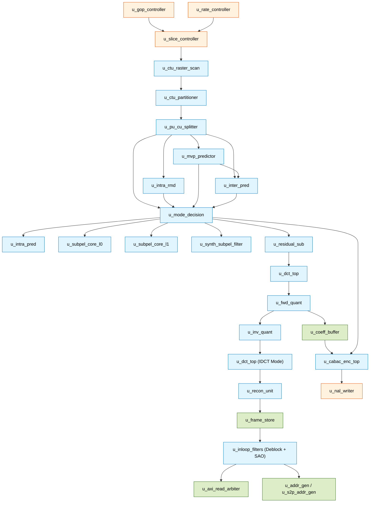

# HEVC Top-Level Port Connection & Interface Specification

## 1. Architectural Scope

This document details the hardware interface definitions, signal widths, handshakes, register mappings, and internal submodule interconnects for the **HEVC Hardware Video Encoder Top**:
1. **Core Top-Level**: [`hevc_encoder_top`](file:///d:/UIT_Doc/hevc_hw_encoder/rtl/top/hevc_encoder_top.v) (`rtl/top/hevc_encoder_top.v`) — Synthesizable hardware video encoder engine integrating prediction, transform, quantization, in-loop filtering, and CABAC entropy modules.
2. **SoC Top Wrapper**: [`hevc_encoder_axi_top`](file:///d:/UIT_Doc/hevc_hw_encoder/rtl/top/hevc_encoder_axi_top.v) (`rtl/top/hevc_encoder_axi_top.v`) — System-on-Chip integration wrapper providing AXI4-Lite control registers, AXI4-Stream video input/output, AXI4 memory master, and interrupt lines.
3. **Internal Subsystem Interconnect**: Comprehensive signal wiring matrix across the **27 instantiated hardware module instances** (23 distinct module architectures) inside `hevc_encoder_top.v`.

---

## 2. Core Top-Level: `hevc_encoder_top.v` Port Map

```mermaid
graph LR
    classDef clk fill:#fff3e0,stroke:#e65100,stroke-width:1px,color:#000;
    classDef ctrl fill:#e1f5fe,stroke:#0277bd,stroke-width:1px,color:#000;
    classDef video fill:#f1f8e9,stroke:#33691e,stroke-width:1px,color:#000;
    classDef stream fill:#fce4ec,stroke:#880e4f,stroke-width:1px,color:#000;
    classDef axi fill:#ede7f6,stroke:#4a148c,stroke-width:1px,color:#000;
    classDef top fill:#ffe0b2,stroke:#bf360c,stroke-width:2px,color:#000;

    TOP["hevc_encoder_top<br/>(Core Engine)"]:::top

    CLK["clk, rst_n"]:::clk --> TOP
    HOST["encode_start, total_frames&#91;15:0&#93;"]:::ctrl --> TOP
    TOP --> STAT["encode_done, frame_done"]:::ctrl

    VIN["in_valid, in_pixel_y/u/v&#91;9:0&#93;"]:::video --> TOP
    TOP --> VREADY["in_ready"]:::video

    TOP --> BOUT["out_valid, out_byte&#91;7:0&#93;"]:::stream
    BIN["out_ready"]:::stream --> TOP

    TOP --> AXI_WR["axi_awvalid, axi_awaddr&#91;32:0&#93;, axi_wdata&#91;255:0&#93;..."]:::axi
    AXI_RD["axi_rvalid, axi_rdata&#91;255:0&#93;..."]:::axi --> TOP

    CFG["cfg_base_qp&#91;5:0&#93;, cfg_gop_structure&#91;1:0&#93;, cfg_rc_enable..."]:::ctrl --> TOP
    TOP --> VBV["status_vbv_fullness_pct&#91;15:0&#93;"]:::ctrl
```

### 2.1 Elaboration Parameters
| Parameter | Type | Default Value | Description |
|:---|:---|:---|:---|
| `FRAME_WIDTH` | Integer | ``DEFAULT_FRAME_WIDTH` (128) | Frame width in luma pixels (Supported: 64, 128, 256, 1920, 3840). |
| `FRAME_HEIGHT` | Integer | ``DEFAULT_FRAME_HEIGHT` (128) | Frame height in luma pixels (Supported: 64, 128, 256, 1080, 1088, 2160). |
| `GOP_STRUCTURE` | Integer | ``DEFAULT_GOP_STRUCTURE` (1) | 0: IPP, 1: IPBB (Low-Delay B), 2: Hierarchical Random Access B. |
| `BASE_QP` | `[5:0]` | ``QP_DEFAULT` (29) | Baseline quantization parameter ($0..51$). |
| `RC_ENABLE` | Bit | ``RATE_CONTROL` (0) | 1: Enable VBV rate controller, 0: Use fixed base QP. |
| `TARGET_BITRATE_KBPS`| `[15:0]` | ``TARGET_BITRATE_DEFAULT` (5000)| Target bitrate in kbps for rate control. |

### 2.2 Core Port Specifications Table (`hevc_encoder_top.v`)
| Port Name | Dir | Width | Active State / Protocol | Description |
|:---|:---:|:---:|:---|:---|
| **Global Clock & Reset** | | | | |
| `clk` | In | 1 | Rising edge | Main system and processing clock. |
| `rst_n` | In | 1 | Low async/sync | Active-low global asynchronous reset. |
| **Host Control** | | | | |
| `encode_start` | In | 1 | High pulse / level | Strobe to initiate encoding session. |
| `total_frames` | In | 16 | Unsigned integer | Total number of frames to encode before asserting `encode_done`. |
| `encode_done` | Out | 1 | High level | Asserted when the entire multi-frame session completes. |
| `frame_done` | Out | 1 | High pulse | Strobe asserted for 1 cycle upon completion of each individual frame. |
| **Video Input Stream (YUV 4:2:0)** | | | | |
| `in_valid` | In | 1 | High level | Indicates valid pixel input samples. |
| `in_ready` | Out | 1 | High level | Backpressure signal from encoder input buffer to video source. |
| `in_pixel_y` | In | 10 | Unsigned [9:0] | 10-bit raw luma sample ($Y$). |
| `in_pixel_u` | In | 10 | Unsigned [9:0] | 10-bit raw blue-difference chroma sample ($Cb/U$). |
| `in_pixel_v` | In | 10 | Unsigned [9:0] | 10-bit raw red-difference chroma sample ($Cr/V$). |
| **Bitstream Output Stream** | | | | |
| `out_valid` | Out | 1 | High level | Valid output byte indicator. |
| `out_ready` | In | 1 | High level | Ready handshake from downstream consumer / DMA FIFO. |
| `out_byte` | Out | 8 | Hex [7:0] | Compressed HEVC Annex B byte stream. |
| **AXI4 DRAM Master (Write Address Channel)** | | | | |
| `axi_awvalid` | Out | 1 | High level | Write address valid. |
| `axi_awready` | In | 1 | High level | Slave write address ready. |
| `axi_awaddr` | Out | 33 | Byte address [32:0] | External DRAM write target address (supports up to 8 GB). |
| `axi_awlen` | Out | 8 | Unsigned [7:0] | Burst length = beats - 1 (e.g. 8'd3 for 4-beat burst). |
| `axi_awsize` | Out | 3 | Constant 3'b101 | Burst size = 32 bytes ($256\text{ bits}$). |
| `axi_awburst` | Out | 2 | Constant 2'b01 | Burst type = INCR (incremental). |
| **AXI4 DRAM Master (Write Data Channel)** | | | | |
| `axi_wvalid` | Out | 1 | High level | Write data valid. |
| `axi_wready` | In | 1 | High level | Slave write data ready. |
| `axi_wdata` | Out | 256 | Data bus [255:0] | 256-bit write data payload (reconstructed frame samples). |
| `axi_wstrb` | Out | 32 | Byte enables [31:0] | Active-high write strobe per byte (typically `32'hFFFF_FFFF`). |
| `axi_wlast` | Out | 1 | High pulse | Indicates last transfer in write burst. |
| **AXI4 DRAM Master (Write Response Channel)** | | | | |
| `axi_bvalid` | In | 1 | High level | Write response valid. |
| `axi_bready` | Out | 1 | High level | Master ready to accept write response. |
| **AXI4 DRAM Master (Read Address Channel)** | | | | |
| `axi_arvalid` | Out | 1 | High level | Read address valid. |
| `axi_arready` | In | 1 | High level | Slave read address ready. |
| `axi_araddr` | Out | 33 | Byte address [32:0] | External DRAM read source address for reference frames. |
| `axi_arlen` | Out | 8 | Unsigned [7:0] | Read burst length. |
| `axi_arsize` | Out | 3 | Constant 3'b101 | Read burst size = 32 bytes ($256\text{ bits}$). |
| `axi_arburst` | Out | 2 | Constant 2'b01 | Burst type = INCR. |
| **AXI4 DRAM Master (Read Data Channel)** | | | | |
| `axi_rvalid` | In | 1 | High level | Read data valid. |
| `axi_rready` | Out | 1 | High level | Master ready to accept read data beat. |
| `axi_rdata` | In | 256 | Data bus [255:0] | 256-bit read data payload from external DRAM. |
| `axi_rlast` | In | 1 | High pulse | Indicates last transfer in read burst. |
| **Runtime Configuration & Status** | | | | |
| `cfg_base_qp` | In | 6 | Range [0..51] | Dynamic override for base QP. |
| `cfg_gop_structure` | In | 2 | Enum [1:0] | Dynamic override for GOP pattern (0: IPP, 1: IPBB, 2: Hierarchical B). |
| `cfg_rc_enable` | In | 1 | Boolean | Dynamic enable for rate controller. |
| `cfg_target_bitrate_kbps`| In | 16 | kbps | Dynamic target bitrate. |
| `cfg_sao_enable` | In | 1 | Boolean | Enable/disable in-loop Sample Adaptive Offset (SAO). |
| `status_vbv_fullness_pct`| Out| 16 | Percentage [0..100] | Current VBV virtual buffer occupancy percentage. |

---

## 3. SoC Top Wrapper: `hevc_encoder_axi_top.v` Architecture & Ports

[`hevc_encoder_axi_top.v`](file:///d:/UIT_Doc/hevc_hw_encoder/rtl/top/hevc_encoder_axi_top.v) wraps `hevc_encoder_top` for seamless integration into ARM Cortex-A / RISC-V SoC environments via standard AXI4 buses.

### 3.1 AXI4-Lite Control & Status Registers (Base Address + Offset)
| Offset | Register Name | Access | Reset Default | Bitfield Definitions |
|:---|:---|:---:|:---:|:---|
| `0x00` | `CONTROL` | RW | `0x00000000` | `bit [0]`: **START** (Write 1 triggers `encode_start` single-cycle pulse; self-clearing) `bit [1]`: **SOFT_RESET** (Active-high soft reset to core) `bit [2]`: **IRQ_EN** (1 = Enable interrupt assertion on frame/session completion) |
| `0x04` | `STATUS` | RO | `0x00000004` | `bit [0]`: **DONE** (Encoding session completed) `bit [1]`: **BUSY** (Encoder core currently active) `bit [2]`: **READY** (Encoder idle, ready for start pulse) |
| `0x08` | `IRQ_STATUS` | RW1C | `0x00000000` | `bit [0]`: **IRQ_PENDING** (Read: interrupt pending; Write 1: acknowledge/clear interrupt) |
| `0x0C` | `TOTAL_FRAMES` | RW | `0x00000001` | `bits [15:0]`: `total_frames` to encode before asserting `encode_done` |
| `0x10` | `BASE_QP` | RW | `BASE_QP` param | `bits [5:0]`: Base quantization parameter ($0..51$) |
| `0x14` | `GOP_STRUCTURE` | RW | `GOP_STRUCT` param| `bits [1:0]`: 0=IPP, 1=IPBB (Low-Delay B), 2=Hierarchical B |
| `0x18` | `TARGET_BITRATE`| RW | `BITRATE` param | `bits [15:0]`: Target bitrate in kbps |
| `0x1C` | `MAGIC_ID / FEATURE_EN` | RW | Read: `0x48455643` | **Read**: ASCII string **"HEVC"** (`0x48455643`) **Write**: `bit [0]`: `reg_rc_enable`, `bit [1]`: `reg_sao_enable` |
| `0x20` | `RESOLUTION` | RO | Packed params | `bits [31:16]`: `FRAME_WIDTH` `bits [15:0]`: `FRAME_HEIGHT` |
| `0x24` | `VBV_FULLNESS` | RO | `0x00000000` | `bits [15:0]`: `status_vbv_fullness_pct` ($0..100\%$) |

### 3.2 SoC Wrapper External Interfaces (`hevc_encoder_axi_top.v`)
| Interface Group | Port Names | Width | Direction | Protocol / Standard | Description |
|:---|:---|:---:|:---:|:---|:---|
| **Clock & Reset** | `clk`, `rst_n` | 1, 1 | In, In | Standard | System clock and active-low asynchronous reset. |
| **AXI4-Lite Slave** | `s_axi_lite_awaddr`, `awprot`, `awvalid`, `awready` | 12, 3, 1, 1 | In, In, In, Out | AXI4-Lite | Address write channel for host register programming. |
| | `s_axi_lite_wdata`, `wstrb`, `wvalid`, `wready` | 32, 4, 1, 1 | In, In, In, Out | AXI4-Lite | Data write channel with byte strobes. |
| | `s_axi_lite_bresp`, `bvalid`, `bready` | 2, 1, 1 | Out, Out, In | AXI4-Lite | Write response handshake (OKAY = 2'b00). |
| | `s_axi_lite_araddr`, `arprot`, `arvalid`, `arready` | 12, 3, 1, 1 | In, In, In, Out | AXI4-Lite | Address read channel. |
| | `s_axi_lite_rdata`, `rresp`, `rvalid`, `rready` | 32, 2, 1, 1 | Out, Out, Out, In | AXI4-Lite | Data read channel. |
| **AXI4-Stream Video Input** | `s_axis_video_tdata` | 32 | In | AXI4-Stream | Packed YUV 4:2:0 pixel streaming interface. |
| | `s_axis_video_tvalid`, `tready` | 1, 1 | In, Out | AXI4-Stream | Stream handshake with backpressure. |
| | `s_axis_video_tlast`, `tuser` | 1, 1 | In, In | AXI4-Stream | End-of-line (`tlast`) and Start-of-frame (`tuser`) markers. |
| **AXI4-Stream Bitstream** | `m_axis_bitstream_tdata` | 8 | Out | AXI4-Stream | Compressed HEVC Annex B byte output stream. |
| | `m_axis_bitstream_tvalid`, `tready` | 1, 1 | Out, In | AXI4-Stream | Valid/ready handshaking to DMA buffer. |
| | `m_axis_bitstream_tlast` | 1 | Out | AXI4-Stream | High on final byte of frame / access unit. |
| **AXI4 Master Memory** | `m_axi_mem_awid`, `awaddr`, `awlen`, `awsize`, `awburst`, `awlock`, `awcache`, `awprot`, `awqos`, `awvalid`, `awready` | 1, 33, 8, 3, 2, 1, 4, 3, 4, 1, 1 | Out (except ready In) | AXI4 Full Master | Write address channel targeting external DRAM reference buffers. |
| | `m_axi_mem_wdata`, `wstrb`, `wlast`, `wvalid`, `wready` | 256, 32, 1, 1, 1 | Out (except ready In) | AXI4 Full Master | 256-bit write data channel for reconstructed frame pixels. |
| | `m_axi_mem_bid`, `bresp`, `bvalid`, `bready` | 1, 2, 1, 1 | In, In, In, Out | AXI4 Full Master | Write response channel. |
| | `m_axi_mem_arid`, `araddr`, `arlen`, `arsize`, `arburst`, `arlock`, `arcache`, `arprot`, `arqos`, `arvalid`, `arready` | 1, 33, 8, 3, 2, 1, 4, 3, 4, 1, 1 | Out (except ready In) | AXI4 Full Master | Read address channel for reference frame fetching. |
| | `m_axi_mem_rid`, `rdata`, `rresp`, `rlast`, `rvalid`, `rready` | 1, 256, 2, 1, 1, 1 | In (except ready Out) | AXI4 Full Master | 256-bit read data payload from external DRAM. |
| **Interrupt Output** | `irq` | 1 | Out | Level | Active-high interrupt asserted on frame or session completion. |

---

## 4. Internal Subsystem Interconnect Matrix

Inside `hevc_encoder_top.v`, **27 core module instances** (representing 23 distinct module architectures) are interconnected across control, partitioning, prediction, transform, in-loop filtering, and entropy coding pipelines.

### Complete 27-Instance Interconnect Wiring Specification

| # | Instance Name | Module Name | Primary Inputs (Sources) | Primary Outputs (Sinks) | Bus Widths & Functional Description |
|:---|:---|:---|:---|:---|:---|
| 1 | `u_gop_controller` | `gop_controller` | `clk`, `rst_n`, `encode_start`, `total_frames`, `sync_frame_done_pulse`, `cfg_gop_structure` | `gop_frame_start`, `gop_frame_poc`, `gop_frame_slice_type`, `alloc_slot`, `ref_l0/l1` | Controls multi-frame GOP hierarchy ($I, P, B$), assigns POC, allocates DPB slots ($0..7$). |
| 2 | `u_slice_controller` | `slice_controller` | `gop_frame_start`, `gop_frame_slice_type`, `frame_qp` | `slice_header_valid`, `ctu_frame_start`, `slice_frame_done` | Generates slice-level header syntax and triggers CTU raster scanning. |
| 3 | `u_rate_controller` | `rate_controller` | `cfg_rc_enable`, `cfg_base_qp`, `target_bitrate_kbps`, `actual_frame_bits` | `rc_frame_qp`, `rc_slice_qp_delta`, `status_vbv_fullness_pct` | Computes dynamic frame QP and monitors VBV buffer fullness via dividerless shift logic. |
| 4 | `u_ctu_raster_scan` | `ctu_raster_scan` | `ctu_frame_start`, `ctu_ready` | `ctu_x`, `ctu_y`, `ctu_addr`, `ctu_valid` | Traverses frame in $64\times 64$ CTUs in raster order. |
| 5 | `u_ctu_partitioner` | `ctu_partitioner` | `ctu_valid`, `split_flag`, `split_valid` | `cu_x`, `cu_y`, `cu_size`, `cu_depth`, `cu_valid` | Recursively partitions $64\times 64$ CTUs into CUs ($64\to 32\to 16\to 8$) using FEN early stop. |
| 6 | `u_pu_cu_splitter` | `pu_cu_splitter` | `cu_valid`, `cu_size`, `cu_depth` | `pu_x`, `pu_y`, `tu_valid`, `tu_size_log2` | Decomposes CUs into Prediction Units (PUs) and Transform Units (TUs). |
| 7 | `u_mvp_predictor` | `mvp_predictor` | `pu_valid`, `cu_x/y`, `neighbor_mv_line_buf`, `col_ref_mv` | `amvp_mv_x_flat`, `amvp_mv_y_flat` | Derives spatial and temporal AMVP candidates ($A_0, A_1, B_0, B_1, B_2, \text{Col}$). |
| 8 | `u_mode_decision` | `mode_decision` | `intra_rd_cost`, `intra_best_mode`, `best_sad`, `best_mv_x/y`, `merge_cand` | `split_flag`, `best_is_intra`, `best_intra_mode`, `best_inter_mv_x/y`, `best_skip_flag` | Minimizes Lagrangian cost $J = D + \lambda R$; drives FEN early split termination. |
| 9 | `u_residual_sub` | `residual_sub` | `orig_pixel`, `pred_pixel`, `orig_valid`, `pred_valid` | `residual_data` | Subtracts predicted pixel from original sample to form 16-bit residual ($16\text{-bit}$). |
| 10 | `u_intra_rmd` | `intra_rmd` | `orig_samples`, `ref_samples` | `intra_best_mode`, `intra_rd_cost` | Pre-screens all 35 intra modes using $4\times 4$ Hadamard SATD. |
| 11 | `u_inter_pred` | `inter_pred_top` | `search_start`, `cu_orig_flat`, `mvp_x/y`, `ref_slot_in/l1` | `best_mv_x/y`, `best_sad`, `mc_pred_y/cb/cr` | Executes integer TZ search, quarter-pel FME, and bi-prediction MC. |
| 12 | `u_synth_subpel_filter` | `streaming_subpel_filter` | `raw_ref_pixels`, `frac_x/y` | `filtered_subpel_pixels` | Pipelined sub-pel FIR interpolation filter for fractional motion compensation. |
| 13 | `u_subpel_core_l0` | `subpel_interpolation_core` | `ref_stream_l0`, `subpel_phase_x/y` | `interp_pixels_l0` | 8-tap luma / 4-tap chroma sub-pel interpolation engine for List 0. |
| 14 | `u_subpel_core_l1` | `subpel_interpolation_core` | `ref_stream_l1`, `subpel_phase_x/y` | `interp_pixels_l1` | 8-tap luma / 4-tap chroma sub-pel interpolation engine for List 1 (B-frames). |
| 15 | `u_intra_pred` | `intra_pred_top` | `intra_mode`, `pu_size_log2`, `ref_sample` | `intra_pred_pixel`, `out_valid` | Computes Planar (0), DC (1), or Angular (2..34) prediction matrices with 3-tap ref filter. |
| 16 | `u_dct_top` | `dct_top` | `residual_data`, `tu_size_log2`, `is_dst7`, `fwd_inv_n=1` | `dct_out_data` ($32\times 32\times 16$) | 2-pass row-serial transform using `transform_1d_core` and `transpose_ram_32x32`. |
| 17 | `u_addr_gen` | `address_generator` | `ctu_x`, `ctu_y`, `latched_wr_slot` | `axi_awaddr`, `axi_awlen` | Computes byte addresses in DRAM for reconstructed frame writeback. |
| 18 | `u_fwd_quant` | `fwd_quant` | `dct_out_data`, `frame_qp`, `tu_size_log2` | `quant_out_level`, `quant_out_cbf` | Deadzone scalar quantization and Coded Block Flag generation. |
| 19 | `u_inv_quant` | `inv_quant` | `quant_out_level`, `frame_qp` | `inv_quant_out_coeff` | Dequantizes transform coefficients for the local reconstruction feedback loop. |
| 20 | `u_s2p_addr_gen` | `address_generator` | `ref_req_x`, `ref_req_y`, `ref_slot` | `fs_araddr`, `fs_arlen` | Serial-to-parallel memory address generator for reference frame read requests. |
| 21 | `u_recon_unit` | `recon_unit` | `pred_pixel`, `idct_out_data` | `recon_out_pixel` ($10\text{-bit}$) | Reconstructs pixels: $\text{Clip Main10}(\text{Pred} + \text{IDCT}_{\text{res}}) \in [0..1023]$. |
| 22 | `u_inloop_filters` | `decoder_inloop_filters` | `recon_out_pixel`, `cu_map_*`, `nbr_*` | `filt_out_pixel`, `inloop_ctu_done` | Dual in-loop filter subsystem combining `deblock_top` and `sao_top`. |
| 23 | `u_frame_store` | `frame_store` | `recon_out_pixel`, `filt_out_pixel` | `ref_resp_data`, `axi_wdata` | Multi-bank on-chip reconstructed pixel buffer and DMA interface. |
| 24 | `u_axi_read_arbiter` | `axi_read_arbiter` | `fs_arvalid`, `tz_arvalid`, `mc_arvalid` | `axi_arvalid`, `axi_araddr` | Round-robin arbitration for external DRAM read requests across search and filter engines. |
| 25 | `u_coeff_buffer` | `coeff_buffer` | `quant_out_level`, `coeff_rd_addr` | `coeff_rd_data` | Dual-port SRAM buffer decoupling fast Reconstruction from CABAC serialization. |
| 26 | `u_cabac_enc_top` | `cabac_enc_top` | `wire_cu_req`, `pred_req`, `coeff_req`, `sao_req` | `rbsp_byte`, `rbsp_valid` | M-coder entropy coder with 154 contexts, binarizers, and single-cycle renormalization. |
| 27 | `u_nal_writer` | `nal_writer` | `rbsp_byte`, `rbsp_valid`, `nal_type` | `out_byte`, `out_valid` | Packs RBSP into Annex B NAL units with `0x00000001` headers and emulation prevention. |

