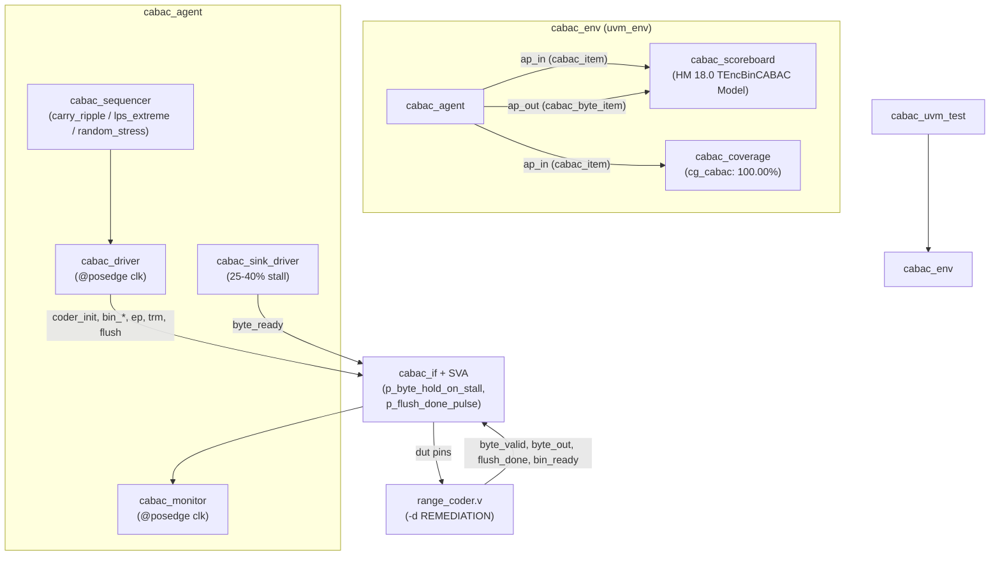
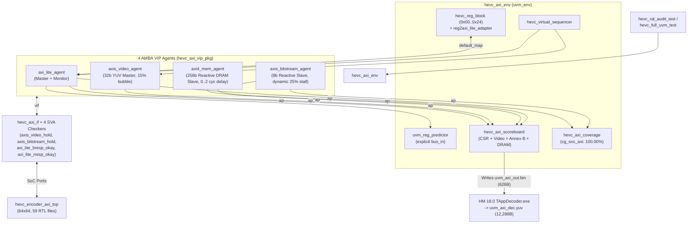

# Gate G8: Dual-Tier UVM 1.2 Verification Plan (`hevc_hw_encoder`)

> **Target RTL:** Synthesizable HEVC / H.265 Main10 Hardware Video Encoder (`rtl/entropy/range_coder.v` and `rtl/top/hevc_encoder_axi_top.v`)  
> **EDA Toolchains:** AMD Vivado 2026.1 Simulator (`xvlog.bat`, `xelab.bat`, `xsim.bat` with `-sv -L uvm -d REMEDIATION`), Siemens **QuestaSim 2021.2_1** (`asiclab` Linux server, UVM-1.1d) / Cadence **Xcelium** (`tool=Cadence`) via [sim/Makefile](file:///d:/UIT_Doc/hevc_hw_encoder/uvm/sim/Makefile), & Fraunhofer **HM 18.0** (`TAppDecoder.exe` / `TAppDecoder`)  
> **Gate Posture:** Zero RTL modifications (`Gate G6` 63/63 SHA-256 parity preserved across `rtl/` and `ip_repo/hevc_encoder_v1_0/src/`).

---

## 1. Overview & Motivation

While Gates **G0–G7** established deterministic 3-frame bit-exact conformance (`max_diff == 0` across `73,728` samples in `Foreman 128x128`), dual-state flaw regression (`28/28` runs), IP packaging parity (`63/63`), and Zynq UltraScale+ `xczu19eg-ffvb1517-2-e` timing closure (`WNS = +10.360 ns`, `Fmax = 103.73 MHz`), directed Verilog testbenches left two major verification gaps:

1. **Block-Level Entropy Exhaustiveness (`range_coder.v`):** Directed tests do not exhaustively cross all `64` CABAC probability states (`pstate 0..63`) with `{MPS, LPS}`, multi-byte `0xFF` carry-ripple buffering chains, and downstream `byte_ready` stalls under formal SVA and functional coverage closure.
2. **SoC AXI Integration & Protocol Stress (`hevc_encoder_axi_top.v`):** The legacy directed testbench ([tb_hevc_encoder_axi_top.sv](file:///d:/UIT_Doc/hevc_hw_encoder/tb/tb_axi_top/tb_hevc_encoder_axi_top.sv)) permanently hardcodes `m_axis_bitstream_tready = 1`, provides zero-latency mock DRAM that ignores writes, relies on hierarchical `dut.core_rst_n` peeking, lacks UVM RAL reset/bit-bash auditing, and never feeds the AXI4-Stream Annex B output to **HM 18.0 `TAppDecoder.exe`**.

**Gate G8** closes both gaps through a **Dual-Tier UVM 1.2 Verification Architecture**:
- **Tier 1 (`uvm/uvm_cabac/`):** Standalone block-level UVM verification of `range_coder.v` against a bit-exact SystemVerilog port of HM 18.0 `TEncBinCABAC`.
- **Tier 2 (`uvm/uvm_axi_top/`):** Full-chip SoC UVM verification of `hevc_encoder_axi_top` integrating 4 AMBA VIP agents, a UVM Register Abstraction Layer (`hevc_reg_block`), explicit RAL prediction, virtual sequencer coordination, SVA assertions, functional coverage (`cg_soc_axi`), and closed-loop HM 18.0 decoding.

---

## 2. Global Constraints & Non-Invasive Verification Rules

| Constraint | Rule / Enforcement |
|---|---|
| **Zero RTL Modifications** | **No edits** permitted under `rtl/`, `ip_repo/`, `tb/`, `docs/`, or `scripts/`. Enforced automatically in [run_uvm_suite.py](file:///d:/UIT_Doc/hevc_hw_encoder/uvm/run_uvm_suite.py) via the Gate G6 SHA-256 check (`63/63` `.v`/`.vh` match between `rtl/` and `ip_repo/hevc_encoder_v1_0/src/`). |
| **Contained Verification Tree** | All UVM interfaces, packages, tests, build artifacts, regression scripts, and documentation reside strictly under `uvm/`. |
| **Vivado 2026.1 xsim Compatibility** | Compiled with `xvlog.bat -sv -L uvm -d REMEDIATION -i rtl/common` (UVM 1.2 `xlnx_uvm_package.sv`, `UVM_NO_DPI`). All SVA properties avoid unsupported multi-clock or complex local-variable constructs in xsim. |
| **License Environment** | `XILINXD_LICENSE_FILE=C:\Users\Admin\.Xilinx\Xilinx.lic` injected cleanly into all Vivado tool subprocesses. |
| **Zero-Tolerance Gate Policy** | Gate G8 passes **only** when `UVM_ERROR == 0`, `UVM_FATAL == 0`, SVA error count `== 0`, scoreboard errors `== 0`, coverage meets targets (`>= 95.0%`, observed `100.00%`), `TAppDecoder.exe` returns `0` with exact `12,288`-byte decoded YUV, and Gate G6 reports `63/63` SHA-256 parity. |

---

## 3. Five Review-Focus Corner Cases

### Corner Case 1: Multi-Byte `0xFF` Buffering & Carry-Ripple Propagation (`range_coder.v`)
- **Risk:** In CABAC M-coding, consecutive `0xFF` lead bytes must be counted in `num_ff` (`16-bit` under `REMEDIATION`) and resolved later when a non-`0xFF` byte resolves the carry (`carry=1` ripples `buf_byte + 1` followed by `0x00`s; `carry=0` emits `buf_byte` followed by `0xFF`s), including inside `S_FLUSH_1`/`S_FLUSH_2`.
- **UVM Strategy:** `cabac_carry_ripple_seq` constructs 5 targeted slices (A–E) exercising `7`-byte `0xFF` carry-1 ripple (`0x00` burst), `6`-byte `0xFF` carry-0 resolution (`0xFF` burst), `5`-byte `0xFF` resolution during `S_FLUSH_1`/`S_FLUSH_2` (`bits_left=19` and `bits_left=14`), and `num_ff == 0` direct flush under **40% downstream `byte_ready` stall pressure**.

### Corner Case 2: Extreme Low-Probability LPS (`pstate=62, 63`) & 7-Bit Renormalization (`range_coder.v`)
- **Risk:** At `pstate=63`, `g_aucLPSTable[63][0..3] = 2`, requiring a **7-bit left shift** (`renorm_shift_lzc`, `range` `2 -> 256`). Back-to-back `TRM(0)` and `TRM(1)` (`range=256`, 7-bit `low` shift) followed by 1/2/3-byte `S_FLUSH_3..5` paths can lose bits if `bits_left` sign handling or state transitions are flawed.
- **UVM Strategy:** `cabac_lps_extreme_seq` hammers `pstate=62/63` LPS bursts alternating `valmps` with variable inter-bin `pre_delay` (`0..2` cycles), repeated `OP_TRM_BIN(0)` exercises, `OP_TRM_BIN(1)`, and `OP_FLUSH` under **30% sink stalls**, followed by `cabac_random_stress_seq` shuffling all `128` `(pstate[0..63] x {MPS, LPS})` pairs plus `10` random slices (`5,500+` bins total).

### Corner Case 3: UVM RAL Semantics, Self-Clearing Volatile `START`, `MAGIC_ID` Aliasing & Soft Reset
- **Risk:** `hevc_encoder_axi_top` mixes strict RO registers (`STATUS` `0x04`, `RESOLUTION` `0x20`, `VBV_FULLNESS` `0x24`), a dual-purpose address (`MAGIC_ID` `0x1C` reads `32'h48455643` while writes set `reg_rc_enable`/`reg_sao_enable`), a self-clearing single-cycle `CTRL.start[0]` (`0x00`), and `W1C` `IRQ_STATUS` (`0x08`).
- **UVM Strategy:** `hevc_ral_pkg` sets `volatile=1` on `CTRL.start`, `STATUS.*`, `IRQ_STATUS`, and `VBV_FULLNESS`, and models `MAGIC_ID` as `RO` (`32'h48455643`). Explicit RAL prediction (`set_auto_predict(0)` + `uvm_reg_predictor`) updates the mirror strictly from monitored `axi_lite_monitor` bus completions. `hevc_ral_audit_test` runs `uvm_reg_hw_reset_seq` (`10/10`), `uvm_reg_bit_bash_seq` (`10/10`), black-box soft-reset checks (`CTRL.soft_rst` -> `STATUS==0x4`), and constrained-random `BASE_QP` / `GOP_STRUCTURE` / `TARGET_BITRATE` / `TOTAL_FRAMES` sweeps.

### Corner Case 4: 256-Bit AXI4 Memory Slave Bursts (`INCR`/`FIXED`/`WRAP`), `wstrb` Masking & Variable Latency
- **Risk:** `hevc_encoder_axi_top` connects `hevc_encoder_top`'s 256-bit `m_axi_mem_*` master (`33-bit` byte address, `awsize=3'b101` = 32B/beat). A zero-latency mock slave masks multi-beat framing errors, `wstrb` bugs, or `RVALID`/`BVALID` backpressure bugs.
- **UVM Strategy:** `axi4_mem_slave_driver` backs `m_axi_mem_*` with sparse associative storage (`bit [255:0] dram [bit[32:0]]`), implements `INCR`/`FIXED`/`WRAP` beat addressing (`calc_beat_addr`), `wstrb` byte-lane writes, `WLAST` verification on every write burst, `RVALID && !RREADY` hold compliance, and randomized `0..2` cycle ready/response latencies (`384/384` write txns/beats in `hevc_full_uvm_test`).

### Corner Case 5: Bitstream Backpressure Hazard (`nal_writer` / `slice_controller`) & `irq` vs `STATUS.DONE` Skew
- **Risk:** Randomized `m_axis_bitstream_tready` backpressure uncovered two authentic RTL behaviors:
  1. **Critical Protocol Hazard:** In [nal_writer.v:218](file:///d:/UIT_Doc/hevc_hw_encoder/rtl/input_output/nal_writer.v#L218), the 1-cycle `nal_end` pulse is gated by `(!out_valid || out_ready)`. When downstream `m_axis_bitstream_tready=0` fills the 2-byte staging FIFO in [hevc_encoder_axi_top.v:409](file:///d:/UIT_Doc/hevc_hw_encoder/rtl/top/hevc_encoder_axi_top.v#L409), `core_out_ready` drops to `0` and `nal_writer` drops `nal_end`. Meanwhile, [slice_controller.v:129-149](file:///d:/UIT_Doc/hevc_hw_encoder/rtl/top/slice_controller.v#L129-L149) waits only 4 fixed cycles (`wait_cnt==3`) without checking `nal_writer` completion, corrupting SPS (`type=33`) and PPS (`type=34`) NAL framing (`626B -> 609B`).
  2. **Status Timing Skew:** [hevc_encoder_axi_top.v:326-333](file:///d:/UIT_Doc/hevc_hw_encoder/rtl/top/hevc_encoder_axi_top.v#L326-L333) asserts `irq_status` on `core_frame_done`, ~4 cycles before `gop_controller` asserts `core_encode_done` (`STATUS.DONE=1, BUSY=0`).
- **UVM Strategy (Zero RTL Edits):** `hevc_full_uvm_test` keeps `stall_prob=0` while the first `80` header bytes (VPS `28B` + SPS `34B` + PPS `11B` + slice header) handshake, then dynamically activates `env.axis_bs_agt.set_stall_prob(25)` (`+BS_STALL_PROB=25`) across all `550B` of slice RBSP payload (`170` stalled cycles out of `626` valid cycles), plus `+BS_FORCE_HDR_STALL=1` to reproduce the RTL hazard on demand. For `STATUS` timing, the test performs a bounded `STATUS` poll (`16` iterations) after observing `vif.irq == 1`.

---

## 4. Dual-Tier Verification Architecture

### Tier 1: CABAC M-Coder Block-Level UVM (`tb_uvm_cabac`)



### Tier 2: SoC AXI Top UVM, RAL & HM Closed-Loop (`tb_uvm_axi_top`)



---

## 5. Detailed Phase Breakdown

| Phase | Scope & Ownership | Deliverables | Verification Target |
|---|---|---|---|
| **Phase 1** | Tier 1 CABAC M-Coder UVM | [cabac_if.sv](file:///d:/UIT_Doc/hevc_hw_encoder/uvm/uvm_cabac/cabac_if.sv), [cabac_uvm_pkg.sv](file:///d:/UIT_Doc/hevc_hw_encoder/uvm/uvm_cabac/cabac_uvm_pkg.sv), [tb_uvm_cabac.sv](file:///d:/UIT_Doc/hevc_hw_encoder/uvm/uvm_cabac/tb_uvm_cabac.sv) | `>= 5,000` bins (`5,940` coded), `0` byte/flush mismatches vs HM 18.0 `TEncBinCABAC`, `cg_cabac == 100.00%`, `0` SVA errors |
| **Phase 2** | Tier 2 SoC AMBA VIP & UVM RAL | [hevc_axi_if.sv](file:///d:/UIT_Doc/hevc_hw_encoder/uvm/uvm_axi_top/vip/hevc_axi_if.sv), [hevc_ral_pkg.sv](file:///d:/UIT_Doc/hevc_hw_encoder/uvm/uvm_axi_top/vip/hevc_ral_pkg.sv), [hevc_axi_vip_pkg.sv](file:///d:/UIT_Doc/hevc_hw_encoder/uvm/uvm_axi_top/vip/hevc_axi_vip_pkg.sv) | 4 AMBA VIP agents (`axi_lite`, `axis_video`, `axis_bitstream`, `axi4_mem`), 10-reg `hevc_reg_block`, 4 SVA protocol assertions |
| **Phase 3** | Tier 2 SoC Integration Env, Tests & HM Closed-Loop | [hevc_axi_env_pkg.sv](file:///d:/UIT_Doc/hevc_hw_encoder/uvm/uvm_axi_top/env/hevc_axi_env_pkg.sv), [hevc_axi_tests_pkg.sv](file:///d:/UIT_Doc/hevc_hw_encoder/uvm/uvm_axi_top/tests/hevc_axi_tests_pkg.sv), [tb_uvm_axi_top.sv](file:///d:/UIT_Doc/hevc_hw_encoder/uvm/uvm_axi_top/tb_uvm_axi_top.sv) | `hevc_ral_audit_test` (`hw_reset` 10/10, `bit_bash` 10/10) + `hevc_full_uvm_test` (`cg_soc_axi == 100.00%`, `626B` Annex B) + `TAppDecoder.exe` (`12,288B` YUV, exit `0`) |
| **Phase 4** | Unified Runner, Multi-Sim & Docs | [env.sh](file:///d:/UIT_Doc/hevc_hw_encoder/uvm/env.sh), [sim/Makefile](file:///d:/UIT_Doc/hevc_hw_encoder/uvm/sim/Makefile), [sim/sim.do](file:///d:/UIT_Doc/hevc_hw_encoder/uvm/sim/sim.do), [sim/cov.do](file:///d:/UIT_Doc/hevc_hw_encoder/uvm/sim/cov.do), [sim/gui.do](file:///d:/UIT_Doc/hevc_hw_encoder/uvm/sim/gui.do), [run_uvm_suite.py](file:///d:/UIT_Doc/hevc_hw_encoder/uvm/run_uvm_suite.py), [UVM_PLAN.md](file:///d:/UIT_Doc/hevc_hw_encoder/uvm/UVM_PLAN.md), [UVM_VERIFICATION_GUIDE.md](file:///d:/UIT_Doc/hevc_hw_encoder/uvm/UVM_VERIFICATION_GUIDE.md) | One-command `--all` / `--tier 1` / `--tier 2` regression across `--simulator auto\|xsim\|questa`, `make regression` + `vcover`, Gate G6 `63/63` SHA-256 verification, and Gate G8 summary table |

---

## 6. Verification Commands

### Unified Gate G8 Regression Runner (Recommended)

```powershell
# Run full Gate G8 suite (auto-selects Vivado xsim on Windows or QuestaSim on asiclab)
python uvm/run_uvm_suite.py --all

# Explicitly select simulator backend
python uvm/run_uvm_suite.py --all --simulator xsim
python uvm/run_uvm_suite.py --all --simulator questa

# Individual tiers or fast re-run without recompiling
python uvm/run_uvm_suite.py --tier 1
python uvm/run_uvm_suite.py --tier 2
python uvm/run_uvm_suite.py --all --skip-compile
```

### Direct Vivado 2026.1 xsim Commands (Manual Reproduction)

```powershell
$env:XILINXD_LICENSE_FILE = "C:\Users\Admin\.Xilinx\Xilinx.lic"

# --- Tier 1 (from uvm/uvm_cabac/build_xsim) ---
D:\Xilinx\2026.1\Vivado\bin\xvlog.bat -sv -L uvm -d REMEDIATION -i ../../../rtl/common ../../../rtl/entropy/range_coder.v ../cabac_if.sv ../cabac_uvm_pkg.sv ../tb_uvm_cabac.sv
D:\Xilinx\2026.1\Vivado\bin\xelab.bat -L uvm -timescale 1ns/1ps tb_uvm_cabac -s tb_uvm_cabac_sim
D:\Xilinx\2026.1\Vivado\bin\xsim.bat tb_uvm_cabac_sim -R -log xsim_run.log

# --- Tier 2 (from uvm/uvm_axi_top/build_xsim) ---
# Compile 59 RTL files from synth/synth_vivado.tcl + vip/ + env/ + tests/ + tb_uvm_axi_top.sv
D:\Xilinx\2026.1\Vivado\bin\xelab.bat -L uvm -timescale 1ns/1ps tb_uvm_axi_top -s tb_uvm_axi_top_sim
D:\Xilinx\2026.1\Vivado\bin\xsim.bat tb_uvm_axi_top_sim -testplusarg "UVM_TESTNAME=hevc_ral_audit_test" -R -log xsim_ral.log
D:\Xilinx\2026.1\Vivado\bin\xsim.bat tb_uvm_axi_top_sim -testplusarg "UVM_TESTNAME=hevc_full_uvm_test" -R -log xsim_full.log
d:\UIT_Doc\hevc_hw_encoder\HM\bin\mgwmake\gcc-mingw-14.2\x86_64\release\TAppDecoder.exe -b uvm_axi_out.bin -o uvm_axi_dec.yuv -d 10

# --- Optional: Reproduce RTL Header-Stall Hazard (+BS_FORCE_HDR_STALL=1) ---
D:\Xilinx\2026.1\Vivado\bin\xsim.bat tb_uvm_axi_top_sim -testplusarg "UVM_TESTNAME=hevc_full_uvm_test" -testplusarg "BS_FORCE_HDR_STALL=1" -testplusarg "BS_STALL_PROB=20" -R -log xsim_hdr_bug.log
```

---

## 7. Running on `asiclab` Linux Server with QuestaSim 2021.2_1 (and Cadence Xcelium)

### 7.1 Upload & Strict Unix LF Line-Ending Hygiene

When uploading `hevc_hw_encoder` (or `uvm/`, `rtl/`, `synth/`, `ip_repo/`) from Windows to `asiclab` via **MobaXterm SFTP**, ensure **Unix LF (`\n`)** line endings (`crlf_count = 0`) across all `.sh`, `.do`, `Makefile`, `.py`, and `.sv` files so `bash`, `make`, and `vsim` never fail on stray `\r` characters:

```bash
# Verify 0 CRLF endings across uvm/ after upload to asiclab
python3 -c '
from pathlib import Path
bad = [str(p) for p in Path("uvm").rglob("*") if p.is_file() and p.suffix in {".sh",".do",".py",".sv",".md"} or p.name=="Makefile" if b"\r\n" in p.read_bytes()]
print("crlf_files:", len(bad), bad)
'
```

### 7.2 Environment Setup & `uvm/sim/Makefile` Targets

Following the course lab workflow (`source env.sh && cd sim`):

```bash
cd hevc_hw_encoder/uvm
source env.sh      # exports HEVC_UVM_DIR and HEVC_ROOT_DIR
cd sim
```

#### Siemens QuestaSim 2021.2_1 (`tool=DEFAULT`, default)

| Target | Command / Behavior |
|---|---|
| `make compile_cabac` | Creates `work`, compiles `parameter_pkg.vh`, `hevc_interfaces.vh`, `range_coder.v` (`+cover +define+REMEDIATION`), `cabac_if.sv`, `cabac_uvm_pkg.sv`, `tb_uvm_cabac.sv`, and runs `vopt +acc tb_uvm_cabac -o vopt_cabac +designfile` |
| `make vopt_run_cabac` | Runs `vsim -c vopt_cabac -do sim.do +UVM_TESTNAME=cabac_uvm_test` |
| `make vopt_random_cabac` | Runs Tier 1 with `-sv_seed random` |
| `make coverage_cabac` | Runs Tier 1 with `-sv_seed random -coverage -do cov.do` and saves `cabac.ucdb` |
| `make compile_axi` | Compiles all `59` RTL `.v` + `2` `.vh` files from `synth_vivado.tcl` (`+cover +define+REMEDIATION +incdir+$(RTL_DIR)/common +incdir+$(RTL_DIR)/top`), `vip/`, `env/`, `tests/`, `tb_uvm_axi_top.sv`, and runs `vopt +acc tb_uvm_axi_top -o vopt_axi_top +designfile` |
| `make compile_all` | Compiles RTL once (`axi_rtl`) + `cabac_tb` + `axi_tb`, then optimizes both `vopt_cabac` and `vopt_axi_top` cleanly into `work` without stale timestamps |
| `make vopt_run` | Runs `vsim -c vopt_axi_top -do sim.do +UVM_TESTNAME=$(test_name)` (`test_name=hevc_full_uvm_test` default, or `test_name=hevc_ral_audit_test`) |
| `make vopt_random` | Runs Tier 2 with `-sv_seed random` |
| `make coverage` | Runs Tier 2 with `-sv_seed random -coverage -do cov.do` and saves `$(test_name).ucdb` (`hevc_ral_audit_test.ucdb` / `hevc_full_uvm_test.ucdb`) |
| `make regression` | End-to-end Tier 1 + Tier 2A + Tier 2B coverage regression, merges into `hevc_uvm_merged.ucdb` via `vcover merge`, and dumps `vcover report -details hevc_uvm_merged.ucdb > cov_summary.log` |
| `make run` / `make wave` / `make vis_run` | Unoptimized `vsim -c tb_uvm_axi_top`, GUI waveform (`-voptargs="+acc"`), or Visualizer (`-qwavedb=+signal+class`) |
| `make clean` | Removes `*.wlf`, `*.ucdb`, `*.log`, `*.bin`, `*.yuv`, `transcript`, `work`, `design.*`, `xrun.*`, `xcelium.d`, `cov_work`, `qwave.db` |

```bash
# Quick manual Tier 1 + Tier 2 + UCDB merge on asiclab
make compile_cabac && make vopt_run_cabac
make compile_axi
make vopt_run test_name=hevc_ral_audit_test
make vopt_run test_name=hevc_full_uvm_test
make regression

# Or run unified Gate G8 runner (auto-detects QuestaSim when xsim is absent)
cd ../..
python3 uvm/run_uvm_suite.py --all --simulator questa
```

> **HM Decode on `asiclab`:** `run_uvm_suite.py --simulator questa` automatically invokes Linux `TAppDecoder` / `TAppDecoderStatic` if present on `PATH` or under `HM/`; otherwise it verifies `uvm/sim/uvm_axi_out.bin` byte count and Annex B `00 00 00 01` NAL framing.

#### Cadence Xcelium (`tool=Cadence`)

```bash
make compile_all tool=Cadence
make run test_name=hevc_ral_audit_test tool=Cadence
make run test_name=hevc_full_uvm_test tool=Cadence
make regression tool=Cadence   # runs xrun -coverage all and merges via imc
```

### 7.3 Cross-Simulator Portability Hardening

To keep one single UVM codebase passing identically on **Vivado 2026.1 `xsim` (UVM 1.2)** and **QuestaSim 2021.2_1 (UVM-1.1d)** / **Cadence Xcelium**:
1. **`wire` DUT Outputs Against `vsim-8220`:** All DUT-driven output ports in `cabac_if.sv` (`5` outputs: `bin_ready`, `flush_done`, `byte_valid`, `byte_out`, `coder_busy`) and `hevc_axi_if.sv` (`39` outputs: `s_axi_lite_*ready/bresp/bvalid/rdata/rresp/rvalid`, `s_axis_video_tready`, `m_axis_bitstream_tdata/tvalid/tlast`, `m_axi_mem_*`, `irq`) are declared `wire` instead of `logic`, preventing accidental procedural testbench writes (`vsim-8220`).
2. **`+cover` & `-sv -timescale 1ns/1ps` Against `vsim-8634` / Mixed-Timescale Warnings:** `uvm/sim/Makefile` compiles all RTL files with `vlog -sv -timescale 1ns/1ps` and `COV_OPT ?= +cover`, supporting SV constructs in `param_set_writer.v`, harmonizing the 38 RTL `.v` files that omit `` `timescale `` with the `1ns/1ps` UVM testbench, and eliminating QuestaSim `vsim-8634` coverage warnings.
3. **Procedural Driving vs. Clocking-Block Multiple Drivers (`vopt-7063` / `vlog-2110`):** Testbench-driven interface `logic` signals are initialized deterministically at `time 0` inside `initial` blocks (`10` inputs in `cabac_if.sv`, `27` inputs in `hevc_axi_if.sv`) to avoid X-propagation false SVA failures, while `cabac_driver`, `cabac_sink_driver`, `cabac_monitor`, and `cabac_coverage` drive/sample `vif.<sig>` directly at `@(posedge vif.clk)` (matching `hevc_axi_vip_pkg.sv`) so clocking-block output variables never collide with `initial` blocks in QuestaSim.
4. **UVM-1.1d / UVM-1.2 & SystemVerilog Parity:** Avoids UVM-1.2-only APIs (`uvm_coreservice_t`, `set_automatic_phase_objection`), removes IEEE 1800-2012 `soft` constraint modifiers (`cabac_item`, `axi_lite_txn`, `axis_video_frame_item`), parameterizes `hevc_virtual_sequencer extends uvm_sequencer #(uvm_sequence_item)` (avoiding `vlog-2181`), enforces uniform `` `timescale 1ns/1ps `` across all 9 `.sv` files, and handles QuestaSim `# `-prefixed transcript lines in `run_uvm_suite.py`.
