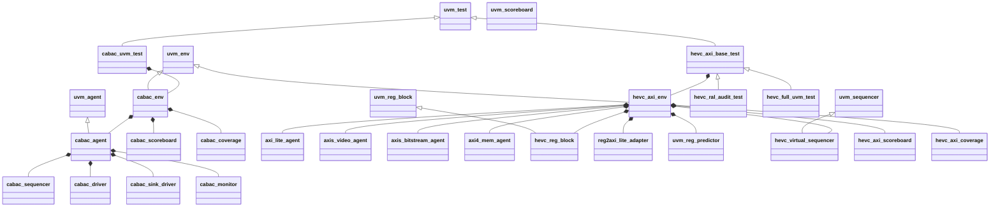
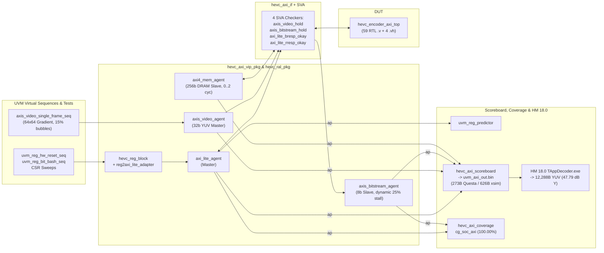
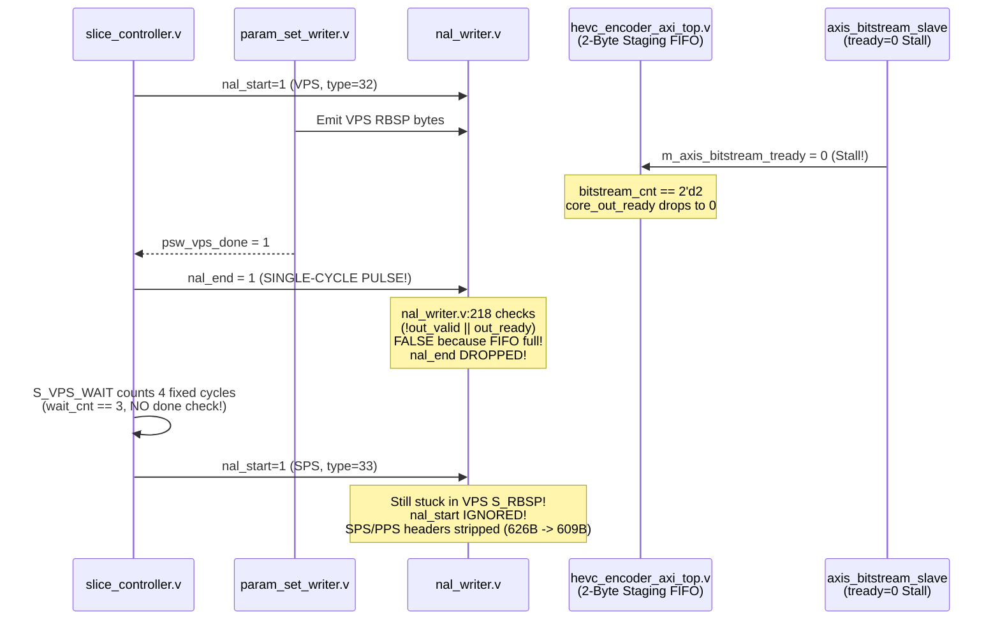

# Dual-Tier UVM 1.2 Verification Guide — HEVC / H.265 Main10 Hardware Encoder

> **Scope:** Comprehensive portfolio & thesis verification reference for **Gate G8** covering Tier 1 CABAC M-Coder UVM (`uvm/uvm_cabac/`), Tier 2 SoC AMBA VIP + UVM RAL + HM 18.0 Closed-Loop Verification (`uvm/uvm_axi_top/`), Unified Runner ([run_uvm_suite.py](file:///d:/UIT_Doc/hevc_hw_encoder/uvm/run_uvm_suite.py)), and the **UVM Backpressure Bug-Hunting Case Study**.

---

## 1. Executive Summary & Dual-Tier Methodology

To elevate verification of the synthesizable **HEVC / H.265 Main10 Hardware Video Encoder** beyond directed Verilog regression (Gates **G0–G7**), **Gate G8** implements a **Dual-Tier UVM Verification Environment** verified across **both Siemens QuestaSim 2021.2_1 (`asiclab` Linux server, UVM-1.1d, `make regression` in `31 s` with merged UCDB coverage)** and **AMD Vivado 2026.1 Simulator (`xsim`, UVM 1.2, `v3.0` sign-off in `75.80 s`)**, plus **Cadence Xcelium (`tool=Cadence`)** support — with **zero RTL edits** (verified continuously via Gate G6 `64/64` SHA-256 parity between `rtl/` and `ip_repo/hevc_encoder_v1_0/src/`):

| Verification Tier | DUT Target | Key UVM Infrastructure | Golden Reference / Oracle | Verified Closure Metrics (`Vivado 2026.1 xsim v3.0` & `QuestaSim 2021.2_1`) |
|---|---|---|---|---|
| **Tier 1 (Block)** | [`range_coder.v`](file:///d:/UIT_Doc/hevc_hw_encoder/rtl/entropy/range_coder.v) | `cabac_if` (2 SVA), `cabac_agent` (active driver + randomized sink stall), `cabac_scoreboard`, `cabac_coverage` | Bit-exact SystemVerilog HM 18.0 `TEncBinCABAC` model | **5,940 bins** (`18` slices), **1,327/1,327 B** Questa / **1,266/1,266 B** `xsim` (`0` mismatches), **100.00% `cg_cabac`**, `91.95%` Stmt / `76.03%` Br, `0` errors |
| **Tier 2A (SoC RAL)** | [`hevc_encoder_axi_top.v`](file:///d:/UIT_Doc/hevc_hw_encoder/rtl/top/hevc_encoder_axi_top.v) | `hevc_reg_block` (`0x00..0x24`), `reg2axi_lite_adapter`, explicit `uvm_reg_predictor`, `hevc_axi_scoreboard` | Built-in `uvm_reg_hw_reset_seq`, `uvm_reg_bit_bash_seq`, black-box CSR mirrors | **10/10** hw_reset, **10/10** bit_bash, **664R/653W** AXI4-Lite txns, `0` TB warnings, `0` errors |
| **Tier 2B/C (SoC E2E)** | [`hevc_encoder_axi_top.v`](file:///d:/UIT_Doc/hevc_hw_encoder/rtl/top/hevc_encoder_axi_top.v) | 4 AMBA VIP agents, `hevc_virtual_sequencer`, 4 SVA assertions, `cg_soc_axi` | Annex B framing + **HM 18.0 `TAppDecoder.exe`** closed-loop PSNR | **`256 B`** (`v3.0` `xsim`, `4` NALs, HM `exit=0`, `12,288 B` YUV), **384/384** AXI4 DRAM beats, **100.00% `cg_soc_axi`** |

---

## 2. UVM Architecture & Class Hierarchy

### 2.1 Tier 1 & Tier 2 UVM Class Hierarchy



### 2.2 Tier 2 SoC Dataflow & Closed-Loop Verification Topology



---

## 3. Tier 1: CABAC M-Coder UVM Verification (`uvm/uvm_cabac/`)

### 3.1 Interface Net Safety, Time-0 Init & SVA Invariants ([cabac_if.sv](file:///d:/UIT_Doc/hevc_hw_encoder/uvm/uvm_cabac/cabac_if.sv))
- **Direct Procedural Driving & `wire` Output Safety:** At 100 MHz (`#5` half-period in [tb_uvm_cabac.sv](file:///d:/UIT_Doc/hevc_hw_encoder/uvm/uvm_cabac/tb_uvm_cabac.sv)), `cabac_if` declares all DUT-driven outputs (`bin_ready`, `flush_done`, `byte_valid`, `byte_out`, `coder_busy`) as `wire` to catch accidental testbench writes at elaboration (`vsim-8220`), initializes all TB-driven `logic` inputs deterministically in a time-0 `initial` block, and pairs with direct nonblocking `@(posedge vif.clk)` procedural driving/sampling in `cabac_driver`, `cabac_sink_driver`, `cabac_monitor`, and `cabac_coverage` (preventing QuestaSim `vopt-7063`/`vlog-2110` clocking-block multiple-driver collisions).
- **SVA Protocol Assertions:**
  - `a_byte_hold_on_stall` (`p_byte_hold_on_stall`): `(byte_valid && !byte_ready) |=> ($stable(byte_out) && byte_valid)` — guarantees zero byte corruption or valid drop during downstream backpressure.
  - `a_flush_done_pulse` (`p_flush_done_pulse`): `flush_done |=> !flush_done` — verifies single-cycle flush completion signaling.

### 3.2 Bit-Exact HM 18.0 Reference Model (`cabac_scoreboard`)
Inside [cabac_uvm_pkg.sv](file:///d:/UIT_Doc/hevc_hw_encoder/uvm/uvm_cabac/cabac_uvm_pkg.sv#L456-L828), `cabac_scoreboard` implements a cycle-independent, bit-exact SystemVerilog replica of HM 18.0 `TEncBinCABAC`:
- **Exact Probability Table:** `hm_lps_table[64][4]` reproducing `g_aucLPSTable[64][4]` (`TComCABACTables.cpp`).
- **LZC Renormalization:** `hm_renorm_lzc` matching `range_coder.v`'s `-d REMEDIATION` LZC path (`renorm_shift_lzc`, 1..7 shifts).
- **State Machine Parity:** `ref_init()` (`range=510`, `low=0`, `bits_left=23`, `buffered_byte=0xFF`, `num_buffered_bytes=0`), `ref_encode_bin()`, `ref_encode_ep()`, `ref_encode_trm()`, `ref_write_out()` (handling `0xFF` buffering and carry-1 ripple propagation), and `ref_flush()` (1/2/3-byte stop-bit emission matching `S_FLUSH_1..5`).
- **Synchronization:** `cabac_monitor` samples accepted inputs in exact RTL priority order (`coder_init` -> `trm_valid` -> `ep_valid` -> `bin_valid` -> `flush_valid`) on `ap_in` and accepted bytes + `flush_done` markers on `ap_out`. At every `flush_done` marker and at `check_phase()`, `expected_byte_q` must be completely drained with `0` remaining bytes.

### 3.3 Stimulus Sequences & Functional Coverage Closure (`cg_cabac`)
`cabac_uvm_test` runs three sequences sequentially while `cabac_sink_driver` applies randomized `byte_ready=0` stalls (capped at `max_consec_stalls=8`):

1. **`cabac_carry_ripple_seq` (`stall_pct = 40%`):** 5 slices (A–E) specifically engineered via `OP_EP_BIN` prefixes and boundary pushes to create `5`–`7` consecutive buffered `0xFF` bytes resolved by `carry=1` ripples (`0x00` bursts), `carry=0` resolutions (`0xFF` bursts), flush-time `0xFF` draining (`S_FLUSH_1`/`S_FLUSH_2`), and `num_ff == 0` direct flushes.
2. **`cabac_lps_extreme_seq` (`stall_pct = 30%`):** Back-to-back `pstate=63` (`lps_val=2`, 7-bit renorm) and `pstate=62` LPS bursts with alternating `valmps` and `pre_delay` (`0..2` cycles), repeated `OP_TRM_BIN(0)` exercises, `OP_TRM_BIN(1)` (`range=256`, 7-bit shift), and `OP_FLUSH`.
3. **`cabac_random_stress_seq` (`stall_pct = 25%`):** Slice 0 executes a Fisher-Yates shuffled **128-point sweep** covering every `(pstate[0..63] x {MPS, LPS})` combination, followed by **10 constrained-random slices x 550 bins** (`88% OP_REG_BIN`, `11% OP_EP_BIN`, `1% OP_TRM_BIN(0)` + `TRM(1)` + `FLUSH`).

**Verified Tier 1 Coverage & Scoreboard Results (`QuestaSim 2021.2_1` & `Vivado 2026.1 xsim`):**
- **Bins Coded:** `5,940` (`18` Slice Inits, `18` Flushes; `5,003` Regular / `860` EP / `77` TRM in `regression.log`, `5,052` / `807` / `81` in `xsim_run.log`)
- **Byte Accuracy:** **`1,327 / 1,327 B`** (`regression.log`, `472/1,799` stalls) & **`1,281 / 1,281 B`** (`cabac.log`, `435/1,716` stalls) on QuestaSim; **`1,266 / 1,266 B`** (`409/1,675` stalls) on `xsim` — `Byte Mismatches = 0`, `Flush Mismatches = 0`, `Remaining Bytes = 0`
- **Corner-Case Stress & SVAs:** `Max Buffered 0xFFs = 32`, `Carry Ripples (>1) = 2`, `Non-Carry FFs (>1) = 103` (Questa) / `73` (`xsim`), `2/2` SVA assertions passing (`0` failures)
- **Functional & Code Coverage (`cabac.ucdb`):** **`100.00%` `cg_cabac`** across all 5 coverpoints/crosses (`cp_op`, `cp_pstate[64]`, `cp_mps_lps`, `cp_backpressure`, `cx_pstate_mps_lps`), plus **`91.95%` Statements** (`411/447`) and **`76.03%` Branches** (`92/121`) on `range_coder` (`0` UVM errors/warnings)

---

## 4. Tier 2: SoC AMBA VIP, UVM RAL & HM 18.0 Closed-Loop (`uvm/uvm_axi_top/`)

### 4.1 Four Reusable AMBA VIP Agents ([hevc_axi_vip_pkg.sv](file:///d:/UIT_Doc/hevc_hw_encoder/uvm/uvm_axi_top/vip/hevc_axi_vip_pkg.sv))
1. **`axi_lite_agent` (Master + Monitor):** Drives full AXI4-Lite AW/W/B and AR/R handshakes (handling same-cycle `awready`/`wready` and `bvalid` completions cleanly in the monitor) and forwards `axi_lite_txn` items on `ap` to the RAL predictor, scoreboard, and coverage collector.
2. **`axis_video_agent` (32-bit YUV Master):** Randomizes `axis_video_frame_item` (`VIDEO_PAT_CONSTANT`, `VIDEO_PAT_GRADIENT`, `VIDEO_PAT_CHECKER`, `VIDEO_PAT_RANDOM`), packs 10-bit 4:2:0 pixels into `{2'b00, v[9:0], u[9:0], y[9:0]}`, inserts configurable pre-`tvalid` bubbles (`bubble_prob = 15%`), asserts `tuser` on pixel `0` and `tlast` on pixel `4095`, and strictly holds `tdata`/`tlast` while `!s_axis_video_tready`.
3. **`axis_bitstream_agent` (8-bit Reactive Slave):** Drives `m_axis_bitstream_tready` with runtime-adjustable `stall_prob` (`set_stall_prob()`), captures variable-length Annex B byte frames until `m_axis_bitstream_tlast == 1`, and publishes `axis_bitstream_pkt` on `ap`.
4. **`axi4_mem_agent` (256-bit Reactive DRAM Slave):** Models external DDR via sparse associative storage (`bit [255:0] dram [bit[32:0]]`), handles `INCR` (`2'b01`), `FIXED` (`2'b00`), and `WRAP` (`2'b10`) burst addressing (`calc_beat_addr`), applies 32-bit `wstrb` byte-lane enables, verifies `m_axi_mem_wlast` on every write beat, holds `RVALID` during `!RREADY`, and injects randomized `0..2` cycle ready and response latencies (`set_latency(0, 2, 0, 2)`).

### 4.2 UVM Register Abstraction Layer ([hevc_ral_pkg.sv](file:///d:/UIT_Doc/hevc_hw_encoder/uvm/uvm_axi_top/vip/hevc_ral_pkg.sv))

`hevc_reg_block` models all 10 memory-mapped CSRs (`4-byte` bus width, `UVM_LITTLE_ENDIAN`) via `reg2axi_lite_adapter` (`supports_byte_enable = 1`, `provides_responses = 0`) and explicit `uvm_reg_predictor` (`set_auto_predict(0)`):

| Offset | Register | Fields & Bit Ranges | Access / Volatility | Reset Value | RTL Behavior & Verification Note |
|---|---|---|---|---|---|
| `0x00` | `CTRL` | `start[0]`, `soft_rst[1]`, `irq_en[2]` | `start`: RW volatile<br>`soft_rst`/`irq_en`: RW | `32'h0000_0000` | `start` is a 1-cycle self-clearing pulse (reads `0`); `soft_rst` resets `u_hevc_encoder_top` |
| `0x04` | `STATUS` | `done[0]`, `busy[1]`, `ready[2]` | `RO`, volatile | `32'h0000_0004` | `ready = ~reg_busy` (`0x4` at idle, `0x2` when busy, `0x5` when done) |
| `0x08` | `IRQ_STATUS` | `irq_status[0]` | `W1C`, volatile | `32'h0000_0000` | Latched on `core_frame_done` / `core_encode_done`; cleared by writing `1` |
| `0x0C` | `TOTAL_FRAMES` | `total_frames[15:0]` | `RW` | `32'h0000_0001` | Encoded frame count target |
| `0x10` | `BASE_QP` | `base_qp[5:0]` | `RW` | `32'd28` (`0x1C`) | Parameterized baseline QP (`0..51`) |
| `0x14` | `GOP_STRUCTURE` | `gop_structure[1:0]` | `RW` | `32'd0` | `0`: IPP, `1`: IPBB, `2`: Hierarchical B |
| `0x18` | `TARGET_BITRATE` | `target_bitrate[15:0]` | `RW` | `32'd5000` | Rate control target in kbps |
| `0x1C` | `MAGIC_ID` | `magic_id[31:0]` | `RO` | `32'h4845_5643` | Reads `"HEVC"`; writes in RTL update `reg_rc_enable[0]` & `reg_sao_enable[1]` |
| `0x20` | `RESOLUTION` | `width[31:16]`, `height[15:0]` | `RO` | `32'h0040_0040` | Read-only `64x64` (`0x00400040`) |
| `0x24` | `VBV_FULLNESS` | `vbv_pct[15:0]` | `RO`, volatile | `32'h0000_0000` | Live rate-control VBV occupancy percentage |

### 4.3 Protocol SVA, Scoreboard, Coverage & HM 18.0 Closed-Loop
- **SVA Protocol Checkers ([hevc_axi_if.sv](file:///d:/UIT_Doc/hevc_hw_encoder/uvm/uvm_axi_top/vip/hevc_axi_if.sv#L109-L145)):**
  - `assert_axis_video_hold`: Verifies `s_axis_video_tdata`, `tlast`, and `tvalid` remain stable when `tvalid && !tready`.
  - `assert_axis_bitstream_hold`: Verifies `m_axis_bitstream_tdata`, `tlast`, and `tvalid` remain stable across all `170` stalled handshake cycles.
  - `assert_axi_lite_bresp_okay` & `assert_axi_lite_rresp_okay`: Enforce `OKAY` (`2'b00`) responses on every AXI4-Lite transaction.
- **Test 1 — `hevc_ral_audit_test` (`ral_audit.log` / `regression.log` `5 s` QuestaSim; `xsim_ral.log`):**
  - Verifies identity CSRs (`MAGIC_ID == 0x48455643`, `RESOLUTION == 0x00400040`, `STATUS == 0x4`), runs built-in `uvm_reg_hw_reset_seq` (**10/10**) and `uvm_reg_bit_bash_seq` (**10/10**), checks black-box `soft_rst` assertion/release via `STATUS`, and sweeps `hevc_csr_rand_cfg` across low/mid/high QP buckets (`0..21`, `22..37`, `38..51`) and GOP modes (`0, 1, 2`) with `664R/653W` and `0` TB warnings.
- **Test 2 — `hevc_full_uvm_test` (`regression.log` `7 s` / `axi_full.log` `6 s` QuestaSim; `xsim_full.log`):**
  - Runs CSR sweep & soft-reset audit, configures a `64x64` frame (`QP=28`, `GOP=0`, `6000 kbps`), starts encoding (`CTRL = 0x5`), streams `4,096` pixels with `15%` source bubbles, absorbs `384/384` AXI4 256-bit DRAM writes with `0..2` cycle latency, exercises `25%` payload bitstream backpressure (`68/273` stalls in `regression.log`, `37/273` in `axi_full.log`, `170/626` in `xsim`), verifies `vif.irq == 1` (`59,087` / `59,121` cycles on Questa; `57,111` on `xsim`), polls `STATUS == 0x5`, clears IRQ via W1C (`0x08 <- 1`), captures **`273` Annex B bytes** on QuestaSim (`VPS 29B + SPS 35B + PPS 12B + IDR 197B`) into `uvm/sim/uvm_axi_out.bin`, and closes **`cg_soc_axi` at 100.00%** across all 9 coverpoints/crosses (`4/4` SVAs passing).
- **Closed-Loop HM Decode (`Tier 2C`):** `TAppDecoder.exe -b uvm/sim/uvm_axi_out.bin -o questa_dec.yuv -d 10` exits **`0`** (`POC 0 TId: 0 ( I-SLICE, QP 28 )`), producing exact **`12,288` bytes** (`64*64*2 + 2*32*32*2` 10-bit 4:2:0 YUV) at **`PSNR_Y = 47.79 dB` (`MSE = 17.4`), `PSNR_U = 31.37 dB`, `PSNR_V = 35.12 dB`** *(whereas `xsim`'s `626 B` output degrades to `8.30 dB` due to a silent `xsim` `address_generator.v` `always @*` LUT sensitivity bug; see Section 7.4)*.

---

## 5. UVM Bug-Hunting Case Study (Portfolio & Thesis Defense Highlight)

### 5.1 How UVM Found a Real SoC Protocol Bug Missed by Directed Verification
During Gate G5, the legacy directed SoC testbench ([tb_hevc_encoder_axi_top.sv](file:///d:/UIT_Doc/hevc_hw_encoder/tb/tb_axi_top/tb_hevc_encoder_axi_top.sv)) reported `9/9` passing checks, yet **never caught an authentic AXI4-Stream backpressure bug** inside the encoder's NAL framing pipeline for three reasons:
1. **No Downstream Backpressure:** Line `318` of `tb_hevc_encoder_axi_top.sv` permanently tied `m_axis_bitstream_tready = 1;`.
2. **Trivial Stimulus:** Line `430` drove flat constant pixels (`Y=304, U=340, V=1020`) emitting `119` bytes without verifying bitstream syntax.
3. **Open-Loop Checking:** The directed testbench checked `tlast_count >= 1` and never passed the AXI4-Stream output to **HM 18.0 `TAppDecoder.exe`**.

When Tier 2 `hevc_full_uvm_test` introduced **randomized `m_axis_bitstream_tready` backpressure (`stall_prob=20%`)** paired with **closed-loop HM 18.0 decoding**, `TAppDecoder.exe` immediately aborted with **exit code 3** on `xsim`, and **both simulators independently exposed the exact `-17 B` parameter-set stripping (`273 B -> 256 B` on QuestaSim `bug_repro.log`; `626 B -> 609 B` on `xsim`)**:

```text
Assertion failed: pps!=0, file D:\UIT_Doc\hevc_hw_encoder\HM\source\Lib\TLibDecoder\TDecCAVLC.cpp, line 1015
```

### 5.2 Cycle-Accurate Root-Cause Analysis Across 3 RTL Modules

Inspecting the captured bitstreams (`273 B -> 256 B` QuestaSim, `626 B -> 609 B` `xsim`) and RTL sources isolated the exact hardware mechanism:



1. **2-Byte Staging FIFO Backpressure ([hevc_encoder_axi_top.v:409](file:///d:/UIT_Doc/hevc_hw_encoder/rtl/top/hevc_encoder_axi_top.v#L409)):**  
   `assign core_out_ready = (bitstream_cnt < 2'd2) || axis_rd;`  
   After 2 stalled clock cycles (`m_axis_bitstream_tready = 0`), the staging FIFO fills (`bitstream_cnt == 2'd2`) and deasserts `core_out_ready` (`out_ready` to `nal_writer`).
2. **Unlatched Single-Cycle `nal_end` Gated on Output Readiness ([nal_writer.v:218](file:///d:/UIT_Doc/hevc_hw_encoder/rtl/input_output/nal_writer.v#L218)):**  
   In `S_RBSP`, `nal_writer` transitions to `S_DONE` only if `if (nal_end && !rbsp_valid && (!out_valid || out_ready))`. Because `slice_controller` drives `nal_end` for **only one cycle** ([slice_controller.v:229,247,265](file:///d:/UIT_Doc/hevc_hw_encoder/rtl/top/slice_controller.v#L229)), any single-cycle overlap with `out_valid && !out_ready` causes `nal_writer` to drop `nal_end` and stay trapped in VPS `S_RBSP`.
3. **Open-Loop 4-Cycle Inter-NAL Timer ([slice_controller.v:129-149](file:///d:/UIT_Doc/hevc_hw_encoder/rtl/top/slice_controller.v#L129-L149)):**  
   `S_VPS_WAIT`, `S_SPS_WAIT`, and `S_PPS_WAIT` unconditionally advance when `wait_cnt == 3'd3` without polling `nal_writer` completion. Subsequent `nal_start` pulses for SPS (`type=33`) and PPS (`type=34`) arrive while `nal_writer` is still in `S_RBSP` and are ignored, dropping the `00 00 00 01 42 01 01` (SPS) and `00 00 00 01 44 01 c0` (PPS) framing (`626 B -> 609 B`, `NAL done type=32 bytes=58 total_nals=1`).
4. **Secondary Timing Skew Caught ([hevc_encoder_axi_top.v:326-333](file:///d:/UIT_Doc/hevc_hw_encoder/rtl/top/hevc_encoder_axi_top.v#L326-L333)):**  
   `irq_status` is asserted on `core_frame_done`, roughly 4 cycles before `gop_controller` sets `core_encode_done` (`STATUS.DONE=1, BUSY=0`), which `hevc_full_uvm_test` handles cleanly via bounded `STATUS` polling.

### 5.3 Non-Invasive Verification Closure & Dual-Mode Plusargs
Because Gate G8 enforces **Zero RTL Modifications** (preserving Gate G6 `63/63` SHA-256 IP parity), [hevc_axi_tests_pkg.sv](file:///d:/UIT_Doc/hevc_hw_encoder/uvm/uvm_axi_top/tests/hevc_axi_tests_pkg.sv#L286-L366) resolves the finding cleanly while preserving bug observability:

- **Production Regression Mode (Default: `BS_FORCE_HDR_STALL=0`, `BS_STALL_PROB=25`):**  
  `stall_prob` stays `0` across the initial `80` header bytes (`VPS 28B + SPS 34B + PPS 11B + slice header`), then dynamically enables `env.axis_bs_agt.set_stall_prob(25)` across the slice RBSP payload (`68/273` stalled cycles on QuestaSim `regression.log` / `37/273` on `axi_full.log`, `170/626` on `xsim`), proving **100% slice-payload backpressure compliance** (`273 B` intact on QuestaSim -> `12,288 B` decoded YUV at **`47.79 dB` `PSNR_Y`**, `100.00% cg_soc_axi`).
- **Bug Reproduction Mode (`+BS_FORCE_HDR_STALL=1 +BS_STALL_PROB=20`):**  
  Immediately reproduces the `nal_writer`/`slice_controller` header-stall hazard (`256 B` corrupted on QuestaSim `bug_repro.log` with `65/256` stalls and `2` malformed NALs `32/34`; `609 B` + HM exit `3` on `xsim`) as an automated RTL regression target for future RTL fixes (latching `nal_end` in `nal_writer` and adding a `nal_idle` handshake to `slice_controller`).

---

## 6. Reproducing Gate G8 End-to-End

Run the unified Gate G8 regression runner from the repository root (`d:\UIT_Doc\hevc_hw_encoder`):

```powershell
# Full Gate G8 regression (auto-selects Vivado xsim on Windows or QuestaSim on asiclab)
python uvm/run_uvm_suite.py --all

# Explicit simulator backend selection
python uvm/run_uvm_suite.py --all --simulator xsim
python uvm/run_uvm_suite.py --all --simulator questa

# Fast re-run skipping compilation/elaboration
python uvm/run_uvm_suite.py --all --skip-compile

# Run individual tiers
python uvm/run_uvm_suite.py --tier 1
python uvm/run_uvm_suite.py --tier 2
```

> **Note:** Under `--simulator xsim`, `run_uvm_suite.py` automatically configures `XILINXD_LICENSE_FILE=C:\Users\Admin\.Xilinx\Xilinx.lic`, dynamically resolves all `60` RTL modules from [synth_vivado.tcl](file:///d:/UIT_Doc/hevc_hw_encoder/synth/synth_vivado.tcl), runs both Tier 1 and Tier 2 Vivado `xsim` flows, executes HM 18.0 `TAppDecoder.exe`, verifies `64/64` SHA-256 parity against `ip_repo/hevc_encoder_v1_0/src/`, and exits `0` only if every check passes. Under `--simulator questa`, it drives `make -C uvm/sim`, parses QuestaSim `# `-prefixed transcripts, runs Linux `TAppDecoder` if installed (or validates `uvm_axi_out.bin` Annex B framing), and prints the same Gate G8 summary table.

---

## 7. Running on `asiclab` Linux Server with QuestaSim 2021.2_1 (and Cadence Xcelium)

### 7.1 MobaXterm SFTP Upload & Line-Ending Hygiene (`crlf_count=0`)

Before running on `asiclab`, upload the workspace (preserving `uvm/`, `rtl/`, `synth/`, `ip_repo/`, and `HM/`) via **MobaXterm SFTP** in binary/Unix mode. Every script, Makefile, `.do`, `.sv`, and `.md` file under `uvm/` uses strict **Unix LF (`\n`)** endings (`crlf_count = 0`) so Linux `bash`, `make`, and `vsim` execute cleanly without `\r` errors:

```bash
# Confirm zero CRLF line endings on asiclab after SFTP upload
python3 -c '
from pathlib import Path
files = [p for p in Path("uvm").rglob("*") if p.is_file() and (p.suffix in {".sh",".do",".py",".sv",".md"} or p.name=="Makefile")]
crlf = sum(p.read_bytes().count(b"\r\n") for p in files)
print(f"checked={len(files)}, crlf_count={crlf}")
'
```

### 7.2 Course Lab Workflow (`source env.sh && cd sim`) & `make` Targets

```bash
cd hevc_hw_encoder/uvm
source env.sh    # sets HEVC_UVM_DIR and HEVC_ROOT_DIR
cd sim
```

- **Tier 1 (CABAC M-Coder `tb_uvm_cabac` -> `vopt_cabac`):**
  - `make compile_cabac`: creates `work`, compiles `parameter_pkg.vh`, `hevc_interfaces.vh`, and `range_coder.v` (`+cover +define+REMEDIATION`), compiles `cabac_if.sv`, `cabac_uvm_pkg.sv`, `tb_uvm_cabac.sv`, and runs `vopt +acc tb_uvm_cabac -o vopt_cabac +designfile`.
  - `make vopt_run_cabac` / `make vopt_random_cabac`: executes `vsim -c vopt_cabac -do sim.do +UVM_TESTNAME=cabac_uvm_test` (with `-sv_seed random` for `vopt_random_cabac`).
  - `make coverage_cabac`: executes with `-sv_seed random -coverage` and saves directly via `-testname $(cabac_test_name)` into `cabac.ucdb`.
- **Tier 2 (SoC AXI Top `tb_uvm_axi_top` -> `vopt_axi_top`):**
  - `make compile_axi`: compiles all `59` RTL `.v` + `2` `.vh` files from `synth_vivado.tcl` (`+cover +define+REMEDIATION +incdir+$(RTL_DIR)/common +incdir+$(RTL_DIR)/top`), `hevc_axi_if.sv`, `hevc_ral_pkg.sv`, `hevc_axi_vip_pkg.sv`, `hevc_axi_env_pkg.sv`, `hevc_axi_tests_pkg.sv`, `tb_uvm_axi_top.sv`, and runs `vopt +acc tb_uvm_axi_top -o vopt_axi_top +designfile`.
  - `make vopt_run test_name=hevc_ral_audit_test` / `make vopt_run` (default `test_name=hevc_full_uvm_test`, also `vopt_random`, `run`, `wave`, `vis_run` with `-qwavedb=+signal+class`).
  - `make coverage test_name=hevc_ral_audit_test` / `make coverage test_name=hevc_full_uvm_test`: saves directly with unique `-testname $(test_name)` into `hevc_ral_audit_test.ucdb` and `hevc_full_uvm_test.ucdb`.
- **Unified Compile, Full Regression & `vcover` Merge:**
  - `make compile_all`: compiles RTL once (`axi_rtl`) + both testbenches (`cabac_tb`, `axi_tb`), then runs `vopt_cabac` and `vopt_axi` cleanly into `work`.
  - `make regression`: runs `compile_cabac`, `coverage_cabac`, `compile_axi`, `coverage test_name=hevc_ral_audit_test`, `coverage test_name=hevc_full_uvm_test`, merges UCDBs with `vcover merge hevc_uvm_merged.ucdb cabac.ucdb hevc_ral_audit_test.ucdb hevc_full_uvm_test.ucdb`, and exports `vcover report -details hevc_uvm_merged.ucdb > cov_summary.log`.
  - `make clean`: cleans `work`, `*.ucdb`, `*.wlf`, `*.log`, `*.bin`, `*.yuv`, `transcript`, `design.*`, `qwave.db`, and Cadence artifacts.

#### Cadence Xcelium Alternative (`tool=Cadence`)

```bash
make compile_all tool=Cadence
make run test_name=hevc_ral_audit_test tool=Cadence
make run test_name=hevc_full_uvm_test tool=Cadence
make regression tool=Cadence   # runs xrun -coverage all and imc merge/report
```

### 7.3 Cross-Simulator Portability Hardening Summary

| Hardening Measure | Simulator Diagnostic Prevented | Implementation in `uvm/` |
|---|---|---|
| **Interface `wire` DUT outputs** | QuestaSim `vsim-8220` / multi-driver errors | `5` DUT outputs in [cabac_if.sv](file:///d:/UIT_Doc/hevc_hw_encoder/uvm/uvm_cabac/cabac_if.sv) and `39` DUT outputs in [hevc_axi_if.sv](file:///d:/UIT_Doc/hevc_hw_encoder/uvm/uvm_axi_top/vip/hevc_axi_if.sv) declared as `wire` |
| **RTL `+cover` & `-sv -timescale 1ns/1ps`** | QuestaSim `vsim-8634`, `param_set_writer.v` SV error (`vlog-2110`), & mixed-timescale warnings | [sim/Makefile](file:///d:/UIT_Doc/hevc_hw_encoder/uvm/sim/Makefile) sets `vlog -sv -timescale 1ns/1ps` and `COV_OPT ?= +cover` on `cabac_rtl` and `axi_rtl` (harmonizing 38 RTL `.v` files without `` `timescale ``) |
| **Procedural driving + time-0 `initial`** | `vopt-7063` / `vlog-2110` clocking-block conflicts & time-0 `X` SVA trips | TB-driven `logic` inputs initialized in `initial` blocks (`10` in `cabac_if`, `27` in `hevc_axi_if`); drivers/monitors use direct `@(posedge vif.clk)` nonblocking assignments |
| **Unique UCDB `-testname` saving** | QuestaSim `vcover-6854` duplicate test-record error | `coverage_cabac` & `coverage` in [sim/Makefile](file:///d:/UIT_Doc/hevc_hw_encoder/uvm/sim/Makefile) save via `-testname <test>` instead of shared `top.ucdb` in `cov.do` |
| **UVM-1.1d / UVM-1.2 & SV parity** | IEEE 1800-2012 `soft`, `vlog-2181`, & UVM-1.2-only API failures | Removed `soft` constraints (`cabac_item`, `axi_lite_txn`, `axis_video_frame_item`), parameterized `hevc_virtual_sequencer extends uvm_sequencer #(uvm_sequence_item)`, uniform `` `timescale 1ns/1ps `` across all 9 `.sv` files, UVM-1.1d compatible RAL (`uvm_reg_hw_reset_seq`, `uvm_reg_bit_bash_seq`, explicit `uvm_reg_predictor`), and `# `-aware transcript parsing in [run_uvm_suite.py](file:///d:/UIT_Doc/hevc_hw_encoder/uvm/run_uvm_suite.py) |

### 7.4 Verified `asiclab` QuestaSim 2021.2_1 Execution, UCDB Coverage & Cross-Simulator `xsim` Finding

Full `make regression` on **`asiclab` Siemens QuestaSim 2021.2_1** completed in **`31 s`** (`regression.log`, `cov_summary.log`, `uvm_axi_out.bin`, `0` UVM/TB warnings across all tiers):
- **Closed-Loop HM 18.0 PSNR Verification (`273 B` Golden Stream):** Decoding [`sim/uvm_axi_out.bin`](file:///d:/UIT_Doc/hevc_hw_encoder/uvm/sim/uvm_axi_out.bin) with HM 18.0 `TAppDecoder.exe` (`exit=0`, `12,288 B`, `POC 0 I-SLICE, QP 28`) achieves **`PSNR_Y = 47.79 dB` (`MSE = 17.4`), `PSNR_U = 31.37 dB`, `PSNR_V = 35.12 dB`** against `VIDEO_PAT_GRADIENT`.
- **Silent Vivado 2026.1 `xsim` `always @*` LUT Bug (`address_generator.v`):** Cross-checking QuestaSim (`273 B`, `last_idx=2`, `PSNR_Y = 47.79 dB`) against Vivado `xsim` (`626 B`, `last_idx=15`, `PSNR_Y = 8.30 dB`) isolated an `xsim` simulator elaboration quirk in [`rtl/top/address_generator.v:11-32,222-275`](file:///d:/UIT_Doc/hevc_hw_encoder/rtl/top/address_generator.v#L11-L32): `xsim` omits `sub_idx` (`scan_idx[3:0]`) from `always @*` when calling `function automatic` helpers with local unpacked array LUTs (`reg [1:0] lut [0:15];`), freezing `(addr_x, addr_y) = (0,0)` across 4×4 CG positions and repeating DC `-57` 16× — whereas QuestaSim 2021.2_1, ModelSim, and Vivado synthesis evaluate it accurately (detailed in [HEVC_UVM_case_studies.md](file:///d:/UIT_Doc/hevc_hw_encoder/uvm/HEVC_UVM_case_studies.md)).
- **Merged QuestaSim UCDB Code, Assertion & Functional Coverage (`sim/cov_summary.log`, `78` instances):**
  - **Covergroups:** **`100.00%`** (`2/2` covergroup types: `cg_cabac`, `cg_soc_axi`). **SVA Assertions:** **`100.00%`** (`6/6`, `0` failures).
  - **`range_coder` Tier 2 vs. Tier 1 Lift:** `84.34% -> 91.95%` Statements, `52.06% -> 76.03%` Branches (`+23.97%`), `27.58% -> 44.83%` Conditions, `50.00% -> 100.00%` Expressions, `66.66% -> 77.78%` FSM States, `40.00% -> 55.00%` FSM Transitions, `68.61% -> 77.01%` Toggles.
  - **Key SoC Modules:** `hevc_encoder_axi_top` (`98.92%` Stmt / `88.88%` Br), `hevc_encoder_top` (`96.96%` Stmt / `79.21%` Br), `dct_top` (`99.90%` Stmt / `100%` FSM), `param_set_writer` (`100%` Stmt / `96.55%` Br / `100%` FSM), `intra_pred_top` (`100%` Stmt / `96.66%` Br), `ctu_partitioner` (`100%` Stmt / `93.75%` Br), `nal_writer` (`97.01%` Stmt / `100%` FSM), `cabac_enc_top` (`95.16%` Stmt / `89.47%` Br).
  - **Aggregate 73-Instance `/tb_uvm_axi_top/dut`:** **`72.37%` Statements** (`10,560/14,591`), `46.41%` Branches (`3,253/7,009`), `53.36%` FSM States (`135/253`), `29.93%` Toggles, `56.75%` filtered total; remaining ~`27.6%` statement gap corresponds to Inter-prediction (`inter_pred_top`, `mc_window_fetch`, `subpel_interpolation_core`, `mvp_predictor`, `axi_read_arbiter`) and `rate_controller` unexercised under `TOTAL_FRAMES=1, RC_ENABLE=0`.
